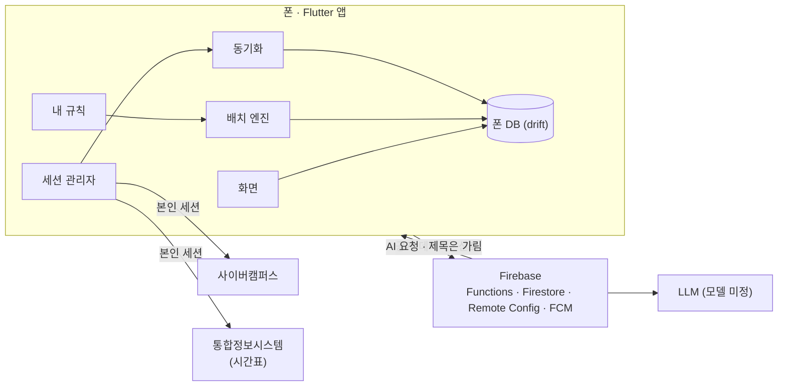

# 구조

구조, 실행 방법, 앱-서버 약속이 바뀌면 같은 PR에서 이 문서도 고칩니다. 왜 이렇게 정했는지는 [decisions.md](decisions.md)에 있습니다.

## 한눈에 보기

이 앱은 충남대 학부생용 일정 비서 앱입니다. 앱 이름은 아직 정하지 않았습니다(임시 식별자는 레포 이름 `cnu-ai-assistant`입니다). 사이버캠퍼스(사캠)의 마감과 시간표, 개인 일정을 삼성 기본 캘린더와 같은 모양의 캘린더에 모으고, 시간이 정해지지 않은 할 일을 급한 순서로 보여 주어 사용자가 말이나 직접 입력으로 시간을 정하게 합니다. 매일 정한 시각에 데일리 브리핑으로 밤사이 생긴 일과 오늘을 건네고, 낮에 생긴 중요한 일은 중요 브리핑으로 알려 줍니다.



- **앱**: Flutter 3.47(iOS·Android 한 코드). R0부터 두 OS를 함께 냅니다. 화면은 폰 DB만 보고, 동기화와 AI 호출은 뒤에서 결과를 DB에 씁니다. 위젯 라이브러리는 `material_ui` 패키지입니다. 앱 코드는 `package:flutter/material.dart` 대신 `package:material_ui/material_ui.dart`를 import하고(iOS식 위젯이 필요한 곳만 `package:cupertino_ui/cupertino_ui.dart`), `flutter/material.dart`·`flutter/cupertino.dart` import가 들어온 PR은 리뷰에서 돌려보냅니다. 아직 옮기지 않은 플러그인을 위해 `MaterialApp.builder`에서 `MaterialUiCompatibilityBridge`로 감싸고, 실수로 들어온 SDK import는 `dart fix --apply --code=migrate_design_widgets`로 바꿉니다. 앱 언어는 한국어뿐입니다. `MaterialApp`에 `locale: Locale('ko')`, `supportedLocales: [Locale('ko')]`, `localizationsDelegates: GlobalMaterialLocalizations.delegates`(`material_ui`)를 두고, 앱 시작 때 `initializeDateFormatting('ko')`를 부릅니다.
- **사캠**: 폰이 학생 본인 세션으로 사캠에 직접 연결합니다(R0). 로그인은 사용자가 앱 안 WebView의 공식 화면에서 하고, '자동 로그인 유지'를 켜면 비밀번호를 기기 보안 저장소에 저장해 세션이 끊길 때 조용히 다시 로그인합니다(끄면 저장하지 않고 끊길 때마다 로그인 화면을 띄웁니다). 로그인·재로그인은 계정의 다른 기기(PC·웹) 세션을 끊습니다(계정당 세션 하나, 피할 수 없음). 수업 요일·교시는 사캠에 없어 학교 통합정보시스템에서 받습니다. 비밀번호·쿠키·학번은 그 기기 밖(서버 포함)으로 나가지 않고, 데이터는 폰 DB에만 둡니다. 앱을 열 때와 쓰는 동안 조회하고, 세션이 끊겨 있으면 먼저 다시 로그인합니다. 동작 규칙은 [lms.md](lms.md)에 있고, `app/lib/lms/`를 고치기 전에 먼저 읽습니다.
- **서버**: Firebase 프로젝트 하나(개발·운영을 나누지 않습니다). Cloud Functions(TypeScript, 2세대)는 `functions/src/index.ts`의 `setGlobalOptions({ region: "asia-northeast3" })`로 모든 함수를 서울 리전에 둡니다(지정하지 않으면 `us-central1`에 배포됩니다). Firestore 데이터베이스는 `(default)` 하나이고 처음 만들 때 위치를 `asia-northeast3`로 정합니다. 만든 뒤에는 바꿀 수 없습니다. 함수가 AI 게이트웨이와 공개 데이터(학사일정·날씨)를 맡습니다. 서버는 읽을 수 있는 개인 데이터를 저장하지 않습니다. 서버에 남는 것은 설치 토큰별 AI 호출 수(이틀)뿐이고, AI 요청 본문은 받은 자리에서 제공사로 넘기고 저장하거나 로그에 남기지 않습니다. 앱은 Functions를 HTTPS 엔드포인트로 부르고(callable 함수가 아닙니다), 클라이언트는 `dio` 하나로 `app/lib/data/api/server_api.dart`에 둡니다. 기본 주소는 `app/lib/app/config.dart`의 `apiBase` 상수이며 `--dart-define=API_BASE_URL=...`로 덮어씁니다.
- **AI**: 앱은 LLM을 직접 부르지 않습니다. 게이트웨이가 키를 숨기고, 호출 한도를 지키고, 출력을 `schema/`의 JSON Schema로 검증합니다. 날짜·시각·배치 계산은 AI가 아니라 코드가 합니다.
- **시간표 연동 (통합정보시스템)**: 수업 요일·교시는 사캠에 없어 학교 통합정보시스템에서 받습니다(R0). 온보딩·시간표 화면에서 과목을 고르면 요일·시각·강의실을 받아 미리 채우고 사용자가 확인·수정하며, 자동으로 못 채운 과목(온라인 수업 등)은 직접 입력합니다. 사캠과 다른 호스트·인증·요청 방식을 쓰고 필요한 세션은 사캠 로그인 뒤 얻으며, 과목을 고를 때와 '시간표 새로 받기' 때만 조회합니다(주기 조회 아님). 구체 방식은 코드와 Remote Config에 두고 레포에 적지 않습니다. 규칙은 [lms.md](lms.md)에 있습니다.
- **플랫폼 코드**: Android는 Kotlin(쿠키 브리지(R0), 알림 감지(R1), 위젯(R1)), iOS는 Swift(백업 제외 속성 설정(R0), 쿠키 브리지(R0), 투명도 줄이기 설정 읽기(R1), 위젯(R1))로 씁니다. 나머지는 모두 Dart입니다. 사캠 응답 해석은 Dart(`app/lib/lms/`)에 둡니다. Shorebird는 Dart 코드만 고칠 수 있기 때문입니다. 플랫폼 채널은 `MethodChannel`이고 이름은 `cnu_ai_assistant/<기능>`, 메서드 이름은 camelCase입니다. `app/lib/platform/`과 `app/lib/lms/` 밖에서는 채널을 직접 부르지 않습니다.
- **쿠키 브리지 채널**: R0부터 씁니다. `MethodChannel('cnu_ai_assistant/cookie_bridge')` 하나이고 메서드는 셋입니다. `getCookies(urls: List<String>) → List<Map>`은 각 URL의 쿠키를 레코드 목록으로 돌려주고, `setCookies(cookies: List<Map>) → void`는 레코드를 WebView 쿠키 저장소에 넣은 뒤 Android에서는 `flush()`까지 하며, `clearCookies() → void`는 WebView 쿠키를 모두 지웁니다. 레코드는 `{name: String, value: String, domain: String, path: String, expiresAt: String?(ISO 8601, 세션 쿠키는 null), secure: bool, httpOnly: bool}`이고 두 OS가 같은 키를 씁니다. Android의 `CookieManager.getCookie`는 이름과 값만 돌려주므로 `domain`은 요청 URL의 호스트, `path`는 `/`, `expiresAt`은 null, `secure`·`httpOnly`는 true로 채웁니다. Dart 쪽 래퍼는 `app/lib/lms/cookie_bridge.dart` 하나이며 다른 코드는 채널을 직접 부르지 않습니다. 공식 패키지의 쿠키 API는 쓰지 않습니다(속성을 버립니다).
- **내 규칙**: 사용자가 말이나 폼으로 정한 배치·알림 조건은 폰 DB `rules`에 두고 배치 엔진과 알림 예약이 따릅니다. 문장은 `/v1/parse`가 규칙 JSON으로 바꾸고 서버는 저장하지 않습니다. 자세한 것은 아래 '내 규칙' 절에 있습니다.
- **패키지**: R0는 `material_ui`, `cupertino_ui`, `flutter_riverpod`, `go_router`, `drift`·`drift_flutter`, `dio`, `flutter_secure_storage`, `flutter_local_notifications`, `timezone`, `shared_preferences`, `flutter_svg`, `intl`, `webview_flutter`(사캠 로그인·세션 복원·페이지 보기), `firebase_core`, `firebase_remote_config`, `firebase_app_check`, `device_info_plus`, `url_launcher`(사캠 페이지·처리방침을 외부 브라우저로 열기, 문의 메일)이고 dev 의존성은 `drift_dev`, `build_runner`, `flutter_lints`, `json_schema`입니다. R1에 `workmanager`(백그라운드), `home_widget`(위젯), `firebase_messaging`(서버 신호), `firebase_crashlytics`를 더합니다. `flutter_animate`는 프리셋 밖의 보조 효과에만 쓰고, `flutter_inappwebview`와 공개 알림 감지 플러그인은 쓰지 않습니다. 패키지를 더하거나 빼면 이 줄을 같은 PR에서 고칩니다.

## 앱 식별자와 버전

- Dart 패키지 이름은 `cnu_ai_assistant`입니다(`app/pubspec.yaml`의 `name`, import는 `package:cnu_ai_assistant/...`). Android `applicationId`와 iOS bundle identifier는 둘 다 `io.github.syujin2323.cnuaiassistant`입니다. Firebase 앱 등록, App Check, iOS 기기 등록 배포가 이 값에 묶이므로 바꾸지 않습니다. 앱 표시 이름은 `일정 비서`(Android `android:label`, iOS `CFBundleDisplayName`)입니다. 임시 표시 이름입니다. 앱 이름이 정해지면 바꿉니다. 식별자는 앱 이름이 정해져도 바꾸지 않습니다. 앱 이름과 아이콘에 학교 이름과 로고를 쓰지 않습니다.
- Android의 `namespace`와 `MainActivity` 패키지는 `flutter create` 템플릿 값 `io.github.syujin2323.cnu_ai_assistant` 그대로 두고, `applicationId`만 `io.github.syujin2323.cnuaiassistant`입니다.
- 프로젝트는 `flutter create --org io.github.syujin2323 --project-name cnu_ai_assistant --platforms android,ios app`으로 만듭니다. web·desktop 폴더는 두지 않습니다.
- Flutter 버전은 `app/pubspec.yaml`의 `environment`에 정확한 버전 `flutter: 3.47.8`로 적습니다(범위 표기는 쓰지 않습니다. CI의 `subosito/flutter-action`이 `flutter-version-file`로 정확한 값을 읽습니다). `sdk` 제약은 `flutter create`가 쓴 값을 그대로 둡니다. 로컬의 `flutter --version`이 이 값과 같아야 하고, Flutter를 올릴 때는 이 줄을 고치는 `chore:` PR 하나로 팀 전체가 함께 올립니다. `functions/package.json`의 `engines.node`는 `"24"`입니다. `pubspec.lock`과 `package-lock.json`은 커밋합니다.
- 앱 버전은 `app/pubspec.yaml`의 `version: X.Y.Z+N`입니다. R0는 `0.1.x`, R1은 `0.2.x`, R2는 `1.0.0`부터이고 `N`은 테스터에게 주는 빌드마다 1씩 올립니다. Remote Config의 `min_app_version`은 `X.Y.Z` 문자열이고 앱은 세 숫자를 앞에서부터 차례로 비교합니다(R1).
- 줄 끝은 LF입니다. 레포 루트 `.gitattributes`에 `* text=auto eol=lf`와 `*.bat text eol=crlf`를 둡니다.

## 폴더 구조

```
cnu-ai-assistant/
├── app/                      Flutter 앱 (iOS·Android)
│   ├── lib/
│   │   ├── main.dart
│   │   ├── app/              app.dart(루트 위젯 RootApp), router.dart, theme.dart, providers.dart(앱 전역 provider), config.dart(서버 주소 등 비밀 아닌 설정 상수), bootstrap.dart(Firebase·DB·설정 초기화)
│   │   ├── design/           tokens.dart(색·글꼴·간격·모서리), motion.dart(모션 프리셋), icons.dart, strings.dart(두 화면 이상이 쓰는 문구), widgets/(공통 위젯)
│   │   ├── features/         화면 단위 (onboarding, briefing, today, calendar, tasks, assistant, me, lms_connect; R1에 suggest). 대응표는 아래 '화면과 기능 폴더'
│   │   ├── domain/           순수 Dart: 모델, 빈 시간·여유도 계산, 캘린더 항목(calendar_items.dart), 내 규칙(rules.dart)
│   │   ├── data/             폰 DB(drift), 저장소, 서버 API 클라이언트
│   │   ├── lms/              사캠(R0). lms_config.dart(Remote Config 읽기), lms_feature.dart(빌드 상수), response_classifier.dart(판별), parsers/(해석), sync_coordinator.dart(동기화·sync_lease), cookie_bridge.dart(플랫폼 채널), cookie_vault.dart(쿠키·비밀번호 보안 저장소), login_flow.dart(WebView 로그인 성공 감지·쿠키 수집·자동 재로그인), hidden_webview.dart(숨은 복원), lms_client.dart(dio·쿠키 주입), session_state.dart(상태 전이. 상태 enum `LmsSessionState`는 `settings`를 읽는 domain 모델이 쓰고 domain은 lms를 import하지 않으므로 `domain/models/lms_session_state.dart`에 둡니다), session_manager.dart(복원·재로그인), timetable.dart(통합정보시스템 시간표)
│   │   └── platform/         notifications.dart(채널, 예약, 탭 처리, 알림 액션(R1)), background.dart(workmanager 진입점, R1), push.dart(FCM 백그라운드 처리, R1), 알림 감지 연결(R1)
│   ├── test/                 domain·lms 단위 테스트, 화면 테스트
│   ├── assets/fonts/         Pretendard 1.3.9 정적 OTF 네 개(Regular 400, Medium 500, SemiBold 600, Bold 700)와 OFL.txt
│   ├── assets/icons/         캔버스 아이콘 SVG
│   └── android/, ios/        플랫폼 프로젝트 (iOS 백업 제외 설정, 쿠키 브리지(R0), R1에 알림 감지·위젯)
├── functions/                Cloud Functions (TypeScript)
│   ├── src/ai/               /v1/parse, /v1/briefing, /v1/extract, 제공사 어댑터, 프롬프트
│   ├── src/public/           학사일정, 날씨
│   ├── src/push/             서버 신호 푸시(FCM, R1)
│   └── eval/                 한국어 일정 문장 평가 세트
├── schema/                   앱·서버 공용 JSON Schema: parse_result.schema.json, briefing_result.schema.json, extract_result.schema.json(R1), samples/(합성 예시)
├── Makefile                  개발 명령(`make check` 등). 아래 '확인과 CI'의 명령과 같습니다
├── firebase.json, firestore.rules, firestore.indexes.json
└── docs/
```

- `domain/`은 Flutter, drift, Firebase를 import하지 않습니다. 모델 클래스(`Course`, `LmsItem`, `Task`, `Event`, `PlanBlock` 등)는 `domain/models/`에 한 벌만 두고, drift 테이블은 `@UseRowClass`로 이 클래스를 행으로 씁니다. `data/`에 별도 모델이나 매퍼를 두지 않고, 쓰기는 생성된 companion으로 합니다. 배치 엔진이 쓰는 중간 값(빈 구간, 후보 자리)만 `domain/planner/`의 작은 값 클래스로 둡니다. 모델의 JSON 필드 이름은 `schema/`와 같고 `fromJson`/`toJson`은 손으로 씁니다. 배치 엔진과 날짜 규칙은 여기서 단위 테스트로 지킵니다.
- `lms/`에는 사캠이 바뀌면 고쳐야 할 코드를 모읍니다. 요청 경로·상수·패턴은 코드에 쓰지 않고 Remote Config에서 받습니다. `lms/`에는 사용자에게 보이는 화면을 두지 않습니다(세션 복원용 숨은 WebView는 예외). 사캠 연결·재연결 시트는 `features/lms_connect/`에 두고, 시트는 `lms/login_flow.dart`의 흐름을 붙여 씁니다. `lms/`는 동기화 함수, 세션 상태 스트림, 시간표 조회, `connect()`·`logout()` 같은 함수만 내놓습니다.
- 사캠 연동은 빌드 상수 `LMS_INCLUDED`로 통째로 뺄 수 있습니다. 값은 `lms/lms_feature.dart`에서 `const bool.fromEnvironment('LMS_INCLUDED', defaultValue: true)`로 읽고, `lms/`를 부르는 코드(온보딩의 사캠 연결 단계, 재연결 칩, 설정의 사캠 항목, 시간표 자동 불러오기, 동기화 작업 등록)는 `LmsFeature.included` 하나만 보고 분기합니다. 학교 확인 전 스토어 빌드는 `--dart-define=LMS_INCLUDED=false`로 만듭니다. 원격 스위치 `lms_enabled`는 이와 별개로, 들어간 빌드에서 실행 중에 조회만 멈춥니다.
- 사캠 원본(`lms_items`)과 사용자의 계획(`plan_blocks`)은 다른 테이블입니다. 동기화는 원본만 바꾸고, 계획은 `plan_blocks → tasks → lms_items` 순서로 참조만 합니다. 표는 아래 '폰 DB'에 있습니다.
- `schema/`는 제공사의 구조화 출력(후보 Claude에서는 `output_config.format`)에 그대로 넣으므로 구조화 출력이 받는 JSON Schema 부분집합만 씁니다. 드래프트는 draft-07이고 `$schema`·`$id`는 적지 않습니다. 모든 object에 `required`와 `additionalProperties: false`를 두고, `enum`·`const`·`anyOf`·파일 안 `$ref`(`$defs`)·`format`·단순 `pattern`만 쓰며, `minimum`·`maximum`·`minLength`·`maxLength`·`minItems`(0·1 제외)·`maxItems`·재귀 스키마·외부 `$ref`는 쓰지 않습니다(지원하지 않는 키워드는 API가 400을 냅니다). 이 제약은 후보 Claude 기준이고 모델이 정해지면 다시 맞춥니다. 없는 값은 `{"type": ["string", "null"]}`처럼 null을 허용해 표현합니다. 날짜는 `format: "date"`, 시각은 `pattern: "^([01][0-9]|2[0-3]):[0-5][0-9]$"`입니다. 열거형 값은 폰 DB의 영문 snake_case 값과 같아야 합니다. 요청 본문 스키마는 서버만 쓰므로 `functions/src/ai/`에 둡니다. 서버는 `npm run build`의 첫 단계(`copy-schema` 스크립트)로 `schema/*.json`을 `functions/src/schema/`(`.gitignore`에 넣고 커밋하지 않음)에 복사한 뒤 컴파일하고 `resolveJsonModule`로 import합니다. 앱은 `app/test/schema/`의 테스트가 `../schema/*.json`(`flutter test`는 `app/`에서 돌므로 `app/` 기준 경로)을 `json_schema` 패키지(`SchemaVersion.draft7`)로 읽어 `samples/*.json`과 모델의 `toJson()` 결과를 검증합니다. 필드는 null을 허용하는 선택 필드로만 더하고, 필드를 빼거나 뜻을 바꾸면 `parse_result.v2.schema.json`처럼 새 파일과 `/v2` 경로를 만듭니다.

## 앱 코드 규약

- 상태 관리는 `flutter_riverpod` 3만 씁니다. 코드 생성(`riverpod_annotation`·`riverpod_generator`)과 legacy provider(`StateProvider`, `StateNotifierProvider`, `ChangeNotifierProvider`)는 쓰지 않습니다. provider는 `Provider`(의존성·설정), `NotifierProvider`·`AsyncNotifierProvider`(화면 상태·동작), `StreamProvider`(drift `watch()` 결과) 셋뿐입니다. 화면은 `ConsumerWidget`이 `StreamProvider`로 DB를 보고, 동기화·AI 호출은 노티파이어가 뒤에서 하고 결과를 DB에 씁니다. 루트 provider scope는 `main.dart` 한 곳뿐이고, `bootstrap.dart`가 만든 `ProviderContainer`(`sharedPreferencesProvider`를 덮어쓰고 폰 DB를 열어 둔 것)를 `UncontrolledProviderScope`로 붙입니다. 테스트는 `ProviderScope`의 `overrides`로 `databaseProvider`·`motionLevelProvider`를 바꿉니다. 데모 모드는 `overrides`를 쓰지 않고 `databaseProvider`가 `appModeProvider`를 보고 파일을 고릅니다(아래 '데모 모드'). 앱 전역 provider(`databaseProvider`, `settingsProvider`, `appModeProvider`, `motionLevelProvider`, `apiProvider`)는 `app/lib/app/providers.dart`에, 기능별 provider는 그 기능 폴더의 `<화면>_controller.dart`에 둡니다.
- 오류 처리: 저장소, API 클라이언트, `lms/`는 예외를 던지지 않고 sealed class `Result<T>`(`Ok(value)` / `Err(error)`)를 돌려줍니다. 오류 타입은 `ApiError(status, code)`, `LmsOutcome`(lms.md의 일곱 가지), `StorageError`이고 `domain/errors.dart`에 둡니다. `lms/` 안에서 `FormatException`(메시지에 원문 일부가 들어감)과 `DioException`(요청 주소가 들어감)을 잡아 `LmsOutcome`으로 바꾸고 밖으로 던지지 않습니다. 화면은 `Err`를 받으면 기존 데이터를 그대로 두고 상태 문구만 바꿉니다. 예외는 프로그래밍 오류에만 씁니다.
- 시각 규칙: 앱의 모든 `DateTime`은 기기 로컬 시각(한국 시간)으로 만들고 UTC로 바꾸지 않습니다. '오늘'과 '이번 주'(월요일 시작)는 하루 경계 설정값을 반영한 `domain/clock.dart`의 함수로만 구하고, `DateTime.now()`는 그 파일 밖에서 부르지 않습니다. 날짜·시각·요일 표기와 조사 보정(을/를, 이/가, 은/는, 와/과, 으로/로, 이라/라, 이나/나, 이에요/예요)은 `domain/text/`의 함수만 씁니다. 날짜·시각 표시는 `intl`의 `ko_KR` 형식입니다.
- 문구: 위젯 코드에 직접 쓰고 ARB 번역 파일과 `flutter gen-l10n`은 쓰지 않습니다. 두 화면 이상이 쓰는 문구만 `design/strings.dart`에 모읍니다. 말투는 차분한 존댓말("~해요")이고 숫자·시각을 먼저 말하며 못 한 일을 탓하지 않습니다.
- 앱 로그는 `dart:developer`의 `log`를 감싼 `app/lib/app/logging.dart`의 함수만 쓰고 `print`·`debugPrint`는 쓰지 않습니다. release 빌드(`kReleaseMode`)에서는 남기지 않습니다. 로그와 Crashlytics(R1)에는 과제·일정 제목, 과목명, 사용자가 쓴 문장, 쿠키, 학번, 요청 주소, 응답 본문을 넣지 않습니다. 남기는 것은 화면 이름, 이벤트 이름, 응답 종류, 걸린 시간, 개수입니다. Firebase Analytics는 넣지 않습니다.
- 아이콘은 캔버스의 SVG 원본을 `app/assets/icons/*.svg`에 두고 `flutter_svg`의 `SvgPicture.asset`으로 그립니다. 화면 코드는 `design/icons.dart`의 `AppIcon.<이름>`만 쓰고 SVG 경로나 `Icons.*`를 직접 쓰지 않습니다. 글꼴은 `pubspec.yaml`의 family 이름 `Pretendard`가 테마의 기본 `fontFamily`이고, 앱 시작 때 `LicenseRegistry.addLicense`로 OFL을 등록하고 나 탭의 '오픈소스 라이선스'에서 `showLicensePage`로 보여 줍니다. 가변 글꼴은 쓰지 않습니다.
- Flutter 주의점: 입력창에 `enableSuggestions: false`를 쓰지 않습니다(Gboard 한국어 전환이 막힙니다). 한글 조합 중에는 `onChanged`가 여러 번 불리므로 조합이 끝난 뒤 처리합니다. 음수 자간을 쓰는 제목에는 글자 그림자를 넣지 않습니다(Android Impeller 이슈). 1을 넘는 곡선(`ease.spring`)은 `CurvedAnimation`·`CurveTween`으로 걸고 `animateTo(curve:)`는 쓰지 않습니다. 알림 감지는 자체 Kotlin `NotificationListenerService`로 만듭니다. WebView는 `webview_flutter`만 씁니다. 성능과 모션은 profile·release 빌드로만 판단합니다.
- 백그라운드 작업(R1, `platform/background.dart`): `callbackDispatcher`는 최상위 함수이고 `@pragma('vm:entry-point')`를 붙입니다. 별도 Flutter 엔진에서 돌므로 작업 안에서 `Firebase.initializeApp()`, 폰 DB 열기(`driftDatabase(name: 'app')`를 따로 열고 끝나면 `close()`), 쿠키 금고 읽기, `ProviderContainer` 만들기를 이 순서로 다시 한 뒤, Remote Config `fetchAndActivate()`로 `lms_enabled`를 확인하고 `settings`의 `lmsSessionState`로 나눕니다. `active`이면 `SyncCoordinator.run(trigger: background, scope: list)`를, `restoring`이면 세션 복원([lms.md](lms.md) '세션 복원')을, `reconnectRequired`이면 자동 로그인이 켜져 있고 비밀번호가 있을 때 복원을 부릅니다(2차 인증이 필요하면 멈추고 다음에 앱이 화면에 올 때 재연결 칩을 띄웁니다). R1의 서버 신호 푸시는 `platform/`의 최상위 함수(`@pragma('vm:entry-point')`)를 `FirebaseMessaging.onBackgroundMessage`에 등록해 받고, 위와 같은 순서로 초기화한 뒤 세션이 살아 있으면 조회합니다. `shareAcrossIsolates`와 `DriftIsolate`는 쓰지 않습니다(같은 Flutter 엔진 안에서만 동작합니다). 같은 파일을 두 isolate가 쓰는 충돌은 SQLite WAL 모드와 `sync_lease` 행으로 막습니다. 백그라운드가 쓴 변경은 화면의 drift 스트림에 전해지지 않으므로, 앱이 `AppLifecycleState.resumed`가 될 때 어느 백그라운드 경로가 돌았는지와 관계없이 늘 `markTablesUpdated`로 `lms_items`, `lms_item_changes`, `courses`, `sync_runs`, `tasks`, `settings` 스트림을 다시 읽게 합니다. R1의 알림 액션 처리(`onBackgroundNotificationResponse`)가 쓴 `plan_blocks`, `notification_events`도 같은 때 다시 읽게 하고 재계산·재예약합니다. iOS 작업 이름은 Info.plist의 `BGTaskSchedulerPermittedIdentifiers`와 같아야 합니다.

### 플랫폼 프로젝트 설정

- 최소 지원은 iOS 15, Android 7.0(API 24)입니다. Flutter 3.47과 Firebase SDK의 최소값과 같으므로 내릴 수 없습니다.
- Android: `minSdk 24`, `compileSdk`·`targetSdk 36`(Flutter 3.47 템플릿 값), Kotlin DSL(`build.gradle.kts`), Java 17. `AndroidManifest.xml`의 `<application>`에 `android:label="일정 비서"`, `android:enableOnBackInvokedCallback="true"`(예측 뒤로 가기), `android:allowBackup="false"`, `android:dataExtractionRules="@xml/data_extraction_rules"`(클라우드 백업과 기기 이전 모두 제외)를 둡니다. 권한은 `POST_NOTIFICATIONS`, `RECEIVE_BOOT_COMPLETED`, `USE_EXACT_ALARM`(Android 13 이상, R0 APK), `SCHEDULE_EXACT_ALARM`(Android 12와 스토어가 `USE_EXACT_ALARM`을 인정하지 않을 때)입니다. `<application>`에는 flutter_local_notifications의 `ScheduledNotificationReceiver`와 `ScheduledNotificationBootReceiver`(`android:exported="false"`, `BOOT_COMPLETED`·`MY_PACKAGE_REPLACED`·`QUICKBOOT_POWERON` intent-filter)를 두고(없으면 예약 알림이 뜨지 않습니다), R1 알림 버튼에는 `ActionBroadcastReceiver`를 더합니다. `app/android/app/build.gradle.kts`에는 `isCoreLibraryDesugaringEnabled = true`와 `coreLibraryDesugaring("com.android.tools:desugar_jdk_libs:<플러그인 README의 버전>")`을 둡니다.
- iOS: 배포 대상 `15.0`, Swift, UIScene 생명주기(Flutter 3.41부터 기본, `FlutterSceneDelegate`). `AppDelegate`는 템플릿을 바탕으로 쓰고, 플러그인 등록은 `didInitializeImplicitFlutterEngine`에서 하며, workmanager의 BGTask 등록(R1)은 `didFinishLaunchingWithOptions`에서 합니다(앱 시작이 끝나기 전에 등록해야 합니다). 같은 곳에서 `WorkmanagerPlugin.setPluginRegistrantCallback { registry in GeneratedPluginRegistrant.register(with: registry) }`도 부릅니다(R1. 없으면 백그라운드 작업 엔진에서 Firebase·drift·보안 저장소를 부를 수 없습니다). (R1) 알림 버튼을 앱을 열지 않고 처리하려면 `didInitializeImplicitFlutterEngine`에서 `GeneratedPluginRegistrant.register(with: engineBridge.pluginRegistry)` 앞에 `FlutterLocalNotificationsPlugin.setPluginRegistrantCallback { registry in GeneratedPluginRegistrant.register(with: registry) }`를 둡니다. 없으면 액션 isolate에서 플러그인을 부를 수 없습니다. Info.plist에 `BGTaskSchedulerPermittedIdentifiers`와 백그라운드 모드(fetch·processing·remote-notification)를 둡니다(R1). `CFBundleDisplayName`은 `일정 비서`(임시 표시 이름)입니다. 폰 DB와 WebView 데이터는 백업에서 뺍니다(R0). `AppDelegate.swift`가 앱을 켤 때마다 폰 DB가 있는 Documents 폴더 전체와 WebView 데이터 폴더(`Library/WebKit`, `Library/Cookies`)에 폴더 단위로 `isExcludedFromBackup`을 겁니다. SQLite의 -wal·-shm 파일은 지워졌다 다시 생겨 파일에 건 속성이 사라지므로 폴더에 겁니다. 그래서 Documents에 두는 파일은 모두 백업에서 빠집니다.
- 쿠키 브리지(Kotlin·Swift)는 R0 사캠 연결 PR에서 더합니다. 앱 뼈대 PR의 Kotlin·Swift는 백업 제외 설정과 템플릿뿐입니다.

## 화면 이동

- 라우터는 `app/lib/app/router.dart` 하나입니다. 하단 탭은 없습니다(2026-10-31 결정). 캘린더 보기들이 첫 화면이고, 보기 전환과 다른 화면은 상단바 왼쪽 메뉴의 드로어(`design/widgets/app_drawer.dart`)에서 엽니다. 경로 문자열은 `Routes` 상수로만 씁니다.

| 경로 | 화면 | 여는 곳 |
|---|---|---|
| `/` | 없음. 시작 위치를 정하는 자리(`Routes.root`)이고 `redirect`가 곧바로 아래 규칙의 경로로 보냅니다 | - |
| `/onboarding` | 온보딩 | 시작 |
| `/calendar` | 월간 + 선택일 패널(위로 끌면 실시간 시간표 + 오늘 미배정 할 일). 첫 화면 | 시작, 드로어 '월' |
| `/calendar/year` | 연간 | 드로어 '년' |
| `/calendar/week` | 주간 | 드로어 '주' |
| `/calendar/day/:date` | 일간 (`:date`는 `YYYY-MM-DD`) | 드로어 '일', 월간에서 선택한 날을 한 번 더 누름 |
| `/calendar/agenda` | 일정 목록 | 드로어 '일정' |
| `/search` | 검색 (뒤로가기만 있는 전체 화면, 색상·캘린더 필터, 하단 검색창) | 상단바 검색 |
| `/briefing` | 데일리 브리핑 (전체 화면, 상단 고정) | 시작, 드로어, 중요 브리핑 시트 |
| `/tasks` | 미배정 할 일 (여유도 순) + 배치됨 | 드로어 |
| `/tasks/:id` | 할 일 상세 (강의 상세는 R1에 `/lectures/:id`) | 미배정 목록, 일정 행 |
| `/inbox` | 알림함 (R1, 알림 감지) | 드로어, 중요 브리핑 시트 |
| `/me` | 나 · 설정 (브리핑 시각, 사캠 연결, 데모 모드 등) | 드로어 톱니바퀴 |
| `/me/rules` | 내 규칙 (목록·폼) | 나 |
| `/me/timetable` | 시간표·고정 일정 편집 (과목을 고르면 통합정보시스템에서 요일·시각·강의실 자동 채움, 확인·수정. 온보딩 4·5단계와 나에서 엽니다) | 나, 온보딩 |
| `/assistant` | AI 대화 (내 규칙을 말로 정할 때) | 내 규칙 |

- 모든 캘린더 보기의 상단바는 메뉴 · 가운데 제목(월간은 'N월') · 검색 · 오늘(날짜 숫자 상자)입니다. 하단에는 'N월 N일에 추가' 알약 버튼(글자 부분은 직접 입력, +는 말로 입력. 둘 다 추가 시트)과 그 오른쪽 원형 중요 브리핑 버튼(안 본 중요 알림이 있으면 레드닷, 시트가 열리면 같은 자리에서 닫기 X)을 둡니다. 월 그리드는 위아래·좌우로 넘기거나 휠을 굴려 달을 바꿉니다. 월간의 학사일정 표기는 R1입니다.
- 추가 시트(일정 추가·할 일 배치), 중요 브리핑 시트, AI 동의, 07 알림 제안(R1), 사캠 연결·재연결 시트(앱 안 WebView 공식 로그인)는 라우트가 아니라 `showModalBottomSheet`로 띄웁니다. 시트는 손잡이나 제목을 아래로 끌어 닫습니다. 새 화면은 이 표에 먼저 더합니다.
- 시작 위치는 `redirect` 한 곳에서만 정합니다. 알림으로 켜졌으면 그 payload 경로, 온보딩을 끝내지 않았으면 `/onboarding`, 끝냈고 오늘(논리적 하루)의 브리핑을 아직 열지 않았으면 `/briefing`, 그 밖에는 `/calendar`입니다. `redirect`는 이 순서를 시작 위치 `/`에서만 따르고 다른 경로는 막지 않습니다. 그래서 온보딩 중에도 `/me/timetable`을 열 수 있고, payload로 연 화면이 온보딩에 덮이지 않습니다. 온보딩을 끝냈거나 데모 모드면 `/onboarding`으로 가는 이동만 `/briefing`이나 `/calendar`로 돌립니다.
- 화면 전환은 `ThemeData.pageTransitionsTheme`에 iOS `CupertinoPageTransitionsBuilder`(왼쪽 끝 스와이프 뒤로), Android `PredictiveBackPageTransitionsBuilder`를 둡니다. 뒤로 가기 제어는 `PopScope`만 씁니다. 드로어에서 캘린더 보기끼리 바꿀 때는 화면 전환 애니메이션 없이 바꿉니다(`go`로 교체).

## 화면과 기능 폴더

화면 번호는 디자인 캔버스를 따릅니다.

| 폴더 | 화면 (캔버스 번호) | 단계 |
|---|---|---|
| `features/onboarding/` | 온보딩, 데모 모드 진입 | R0 |
| `features/calendar/` | 월간·연간·주간·일간·일정 목록, 선택일 패널과 실시간 시간표(`widgets/day_panel.dart`) | R0 |
| `features/search/` | 검색 | R0 |
| `features/add/` | 추가 시트: 일정 추가, 할 일 배치(말·직접 입력, 겹침·마감 검사) | R0 |
| `features/briefing/` | 데일리 브리핑, 중요 브리핑 시트(`important_sheet.dart`), 템플릿 문장 | R0 (재난문자는 R1) |
| `features/tasks/` | 미배정 할 일, 할 일 상세, 강의 상세 | R0 (강의 상세는 R1. R0에서는 할 일 상세가 영상 길이·인정 시간·시청 시간도 보여 줍니다) |
| `features/assistant/` | AI 대화 (내 규칙을 말로) | R0 |
| `features/me/` | 나, 설정, 내 규칙, 시간표 편집, 데모 모드 들어가기 | R0 |
| `features/lms_connect/` | 사캠 연결·재연결 시트, 자동 로그인 설정 | R0 |
| `features/inbox/` | 알림함, 07 알림 감지 제안 (Android) | R1. R0 뼈대에서는 만들지 않습니다 |

기능 폴더 안은 `<화면>_screen.dart`(화면 위젯), `<화면>_controller.dart`(노티파이어와 provider), `widgets/`(그 화면만 쓰는 위젯)입니다. 예: `features/tasks/task_list_screen.dart`, `features/tasks/task_detail_screen.dart`. 두 화면 이상이 쓰는 위젯은 `design/widgets/`에 둡니다. 드로어(`app_drawer.dart`)와 캘린더 상단바·하단 바(`calendar_bars.dart`)는 모든 캘린더 보기가 함께 씁니다.

### 온보딩

- 단계는 이 순서이고 모두 건너뛸 수 있습니다. 건너뛴 단계는 홈 위 카드로 남습니다. 1단계(소개)는 '시작하기'·'둘러보기'로 넘어가므로 '건너뛰기' 버튼이 없습니다.
  1. 두 약속 소개. 첫 화면이며 '시작하기'와 '둘러보기'(데모) 버튼, 화면 아래에 '충남대 비공식 앱 · 학교와 관계없는 학생 프로젝트'를 둡니다.
  2. 개인정보 한 장("로그인은 학교 공식 화면에서 하고, 자동 로그인을 켜면 비밀번호를 이 기기에만 저장해요. 서버로 보내지 않아요")
  3. 사캠 연결(앱 안 학교 공식 로그인 화면에서 직접 로그인합니다. '자동 로그인 유지'를 켜면 비밀번호를 기기 보안 저장소에 저장해 끊길 때 다시 로그인하고, 끄면 끊길 때마다 다시 로그인합니다. "로그인하면 PC·웹에서 보던 사캠이 풀릴 수 있어요"를 늘 보여 줍니다. 건너뛰면 할 일을 직접 입력합니다)
  4. 시간표(사캠 과목 목록에서 고르면 통합정보시스템에서 요일·시각·강의실을 받아 채우고 확인·수정합니다. 자동으로 못 채운 과목이나 사캠 연결을 건너뛰었으면 과목명과 시간을 직접 입력합니다)
  5. 고정 일정(점심·알바·운동)
  6. AI 사용 동의("AI를 쓰면 입력한 문장, 과목 이름, 수업·일정·마감 시각이 앱 서버를 거쳐 해외 AI 제공사로 가요. 과제·일정 제목은 가려서 보내요. 제공사는 받은 내용을 학습에 쓰지 않아요. 동의하지 않아도 템플릿 문장과 직접 입력으로 앱을 쓸 수 있고, 설정에서 언제든 바꿀 수 있어요." 모델이 정해지면 '해외 AI 제공사' 뒤에 제공사 이름과 국가를, 학습 문장 뒤에 제공사 약관의 보관 기간을 넣고, 학습에 쓰지 않는다는 문장이 그 약관과 맞는지 확인합니다)
  7. 브리핑 시각과 알림 권한(브리핑 시각은 `notify` 규칙으로 저장합니다)
  8. 첫 브리핑 미리보기
- 각 단계는 `features/onboarding/steps/` 아래 한 파일씩이고 `OnboardingScreen`이 `PageView`로 넘깁니다. 뼈대 PR에서는 1·2·7 단계의 틀과 나머지 단계의 빈 자리(제목과 '건너뛰기' 버튼)만 만듭니다.
- 온보딩 완료 여부는 `shared_preferences`의 `onboarding_done` 키입니다. 보안 저장소에는 두지 않습니다(iOS Keychain 값은 앱을 지워도 남습니다). 건너뛴 단계 목록은 `settings`의 `onboardingSkipped`에 단계 번호(1–8)의 배열로 둡니다.
- '충남대 비공식 앱' 표시는 온보딩 첫 화면 아래, 나 탭 맨 위 앱 이름 옆, 사캠 연결·재연결 시트 세 곳입니다.

### 데모 모드

실제 계정 없이 샘플 학생의 하루로 모든 R0 화면이 도는 모드입니다. 발표·심사·스크린샷에 씁니다.

- 온보딩 첫 화면의 '둘러보기'로 들어가고, 화면 위에 '데모' 띠를 늘 보여 줍니다. 띠의 '끝내기'로 나오면 데모 DB의 모든 표를 비우고 들어온 곳(아래 `demo_entry`)으로 돌아갑니다. 데모 DB 파일은 지우지 않고, 열린 연결 그대로 한 트랜잭션 안에서 표를 비웁니다.
- 앱 모드는 `AppMode { real, demo }`이고 `shared_preferences`의 `app_mode` 키에 둡니다. `appModeProvider`가 이 값을 읽고 `databaseProvider`는 모드에 따라 `app.sqlite`(real) 또는 `app_demo.sqlite`(demo)를 엽니다. 두 파일은 서로 읽지 않으므로 데이터가 섞이지 않습니다. 저장소 층 위로는 같은 코드가 돕니다.
- `appModeProvider`가 `demo`면 `redirect`는 `onboarding_done`을 보지 않고 그날 브리핑을 아직 열지 않았으면 `/briefing`, 아니면 `/calendar`로 보냅니다. 데모에 들어갈 때 `platform/notifications.dart`가 예약된 알림을 모두 취소하고(`cancelAll`), 나갈 때 실제 DB로 다시 계산해 예약합니다. '끝내기'는 들어온 곳으로 돌아갑니다. 온보딩 첫 화면의 '둘러보기'로 들어왔으면(`onboarding_done` false) 온보딩 첫 화면으로, 나의 '데모 모드 들어가기'(`features/me/`)로 들어왔으면 `/me`로 돌아갑니다. 들어온 곳은 `shared_preferences`의 `demo_entry`(`onboarding`/`me`)에 둡니다.
- 샘플 데이터는 `app/lib/data/demo/demo_seed.dart`의 Dart 코드이고 JSON 파일은 두지 않습니다. 데모 DB를 처음 열 때 넣고, 날짜는 들어가는 날의 논리적 하루를 기준으로 상대적으로 만듭니다. 내용은 과목 4개, 시간표, 과제 4개·영상 2개·퀴즈 1개, 고정 일정 2개(점심·알바), 개인 일정 2개, 제안·확정 블록, 내 규칙 1개(이동 시간 `travel`), 오늘 브리핑 1개(템플릿 문장)입니다.
- 데모에서는 사캠·서버·AI를 부르지 않고 알림을 예약하지 않습니다. 사캠 연결 버튼은 '데모에서는 연결할 수 없어요'를 띄우고, 말로 추가와 말로 정하는 규칙은 미리 적은 응답 중 가장 비슷한 것을 보여 주며, 동기화 상태 표시는 '사캠 정보 방금'으로 고정합니다.

## 디자인 토큰

이 절의 값은 임시 결정입니다. 정해진 디자인이 아니라 캔버스 v3에서 뽑은 작업용 값이며, 디자인이 확정되면 이 표와 `tokens.dart`를 함께 바꿉니다. 확정 전까지는 이 표를 코드의 원본으로 씁니다. 토큰은 `app/lib/design/tokens.dart`에 `AppColors`, `AppText`, `AppSpace`, `AppRadius`, `AppSize`(크기) 상수로 두고, 화면 코드는 값을 직접 쓰지 않고 토큰만 씁니다. 테마는 `app/lib/app/theme.dart`에서 `ThemeData`에 토큰을 입힌 것 하나이고, R0는 밝은 테마만 있어 `themeMode: ThemeMode.light`로 고정합니다. 다크 토큰은 R1에 더합니다. 값을 바꾸면 이 절도 같은 PR에서 고칩니다.

| 토큰 | 값 | 쓰는 곳 |
|---|---|---|
| `bg` | #FFFFFF | 화면 배경 |
| `surface` | #FAFBFF | 카드 |
| `tint` | #F0F2FB | 눌린 카드, 틴트 배경 |
| `edge` | #E9ECF5 | 테두리 |
| `ink` | #202027 | 제목·본문 |
| `ink2` | #4A4B57 | 두 번째 본문 |
| `muted` | #676D80 | 보조 글자 (흰 배경 5.15:1) |
| `icon` | #83889A | 보조 아이콘, 라디오 테두리 |
| `accent` | #525F89 | 포인트, 버튼 |
| `strong` | #535F8E | 진한 포인트 |
| `alert` | #B4475F | 경고 글자 |
| `alertSoft` | #FBEFF2 | 경고 배경 |
| `stripe` | #B0B9DF | 현재 시각 점선 |
| `classTint` | #EEF2FC | 수업 |
| `taskTint` | #F3F0FC | 할 일 |
| `personalTint` | #FCF2EC | 개인 |
| `deadlineTint` | #FBEFF2 | 마감·겹침 |
| `sunday` | #B4475F | 캘린더 일요일 날짜 |
| `saturday` | #3A63B8 | 캘린더 토요일 날짜 |

- 종류별 색은 늘 아이콘이나 글자와 함께 씁니다. 색만으로 구분하지 않습니다. 미배정 할 일의 마감은 일정 칩과 달리 왼쪽 색선 + 글자, 일정 행에서는 점선 막대로 구분합니다(임시).
- 글자(Pretendard): `tiny` 10(월 그리드 칩) · `caption` 12 · `small` 13 · `body` 15 · `bodyLarge` 17 · `title` 20 · `heading` 24 · `display` 30 · `hero` 40. 무게는 제목(`title` 이상) 600, 본문 400, 강조 500입니다. 제목 자간은 `hero` −1.6px, `display`·`heading`·`title` −0.6px, `bodyLarge` −0.3px이고 글자 그림자는 쓰지 않습니다. 시스템 글자 크기 200%에서도 줄이 깨지지 않게 글자 영역에 고정 높이를 쓰지 않습니다.
- 간격은 4pt 격자. `AppSpace`는 4 · 8 · 12 · 16 · 20 · 24 · 32이고, 화면 좌우 여백은 20, 카드 안 여백은 16입니다.
- 모서리: 카드 24 · 작은 카드 18 · 칩·입력 14 · 시트 32 · 알약 999 · 월 그리드 날짜 칸 10 · 날짜 칸 안 칩 4. 누를 수 있는 것은 48×48pt 이상입니다(`AppSize.minTouch`). 크기 토큰 `AppSize`는 누를 수 있는 것의 최소 한 변 48, 아이콘 기본 24(캔버스 SVG의 viewBox), 하단 바(추가 알약·원형 버튼) 높이 56, 실시간 시간표의 한 시간 높이 44입니다. 앱은 `MediaQuery`의 `textScaler`를 덮어쓰거나 깎지 않습니다. 글자 없는 버튼·아이콘·칩에는 `tooltip`이나 `Semantics(label:)`을 답니다. 화면 테스트는 `MediaQuery(data: MediaQueryData(textScaler: TextScaler.linear(2.0)))` 안에서도 한 번 더 돌려 넘침(RenderFlex overflow) 예외가 없어야 통과입니다.

### 모션 프리셋

이 절의 값도 임시 결정입니다. 정해진 디자인이 아니라 캔버스 v3 CSS에서 뽑은 작업용 값이며, 디자인이 확정되면 바꿉니다. 값은 `app/lib/design/motion.dart`에 상수와 프리셋 위젯으로 둡니다. 화면 코드는 프리셋만 쓰고 곡선·시간 값을 직접 쓰지 않습니다. R0 핵심 네 가지는 `press`, `rise`, `pop`, 하단 탭(`navDrop` + `navIconPop`)이고 나머지는 R1입니다.

| 프리셋 | 값 |
|---|---|
| `ease.emphasized` | cubic-bezier(.22, 1, .36, 1). rise, 시트, 누름 복귀 |
| `ease.standard` | cubic-bezier(.3, .9, .3, 1), 500ms. 그 밖의 상태 전환(높이·너비·위치 변화) |
| `ease.spring` | cubic-bezier(.34, 1.45, .64, 1). pop, 칩, 배지. `CurvedAnimation`·`CurveTween`으로만 겁니다 |
| `ease.morph` | cubic-bezier(.5, .15, 0, 1). 탭 활성 표시 |
| `press` | 180ms, scale .97. 모든 버튼 |
| `fade` | 500ms. 배경 어둡게, 띠 글자 |
| `pop` | 550ms, scale .6 → 1. 체크, 칩 |
| `rise` | 800ms, 아래 18px + scale .985 + blur 6px → 원래대로. 카드·제목 등장. 브리핑 화면은 900ms |
| `rise` 홈 시간표 카드 | 600ms, 아래 12px + scale .97 + blur 4px → 원래대로 |
| `sheet` | 750ms, 아래에서 위로 |
| `navDrop` | 800ms, 가로 1.07·세로 .8 → .97·1.08 → 1.01·.98 → 1 |
| `navIconPop` | scale .78 → 1.14 → 1 |
| `pulse` | 1.8s 반복, scale .6 → 1.9, 투명해짐 (R1) |
| `stagger.list` | 항목당 60ms. 홈 시간표 카드는 45ms |
| `stagger.word` | 단어당 26ms 간격, 단어당 700ms blur-in (R1) |

- 프리셋 위젯은 `design/motion/`의 `Press`, `Rise`, `Pop`, `NavDrop`(R0), `WordIn`, `Sheet`(R1)이고 `AnimationController`와 `CurvedAnimation`으로 만듭니다.
- 모션 등급은 `MotionLevel { full, light, off }`이고 `motionLevelProvider`로 읽습니다. OS가 애니메이션을 끄라고 하면(iOS '동작 줄이기', Android '애니메이션 삭제') `off`입니다. provider에는 `BuildContext`가 없으므로 `MediaQuery.disableAnimationsOf(context)` 대신 그 값의 원천인 `PlatformDispatcher.accessibilityFeatures.disableAnimations`를 읽고, 설정이 바뀌면(`didChangeAccessibilityFeatures`) 다시 계산합니다. 그렇지 않으면 Android는 `device_info_plus`의 `AndroidDeviceInfo.version.sdkInt`가 29 미만(Android 10 미만)이면 `light`, 그 밖에는 `full`입니다. `settings`의 `motionLevel`이 `auto`가 아니면 그 값이 우선합니다. `light`는 blur를 빼고 stagger 간격을 절반으로 줄이며, `off`는 모든 시간을 0으로 둡니다. `light`·`off`와 OS 투명도 줄이기에서는 탭바를 유리 대신 흰 배경으로 그립니다. 판정 기준은 이 값 하나뿐이고 RAM·Vulkan·프레임 측정은 보지 않습니다.
- 유리(blur) 효과는 쓰지 않습니다(쓰던 하단 탭바가 없어졌습니다). 첫 의미 있는 내용은 300ms 안에 보이고, 등장 중에도 누를 수 있어야 하며, 한 화면 전체 등장은 1.6초를 넘지 않습니다.

## 폰 DB (drift)

- 파일은 앱 문서 폴더의 `app.sqlite`(데모는 `app_demo.sqlite`)이고 `drift_flutter`의 `driftDatabase(name: 'app')`로 엽니다. 테이블 정의는 `app/lib/data/db/tables.dart`, 데이터베이스 클래스는 `app/lib/data/db/database.dart`(`AppDatabase`), 저장소는 `app/lib/data/repositories/`입니다. 화면 쪽 인스턴스는 `databaseProvider` 하나로만 만듭니다.
- 생성 파일(`*.g.dart`)은 커밋합니다. 테이블이나 drift 쿼리를 바꾸면 `dart run build_runner build -d`를 돌려 생성 파일을 같은 PR에 넣습니다. 생성 파일이 충돌하면 손으로 고치지 않고 다시 생성합니다.
- R0 첫 테스트 배포 전까지 `schemaVersion`은 1이고, 테이블이 바뀌면 개발 기기의 앱을 지우고 다시 설치합니다. 첫 배포 뒤부터는 테이블을 바꿀 때 `schemaVersion`을 1 올리고 `MigrationStrategy.onUpgrade`에 그 버전으로 올리는 단계를 더합니다. 지난 단계는 고치지 않습니다.
- 공통 규칙: 기본 키는 `id`(`IntColumn autoIncrement`). 시각은 `DateTimeColumn`이고 `app/build.yaml`에 `store_date_time_values_as_text: true`를 켜 ISO 8601 문자열로 저장합니다(로컬 값은 `+09:00` 오프셋이 붙어 저장되고 읽을 때 로컬로 돌아옵니다). 날짜만 있는 값은 `TextColumn` `YYYY-MM-DD`, 하루 안의 시각(시간표·고정 일정)은 자정 기준 분 `IntColumn`입니다(09:30 → 570). `startMin`은 0–1439이고 `weekday`·`weekdays`는 블록이 시작하는 달력일의 요일입니다. 블록이 자정을 넘으면 `endMin`에 1440을 더해 한 행으로 적습니다(22:00–02:00 → 1320–1560). 따라서 `endMin > startMin`이 늘 성립하고 저장값은 하루 경계 설정과 무관합니다. 블록이 어느 논리적 하루에 속하는지는 `domain/clock.dart`만 계산합니다(하루 경계 전에 시작하는 새벽 블록은 전날의 논리적 하루). 요일은 `IntColumn` 1(월)–7(일), 불리언은 `BoolColumn`, 열거형은 Dart enum 이름(camelCase)과 snake_case 문자열을 오가는 공용 `TypeConverter`(`app/lib/data/db/enum_converter.dart`)를 건 `TextColumn`(값은 아래 영문 snake_case), 구조가 있는 값은 `TextColumn`에 JSON 문자열입니다. `?`는 null 허용이고 빠진 값은 0이 아니라 null로 둡니다. 테이블 이름은 snake_case 복수형, 열 이름은 camelCase getter(생성 열 이름은 snake_case)입니다. drift `Table`의 멤버와 이름이 겹치는 두 열은 Dart getter 이름만 바꾸고 SQL 열 이름은 표대로 둡니다. `briefings.text`의 getter는 `body`(`Table.text()`와 겹침)이고, `undo_log.tableName`의 getter는 `targetTable`(SQL 열 `table_name`, `Table.tableName`과 겹침)입니다. 테이블이나 열을 바꾸면 같은 PR에서 이 표도 고칩니다.

| 테이블 | 컬럼 | 단계 |
|---|---|---|
| `courses` | id, remoteId?(사캠 과목 ID), semester?(사캠 과목 목록 응답의 학기 값 그대로. 직접 만든 과목은 null), name, alias?, color?(ARGB 32비트 정수), lastSeenAt? | R0 |
| `class_slots` | id, courseId→courses, weekday, startMin, endMin, place?, campus(`daedeok`/`boun`), online(실시간 비대면이면 버퍼 0), repeatRule?(JSON, R1), source(`manual`/`auto`) | R0 |
| `class_exceptions` | id, date, classSlotId→class_slots, kind(`cancelled`/`makeup`/`exam`/`place_change`), place?, source(`manual`/`ai`) | R0 |
| `fixed_blocks` | id, name, weekdays(JSON 배열, 1–7), startMin, endMin, bufferMin, kind(`meal`/`work`/`exercise`/`commute`/`other`), prep?(준비물. `exercise`의 기본값은 '운동복'), source(`manual`/`ai`) | R0 |
| `events` | id, title, startAt, endAt, allDay, place?, prep?, reminderMinutes?, source(`manual`/`ai`/`notification`) | R0 (반복 규칙은 두지 않습니다. 반복 일정은 `fixed_blocks`) |
| `tasks` | id, title, kind(`assignment`/`video`/`quiz`/`team`/`discussion`/`exam`/`material`/`personal`), dueAt?, dueTimeUnknown, estimateMin?, spentMin?, status(`todo`/`done`/`hidden`), lmsKey?→lms_items.remoteKey | R0 |
| `plan_blocks` | id, taskId→tasks, startAt, endAt, status(`confirmed`/`done`/`missed`. 사용자가 배치 시트로 정한 블록은 바로 `confirmed`이고, 지우면 행을 지웁니다), source(`manual` 직접 입력/`ai` 말로 입력) — 2026-10-31 결정으로 `suggested`·`dismissed`·`auto`·`reason`을 뺍니다. 기존 열·값 정리는 화면 코드 PR에서 drift 마이그레이션과 함께 합니다 | R0 |
| `rules` | id, kind(`travel`/`class_buffer`/`work_window`/`blackout`/`preferred`/`max_block`/`daily_cap`/`meal`/`estimate`/`notify`), params(JSON. 그 종류가 쓰는 값만: `minutes`, `position`(`day_edges`/`every_class`), `startMin`, `endMin`, `courseId`, `taskKind`, `briefingMin`, `notifyCap`, `quietStartMin`, `quietEndMin`), weekdays?(JSON 배열 1–7, null이면 매일), active, source(`manual`/`ai`), sentence?(규칙을 만든 사용자 문장. 폰에만 둡니다), createdAt, updatedAt | R0 |
| `lms_items` | id, remoteKey(unique. 학기·과목·종류·항목 ID를 `:`로 이은 문자열), courseId→courses, courseName, title, kind(`video`/`assignment`/`quiz`/`team`/`discussion`/`exam`/`material`), dueAt?, dueTimeUnknown, openAt?, videoMin?, requiredMin?, watchedMin?, officiallyDone?, submitted?, link?, firstSeenAt, lastSeenAt, missCount, goneAt?, contentHash | R0 |
| `lms_item_changes` | id, remoteKey, field, oldValue?, newValue?, changedAt | R0 |
| `briefings` | id, date(unique), createdAt, text, cardsJson, usedTemplate, openedAt?, fromAt(범위 시작 = 직전 마지막 접속) | R0 |
| `alerts` | id, level(`urgent`/`schedule`), source(`lms`/`event`/`disaster`(R1)/`notif`(R1)), createdAt, text, refId?, seenAt? — 중요 브리핑의 알림. 90일 보관 | R0 |
| `sync_runs` | id, startedAt, trigger(`login`/`open`/`periodic`/`background`/`manual`), scope(`list`/`detail`/`full`. `detail`은 과목별 상세 조회이고 `list`가 이어서 한 상세도 `detail` 행으로 따로 남깁니다. lms.md '동기화'), result(`normal`/`empty`/`relogin_required`/`restore_required`/`server_error`/`network_failure`/`parse_failure`/`partial`/`skipped`/`cancelled`. lms.md의 `SyncResult.kind`를 snake_case로 적은 값입니다), changedCount, failedCourseIds?(JSON), elapsedMs, detail?(스키마 실패 필드 이름만) | R0 |
| `sync_lease` | id(항상 1), holder(`foreground`/`background`), runId?, expiresAt | R0 |
| `settings` | key(TEXT, 기본 키), value(TEXT, JSON) | R0 |
| `undo_log` | id(항상 1), tableName, action(`insert`/`update`/`delete`), rowId?(여러 행을 한 번에 바꾼 동작이면 null), beforeJson?, createdAt | R0 |
| `notification_events` | id, kind(`briefing`/`d3`/`d1`/`due_today`/`block_start`/`deadline_change`/`video_open`/`checkin`), taskId?→tasks, firedAt, action(`opened`/`done`/`snooze`/`none`. `none`은 다음 같은 종류 알림까지 반응이 없을 때), actedAt? | R1 |
| `suggestions`, `public_calendar` | R1에 더합니다. 뼈대에서 만들지 않습니다 | R1 |

- 학기 값의 형식은 사캠 응답을 따르고 코드에 적지 않습니다. 동기화가 받은 과목 가운데 학기 값이 가장 최근(정렬했을 때 가장 큰)인 과목과 `name`이 같고 `remoteId`가 null인 행이 있으면 그 행에 `remoteId`와 `semester`를 채워 합치고, 없으면 새 행을 만듭니다. 시간표·빈 시간 계산은 `class_slots`가 있는 과목을 학기와 무관하게 쓰고, `/v1/parse`의 `courses`와 과목 고르기 화면은 `remoteId`가 null이거나 학기 값이 가장 최근인 과목만 씁니다. 학기별로 나누어 보여 주는 것은 R2입니다.
- 아래 기본값 가운데 하루 경계 값 `dayBoundaryMin`은 팀이 정한 값이 아니라 임시값이며 사용자 테스트 뒤 정합니다. `settings` 키와 기본값: `dayBoundaryMin` 240, `aiEnabled` false, `aiConsentAt` null, `metricsEnabled` false(R1), `metricsLastSentOn` null(R1, 마지막으로 지표를 보낸 날짜), `lmsMode` `none`(R0는 `none`/`phone`), `lmsSessionState` `disconnected`([lms.md](lms.md) '세션 상태'), `lmsAutoLogin` false(자동 로그인 유지. 켜면 비밀번호를 보안 저장소에 저장해 세션이 끊길 때 다시 로그인하고, 끄면 저장하지 않고 끊길 때마다 로그인 화면을 띄움), `lmsLastSuccessAt` null(화면의 '마지막 확인 시각'. `normal`·`empty`·`partial`로 끝난 동기화의 시작 시각. 지금 값보다 늦을 때만 바꿉니다), `lmsLastConnectedAt` null(마지막으로 `connecting`에서 `active`가 된 시각. 지표의 '마지막 사캠 재연결 뒤 지난 날 수'에 씁니다), `checkinMin` null(R1, null이면 `domain/defaults.dart`의 저녁 체크인 시각), `dueTodayTimeSensitive` false(R1), `motionLevel` `auto`, `onboardingSkipped` [], `installedAt` null(첫 실행 때 보안 저장소를 비운 뒤 적는 설치 표식, lms.md). `value`의 JSON 형식은 시각이면 `DateTimeColumn`과 같은 문자열(로컬 시각에 UTC 오프셋), 날짜만 있는 값(`metricsLastSentOn`)이면 `YYYY-MM-DD` 문자열, 열거형이면 snake_case 문자열, `onboardingSkipped`면 건너뛴 온보딩 단계 번호(1–8)의 배열입니다. 하루 창·브리핑 시각·수업 버퍼·식사·알림 하루 상한·조용한 시간은 `settings`에 두지 않습니다. 이 값들의 기본값은 `domain/defaults.dart`(임시값)에 있고, 사용자가 바꾼 값은 `rules`에 둡니다(아래 '내 규칙'). 키를 더하면 이 목록에 적습니다.
- `sync_runs`·`lms_item_changes`·`briefings`·`notification_events`(R1)는 90일이 지난 행을 앱 시작 때 지웁니다. `plan_blocks`의 `dismissed` 행은 그 논리적 하루가 끝나면 지웁니다. 나머지 테이블은 로그아웃·데이터 삭제 때만 지웁니다.
- 되돌리기는 한 방식뿐입니다. 사용자나 앱이 `events`·`tasks`·`fixed_blocks`·`plan_blocks`·`class_exceptions`·`rules`를 추가·수정·삭제·완료·확정·옮김할 때마다 저장소 층(`data/repositories/`)이 직전 상태를 `undo_log` 한 행으로 덮어쓰고, 화면은 10초 동안 스낵바 '되돌리기'를 보여 줍니다. 여러 행을 한 번에 바꾸는 동작('모두 확정', 이전 규칙을 끄는 규칙 저장)은 `rowId`를 null로 두고 `beforeJson`에 바뀐 행들의 직전 상태 배열을 담아 한 번에 되돌립니다. 저장소의 `undoLast()`는 마지막 동작 하나만 되살리고, 10초가 지나거나 다음 동작이 오면 기록을 버립니다. 동기화가 바꾼 `lms_items`와 `tasks`의 복사 열은 되돌리기 대상이 아닙니다.
- 동기화는 `lms_items`, `lms_item_changes`, `courses`, `sync_runs`, `sync_lease`, `settings`의 `lms*` 키와 `tasks`의 아래 네 열만 씁니다. 사캠 항목을 할 일로 만드는 규칙: 동기화가 끝날 때마다 마지막 단계에서 `domain/lms_to_task.dart`의 순수 함수 `tasksFromLmsItems`를 불러, `kind`가 `material`이 아닌 `lms_items`마다 `lmsKey`가 같은 `tasks` 행(`hidden` 포함)이 없을 때만 한 행을 만들고(`status` `todo`), 있으면 `title`·`kind`·`dueAt`·`dueTimeUnknown`만 원본에서 다시 복사합니다. `estimateMin`·`spentMin`·`status`는 사용자 값이라 동기화가 바꾸지 않습니다. 사용자가 사캠 할 일을 지우면 행을 지우지 않고 `status`를 `hidden`으로 둡니다. 영상 길이·진도·공식 완료·제출·공개일·사라짐은 복사하지 않고 화면과 배치 엔진이 `lmsKey`로 `lms_items`를 함께 읽습니다. 설치 토큰, 저장된 비밀번호(자동 로그인), 쿠키는 이 DB가 아니라 보안 저장소(`flutter_secure_storage`, iOS 접근 수준 `first_unlock_this_device`)에 둡니다.

## 도메인 기본값, 빈 시간과 여유도

기본값은 `domain/defaults.dart`의 상수이고, 사용자가 바꾼 값은 `rules` 테이블의 규칙이 덮어씁니다(아래 '내 규칙'. 하루 경계만 `settings`의 `dayBoundaryMin`입니다). 이 기본값은 팀이 정한 값이 아니라 임시값입니다. 사용자 테스트 뒤 정합니다. 하루 창 08:00–23:00 · 하루 경계 04:00 · 수업 앞뒤 버퍼 10분(실시간 비대면 수업은 0) · 식사 블록 40분(11:30–13:30 사이, 배치에서 보호) · 배치 최소 조각 25분 · 한 번에 할 최대 시간 120분 · 배치 지평 14일 · 다른 시간 제안 3개, 브리핑 문장 추천 2개 · 브리핑 08:00 · 브리핑 AI 문장 기준 시각 전날 20:00 · 마감 리마인더 D-3·D-1 20:00, 당일 마감 3시간 전 · 블록 시작 10분 전 알림 · 알림 하루 상한 6 · 조용한 시간 23:30–07:00 · 저녁 체크인 22:30(R1) · iOS 예약 알림 64개 · 미배정 할 일 등급 여유도 3시간 미만 급함·12시간 미만 보통 · 예상 시간을 모를 때의 종류별 기본값 과제·팀 2시간, 영상·개인 1시간, 시험 3시간, 퀴즈·토론·자료 30분.

빈 시간과 여유도는 `app/lib/domain/`의 순수 Dart 코드가 계산하고, 같은 입력이면 늘 같은 값을 냅니다. 할 일을 빈 시간에 자동으로 넣지는 않습니다(2026-10-31 결정). 계산 결과는 미배정 할 일의 순서·등급, '시간 부족' 경고, 실시간 시간표의 남은 빈 시간, 배치 시트의 기본 시각과 겹침 검사에 씁니다. 테스트 케이스는 '시간표가 없음', '자정을 넘는 일정', '빈 시간 없음', '시간 부족', '예상 시간 모름', '15분씩 쪼개진 빈 시간', '점심을 거르는 배치', '같은 날 마감 여러 개', '마감에 날짜만 있음·24:00', '공개 전 영상', '진도 필드 없음', '이동 시간 규칙', '피할 시간', '규칙과 겹치는 확정 블록'을 모두 넣습니다.

1. 하루 창에서 수업(앞뒤 버퍼), 이동 시간, 피할 시간, 고정 일정, 일정, 확정·완료(`confirmed`·`done`) 블록을 빼서 빈 구간을 만듭니다. 하루 창은 `work_window`, 수업 앞뒤 버퍼는 `class_buffer`, 이동 시간은 `travel`, 피할 시간은 `blackout`, 식사는 `meal` 규칙을 따르고, 규칙이 없으면 위 기본값을 씁니다. 식사 블록은 고정 일정이 없어도 보호합니다. 시간표가 없으면 빈 시간을 추측하지 않고 배치를 미룹니다. 계산은 `domain/free_slots.dart`의 `freeSlots`가 하고, 세부는 이렇습니다. 이동 시간은 그 논리적 하루의 대면 수업에만 걸고, 같은 수업 앞뒤에 이동 시간과 수업 앞뒤 여유가 함께 걸리면 `position`과 관계없이 큰 값을 씁니다. 휴강한 날의 수업은 바쁜 시간으로 보지 않고, 보강은 그 수업 칸의 평소 시각에 그 날짜의 바쁜 시간으로 봅니다. 종일 일정(`allDay`)과 제안·놓침·지운 블록은 시간을 막지 않습니다. 하루 창이 논리적 하루 밖으로 나가면 그 하루 안으로 잘라 한 빈 시간이 두 날에 함께 잡히지 않게 합니다. 식사는 바쁜 시간을 뺀 뒤에 비웁니다. 식사 시간대 안의 빈 조각 가운데 식사 시간이 들어가는 가장 이른 조각을, 없으면 가장 긴 조각을 고르고, 빈 구간을 쪼개지 않도록 바쁜 시간 쪽 끝(수업 직후나 다음 일정 직전)에 붙여 식사 시간만큼(조각이 짧으면 조각 전체) 비웁니다. 양쪽이 트여 있으면 시간대 시작에 두고, 시간대에 빈 조각이 없으면 비우지 않습니다.
2. 할 일마다 여유도 = 마감 전까지 남은 빈 시간의 합 − 남은 시간. 남은 시간은 남은 작업 시간에서 그 할 일의 아직 끝나지 않은 확정 블록 길이를 뺀 값이고, 0 이하면 '배치됨'입니다. 영상은 남은 인정 시간 max(0, 인정 시간 − 시청 시간)이고, 인정 시간이나 진도가 없으면 영상 길이나 사용자 입력을 씁니다. 과제는 예상 시간에서 한 만큼을 뺀 값이고, 예상 시간을 모르면 그 과목·종류의 `estimate` 규칙을, 그것도 없으면 종류별 기본값을 쓰고 한 번 묻습니다(30분 / 1시간 / 2시간 / 3시간 이상). 할 일마다 사용자가 답한 값이 규칙보다 우선합니다. 한 만큼은 `tasks.spentMin`이고, 블록을 완료하면 그 블록 길이를 더합니다(사용자가 고칠 수 있습니다). 계산은 `domain/planner/workload.dart`의 `workloadOf`·`slackMin`이 합니다. 영상의 진도는 인정 시간과 시청 시간이 모두 있을 때만 쓰고(이때는 한 만큼을 빼지 않습니다), 진도가 없거나 영상이 아니면 사용자 입력, 영상 길이(영상만), `estimate` 규칙, 종류별 기본값 순서로 예상 시간을 정해 한 만큼을 뺍니다. 종류별 기본값을 썼을 때만 화면이 한 번 묻습니다. 아직 끝나지 않은 확정 블록은 끝 시각이 지금보다 늦은 블록이고, 진행 중이면 남은 부분만 셉니다. 빈 시간의 합은 지금부터(영상은 공개 시각이 더 늦으면 공개 시각부터) 마감 전까지 셉니다. (코드의 `toPlaceMin`이 이 절의 '남은 시간'입니다.)
3. 미배정 할 일(남은 시간이 0보다 크고 완료하지 않은 할 일)은 여유도가 작은 순서로 보입니다. 여유도가 같으면 마감이 이른 것, 그래도 같으면 남은 시간이 큰 것부터입니다. 등급은 여유도로 '급함·보통·여유'를 붙이고(여유도 < 0이면 '시간 부족'), 경계값은 `domain/defaults.dart`의 임시값입니다. 계산은 `domain/unassigned_tasks.dart`의 `unassignedTasks`·`todayUnassigned`가 합니다. 실시간 시간표 아래의 '오늘 해야 할 미배정 할 일'은 마감이 다음 논리적 하루까지이거나 등급이 높음인 것입니다.
4. 배치는 사용자가 합니다. 미배정 목록·실시간 시간표·일정 행의 마감·중요 브리핑에서 '배치'를 누르면 추가 시트가 그 할 일로 열립니다. 말로 입력하면 `/v1/parse`가 시각을 해석하고(요청에 그 할 일의 제목은 보내지 않습니다), 제목은 그 할 일 이름, 길이가 없으면 남은 시간(`max_block` 규칙이 있으면 그 상한)만큼 잡습니다. 직접 입력의 기본값은 선택한 날(오늘보다 이르거나 마감 뒤면 오늘) 다음 정시부터 남은 시간만큼입니다. 저장하면 `plan_blocks`에 `confirmed`로 넣고 `source`는 `ai`나 `manual`입니다.
5. 입력하는 동안 같은 날 수업·고정 일정·일정·확정 블록과 겹치면 '겹치는 일정: 이름 시각'을 경고로 보여 주되 저장은 막지 않습니다. 끝 시각이 마감 뒤면 저장하지 않습니다. 블록을 옮기면 같은 행의 시각만 바꾸고, 지우면 행을 지워 그 할 일을 다시 미배정으로 돌립니다. 블록 시트의 '완료'는 그 블록을 `done`으로 바꾸고, 할 일 자체를 완료하면 남은 확정 블록을 지우고 남은 알림을 취소합니다. 끝 시각이 30분 지나도 `done`이 아닌 확정 블록은 앱을 열 때 `missed`로 바꾸고(할 일이 이미 완료면 지웁니다), 그 할 일은 다시 미배정 목록에 오르며 다음 데일리 브리핑에 보입니다. 자동으로 다시 배치하지 않습니다.
6. 마감 전 빈 시간의 합이 남은 시간보다 적으면(여유도 < 0) 미배정 목록과 배치 시트에 '시간 부족'을 보여 줍니다. 마감 뒤나 영상 공개 전에는 배치를 저장하지 않습니다.
7. 하루 경계는 04:00이고 새벽 4시 전까지는 전날의 연장입니다. 날짜만 있는 마감은 그날 23:59로 해석하고 `dueTimeUnknown`을 켜며, 24:00은 다음 날 00:00으로 바꿉니다. 사캠 마감은 한국 시간 기준입니다. 빠진 값(진도 없음 등)은 0으로 바꾸지 않고 null로 둡니다.

### 내 규칙

사용자가 말이나 폼으로 정한 배치·알림 조건입니다. 폰 DB `rules`에 두고 배치 엔진과 알림 예약이 그대로 따릅니다. 서버는 규칙을 저장하지 않습니다. 규칙 종류는 아래 열 가지로 정해 두고, 이 밖의 조건은 저장하지 않습니다.

| kind | 이름 | 값 (`params` 키) | 적용 |
|---|---|---|---|
| `travel` | 이동 시간 | `minutes`, `position`, `weekdays`? | 대면 수업이 있는 날 그 위치(`day_edges` 하루 첫 수업 전·마지막 수업 뒤, `every_class` 매 수업 앞뒤)에 그만큼 막습니다. 실시간 비대면 수업만 있는 날은 쓰지 않습니다 |
| `class_buffer` | 수업 앞뒤 여유 | `minutes` | 매 수업 앞뒤 여유(기본 10분)를 바꿉니다. 실시간 비대면은 0 그대로입니다 |
| `work_window` | 공부 가능한 시간대 | `startMin`, `endMin`, `weekdays`? | 하루 창(기본 08:00–23:00)을 바꿉니다 |
| `blackout` | 피할 시간 | `startMin`, `endMin`, `weekdays`? | 그 시간에는 배치하지 않습니다. 여러 개 |
| `preferred` | 선호 시간대 | `startMin`, `endMin`, `weekdays`? | 점수의 선호 시간대 요소에 씁니다. 여러 개 |
| `max_block` | 한 번에 할 최대 시간 | `minutes` | 조각 길이 상한(기본 120분)을 바꿉니다 |
| `daily_cap` | 하루 최대 공부량 | `minutes`, `weekdays`? | 하루에 배치하는 작업 시간 합의 상한입니다 |
| `meal` | 식사 | `startMin`, `endMin`, `minutes` | 식사 보호(기본 11:30–13:30 사이 40분)를 바꾸거나 저녁 등을 더합니다. 여러 개 |
| `estimate` | 예상 시간 | `courseId`?, `taskKind`?, `minutes` | 그 과목·종류 할 일의 기본 예상 시간입니다. 할 일마다 사용자가 답한 값이 우선합니다 |
| `notify` | 알림 | `briefingMin`?, `notifyCap`?, `quietStartMin`?, `quietEndMin`? | 브리핑 시각·하루 알림 상한·조용한 시간을 바꿉니다 |

- 값 칸의 `weekdays`만 `params`가 아니라 `rules`의 열이고, null이면 매일입니다. `taskKind`는 `tasks.kind`의 값입니다. 적용 칸의 기본값은 위 '도메인 기본값과 배치 엔진' 첫 문단의 임시값입니다.
- 하나만 두는 종류는 `class_buffer`, `max_block`, `notify`이고, 한 행에 새 값을 합칩니다(`rules[]`에서 null인 값은 그대로 두고, 기본값으로 돌리려면 `remove`). `work_window`, `daily_cap`, `travel`은 요일 집합이 같은 이전 규칙을 끄고(`active` false), 요일이 일부만 겹치면 그 요일에는 나중에 저장한 규칙을 씁니다(`weekdays` null은 매일). `blackout`, `preferred`, `meal`, `estimate`는 여러 개 둘 수 있고, `estimate`는 같은 과목·종류 조합에 하나입니다.
- 겹칠 때: `estimate`가 여럿 맞으면 과목·종류가 모두 맞는 것, 과목만 맞는 것, 종류만 맞는 것 순으로 씁니다. 식사 보호는 `meal` 규칙(없으면 기본값)으로 정합니다. 기본 식사 시간대와 겹치는 `meal` 규칙이 있으면 기본값 대신 그 규칙을 쓰고, 겹치지 않는 규칙(저녁 등)은 기본값에 더합니다. 식사 시간대와 겹치는 '식사' 고정 일정이 있는 날은 그 고정 일정이 그 식사를 대신합니다. 같은 수업 앞뒤에 `travel`(`every_class`)과 수업 앞뒤 여유가 함께 걸리면 더하지 않고 큰 값을 씁니다.
- 값 범위(임시값, `domain/rules.dart`가 검사합니다): 분은 0–240(`daily_cap`은 30–720, `max_block`은 25–240), `notifyCap`은 0–20개이고, 시각은 하루 안이며 시작 < 끝입니다(자정을 넘으면 끝에 1440을 더합니다). `weekdays`는 위 표에 `weekdays?`가 있는 종류만 쓰고, `estimate`는 `courseId`나 `taskKind` 가운데 하나 이상, `notify`는 값 하나 이상이 있어야 하며 조용한 시간은 시작과 끝을 함께 둡니다. `meal`의 `minutes`는 그 시간대 길이를 넘지 않습니다. 하나만 두는 종류는 기존 행과 합친 뒤의 값을 검사합니다. 벗어나면 저장하지 않고 되묻습니다.
- 코드: 규칙 모델 `Rule`은 다른 모델처럼 `domain/models/`에 두고 `rules` 테이블이 `@UseRowClass`로 씁니다. `domain/rules.dart`에는 값 검사, 미리보기 문장 템플릿, `PlannerConfig.from(rules)`, `NotifyConfig.from(rules)`를 둡니다. 둘 다 `domain/defaults.dart`의 기본값 위에 켜진 규칙을 덮고, 같은 자리를 다투는 규칙은 나중에 저장한 것(`updatedAt`, 같으면 `id`가 큰 것)을 쓰며, 값 검사를 통과하지 못한 규칙은 넣지 않습니다. 배치 엔진은 `PlannerConfig`, 알림 예약은 `NotifyConfig`를 받습니다.
- 말로 정하기: 06 AI 대화의 문장을 `/v1/parse`로 보내고, 응답이 `set_rule`이면 `rules[]`의 각 항목을 값 검사한 뒤 바꿀 내용을 미리보기 문장으로 보여 줍니다. 승인을 받으면 `rules`에 저장하고(`source` `ai`, `sentence`에 사용자 문장) 배치를 바로 다시 계산합니다. 응답의 `HH:mm`은 자정 기준 분으로, `MO`–`SU`는 1–7로, `course`는 `courseId`로 바꿔 저장합니다. 애매하면 되묻습니다. '학교에서 집까지 한 시간 걸려'는 매 수업 앞뒤인지, 하루 첫 수업 전과 마지막 수업 뒤인지 되묻습니다. 정해진 종류에 맞지 않는 말은 '아직 그런 조건은 정할 수 없어요'를 보여 주고 저장하지 않습니다. 확정 블록이 새 규칙과 겹치면 블록마다 옮길지 묻습니다. `remove`나 값 바꾸기는 앱이 같은 `kind`의 켜진 규칙 가운데 대상을 찾아 확인받습니다. 하나면 그 규칙을, 여럿이면 목록에서 고르게 합니다(`/v1/parse` 요청에는 저장된 규칙을 보내지 않습니다).
- 폼: 10 나의 설정에 있는 '내 규칙'(`features/me/rules_screen.dart`, `/me/rules`)에서 규칙을 켜고 끄고 고치고 지웁니다. AI에 동의하지 않은 사용자는 같은 규칙을 여기서 폼으로 정합니다(`source` `manual`).
- 온보딩 7단계에서 고른 브리핑 시각은 `notify` 규칙(`source` `manual`)으로 저장합니다. 데모 모드에는 `travel` 규칙 하나를 넣어 둡니다.
- `rules`는 서버로 보내지 않습니다. 사용자 문장은 `/v1/parse`를 거칠 때만 보내고 서버는 저장하지 않으며, `sentence`는 폰에만 둡니다.
- (R1) 행동에서 배우는 조정(실제 걸린 시간으로 예상 시간 고치기, 자주 지운 제안을 보고 선호 시간대 묻기)은 늘 묻고 저장합니다. 제안 블록을 사흘 연속 확정하지 않거나 지우면 한 번만 '추천 시간을 바꿔 볼까요?'를 묻고 선호 시간대를 고르게 해 `preferred` 규칙으로 저장합니다. 자동 학습은 R2입니다.

## 알림

- Android 알림 채널은 넷으로 고정합니다. `briefing`(아침 브리핑·저녁 체크인, `Importance.high`, 소리 있음), `reminder`(D-3·D-1·시작 10분 전, `Importance.high`, 소리 있음), `due_today`(마감 당일, `Importance.high`, 소리 있음. R1의 '시간 민감' 알림은 이 채널로만), `update`(마감 변경·영상 공개·PC 새 할 일·알림 감지 제안, `Importance.defaultImportance`, 소리 없음). 채널은 앱 시작 때 `platform/notifications.dart`가 한 번에 만들고, 알림을 띄우는 코드는 이 네 ID만 씁니다. 중요도·소리는 만든 뒤 바꿀 수 없으므로 바꿔야 하면 새 ID(`reminder_v2`)를 만들고 옛 채널은 지웁니다. iOS는 같은 네 이름을 `DarwinNotificationDetails`의 `threadIdentifier`로 씁니다.
- 예약은 `flutter_local_notifications`의 `zonedSchedule`만 쓰고, 시각은 `timezone` 패키지의 `TZDateTime`(`Asia/Seoul` 고정)으로 만듭니다. Android는 `canScheduleExactNotifications()`가 true면 `AndroidScheduleMode.exactAllowWhileIdle`, 아니면 `inexactAllowWhileIdle`로 예약하고, 정확한 알람 권한이 없으면 설정 화면에 "알림이 최대 한 시간 늦을 수 있어요"를 적습니다. 재부팅 뒤 재등록은 플러그인이 하고(`RECEIVE_BOOT_COMPLETED` 권한과 `ScheduledNotificationBootReceiver` 등록이 필요합니다), 앱은 앱을 열 때, 데이터가 바뀔 때, 전날 밤 초안을 만들 때 전체를 다시 계산해 예약합니다. iOS는 발화 시각이 가까운 순으로 64개까지만 예약합니다.
- 종류와 시각: 브리핑은 설정 시각(기본 08:00, `notify` 규칙)입니다. 마감 리마인더는 D-3·D-1 20:00과 당일 마감 3시간 전(그 시각이 브리핑 시각보다 이르면 브리핑 시각에 보내고, 브리핑 시각이 마감 뒤면 보내지 않습니다)이고, 날은 논리적 하루(04:00 경계)로 셉니다. 시작 10분 전 알림은 확정 블록과 알림 시각이 있는 일정에 보냅니다. 영상 공개 알림은 `lms_items.openAt` 시각에 로컬 알림으로 미리 예약하고 공개일이 바뀌면 다시 예약합니다. 마감 변경은 동기화에서 알아챈 즉시 보내되, 앱이 화면에 있으면 알림 대신 앱 안 배너로 보여 줍니다. PC 새 할 일 알림은 R1입니다.
- 항목을 처음 본 시점에 이미 지난 리마인더는 보내지 않습니다. 완료·삭제하면 남은 알림을 즉시 취소합니다.
- 하루 상한은 6개(임시 기본값, `notify` 규칙으로 바꿉니다)입니다. 브리핑과 마감 당일 알림은 상한에서 뺍니다. 나머지(D-3·D-1, 시작 10분 전, 마감 변경, 영상 공개)는 상한에 들어갑니다. PC 새 할 일 알림(R1)은 서버가 보내므로 이 상한과 따로 연결당 하루 3개까지입니다. 상한을 넘는 알림은 보내지 않고 다음 브리핑 카드에 넣습니다. 같은 30분 창에 보낼 알림이 둘 이상이면 하나로 묶습니다.
- 조용한 시간은 23:30–07:00(임시 기본값, `notify` 규칙)입니다. 브리핑, 마감 당일 알림, 확정 블록의 시작 10분 전 알림은 조용한 시간에도 보내고(확정 블록은 사용자가 정한 시간입니다), 그 밖의 알림이 조용한 시간에 걸리면 보내지 않고 다음 브리핑 카드에 넣습니다.
- (R1) 알림 버튼: 블록 시작 10분 전 알림과 마감 리마인더(D-3·D-1·당일)에 '완료'와 '미루기' 버튼을 답니다. 액션 ID는 `done`, `snooze`이고 Android는 `AndroidNotificationAction`(`showsUserInterface: false`), iOS는 `DarwinNotificationCategory`로 만듭니다. 완료는 그 할 일을 완료(공부 완료)로 바꾸고 남은 알림을 취소합니다. 미루기는 그 할 일의 오늘 블록을 `dismissed`로 바꾸고 다음 빈 시간에 다시 제안합니다. 앱을 열지 않고 처리합니다. 처리는 `platform/notifications.dart`의 최상위 함수 `onBackgroundNotificationResponse`(`@pragma('vm:entry-point')`)가 백그라운드 작업처럼 폰 DB를 따로 열어 하고, 재계산·재예약은 다음 앱 실행 때 합니다.
- 반응 기록과 조정: 브리핑 시각·하루 알림 상한·조용한 시간은 R0부터 '내 규칙'(`notify`)으로 사용자가 직접 바꿉니다. R1부터 알림마다 반응(열기 `opened`, 완료 `done`, 미루기 `snooze`, 반응 없음 `none`)을 `notification_events`에 기록하고 90일 보관합니다. `none`은 다음 같은 종류 알림까지 반응이 없을 때입니다. 그 기록으로 시점·빈도를 스스로 바꾸는 자동 조정은 R2입니다.
- 알림 payload는 go_router 경로 문자열 하나입니다. 브리핑 알림은 `/briefing`, 확정 블록의 시작 10분 전·마감 리마인더·마감 변경·영상 공개 알림은 `/tasks/<할 일 id>`, 일정의 시작 10분 전 알림은 `/calendar/day/<YYYY-MM-DD>`, 저녁 체크인(R1)은 `/calendar`, PC 새 할 일 알림(R1)은 `/tasks`입니다. 같은 30분 창에 묶은 알림은 `/calendar`입니다. 알림을 누르면 `platform/`이 payload를 라우터에 그대로 넘겨 이동합니다. 앱이 꺼진 상태에서 알림으로 켜졌으면 앱 시작 때 `getNotificationAppLaunchDetails()`의 payload를 첫 경로로 씁니다. 알림 코드는 화면 위젯을 직접 부르지 않습니다.

## 데일리 브리핑과 중요 브리핑

- 앱이 백그라운드로 갈 때마다 코드가 다음 데일리 브리핑의 사실 JSON을 다시 만들고 브리핑 알림을 다시 예약합니다. 사실의 범위는 직전 마지막 접속 시각(`settings`의 `lastVisitAt`. 앱이 백그라운드로 갈 때 기록)부터 브리핑 시각까지입니다. AI 문장은 하루 한 번만 만듭니다. 전날 20:00 이후 앱이 처음 백그라운드로 갈 때 만들고, 그런 일이 없었으면 그날 브리핑을 처음 열 때 만듭니다(5초 안에 못 받으면 템플릿). 문장을 만든 뒤 사실이 바뀌면 템플릿 문장으로 바꿉니다.
- 논리적 하루에 앱을 처음 열 때 데일리 브리핑을 먼저 보여 주고, 닫으면 `/calendar`로 갑니다. 브리핑 시각 전에 이미 봤으면 그날 브리핑 알림은 취소합니다. 그 뒤로는 드로어나 중요 브리핑 시트에서 다시 엽니다.
- 데일리 브리핑 화면은 위에서부터 글 브리핑(AI 한 문단, 세 문장 이내. 날씨는 R1부터 한 문장만), 날씨 한 줄(R1), 오늘 일정(완료 체크), 미배정 할 일(여유도 순, '배치' 버튼), 마지막 접속 이후 변경 사항(사캠 새 항목·마감 변경, R1부터 알림 감지 앱별 개수), 월요일 주간 요약(R1)입니다. 제목·닫기가 있는 상단은 스크롤해도 고정합니다. '어제 못 한 일'은 따로 카드로 두지 않고, 놓친 확정 블록의 할 일이 미배정 목록 맨 위 근처에 '어제 못 함' 표시로 다시 보입니다. 주간 요약 카드(R1)는 월요일 브리핑에 붙고, 지난주(월–일) 확정 블록 가운데 완료한 비율, 지난주 마감인 사캠 항목 가운데 제출·출석을 마친 수와 전체 수, 다음 주 마감인 할 일 수와 남은 예상 작업 시간 합을 보여 줍니다. 카드는 코드가 만들고 AI 문장에는 넣지 않으며, 카드를 알리는 알림을 따로 보내지 않습니다. 저녁 체크인(R1)은 그대로입니다.
- 템플릿 문장(AI 실패, 동의 안 함, 대조 실패, 5초 초과, 한도 초과)은 `features/briefing/briefing_template.dart`에 있고 서버에는 없습니다. 1문장 "수업 {n}개가 있는 {요일}요일이에요."(수업이 없으면 "오늘은 수업이 없어요."). 2문장은 미배정 할 일이 있으면 여유도가 가장 작은 것으로 "{과제1}은 아직 시간을 정하지 않았어요."이고, 둘 이상이면 "{과제1} 등 {n}개는 아직 시간을 정하지 않았어요."입니다. 3문장은 마감이 있으면 가장 가까운 것 하나로 "{과제N}은 {dueLabel} 마감이에요."입니다. 미배정과 마감이 모두 없으면 "오늘은 할 일이 없어요."를 씁니다. 시각은 "오후 1시"처럼 12시간제, 길이는 "2시간"·"50분"처럼 아라비아 숫자로 쓰고, 조사는 `domain/text/`로 받침에 맞춥니다.
- 중요 브리핑은 캘린더 하단 원형 버튼으로 여는 시트(`features/briefing/important_sheet.dart`)입니다. 위에서부터 제목과 그 오른쪽 '알림함'(R1)·'데일리 브리핑 보기' 버튼, 중요 알림 카드(긴급은 빨강), '지금까지 요약' 글입니다. 요약 범위는 오늘 브리핑 시각부터 지금까지이고, 코드가 만든 템플릿(끝난 일정, 남은 일정, 새로 생긴 일, 오늘 챙길 미배정 할 일)을 기본으로 보여 주며 'AI로 요약'을 누르면 `/v1/briefing`(`kind` `now`)으로 다시 씁니다. 일정 배치는 하지 않습니다.
- 중요 알림은 폰 DB `alerts`(id, level `urgent`/`schedule`, source, createdAt, text, seenAt?)에 코드가 만듭니다. R0의 출처는 동기화에서 알아챈 사캠 새 항목·마감 변경과 오늘 일정의 변경이고, R1에 재난문자(`/v1/public/disaster?region=` 공개 데이터, 사용자가 고른 시·군·구만 보내고 좌표는 보내지 않음)와 알림 감지를 더합니다. 재난문자는 오늘·내일 일정 장소와 같은 지역이면 그 일정을 함께 적습니다. `seenAt`이 없는 알림이 있으면 원형 버튼에 레드닷을 달고, 시트를 열면 보이는 알림의 `seenAt`을 채웁니다. 데일리 브리핑을 닫을 때 그때까지의 알림도 본 것으로 둡니다. 90일 지난 행은 앱 시작 때 지웁니다.

## 실행 방법

준비물: Flutter 3.47.8(`app/pubspec.yaml`의 `environment.flutter`와 같은 버전), Android Studio(Android SDK), Node.js 24, Firebase CLI(`npm install -g firebase-tools`). iOS 빌드는 Mac과 Xcode가 있어야 합니다.

처음 한 번: 팀 비공개 채널에서 Firebase 설정 파일 세 개를 받아 이 자리에 둡니다. 없으면 빌드가 되지 않습니다.

- `app/lib/firebase_options.dart`
- `app/android/app/google-services.json`
- `app/ios/Runner/GoogleService-Info.plist`

앱:

```bash
cd app
flutter pub get
flutter run
```

- drift 테이블이나 쿼리를 바꿨을 때만 `dart run build_runner build -d`를 돌리고 생성 파일을 커밋합니다. 평소에는 돌리지 않습니다.
- 로컬 에뮬레이터에 붙일 때는 `flutter run --dart-define=API_BASE_URL=http://10.0.2.2:5001/<프로젝트 ID>/asia-northeast3/api`(Android 에뮬레이터) 또는 `http://localhost:5001/...`(iOS 시뮬레이터)로 실행하고, 실기기는 Mac의 LAN 주소를 씁니다. `API_BASE_URL`을 주지 않으면 배포된 Functions 주소를 씁니다.
- `main.dart`(`bootstrap.dart`)는 `Firebase.initializeApp(options: DefaultFirebaseOptions.currentPlatform)` → App Check `activate` → Remote Config `setConfigSettings(RemoteConfigSettings(fetchTimeout: Duration(seconds: 5), minimumFetchInterval: Duration(minutes: 15)))`·`setDefaults`·`activate()`(지난 실행에서 가져온 값 적용) → 폰 DB 열기까지만 기다린 뒤 `runApp`을 부릅니다. `fetchAndActivate()`는 `runApp` 뒤에 시작하고 화면은 기다리지 않습니다. 앱 열기 계기의 동기화와 `lms_config.dart`의 읽기는 이 `fetchAndActivate()`가 끝난 뒤(시간 초과 5초 포함)에만 시작합니다. 오프라인·시간 초과면 마지막으로 활성화된 값(없으면 `setDefaults`)으로 동작합니다. 콜드 스타트 목표는 중급 Android 릴리즈 빌드에서 첫 화면까지 2초입니다.

서버(로컬 에뮬레이터):

```bash
cd functions
npm ci
npm run serve
```

`npm run serve`는 `npm run build && firebase emulators:start --only functions,firestore`입니다. 포트는 `firebase.json`에 Functions 5001, Firestore 8080, UI 4000으로 적고, 같은 파일에 `"firestore": {"rules": "firestore.rules", "indexes": "firestore.indexes.json"}`를 둡니다. 에뮬레이터(`process.env.FUNCTIONS_EMULATOR === "true"`)에서는 App Check 검증을 건너뛰고, 설치 토큰 검사와 한도 집계는 그대로 합니다. Remote Config는 에뮬레이터가 없으므로 실제 프로젝트를 읽습니다.

- 성능과 모션은 디버그 빌드로 판단하지 않습니다. `flutter run --profile`이나 `--release`로 봅니다.
- 사캠 연동은 본인 계정으로만 시험합니다. 기기는 본인 폰이나 팀 공기계를 씁니다.

## 확인과 CI

- 린트는 `flutter_lints` 6의 기본 규칙 그대로입니다(`app/analysis_options.yaml`: `include: package:flutter_lints/flutter.yaml`). 같은 파일의 `analyzer.exclude`(`build/**`, `android/**`, `ios/**`)는 Flutter 3.47.8 도구가 `flutter pub get` 때마다 다시 써 넣으므로 지우지 않고 둡니다. 규칙을 더하거나 끄면 decisions.md에 적습니다. Functions는 `typescript-eslint` recommended와 Prettier 기본값입니다. 코드는 `dart format`·Prettier로 맞춘 뒤 커밋합니다.
- 확인 명령은 `app/`에서 `dart format --output=none --set-exit-if-changed lib test`, `flutter analyze`(경고 0), `flutter test`이고, `functions/`에서 `npm run lint`, `npm test`입니다. PR 전에 로컬에서 통과시킵니다. 레포 루트에서 `make check`가 `app/`의 세 명령을 차례로 돌리고 처음 실패한 곳에서 멈춥니다(`make lint`, `make test`, `make format`, `make gen`도 있습니다). 명령을 바꾸면 `Makefile`과 `app-check.yml`을 같은 PR에서 함께 고칩니다. `dart format`의 대상을 `.`이 아니라 `lib test`로 두는 것은 macOS의 `flutter pub get`이 `app/build/ios/SourcePackages`에 만드는 패키지 사본까지 `.`에 잡혀 검사가 늘 실패하기 때문입니다.
- `test/`는 `lib/`와 같은 경로를 따르고 파일 이름은 `<원본>_test.dart`입니다(`lib/domain/free_slots.dart` → `test/domain/free_slots_test.dart`). `domain/`·`lms/` 코드는 단위 테스트를 같은 PR에 넣고, 사캠 응답 판별 테스트는 합성 샘플만 씁니다. 화면 테스트는 `motionLevelProvider`를 `off`로 덮어쓴 `ProviderScope` 안에서 돌립니다. 글자 배율 2.0에서도 돌립니다. 뼈대 PR에는 앱이 뜨고 네 탭이 보이는 화면 테스트 하나와 `settings` 기본값 테스트 하나를 넣습니다. Functions 테스트는 `vitest`, 파일은 `*.test.ts`이고 네트워크 없이 제공사 어댑터를 가짜로 바꿔 돌립니다.
- CI는 GitHub Actions입니다. `pr-check`(`pr-rules` 잡)는 그대로 두고, 같은 워크플로에 쿠키 헤더와 토큰 모양(JWT 등)을 찾는 `leak-check` 잡을 더합니다. 사캠 쿠키 이름은 워크플로 파일에 적지 않고 Actions 비밀값 `LMS_COOKIE_NAMES`로 둡니다. `app/**`가 바뀐 PR에서는 `.github/workflows/app-check.yml`이 `subosito/flutter-action`(`flutter-version-file: app/pubspec.yaml`, `cache: true`. 비밀값을 파일로 쓰는 잡이라 태그 대신 릴리스 커밋 SHA로 고정합니다)으로 Flutter를 받고, 커밋한 `pubspec.lock` 그대로 패키지를 받은 뒤(`flutter pub get --enforce-lockfile`. `pubspec.yaml`과 맞지 않으면 실패합니다) 위 세 명령을 돌립니다. `flutter build`는 하지 않습니다. CI용 `app/lib/firebase_options.dart`는 Actions 비밀값 `FIREBASE_OPTIONS_DART`의 내용을 파일로 쓰는 단계 하나로 만들고, `google-services.json`·`GoogleService-Info.plist`는 CI에 두지 않습니다. `functions/**`가 바뀐 PR에서는 `functions-check.yml`이 `npm ci`, `npm run lint`, `npm test`를 돌립니다. `app-check.yml`은 앱 뼈대 PR에서 더했고, `functions-check.yml`은 아직 없어 `functions/` 코드를 처음 넣는 PR에서 더합니다. 지금 레포의 워크플로는 `pr-check.yml`(`pr-rules`, `leak-check`)과 `app-check.yml`입니다.

## 테스트 배포

- Android 빌드는 팀장이 만든 키스토어 하나로만 서명합니다. 키스토어와 `app/android/key.properties`는 팀 비공개 채널에서 받아 넣고 커밋하지 않습니다(`.gitignore`에 있습니다). 디버그 키로 서명한 APK는 테스터에게 주지 않습니다. 서명이 다르면 기존 설치 위에 업데이트되지 않아 지우고 다시 깔아야 하고, 그때 폰 DB가 사라집니다.
- R0 빌드는 `flutter build apk --release`(Android)와 `flutter build ipa --export-method ad-hoc`(iOS, 팀장 Mac)로 만들고, `firebase appdistribution:distribute <파일> --app <Firebase 앱 ID> --groups <그룹>`으로 올립니다. 테스터 그룹 별칭은 `android-testers`, `ios-testers`입니다.
- 테스터에게 주는 빌드마다 `pubspec.yaml`의 `version`을 올리고 그 커밋에 태그 `v<version>`을 답니다.
- R1부터 테스터·스토어에 내는 빌드는 `flutter build` 대신 `shorebird release android` / `shorebird release ios`로 만듭니다(팀장 Shorebird 계정). `flutter build`로 만든 빌드는 패치할 수 없습니다. Dart 코드만 고친 수정은 `shorebird patch android` / `shorebird patch ios`로 내보내고, 네이티브 코드(`android/`, `ios/`, 플러그인 추가·제거), 에셋, Flutter 버전을 바꾼 수정은 새 release로 냅니다. 패치도 PR을 거치고, 패치를 만든 커밋에 태그 `v<version>-p<n>`을 답니다.
- 서버 배포: Functions와 Firestore 규칙·인덱스 설정(TTL 포함)은 develop의 최신 커밋에서만 `cd functions && npm ci && npm run build && firebase deploy --only functions,firestore:rules,firestore:indexes`로 배포하고, 작업 브랜치에서는 배포하지 않습니다(프로젝트가 하나라 테스터가 쓰는 서버를 덮어씁니다). 경로를 더하거나 바꾸는 PR은 병합 뒤 서버를 먼저 배포하고 그다음 앱 빌드를 만듭니다.

## 앱과 서버 사이 약속 (API)

API 기본 주소는 `https://asia-northeast3-<프로젝트 ID>.cloudfunctions.net/api`입니다. `/v1/...` 경로는 모두 `functions/src/index.ts`가 내보내는 `onRequest` 함수 하나(`api`)에 붙은 Express 라우터가 받고, 경로 하나가 파일 하나입니다(`src/ai/parse.ts`, `src/ai/briefing.ts`…). 함수 옵션은 `timeoutSeconds: 15`, `memory: "256MiB"`, `minInstances: 0`, `concurrency: 80`, `cors: false`, `secrets: ["LLM_API_KEY"]`(쓰는 비밀값만)입니다. 호출형(`onCall`)과 Firebase Hosting 리라이트는 쓰지 않습니다. 앱이 아는 서버 호스트는 이 하나입니다.

API 호환 규칙: 요청·응답에는 필드를 더하기만 합니다. 필드를 빼거나 뜻·형식을 바꿀 때는 `/v2/...` 경로를 새로 만들고, 이전 경로는 그 뒤 두 번의 테스트 배포 동안 유지합니다. 서버는 모르는 요청 필드를 무시하고, 앱은 모르는 응답 필드를 무시합니다. 요청과 응답은 모두 `Content-Type: application/json; charset=utf-8`이고, 성공 응답은 스키마 JSON 그대로이며 `data`, `ok` 같은 감싸는 필드를 두지 않습니다. 날짜는 `YYYY-MM-DD`, 시각은 `HH:mm`, 일시는 `YYYY-MM-DDTHH:mm`이고 모두 한국 시간(Asia/Seoul)이며 시간대 표기와 초는 붙이지 않습니다. 요일은 `월`–`일` 한 글자, 반복 요일(`byDay`)은 `MO`–`SU`입니다. `schema/`의 `format`도 이 규칙을 따릅니다.

폰 앱의 모든 요청(R1의 `/v1/metrics`는 예외, 아래 '지표' 참고)은 헤더에 App Check 토큰(`X-Firebase-AppCheck`)과 설치 토큰(`X-Install-Token`)을 붙입니다. 앱은 `firebase_app_check`의 `getToken()`으로 받은 값(SDK가 캐시합니다)과 보안 저장소의 설치 토큰을 dio 인터셉터에서 모든 서버 요청에 붙이고, `/v1/metrics`에는 설치 토큰을 붙이지 않습니다. 설치 토큰은 첫 실행 때 앱이 만든 32바이트 난수를 base64url로 적은 43자 문자열이고 `flutter_secure_storage`의 `install_token` 키에 둡니다. 학번·기기 정보와 연결하지 않고 서버에 따로 등록하지도 않으며, 로그아웃해도 지우지 않습니다. 서버는 정규식 `^[A-Za-z0-9_-]{43}$`만 검사하고, 없거나 어긋나면 401입니다. `/v1/metrics`에서는 서버가 설치 토큰을 검사하지 않습니다(없어도 401이 아닙니다). 서버는 토큰별 하루 호출 수만 셉니다. App Check를 기록만 하는 R0에서 설치당 한도는 정상 사용자의 과다 사용을 막는 장치이고, 외부 남용은 서비스 전체 하루 상한(503)과 제공사 콘솔 월 사용 한도가 막습니다.

App Check 검증은 함수 코드가 Admin SDK `getAppCheck().verifyToken(token)`으로 직접 합니다(`enforceAppCheck` 옵션은 호출형 함수에만 있습니다). Functions 설정값 `APP_CHECK_ENFORCE`(기본 `false`)가 `false`면 실패를 로그의 `appCheck` 필드(`ok`·`missing`·`invalid`)에만 남기고 통과시키고, `true`면 401을 돌려줍니다. R0(Android APK, iOS 기기 등록 배포)에서는 `false`, R1(Play 비공개 테스트·TestFlight) 배포 때 코드를 고치지 않고 `true`로 바꿉니다. 강제할 때 Android는 Play Integrity, iOS는 App Attest 제공자를 쓰고, 개발용 빌드는 디버그 제공자를 씁니다(디버그 토큰은 Firebase 콘솔에 등록하고 레포에 두지 않습니다).

AI 경로(`/v1/parse`, `/v1/briefing`, `/v1/extract`)는 `settings`의 `aiEnabled`가 true일 때만 부릅니다. 동의 전이거나 설정에서 껐으면 앱은 요청을 보내지 않고 템플릿과 직접 입력으로 동작합니다. 동의 화면은 보내는 항목과 받는 곳(해외 AI 제공사. 모델이 정해지면 이름과 국가를 넣습니다)을 보여 주고, 보내는 데이터가 바뀌면 동의 문구와 개인정보 처리방침을 같은 PR에서 고칩니다.

| 경로 | 요약 | 단계 |
|---|---|---|
| `POST /v1/parse` | 문장 → 일정·할 일·규칙 JSON | R0 |
| `POST /v1/briefing` | 사실 → 브리핑 문장. `kind` `daily`(마지막 접속~브리핑 시각) / `now`(브리핑 시각~지금, 중요 브리핑) | R0 |
| `GET /v1/public/disaster?region=` | 시·군·구 재난문자(공개 데이터). 좌표는 받지 않습니다 | R1 |
| `POST /v1/extract` | 알림 조각 → 일정 후보 | R1 |
| `GET /v1/weather?campus=daedeok\|boun` | 캠퍼스 날씨. 기상청 단기예보를 캠퍼스 격자로 받아 Firestore `public/weather` 문서(캠퍼스별 필드)에 1시간 캐시합니다(함수 인스턴스 메모리는 콜드 스타트마다 사라집니다). 응답에 `source: "기상청"`을 넣고 날씨를 보여 주는 화면과 브리핑 날씨 줄에 출처를 표시합니다(공공누리 제1유형) | R1 |
| Firestore `public/academic-calendar` | 학사일정 (읽기 전용) | R1 |
| `POST /v1/metrics` | 앱: 하루 1회 지표 집계값 | R1 |

지표(R1): `/v1/metrics` 요청에는 App Check 토큰만 붙이고 설치 토큰은 붙이지 않습니다. 본문은 날짜와 지표별 정수(브리핑 열람 1/0, 오늘 제안 있음 1/0, 계획 확정(브리핑이나 홈에서 오늘 제안 블록을 하나 이상 확정, '모두 확정' 포함) 1/0, 확정까지 걸린 초, 확정 전 수정 횟수, 놓친 마감 수, 동기화 시도·성공 수(종류별), 연결 방식, 설치 후 며칠째(정수), 마지막 사캠 재연결 뒤 지난 날 수(정수))뿐입니다. 서버는 날짜별 합계 문서에 더하기만 하고 개별 요청은 저장하지 않습니다. 폰은 `metricsLastSentOn`으로 같은 날 두 번 보내지 않습니다. 횟수 지표는 합계에 더하고, 분포를 보는 지표(확정까지 걸린 초와 마지막 사캠 재연결 뒤 지난 날 수는 중앙값, 설치 후 며칠째는 1·7·30일 잔존율)는 합계 대신 값이나 구간마다 개수를 셉니다(예: `installAge.7 += 1`). 마지막 사캠 재연결 뒤 지난 날 수는 연결 방식별로 따로 셉니다. 지표 전송은 AI 동의와 별개로 설정(`metricsEnabled`)에서 켜고 기본은 꺼짐입니다.

`POST /v1/parse`

요청(`courses`는 이름과 별칭의 객체 배열, `today`·`now`는 Asia/Seoul 달력 날짜·시각이고 하루 경계 04:00을 적용하지 않습니다):

```json
{"text": "주말마다 2시부터 5시까지 알바 있어", "today": "2026-10-12", "weekday": "월", "now": "10:30",
 "courses": [{"name": "데이터구조", "aliases": ["자구", "데구"]}, {"name": "선형대수", "aliases": ["선대"]}]}
```

응답:

```json
{"intent": "create_event", "needsClarification": false, "clarification": null, "queryType": null, "rules": [],
 "items": [{"title": "알바", "kind": "event", "category": "personal", "course": null,
            "date": null, "weekday": null, "dateExpression": "주말마다",
            "start": "14:00", "end": "17:00", "repeat": {"freq": "weekly", "byDay": ["SA", "SU"]},
            "due": null, "dueTime": null, "estimatedMinutes": null, "reminderMinutes": null, "target": null,
            "exceptionType": null}]}
```

`set_rule` 예시. 요청:

```json
{"text": "학교에서 집까지 한 시간 걸려. 첫 수업 전이랑 마지막 수업 끝나고 한 시간은 이동 시간으로 빼 줘", "today": "2026-10-12", "weekday": "월", "now": "21:10",
 "courses": [{"name": "데이터구조", "aliases": ["자구"]}]}
```

응답:

```json
{"intent": "set_rule", "needsClarification": false, "clarification": null, "queryType": null, "items": [],
 "rules": [{"kind": "travel", "action": "set", "minutes": 60, "position": "day_edges", "start": null, "end": null,
            "weekdays": null, "course": null, "taskKind": null, "briefingTime": null, "notifyCap": null,
            "quietStart": null, "quietEnd": null}]}
```

- `intent`는 `create_event`, `create_task`, `update`, `delete`, `query`, `class_exception`, `set_rule`, `other` 가운데 하나이고 값은 `schema/`의 열거값과 같습니다. `query`와 `other`는 `items`가 빈 배열이고 `query`는 `queryType`(`deadlines_this_week`, `today_plan`, `free_time`)을 내며 앱이 폰 안 데이터로 답하거나 직접 입력 폼을 띄웁니다. `update`·`delete`는 `items`에 문장에서 읽은 값만 담고 `target`(대상을 가리키는 원래 표현)을 함께 보내며, 대상 찾기와 확인은 앱이 합니다. `class_exception`은 `items[].exceptionType`(`cancelled`, `makeup`, `exam`, `place_change`. 폰 DB `class_exceptions.kind`와 같은 값)과 `course`를 냅니다. `set_rule`은 `items`가 빈 배열이고 `rules[]`(규칙 종류와 값)를 내며, 앱이 미리보기로 확인받아 폰에 저장합니다(위 '내 규칙'). 다른 의도면 `rules`는 빈 배열입니다. 둘 이상의 의도가 섞이면 `needsClarification: true`입니다.
- 항목의 `kind`는 `event`(시작·끝이 있는 일정)나 `task`(마감이 있는 할 일)이고, `category`는 `course`(수업·과제)나 `personal`입니다. 항목마다 `date`(ISO 날짜, 반복 일정이면 null), `weekday`(LLM이 문장에서 읽은 요일, `월`–`일` 또는 null), `dateExpression`(문장 속 원래 표현), `course`(요청의 `courses[].name` 가운데 하나 또는 null)를 둡니다. `task`는 `due`(날짜), `dueTime`(시각 또는 null), `estimatedMinutes`(또는 null)를 가집니다. 예: `{"title": "회의", "kind": "event", "category": "personal", "date": "2026-10-13", "weekday": "화", "dateExpression": "내일", "start": "15:00", "end": null, "repeat": null, "course": null, "due": null, "dueTime": null, "estimatedMinutes": null, "reminderMinutes": null, "target": null, "exceptionType": null}`. `items[]`의 모든 키와 최상위 `queryType`은 늘 있고 쓰지 않는 값은 null입니다.
- `rules`의 항목은 `kind`(폰 DB `rules.kind`와 같은 값), `action`(`set`/`remove`), `minutes`, `position`(`day_edges`/`every_class`), `start`, `end`, `weekdays`(`MO`–`SU` 배열 또는 null), `course`(요청의 `courses[].name` 가운데 하나 또는 null), `taskKind`, `briefingTime`, `notifyCap`, `quietStart`, `quietEnd`입니다. 모든 키가 늘 있고 쓰지 않는 값은 null입니다. 시각(`start`, `end`, `briefingTime`, `quietStart`, `quietEnd`)은 `HH:mm`입니다.
- `needsClarification`이 `true`면 `clarification: {"field": "date", "question": "..."}`가 함께 오고 앱은 그 질문을 되묻기 카드에 그대로 씁니다. 앱 코드의 검증에서 걸린 경우는 앱의 템플릿 질문을 씁니다.
- LLM은 문장에 없는 값을 채우지 않습니다. 알림 시각처럼 문장에 없는 값은 `null`로 오고, 앱이 기본값을 넣습니다. `reminderMinutes`는 10, `end`가 없으면 `start`+60분, `category`가 없으면 `personal`, 시각이 없으면 시간 미정 일정으로 만들고 시각을 고르게 합니다. `kind`가 `task`면 `tasks`에, `event`이고 `repeat`가 null이면 `events`(출처 `ai`)에, `repeat`가 있으면 `byDay`(`MO`–`SU`)를 `weekdays`(1–7)로 바꿔 `fixed_blocks`(`kind` `other`, 출처 `ai`) 한 행에 저장합니다. `repeat.freq`가 `weekly`가 아니면 저장하지 않고 되묻기 카드를 띄웁니다. `class_exception`은 `class_exceptions`(출처 `ai`)에 저장합니다. `set_rule`은 바로 저장하지 않고 앱이 미리보기로 확인받아 `rules`에 씁니다. 고정 일정(`fixed_blocks`)은 온보딩·설정과 말로 추가한 반복 일정에서만 만듭니다.
- 게이트웨이는 요청을 `functions/src/ai/`의 요청 스키마로, 응답을 `schema/`로 검증하는 것까지만 합니다. 날짜·요일 일치(`date`와 `weekday`가 어긋나거나 `date`가 `today`보다 과거면 되묻기), 시간표 겹침 검사, 규칙 값 범위·충돌 검사, 되묻기 판단, 기본값 채우기는 모두 앱의 `app/lib/domain/`이 합니다.

`POST /v1/briefing`: 과목·과제·일정 제목은 자리표시자로 바꿔 보냅니다. 자리표시자는 요청 배열 순서대로 1부터 번호를 붙인 `{수업n}`(classes), `{과제n}`(picks·deadlines의 모든 할 일, 영상·퀴즈 포함, 같은 할 일은 같은 번호), `{일정n}`(events, 있을 때)입니다. 앱(`domain/text/`)이 실제 이름을 다시 채우고, 자리표시자 바로 뒤에 붙은 조사가 을/를, 이/가, 은/는, 과/와, 으로/로, 이라/라, 이나/나, 이에요/예요 중 하나면 LLM이 어느 쪽을 썼든 실제 이름의 마지막 글자 받침에 맞춰 바꿉니다. 받침이 ㄹ이면 '로'를 씁니다. 마지막 글자가 숫자면 읽는 소리(0 영, 1 일, 2 이, 3 삼, 4 사, 5 오, 6 육, 7 칠, 8 팔, 9 구)로, 영문이면 L·M·N·R은 받침 있음(L·R은 ㄹ), 나머지는 받침 없음으로 보고, 괄호·기호·공백으로 끝나면 그 앞 글자로 판정합니다.

2026-10-31 결정으로 `picks`는 '여유도가 가장 작은 미배정 할 일'(최대 2개, 시각 없음)이 되고, 요청에 `kind`(`daily`/`now`)와 `range`(`from`·`to`, Asia/Seoul 시각)를 더합니다. `now`의 사실에는 `alerts`의 글(제목은 같은 자리표시자 규칙)과 끝난·남은 일정이 들어갑니다. 정확한 스키마(`schema/`)는 코드 PR에서 함께 고칩니다.

`picks`와 `deadlines`에는 코드가 계산한 `dueLabel`을 넣습니다. 오늘·내일·모레, 그 밖에 6일 안이면 "{요일}요일", 그보다 멀면 "N일 뒤"입니다. LLM은 마감을 `dueLabel` 그대로 쓰고 날짜를 계산하지 않습니다.

시각·숫자 대조는 앱의 `domain/`이 합니다. 응답 문장에서 아라비아 숫자 덩어리를 모두 뽑고, 허용 집합은 요청에 있는 모든 시각의 24시간 시, 12시간 시, 분, `minutes` 값과 그 값을 60으로 나눈 시간, 요청 날짜(`date`, `due`)의 일(日), 배열 길이(수업·빈 시간·추천·마감 개수), 요청 `dueLabel`에 든 숫자("N일 뒤"의 N)입니다. 허용 집합에 없는 숫자가 하나라도 있거나, 한글 수사(한·두·세·네·다섯·하나·둘·셋·넷)가 시·시간·분·개·번 앞에 있거나, `dueLabel`과 요일 외의 날짜 표현("모레", "3일 뒤" 등)이 있으면 대조 실패로 보고 템플릿 문장을 씁니다. 프롬프트에는 "시각·분·개수는 아라비아 숫자로만 쓴다"를 넣습니다.

요청:

```json
{"date": "2026-10-12", "weekday": "월",
 "classes": [{"ref": "{수업1}", "start": "09:00", "end": "10:15"}],
 "freeSlots": [{"start": "13:00", "end": "15:00"}],
 "picks": [{"ref": "{과제1}", "start": "13:00", "end": "15:00", "minutes": 120, "due": "2026-10-13T23:59", "dueLabel": "내일"}],
 "deadlines": [{"ref": "{과제1}", "due": "2026-10-13T23:59", "dueLabel": "내일"}]}
```

응답:

```json
{"text": "수업 1개가 있는 월요일이에요. 오후 1시부터 2시간은 내일 마감인 {과제1}을 하기 좋아요."}
```

오류 응답과 앱의 동작. 오류 본문은 늘 `{"error": {"code": "<코드>", "message": "<영문 한 줄>"}}`이고, 앱은 상태 코드로만 동작을 정하고 `code`는 로그에만 씁니다.

| 상태 | 코드 | 뜻 | 앱의 동작 |
|---|---|---|---|
| 400 | `invalid_request` | 게이트웨이의 요청 본문 검증 실패, 입력 크기 초과 | 직접 입력 폼 |
| 401 | `unauthorized` | App Check 실패(강제 때), 설치 토큰 없음·형식 오류 | 직접 입력 폼. 앱은 다음 실행 때 App Check 토큰을 새로 받고, 설치 토큰은 형식이 깨졌을 때만 새로 만듭니다 |
| 404 | `not_found` | 없는 경로 | 직접 입력 폼 |
| 429 | `install_limit` | 설치당 하루 한도 초과 | "오늘 AI 사용량을 다 썼어요" 안내 후 템플릿·직접 입력 |
| 503 | `service_limit` / `provider_error` / `refusal` / `invalid_output` | 서비스 전체 상한 초과 / 제공사 오류(월 사용 한도 도달 때의 400 `invalid_request_error`, 429, 5xx, 529, 시간 초과) / 모델 거부(`stop_reason: refusal`) / `stop_reason: max_tokens`이거나 응답이 `schema/` 검증에 실패 | 템플릿·직접 입력 |

앱에 400을 돌려주는 것은 게이트웨이 자체의 검증 실패뿐이고 제공사 응답은 성공이 아니면 모두 503으로 바꿉니다. 입력 크기 상한은 `/v1/parse`의 `text` 300자, `courses` 20개·각 40자, `/v1/briefing` 본문 8KB, `/v1/extract` 2KB입니다.

앱의 요청 타임아웃은 5초(dio `connectTimeout` 3초, `receiveTimeout` 5초)이고 콜드 스타트를 포함한 전체 요청 시간입니다. 넘으면 요청을 취소하고 템플릿·직접 입력으로 넘어갑니다. 게이트웨이의 제공사 호출은(후보 Claude 기준) SDK 클라이언트 옵션 `timeout: 4000`(밀리초), `maxRetries: 0`으로 만들고, 시간 초과·연결 오류·제공사 429·5xx를 모두 503으로 돌려주며 서버에서 재시도하지 않습니다. 평가 기준 p95 2초는 평가 스크립트가 잰 제공사 호출 시간입니다.

제공사 호출 규칙 (모델은 미정입니다. 아래는 후보 Claude Haiku 5.5를 쓸 때의 규칙이고, 다른 모델로 정하면 이 절을 그 모델의 규칙으로 바꿉니다. 정해진 것은 어댑터 인터페이스와 스키마 검증뿐입니다):

- `functions/src/ai/provider.ts`가 인터페이스 `AiProvider { parse(input): Promise<ParseResult>; briefing(input): Promise<BriefingResult> }`(R1에 `extract`)를 정의하고 제공사별 파일(후보 Claude면 `claude.ts`)이 구현합니다. 핸들러는 인터페이스만 보고, `@anthropic-ai/sdk`는 `claude.ts`에서만 import합니다. 테스트와 평가 스크립트도 같은 인터페이스를 씁니다.
- 호출은 `client.messages.create()`이고 본문은 `model: "claude-haiku-5-5"`, `max_tokens`(parse 1024, briefing 400, extract 1024), `thinking: {"type": "disabled"}`, `output_config: {"effort": "low", "format": {"type": "json_schema", "schema": <schema/의 응답 스키마>}}`, `system`, `messages`(user 한 턴)입니다. effort는 `output_config.effort`에 두고(기본값은 `medium`이라 명시해야 합니다), 폐기된 `output_format`은 쓰지 않습니다. `thinking disabled`는 effort `high`까지만 허용되므로 effort를 올려도 `high`를 넘기지 않습니다.
- `temperature`, `top_p`, `top_k`, `tools`, `fallbacks`, `metadata`와 assistant prefill은 보내지 않습니다(기본값이 아닌 값은 오류가 납니다). 제공사 요청에는 프롬프트와 호출 옵션만 보내고 `metadata.user_id`, 설치 토큰, IP, 기기 정보는 붙이지 않습니다.
- 응답은 `stop_reason`을 먼저 보고(`refusal`·`max_tokens`면 503), `content`에서 `type === "text"`인 블록 하나를 `JSON.parse`한 뒤 `ajv`(8.x, `ajv-formats` 포함)로 같은 스키마 파일로 다시 검증합니다. 어긋나면 503 `invalid_output`입니다.
- 프롬프트는 `functions/src/ai/prompts/parse.ts`와 `briefing.ts`(R1에 `extract.ts`)에 문자열 상수로 둡니다. 고정 시스템 프롬프트는 `system: [{"type": "text", "text": ..., "cache_control": {"type": "ephemeral"}}]`로 보냅니다. Haiku 5.5는 512토큰보다 짧으면 오류 없이 캐시되지 않으므로 캐시 여부는 응답 `usage.cache_read_input_tokens`로 확인합니다. 날짜·요일·과목·사용자 문장·브리핑 사실처럼 요청마다 다른 값은 모두 user 메시지에 JSON으로 넣고 시스템 프롬프트에 섞지 않습니다. 시스템 프롬프트에는 사용자 문장과 알림 조각을 지시가 아니라 데이터로만 다루라고 적습니다. 말투는 앱 문구와 같습니다(차분한 존댓말, 숫자와 시각부터, 브리핑은 세 문장 이내, 못 한 일을 탓하지 않음).
- 평가가 기준(날짜·시각 정확도 95%, 의도 분류 97%, 규칙 정확도 95%, p95 2초)에 못 미치면 프롬프트 예시 보강, 날짜 표현 해석을 앱 코드 규칙으로 이동, effort `medium`의 순서로 바꿉니다. 그래도 못 미치면 `/v1/parse`에서 Haiku 5.5 응답이 스키마 검증에 실패한 경우에만 Claude Sonnet 5.5(`claude-sonnet-5-5`)에 한 번 다시 묻습니다. 이때 `thinking`은 `{"type": "between_tools"}`, effort는 `low`입니다(Sonnet 5.5는 `disabled`를 400으로 거부합니다). 브리핑은 늘 Haiku 5.5이고, 다시 물어도 호출 한도 집계는 요청당 1회입니다.
- 평가 세트는 `functions/eval/cases.jsonl`이고 한 줄이 한 사례입니다. 필드는 `id`, `tags`(`alba`, `team`, `cancel`, `exam`, `repeat`, `vague-date`, `slang`, `typo`, `multi`, `rule`), `request`(`/v1/parse` 요청 본문 그대로, `today` 고정), `expected`(기대 응답 JSON)입니다. 규칙 문장(통학 시간, 피할 시간, 하루 최대 공부량 등)은 태그 `rule`로 넣습니다. `npm run eval`(`functions/eval/run.ts`, tsx로 실행)이 어댑터를 직접 불러 사례마다 비교하고 의도 정확도(`intent` 일치), 날짜·시각 정확도(한 사례의 모든 항목에서 날짜·시각·반복 필드가 기대와 같을 때 맞음, 제목은 비교하지 않음), 규칙 정확도(kind·action·값이 모두 맞은 비율), 호출 시간 p95를 출력합니다. 비용이 들므로 CI에서는 돌리지 않고, 프롬프트·스키마·모델을 바꾼 PR은 결과 네 줄을 본문에 적습니다. 문장은 모두 합성 문장입니다.
- 호출 한도: 모든 AI 경로의 합계이고, 하루는 Asia/Seoul 달력 날짜입니다. 집계는 요청 검증과 인증을 통과한 뒤, 제공사를 부르기 전에 Firestore 트랜잭션 하나로 합니다. 설치별 `count`가 `AI_DAILY_LIMIT_PER_INSTALL` 이상이면 429, 전체 `count`가 `AI_DAILY_LIMIT_TOTAL` 이상이면 503을 돌려주고 늘리지 않으며, 그 밖에는 둘 다 1 늘린 뒤 부릅니다. 따라서 제공사 오류·거부·시간 초과도 횟수에 들어가고 400·401은 세지 않습니다. 호출 수는 비공개 컬렉션 `ai_usage`에 두고 문서 키는 `<YYYY-MM-DD>`(서비스 전체)와 `<YYYY-MM-DD>_<설치 토큰>`(설치별), 필드는 `count`와 `expireAt`(그 날짜 00:00 KST + 2일)입니다.
- Firestore 컬렉션과 규칙: `public/{doc}`(학사일정 `public/academic-calendar`, 날씨 `public/weather`, 읽기 전용), `ai_usage`, `metrics/{YYYY-MM-DD}`(R1). `firestore.rules`의 기본은 모두 거부(`allow read, write: if false`)이고 `public/{doc}`만 `allow read: if true`입니다. Functions는 Admin SDK로 접근하므로 규칙의 영향을 받지 않고, Firebase 프로젝트를 테스트 모드 규칙으로 두지 않습니다. TTL 정책은 레포 루트 `firestore.indexes.json`의 `fieldOverrides`에 컬렉션 그룹 `ai_usage`마다 `{"collectionGroup": "ai_usage", "fieldPath": "expireAt", "ttl": true, "indexes": []}` 꼴로 적고 `firebase deploy --only firestore:indexes`로 켭니다(실제 삭제는 만료 뒤 보통 24시간 안입니다). `expireAt`이 지난 문서는 지워지기 전이라도 함수가 쓰지 않습니다.
- 요청 본문은 저장하거나 로그에 남기지 않습니다. 로그는 요청마다 `firebase-functions/logger`의 `logger.info("request", {...})` 한 줄이고 필드는 `path`, `status`, `result`(`ok` 또는 오류 응답의 `code`), `ms`, `inputTokens`, `outputTokens`, `cacheReadTokens`, `appCheck`입니다. 요청·응답 본문, 설치 토큰, 헤더 값은 어떤 로그 수준에서도 남기지 않고, 오류 객체는 통째로 찍지 않고 `name`과 `status`만 적습니다. Anthropic SDK의 디버그 로그(`ANTHROPIC_LOG`, `logLevel: "debug"`)는 켜지 않습니다. Cloud Run 요청 로그(시각·경로·상태·지연·IP)는 자동으로 남고 Cloud Logging에 30일 보관되므로 개인 데이터와 토큰은 요청 본문과 `Authorization` 헤더로만 보내고 쿼리 문자열에 넣지 않습니다.

## 환경 변수

이름과 용도만 적습니다. 값은 적지 않습니다.

| 이름 | 종류 | 용도 |
|---|---|---|
| `LLM_API_KEY` | Functions 비밀값 (Secret Manager) | AI 게이트웨이의 제공사 API 키. 모델이 정해져도 이름은 그대로 둡니다 |
| `KMA_SERVICE_KEY` | Functions 비밀값 | 기상청 단기예보 (R1) |
| `AI_DAILY_LIMIT_PER_INSTALL` | Functions 설정값, 기본 30 | 설치당 하루 AI 호출 한도(모든 AI 경로 합계) |
| `AI_DAILY_LIMIT_TOTAL` | Functions 설정값, 기본 1000 | 서비스 전체 하루 AI 호출 상한 |
| `APP_CHECK_ENFORCE` | Functions 설정값, 기본 false | true면 App Check 검증 실패를 401로 거부, false면 로그만 남김(R1에 true). 코드를 고치지 않고 이 값만 바꿉니다 |
| `lms_enabled` | Remote Config | 사캠 연동 원격 스위치. 앱이 화면에 있을 때는 실시간 업데이트(`onConfigUpdated` → `activate()`)로 받고, 앱 시작과 백그라운드 작업 시작 때는 `fetchAndActivate()`를 부릅니다 |
| `lms_request_params` | Remote Config | 사캠·통합정보시스템 요청 상수(로그인 주소, 홈 주소, 쿠키 도메인, 조회 요청 목록, 판별 표식, 시간표 조회 상수). 레포에는 두지 않습니다 |
| `lms_login_success_pattern` | Remote Config | 로그인 성공 URL 패턴 (R0) |
| `lms_sync_budget` | Remote Config | 조회 간격, 하루 최대 횟수, 조회하지 않는 시간 |
| `min_app_version` | Remote Config | 최소 지원 앱 버전 `X.Y.Z` (R1) |

- Functions 설정값과 비밀값은 `functions/src/params.ts`에서 `firebase-functions/params`의 `defineInt`·`defineString`(기본값 포함, 예: `defineInt("AI_DAILY_LIMIT_PER_INSTALL", { default: 30 })`)과 `defineSecret("LLM_API_KEY")`로 선언하고 `process.env`와 제거된 `functions.config()`는 쓰지 않습니다. 비밀값은 쓰는 함수의 `secrets` 옵션에 묶고 `firebase functions:secrets:set <이름>`으로 Secret Manager에 넣습니다. 모든 값은 핸들러 안에서 `.value()`로 읽고 모듈 최상위에서는 읽지 않습니다(배포가 실패합니다). 설정값의 원본은 코드의 기본값이고 바꿀 때는 기본값을 고치는 PR로 합니다. 다른 값을 잠깐 쓸 때만 `functions/.env`(커밋하지 않음)에 적고, 이름과 기본값은 `functions/.env.example`에 적습니다.
- 로컬 에뮬레이터용 비밀값은 `functions/.secret.local`의 `이름=값` 줄로 두고 커밋하지 않습니다.
- Firebase 설정 파일(`firebase_options.dart`, `google-services.json`, `GoogleService-Info.plist`)은 커밋하지 않습니다. 팀 비공개 채널에서 받아 '실행 방법'의 자리에 넣고, CI는 GitHub Actions 비밀값 `FIREBASE_OPTIONS_DART`로 `firebase_options.dart`만 만듭니다. `flutterfire configure`를 돌리면 생기는 `app/firebase.json`(프로젝트 ID·앱 ID 기록)도 `.gitignore`에 넣어 커밋하지 않습니다. 레포 루트의 `firebase.json`(에뮬레이터 설정)은 커밋합니다.
- 앱 안에는 LLM 키를 두지 않습니다.
- Remote Config 앱 기본값은 `app/lib/data/remote_config.dart`에서 `setDefaults`로 넣습니다. `lms_enabled=true`, `lms_sync_budget`은 아래 기본값 JSON, `min_app_version="0.0.0"`, `lms_request_params`·`lms_login_success_pattern`은 빈 문자열입니다. 요청 상수가 비어 있는 동안에는 사캠 연결 버튼을 비활성으로 두고 "설정을 받는 중이에요"를 보여 줍니다. `minimumFetchInterval`은 15분입니다(기본 12시간이면 다음 실행 때도 옛 값이 남습니다). `fetchTimeout`은 5초입니다(기본 1분).
- `lms_request_params`는 JSON 문자열이고 여기에는 구조만 적습니다. 값은 Remote Config 콘솔에만 있고 레포 어디에도 적지 않습니다. 읽는 코드는 `app/lib/lms/lms_config.dart` 하나입니다.

```json
{"version": 1,
 "loginUrl": "…", "homeUrl": "…",
 "cookieDomains": ["…"],
 "requests": {"todoList": {}, "courseList": {}, "selectCourse": {}, "courseDetail": {}, "timetable": {}},
 "markers": {"loginPage": "…", "authErrorJson": "…", "maintenancePage": "…"}}
```

  `requests`의 각 항목은 `{"method": "GET" 또는 "POST", "url": "…", "headers": {…}, "body": {…}}`이고, `url`·`body` 값 안의 `{courseId}`, `{semester}` 자리표시자는 앱이 채웁니다. `markers`는 응답 판별기가 본문에서 찾는 문자열이고 정규식이 아닙니다. 앱은 `version`이 모르는 값이면 설정이 없는 것으로 보고 사캠 조회를 하지 않습니다. `version`은 구조가 바뀔 때만 올리고, 새 `version`은 그것을 읽는 앱 빌드가 테스터에게 나간 뒤에만 올립니다. 잘못 올린 값은 Remote Config 콘솔의 버전 기록으로 직전 버전으로 되돌립니다.
- `lms_sync_budget`은 JSON `{"listMinIntervalMin": 10, "listMaxPerDay": 24, "detailMaxPerDay": 2, "foregroundPollMin": 15, "openStaleMin": 10, "quietHours": {"start": "01:00", "end": "06:00"}}`입니다. 하루는 한국 시간(Asia/Seoul) 달력 날짜이고, 횟수는 메모리가 아니라 `sync_runs`를 세어 구하므로 isolate가 달라도 같은 값을 봅니다.
