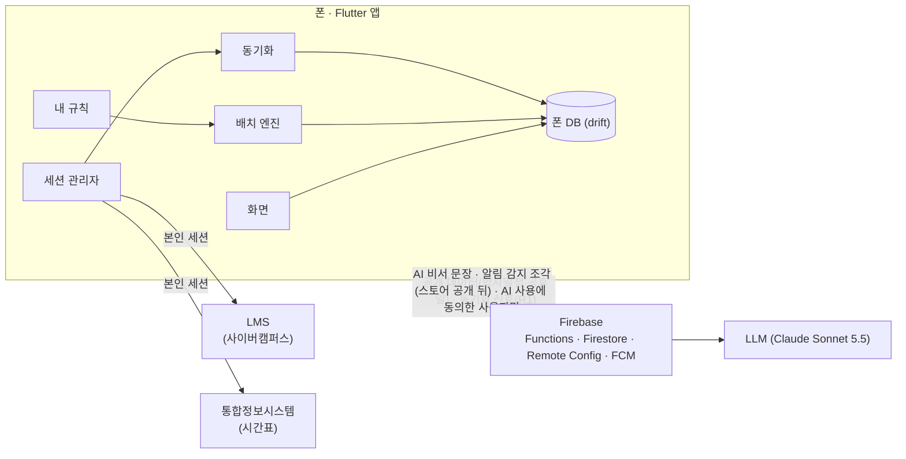

# 구조

구조, 실행 방법, 앱-서버 약속이 바뀌면 같은 PR에서 이 문서도 고칩니다. 왜 이렇게 정했는지는 [decisions.md](decisions.md)에 있습니다. 화면이 보여 주는 것과 동작은 [screens.md](screens.md), LMS(사이버캠퍼스) 연동 규칙은 [lms.md](lms.md)에 있습니다.

## 한눈에 보기

CNU PLANNER는 충남대 학부생용 일정 앱입니다. LMS의 마감과 학교 통합정보시스템의 시간표, 개인 일정을 모아 수업 사이 빈 시간에 할 일을 놓고, 그날 처음 앱을 열면 아침 브리핑에서 오늘 할 일을 고르게 합니다.



- **앱**: Flutter 3.47(iOS·Android 한 코드). R0부터 두 OS를 함께 냅니다. 화면은 세로 폰만 지원하고 iPad는 지원 대상에서 뺍니다(decisions.md 2026-11-06 '화면은 세로 폰만 지원한다'). 화면은 폰 DB만 보고, 동기화와 AI 호출은 뒤에서 결과를 DB에 씁니다. 위젯 라이브러리는 `material_ui` 패키지입니다. 앱 코드는 `package:flutter/material.dart` 대신 `package:material_ui/material_ui.dart`를 import하고(iOS식 위젯이 필요한 곳만 `package:cupertino_ui/cupertino_ui.dart`), `flutter/material.dart`·`flutter/cupertino.dart` import가 들어온 PR은 리뷰에서 돌려보냅니다. 아직 옮기지 않은 플러그인을 위해 `MaterialApp.builder`에서 `MaterialUiCompatibilityBridge`로 감싸고, 실수로 들어온 SDK import는 `dart fix --apply --code=migrate_design_widgets`로 바꿉니다. 앱 언어는 한국어뿐입니다. `MaterialApp`에 `locale: Locale('ko')`, `supportedLocales: [Locale('ko')]`, `localizationsDelegates: GlobalMaterialLocalizations.delegates`(`material_ui`)를 두고, 앱 시작 때 `initializeDateFormatting('ko')`를 부릅니다.
- **LMS**: 폰이 학생 본인 세션으로 LMS에 직접 연결합니다(R0). 로그인은 앱 화면에서 학번·비밀번호로 하고 WebView 로그인 화면은 쓰지 않습니다. 학번·비밀번호는 기기 보안 저장소에 늘 저장하고, 세션이 끊기면 조용히 다시 로그인합니다('자동 로그인 유지' 같은 선택은 없습니다). 로그인·재로그인은 계정의 다른 기기(PC·웹) 세션을 끊습니다(계정당 세션 하나). 할 일은 정해진 시간마다와 사용자가 새로 고칠 때 받고 마지막 확인 시각을 늘 보여 줍니다. 학번·비밀번호·쿠키는 LMS·통합정보시스템에만 보내고 앱 서버로는 보내지 않습니다. 동작 규칙은 [lms.md](lms.md)에 있고, `app/lib/lms/`를 고치기 전에 먼저 읽습니다.
- **서버**: Firebase 프로젝트 하나(개발·운영을 나누지 않습니다). Cloud Functions(TypeScript, 2세대)는 `functions/src/index.ts`의 `setGlobalOptions({ region: "asia-northeast3" })`로 모든 함수를 서울 리전에 둡니다(지정하지 않으면 `us-central1`에 배포됩니다). Firestore 데이터베이스는 `(default)` 하나이고 처음 만들 때 위치를 `asia-northeast3`로 정합니다. 만든 뒤에는 바꿀 수 없습니다. 함수가 AI 게이트웨이와 공개 데이터(학사일정·공휴일, R1)를 맡습니다. 서버는 읽을 수 있는 개인 데이터를 저장하지 않습니다. 서버에 남는 것은 설치 토큰별 AI 호출 수(이틀), 요청 로그(시각·경로·상태·IP, 아래 '앱과 서버 사이 약속 (API)'), R1의 날짜별 지표 합계이고, AI 요청 본문은 받은 자리에서 제공사로 넘기고 저장하거나 로그에 남기지 않습니다. 앱은 Functions를 HTTPS 엔드포인트로 부르고(callable 함수가 아닙니다), 클라이언트는 `dio` 하나로 `app/lib/data/api/server_api.dart`에 둡니다. 기본 주소는 `app/lib/app/config.dart`의 `apiBase` 상수이며 `--dart-define=API_BASE_URL=...`로 덮어씁니다.
- **AI**: 앱은 LLM을 직접 부르지 않습니다. 게이트웨이가 키를 숨기고, 호출 한도를 지키고, 출력을 `schema/`의 JSON Schema로 검증합니다. 모델은 Claude Sonnet 5.5입니다(decisions.md 2026-11-15 'AI 모델은 Claude Sonnet 5.5로 시작한다'). 날짜·시각·배치 계산은 AI가 아니라 코드가 합니다. AI는 06 AI 비서(말로 일정·할 일·수업 변경·규칙·질문)와 07 알림 감지(스토어 공개 뒤)에만 쓰고 아침 브리핑에는 쓰지 않습니다.
- **시간표 연동 (통합정보시스템)**: 수업 요일·교시는 LMS에 없어 통합정보시스템에서 받습니다(R0). 14 온보딩 1단계에서 로그인할 때(첫 로그인과 로그아웃 뒤 로그인) 이번 학기 시간표를 통째로 불러오고, 그 밖에는 13 시간표·고정 일정의 '새로 고침' 때만 다시 조회해 바뀐 수업을 반영할지 묻습니다(주기 조회 아님). 구체 방식은 코드와 Remote Config에 두고 레포에 적지 않습니다. 규칙은 [lms.md](lms.md)에 있습니다.
- **플랫폼 코드**: Android는 Kotlin(저장 공간·루팅 확인 채널, 쿠키 브리지(R0), 07 알림 감지(스토어 공개 뒤)), iOS는 Swift(백업 제외 속성 설정(R0), 백그라운드 작업 등록, 저장 공간·탈옥 확인·투명도 줄이기 채널, 쿠키 브리지(R0))로 씁니다(위젯은 재설계 예정). 저장 공간·루팅·탈옥·투명도 줄이기 채널과 백그라운드 작업 등록은 그것을 쓰는 화면·기능(R1)보다 먼저 첫 테스터 release에 넣었습니다(decisions.md 2026-11-15 '첫 테스터 release에 네이티브 바닥을 미리 넣는다'). 쿠키 브리지는 앱 안 WebView(숨은 복원. LMS 페이지 보기는 재설계 예정)와 쿠키 금고 사이에서 쿠키를 옮기고, 로그인에는 WebView를 쓰지 않습니다(쓰임은 LMS 연동 때 확인합니다). 나머지는 모두 Dart입니다. LMS 응답 해석은 Dart(`app/lib/lms/`)에 둡니다. Shorebird는 Dart 코드만 고칠 수 있기 때문입니다. 플랫폼 채널은 `MethodChannel`이고 이름은 `cnu_ai_assistant/<기능>`, 메서드 이름은 camelCase입니다. `app/lib/platform/`과 `app/lib/lms/` 밖에서는 채널을 직접 부르지 않습니다.
- **쿠키 브리지 채널**: 앱 안 WebView를 쓰는 동안에만 씁니다. `MethodChannel('cnu_ai_assistant/cookie_bridge')` 하나이고 메서드는 셋입니다. `getCookies(urls: List<String>) → List<Map>`은 각 URL의 쿠키를 레코드 목록으로 돌려주고, `setCookies(cookies: List<Map>) → void`는 레코드를 WebView 쿠키 저장소에 넣은 뒤 Android에서는 `flush()`까지 하며, `clearCookies() → void`는 WebView 쿠키를 모두 지웁니다. 레코드는 `{name: String, value: String, domain: String, path: String, expiresAt: String?(ISO 8601, 세션 쿠키는 null), secure: bool, httpOnly: bool}`이고 두 OS가 같은 키를 씁니다. Android의 `CookieManager.getCookie`는 이름과 값만 돌려주므로 `domain`은 요청 URL의 호스트, `path`는 `/`, `expiresAt`은 null, `secure`·`httpOnly`는 true로 채웁니다. Dart 쪽 래퍼는 `app/lib/lms/cookie_bridge.dart` 하나이며 다른 코드는 채널을 직접 부르지 않습니다. 공식 패키지의 쿠키 API는 쓰지 않습니다(속성을 버립니다).
- **내 규칙**: 사용자가 말이나 폼으로 정한 배치 조건과 브리핑 시각은 폰 DB `rules`에 두고 배치 엔진이 따릅니다(알림은 재설계 예정). 문장은 `/v1/parse`가 규칙 JSON으로 바꾸고 서버는 저장하지 않습니다. 자세한 것은 아래 '내 규칙' 절에 있습니다.
- **패키지**: R0는 `material_ui`, `cupertino_ui`, `flutter_riverpod`, `go_router`, `drift`·`drift_flutter`, `dio`, `flutter_secure_storage`, `flutter_local_notifications`·`timezone`(알림은 재설계 예정), `shared_preferences`, `flutter_svg`, `intl`, `webview_flutter`(세션 복원. LMS 페이지 보기는 할 일 상세와 함께 재설계 예정), `firebase_core`, `firebase_remote_config`, `firebase_app_check`, `url_launcher`(처리방침을 외부 브라우저로 열기, 문의 메일. LMS 페이지를 여는 길은 재설계 예정), `package_info_plus`(앱 버전 읽기. 업데이트 필요), `path_provider`(열지 못한 데모 DB 파일 지우기. `drift_flutter`가 이미 쓰는 패키지), `pointycastle`(LMS 요청 본문의 AES-CBC 암호화. 순수 Dart)이고 dev 의존성은 `drift_dev`, `build_runner`, `flutter_lints`, `json_schema`입니다. `workmanager`(백그라운드), `firebase_messaging`(서버 신호), `share_plus`(내보내기 파일 공유), `file_selector`(가져오기 파일 고르기)는 네이티브 부분이 첫 테스터 release에 들어가도록 미리 넣었고 쓰는 Dart 코드는 R1에 붙입니다(decisions.md 2026-11-15 '첫 테스터 release에 네이티브 바닥을 미리 넣는다'). `firebase_crashlytics`(오류 보고)는 첫 테스터 빌드부터 씁니다(decisions.md 2026-11-15 '오류 보고는 개인정보 처리 안내에 넣고 동의한 뒤에만 보낸다'). 루팅·탈옥 판정 플러그인은 쓰지 않습니다(앱의 채널로 확인). `flutter_animate`는 프리셋 밖의 보조 효과에만 쓰고, `flutter_inappwebview`와 공개 알림 감지 플러그인은 쓰지 않습니다. 패키지를 더하거나 빼면 이 줄을 같은 PR에서 고칩니다.

## 앱 식별자와 버전

- Dart 패키지 이름은 `cnu_ai_assistant`입니다(`app/pubspec.yaml`의 `name`, import는 `package:cnu_ai_assistant/...`). Android `applicationId`와 iOS bundle identifier는 둘 다 `io.github.syujin2323.cnuaiassistant`입니다. Firebase 앱 등록, App Check, iOS 기기 등록 배포가 이 값에 묶이므로 바꾸지 않습니다. 앱 표시 이름은 `CNU PLANNER`(Android `android:label`, iOS `CFBundleDisplayName`, 앱 안의 `AppStrings.appName`)이고, 세 곳이 같은지 `test/app/app_test.dart`가 확인합니다. 앱 아이콘에 학교 로고·상징을 쓰지 않고, 앱·스토어·로그인 화면에 '충남대 비공식 앱'을 함께 적습니다.
- Android의 `namespace`와 `MainActivity` 패키지는 `flutter create` 템플릿 값 `io.github.syujin2323.cnu_ai_assistant` 그대로 두고, `applicationId`만 `io.github.syujin2323.cnuaiassistant`입니다.
- 프로젝트는 `flutter create --org io.github.syujin2323 --project-name cnu_ai_assistant --platforms android,ios app`으로 만듭니다. web·desktop 폴더는 두지 않습니다.
- Flutter 버전은 `app/pubspec.yaml`의 `environment`에 정확한 버전 `flutter: 3.47.8`로 적습니다(범위 표기는 쓰지 않습니다. CI의 `subosito/flutter-action`이 `flutter-version-file`로 정확한 값을 읽습니다). `sdk` 제약은 `flutter create`가 쓴 값을 그대로 둡니다. 로컬의 `flutter --version`이 이 값과 같아야 하고, Flutter를 올릴 때는 이 줄을 고치는 `chore:` PR 하나로 팀 전체가 함께 올립니다. `functions/package.json`의 `engines.node`는 `"24"`입니다. `pubspec.lock`과 `package-lock.json`은 커밋합니다.
- 앱 버전은 `app/pubspec.yaml`의 `version: X.Y.Z+N`입니다. R0는 `0.1.x`, R1은 `0.2.x`, R2는 `1.0.0`부터이고 `N`은 테스터에게 주는 빌드마다 1씩 올립니다. Remote Config의 `min_app_version`은 `X.Y.Z` 문자열이고 앱은 `package_info_plus`로 읽은 자기 버전과 세 숫자를 앞에서부터 차례로 비교합니다(`domain/app_version.dart`). 빌드 번호(`+N`)와 꼬리(`-debugkey`)는 보지 않고, 둘 중 하나라도 꼴이 맞지 않거나 읽지 못하면 막지 않습니다(콘솔에 잘못 넣은 값으로 모든 사용자를 막지 않게). 첫 테스터 빌드부터 씁니다(decisions.md 2026-11-15 '업데이트 필요 화면을 첫 테스터 빌드에 넣는다').
- 줄 끝은 LF입니다. 레포 루트 `.gitattributes`에 `* text=auto eol=lf`와 `*.bat text eol=crlf`를 둡니다.

## 폴더 구조

```
cnu-ai-assistant/
├── app/                      Flutter 앱 (iOS·Android)
│   ├── lib/
│   │   ├── main.dart
│   │   ├── app/              app.dart(루트 위젯 RootApp), app_binding.dart(OS의 애니메이션 끄기 신호를 무시하는 앱 바인딩), router.dart, theme.dart, providers.dart(앱 전역 provider), plan_controller.dart(재계산 계기와 마지막 결과), toast_controller.dart(앱의 토스트 하나와 그 되돌리기), config.dart(서버 주소 등 비밀 아닌 설정 상수), bootstrap.dart(Firebase·DB·설정 초기화), startup_failure.dart(시작하지 못한 이유), logging.dart(앱 로그와 잡히지 않은 오류의 처리), update_required.dart(앱 버전과 최소 지원 버전을 견줘 업데이트가 필요한지), crash_reports.dart(오류 보고. Crashlytics를 동의에 맞춰 켜고 끄고 종류와 스택만 보냄)
│   │   ├── design/           tokens.dart(색·글꼴·간격·모서리), motion.dart(모션 프리셋), icons.dart, strings.dart(두 화면 이상이 쓰는 문구), widgets/(공통 위젯)
│   │   ├── features/         화면 단위 (onboarding, briefing, today, calendar, tasks, assistant, me, lms_connect, system; 스토어 공개 뒤에 suggest). 대응표는 아래 '화면과 기능 폴더'
│   │   ├── domain/           순수 Dart: 모델, 빈 시간 계산, 배치 엔진, 내 규칙(rules.dart, 이름·문장은 rule_text.dart), 시계와 논리적 하루(clock.dart), 날짜·시각 표기와 조사·할 일 종류 이름(text/), /v1/parse 응답의 되묻기 판단(parse_checks.dart. 응답 모델은 models/parse_result.dart)
│   │   ├── data/             폰 DB(drift), 저장소, 서버 API 클라이언트(api/: server_api.dart, install_token.dart, parse_client.dart), 데모 샘플(demo/demo_seed.dart), 재계산 서비스(plan_recalculator.dart)
│   │   ├── lms/              LMS(R0). lms_config.dart(Remote Config 읽기. `fetchAndActivate()`가 끝난 뒤 원격 스위치, 해석한 요청 상수, 호출 예산을 내놓고, 그 뒤 실행 중에 바뀐 값(`onConfigUpdated`)은 `activate()`한 뒤 다시 읽음), request_params.dart(요청 상수의 설정 파서. 키 이름, 학교 도메인 https 검사, 로그인 요청 틀의 변수 확인), request_spec.dart(요청 틀의 꼴: 문자열·JSON 틀, 본문, 값 뽑기, 암호), request_runner.dart(요청 틀을 채워 보내고 값을 뽑음), cipher.dart(요청 본문 AES-CBC), sync_budget.dart(호출 예산 파서), response_classifier.dart(판별), parsers/(해석: 과목 목록·할 일 목록, LMS 날짜·시각, 종류 코드 대응 설정), sync_coordinator.dart(동기화: 계기 하나의 차례·예산·잠금·판별·쓰기·상태 전이, `lmsSyncingProvider`), sync_triggers.dart(앱 열기·쓰는 동안 계기), cookie_bridge.dart(플랫폼 채널), cookie_vault.dart(쿠키 상자와 쿠키·학번·비밀번호 보안 저장소), login_flow.dart(로그인 흐름: 로그인 폼이 보는 단계·결과 인터페이스 `LoginFlow`와 요청 상수대로 로그인하는 구현, 로그인 화면을 떠날 때의 상태 정리), account.dart(로그아웃), hidden_webview.dart(숨은 복원, 필요 여부 확인), lms_client.dart(dio. 리다이렉트를 직접 따라가며 쿠키·User-Agent를 붙이고 연결 실패를 한 번 다시 보냄), session_state.dart(상태 전이. 상태 enum `LmsSessionState`는 `settings`를 읽는 domain 모델이 쓰고 domain은 lms를 import하지 않으므로 `domain/models/lms_session_state.dart`에 둡니다), session_manager.dart(복원·재로그인), timetable.dart(통합정보시스템 시간표)
│   │   └── platform/         storage_space.dart(남은 저장 공간), device_integrity.dart(루팅·탈옥 흔적), reduce_transparency.dart(iOS 투명도 줄이기), notifications.dart(알림은 재설계 예정), background.dart(workmanager 진입점, R1), push.dart(FCM 백그라운드 처리, R1), 07 알림 감지 연결(스토어 공개 뒤)
│   ├── test/                 domain·lms 단위 테스트, 화면 테스트, 폰 DB 스키마·마이그레이션 테스트(test/data/db/app/)
│   ├── drift_schemas/        폰 DB 스키마 스냅샷(app/drift_schema_v<N>.json. `make db-schema`가 만듦)
│   ├── assets/fonts/         Pretendard 1.3.9 정적 OTF 네 개(Regular 400, Medium 500, SemiBold 600, Bold 700)와 OFL.txt
│   ├── assets/icons/         캔버스 아이콘 SVG
│   └── android/, ios/        플랫폼 프로젝트 (iOS 백업 제외 설정, 쿠키 브리지(R0), 스토어 공개 뒤에 07 알림 감지)
├── functions/                Cloud Functions (TypeScript, ES 모듈)
│   ├── src/index.ts          함수 진입점(서울 리전, HTTPS 함수 api 하나)
│   ├── src/app.ts            Express 앱(요청 로그 → 본문 읽기·크기 확인 → 경로 → 없는 경로 → 오류 응답). 경로는 src/routes.ts에서 붙임
│   ├── src/params.ts         설정값·비밀값 선언
│   ├── src/http/             오류 응답 형식(errors.ts), 요청마다 남기는 로그 한 줄(request-log.ts)
│   ├── src/ai/               /v1/parse(parse.ts: 경로, provider.ts: 제공사 인터페이스, claude.ts: Claude 어댑터, prompts/: 프롬프트, convert.ts·validate.ts: 제공사용 응답 변환·검증, quota.ts: 호출 한도, app_check.ts, 요청·제공사용 스키마 JSON), /v1/extract(스토어 공개 뒤)
│   ├── scripts/              copy-schema.mjs(레포 루트 schema/*.schema.json을 src/schema/로 복사. build·lint·test 앞에 돎)
│   ├── src/public/           학사일정·공휴일(R1)
│   ├── src/push/             서버 신호 푸시(FCM, R1)
│   ├── test/                 vitest 테스트(src/와 같은 경로의 *.test.ts)
│   └── eval/                 한국어 일정 문장 평가 세트
├── schema/                   앱·서버 공용 JSON Schema: parse_result.schema.json, extract_result.schema.json(스토어 공개 뒤), samples/(합성 예시)
├── Makefile                  개발 명령(`make check` 등). 아래 '확인과 CI'의 명령과 같습니다
├── firebase.json, firestore.rules, firestore.indexes.json
└── docs/
```

- `domain/`은 Flutter, drift, Firebase를 import하지 않습니다. 모델 클래스(`Course`, `LmsItem`, `Task`, `Event`, `PlanBlock` 등)는 `domain/models/`에 한 벌만 두고, drift 테이블은 `@UseRowClass`로 이 클래스를 행으로 씁니다(`settings`만 예외로 생성 행 `SettingRow`와 값 객체 `AppSettings`를 씁니다). `data/`에 별도 모델이나 매퍼를 두지 않고, 쓰기는 생성된 companion으로 합니다. 배치 엔진의 중간 값은 `domain/planner/`(`TimeSpan`과 구간 연산, `Schedule`, `DayAvailability`, 하루 시간표 항목 `DayItem`), 규칙 값 클래스(`MinuteRange` 등)는 `domain/rules.dart`에 둡니다. `fromJson`/`toJson`은 JSON이 필요한 모델(`BlockReason`, `RuleParams` 등)에만 손으로 쓰고, 서버와 맞출 필드 이름은 `schema/`를 따릅니다. 배치 엔진과 날짜 규칙은 여기서 단위 테스트로 지킵니다.
- `lms/`에는 LMS가 바뀌면 고쳐야 할 코드를 모읍니다. 요청 경로·상수·패턴은 코드에 쓰지 않고 Remote Config에서 받습니다. `lms/`에는 사용자에게 보이는 화면을 두지 않습니다(세션 복원용 숨은 WebView는 예외). 로그인 폼은 `features/lms_connect/`에 두고 `lms/login_flow.dart`의 흐름을 붙여 씁니다. `lms/`는 동기화 함수, 세션 상태 스트림, 시간표 조회, `login()`·`logout()` 같은 함수만 내놓습니다.
- LMS 연동은 모든 빌드에 들어갑니다(decisions.md 2026-11-06 'LMS 연동은 모든 빌드에 넣는다'). LMS를 빼는 빌드 상수는 두지 않습니다. 최종 프로토타입에는 실제 모드를 로그인 없이 시작하는 길이 없습니다(데모 모드만 있습니다). debug 빌드(`kDebugMode`)에만 14 온보딩 1단계의 개발용 '로그인 없이 다음으로'를 둡니다(LMS 로그인이 붙은 뒤에도 남김, decisions.md 2026-11-15 '개발용 로그인 없이 다음으로는 debug 빌드에 남긴다'). LMS에 요청하지 않고 LMS 상태를 `active`로 쓴 뒤 2단계로 가며, release·profile 빌드에는 없습니다. 원격 스위치 `lms_enabled`는 실행 중에 LMS 조회를 멈춥니다(꺼져 있으면 로그인·다시 로그인도 막습니다. [lms.md](lms.md) '원격 스위치'). 학교가 멈춰 달라고 하면 이 스위치로 끕니다.
- LMS 원본(`lms_items`)과 사용자의 계획(`plan_blocks`)은 다른 테이블입니다. 동기화는 원본만 바꾸고, 계획은 `plan_blocks → tasks → lms_items` 순서로 참조만 합니다. 표는 아래 '폰 DB'에 있습니다.
- `schema/`는 앱과 서버가 함께 따르는 API 응답의 약속입니다(`parse_result.schema.json`). 드래프트는 draft-07이고 `$schema`·`$id`는 적지 않으며, 파일 안의 공용 정의는 `definitions`에 두고 `$ref`로 가리킵니다. 모든 object는 모든 키를 `required`에 두고 `additionalProperties: false`를 둡니다(키는 늘 있음). 없는 값은 `{"type": ["string", "null"]}`처럼 null을 허용해 표현합니다. 날짜는 `format: "date"`, 시각은 `pattern: "^([01][0-9]|2[0-3]):[0-5][0-9]$"`입니다. 열거형 값은 폰 DB의 영문 snake_case 값과 같아야 합니다. 값의 범위(분, 요일 개수 등)는 앱 `domain/`이 검사해 되묻으므로 스키마에 범위 제약을 두지 않습니다. 이 파일은 제공사의 구조화 출력(Claude의 `output_config.format`)에 그대로 넣지 않습니다. Claude 구조화 출력은 한 요청의 스키마 전체에서 유니언 타입(null을 허용하는 타입 배열·`anyOf`) 필드 16개, 선택 필드(`required`에 없는 키) 24개까지만 받는데, parse 응답에는 null을 허용하는 필드가 그보다 많기 때문입니다(decisions.md 2026-11-15 '제공사에는 빈 값을 빈 문자열로 쓰는 응답 스키마를 따로 넣는다'). 그래서 게이트웨이는 제공사용 응답 스키마(`functions/src/ai/parse_output.schema.json`)로 받습니다. 키는 같고, 유니언 타입과 선택 필드 없이 빈 값을 빈 문자열 `""`(숫자도 숫자 문자열)·빈 배열로 나타냅니다. 게이트웨이가 이것을 null로 바꾸고 `schema/`의 스키마로 다시 검증해 앱에 보냅니다. 제공사용 스키마는 구조화 출력이 받는 JSON Schema 부분집합만 씁니다: `enum`·`const`·`anyOf`·파일 안 `$ref`·`format`·단순 `pattern`만 쓰고, `minimum`·`maximum`·`minLength`·`maxLength`·`minItems`(0·1 제외)·`maxItems`·재귀 스키마·외부 `$ref`는 쓰지 않습니다(지원하지 않는 키워드나 한도를 넘는 스키마는 API가 400을 냅니다). 이 제약은 Claude 기준이고, 모델을 바꾸면 제공사용 스키마만 다시 맞춥니다. 요청 본문 스키마는 서버만 쓰므로 `functions/src/ai/parse_request.schema.json`에 두고, 모르는 필드는 받되 제공사로 넘기지 않습니다. 서버는 `npm run build`의 첫 단계(`copy-schema` 스크립트)로 `schema/*.json`을 `functions/src/schema/`(`.gitignore`에 넣고 커밋하지 않음)에 복사한 뒤 컴파일하고 `resolveJsonModule`로 import합니다. 앱은 `app/test/schema/`의 테스트가 `../schema/*.json`(`flutter test`는 `app/`에서 돌므로 `app/` 기준 경로)을 `json_schema` 패키지(`SchemaVersion.draft7`)로 읽어 `samples/*.json`과 모델의 `toJson()` 결과를 검증합니다. 필드는 null을 허용하는 선택 필드로만 더하고, 필드를 빼거나 뜻을 바꾸면 `parse_result.v2.schema.json`처럼 새 파일과 `/v2` 경로를 만듭니다.

## 앱 코드 규약

- 상태 관리는 `flutter_riverpod` 3만 씁니다. 코드 생성(`riverpod_annotation`·`riverpod_generator`)과 legacy provider(`StateProvider`, `StateNotifierProvider`, `ChangeNotifierProvider`)는 쓰지 않습니다. provider는 `Provider`(의존성·설정), `NotifierProvider`·`AsyncNotifierProvider`(화면 상태·동작), `StreamProvider`(drift `watch()` 결과) 셋뿐입니다. 화면은 `ConsumerWidget`이 `StreamProvider`로 DB를 보고, 동기화·AI 호출은 노티파이어가 뒤에서 하고 결과를 DB에 씁니다. 루트 provider scope는 `main.dart` 한 곳뿐이고, `bootstrap.dart`가 만든 `ProviderContainer`(`sharedPreferencesProvider`와 시작 작업을 마친 실제 DB(`realDatabaseProvider`)를 덮어쓰고 폰 DB를 열어 둔 것)를 `UncontrolledProviderScope`로 붙입니다. 테스트는 `ProviderScope`의 `overrides`로 `databaseProvider`·`motionLevelProvider`를 바꿉니다. 데모 모드는 `overrides`를 쓰지 않고 `databaseProvider`가 `appModeProvider`를 보고 파일을 고릅니다(아래 '데모 모드'). 앱 전역 provider는 `app/lib/app/providers.dart`, 라우터 provider는 `app/lib/app/router.dart`에, 기능별 provider는 그 기능 폴더의 `<화면>_controller.dart`에 둡니다.
- 오류 처리: 저장소, API 클라이언트, `lms/`는 예외를 던지지 않고 sealed class `Result<T>`(`Ok(value)` / `Err(error)`)를 돌려줍니다. 오류 타입은 `ApiError(status, code)`, `LmsOutcome`(lms.md '응답 판별'), `StorageError(operation, causeType, code)`이고 `domain/errors.dart`에 둡니다. 저장소는 폰 DB 실행기 호출(조회·쓰기·트랜잭션)만 `data/repositories/guard_storage.dart`의 `guardStorage`로 감쌉니다. 닫힌 연결(데모를 끝내며 닫은 DB 등의 `StateError`), SQLite 오류, 대체값이 없는 열의 모르는 값(`FormatException`, 아래 '폰 DB'의 '모르는 값')을 `StorageError`로 바꾸고, 앱의 폰 DB는 백그라운드 연결(별도 isolate)이라 SQLite 오류가 `DriftRemoteException`에 싸여 오므로 풀어서 원인의 타입 이름과 SQLite 확장 결과 코드(예: 잠김 5)만 담습니다. 감싼 곳 안의 다른 `StateError`도 `Err`가 되므로 한 행 조회는 `getSingle`(0행·여러 행이면 `StateError`) 대신 `getSingleOrNull`을 씁니다. `lms/` 안에서 `FormatException`(메시지에 원문 일부가 들어감)과 `DioException`(요청 주소가 들어감)을 잡아 `LmsOutcome`으로 바꾸고 밖으로 던지지 않습니다. 화면은 `Err`를 받으면 기존 데이터를 그대로 두고 상태 문구만 바꿉니다. 예외는 프로그래밍 오류에만 씁니다.
- 시각 규칙: 앱의 모든 `DateTime`은 기기 시간대와 관계없이 한국 시각(UTC+9, 서머타임 없음)의 벽시계 값을 담은 로컬 `DateTime`(`isUtc` false)입니다(decisions.md 2026-11-14 '기기 시간대와 관계없이 한국 시각을 쓴다'). 화면의 시각, 논리적 하루, 호출 예산의 하루와 조용한 시간, `/v1/parse`의 날짜·시각이 모두 한국 시각입니다. 지금은 `Clock.now`(한국 시각)로만 구하고 `DateTime.now()`는 `domain/clock.dart` 밖에서 부르지 않으며, 실제 순간을 가리키는 값(UTC 값, 오프셋을 붙여 읽은 값)은 `seoulWallClock`으로, 반대로 한국 시각을 그 순간의 UTC 값으로는 `kstToUtc`로 바꿉니다(로컬 값에 `toUtc`·`toLocal`을 쓰면 기기 시간대가 끼어듭니다). 받아들인 점: 기기 시간대에 서머타임이 있으면 그 시간대에 없는 벽시계 시각(봄에 건너뛰는 한 시간)은 한 시간 밀려 만들어질 수 있습니다(해외에서만 생김). '오늘'과 '이번 주'(월요일 시작), 논리적 하루의 시작·끝(`logicalDayStart`·`logicalDayEnd`)은 하루 경계 설정값을 반영한 `domain/clock.dart`의 함수로만 구합니다. 날짜·시각·요일 표기와 조사 보정(을/를, 이/가, 은/는, 와/과, 으로/로, 이라/라, 이나/나, 이에요/예요)은 `domain/text/`의 함수만 씁니다.
- 조사 판정(`domain/text/josa.dart`): 이름의 끝소리 받침에 맞추고, 받침이 ㄹ이면 '으로' 대신 '로'를 씁니다. 끝의 공백·줄바꿈은 지우고 붙입니다. 괄호(`()`·`[]`·`{}`, 전각 `（）`·`［］`·`｛｝`, `【】`)로 끝나면 괄호 묶음을 떼고 그 앞말로 판정하고('공학수학(2)을', '과제 (팀)를', decisions.md 2026-11-13 '괄호로 끝나는 말 뒤 조사는 괄호 앞말에 맞춘다'), 괄호 앞에 말이 없으면('[실습]을') 괄호 안의 말로 판정합니다. 낫표(「」『』)와 화살괄호(〈〉《》)는 제목·인용을 묶는 부호라 떼지 않고 그 안의 말로 판정합니다('발표「최종」이'). 한글은 음절의 받침(분해형은 끝의 종성 자모), 숫자(전각 포함)는 읽는 소리(0 영, 1 일 … 9 구), 읽는 소리가 있는 기호와 로마 숫자는 표(% 퍼센트, ℃·° 도, # 샵, Ⅰ 일, Ⅱ 이 …)로 판정하고, ASCII로 쓴 로마 숫자(I·II·III·IV·VI·VII·VIII·IX·XI·XII)도 숫자로 읽습니다('미적분학I을'. V·X 한 글자는 영문으로 봅니다). 영문은 끝 영문 덩어리가 한 글자이거나, 모두 대문자이면서 네 글자 이하면 낱자로 읽는 약어로 보아 L·R은 ㄹ, M·N은 받침 있음, 나머지는 받침 없음이고('HTML로', 'ROM을'), 다섯 글자 이상 대문자와 그 밖은 단어로 읽어 ng·m·me·n·ne는 받침 있음, l·le는 ㄹ, pp·bb와 모음 뒤 b·p·c·ck, 자음과 모음 하나 뒤의 t는 받침 있음, 그 밖은 받침 없음입니다('Programming이', 'Docker를', 'Logic을', 'Git을', 'TOEIC을'). 이 규칙에 맞지 않는 단어는 코드 안의 작은 예외 표(끝이 check·hub·book·out인 단어, 단어 bit)로 봅니다. 한자와 그 밖의 글자는 읽는 소리를 모르므로 받침 없음으로 보고, 그 밖의 기호·공백은 건너뛰고 앞 글자를 봅니다.
- 문구: 위젯 코드에 직접 쓰고 ARB 번역 파일과 `flutter gen-l10n`은 쓰지 않습니다. 두 화면 이상이 쓰는 문구만 `design/strings.dart`에 모읍니다. 말투는 차분한 존댓말("~해요")이고 숫자·시각을 먼저 말하며 못 한 일을 탓하지 않습니다.
- 앱 로그는 `dart:developer`의 `log`를 감싼 `app/lib/app/logging.dart`의 함수만 쓰고 `print`·`debugPrint`는 쓰지 않습니다. release 빌드(`kReleaseMode`)에서는 남기지 않습니다. 로그와 Crashlytics(오류 보고)에는 할 일·일정 제목, 과목명, 사용자가 쓴 문장, 쿠키, 학번·비밀번호, 요청 주소, 응답 본문, 예외 메시지를 넣지 않습니다. 예외 메시지에는 SQL과 바인딩 값, 요청 주소가 들어가므로 예외는 타입 이름과 오류 코드(HTTP 상태, SQLite 확장 결과 코드)만 남기고, Crashlytics로 보내는 오류도 예외 대신 종류(타입 이름)만 담은 `ReportedError`와 스택만 보냅니다(`app/lib/app/crash_reports.dart`). 잡히지 않은 오류는 `installErrorHandlers`의 처리기가 `crashReporter`(bootstrap이 Firebase를 연 뒤 검)로 치명 오류로 넘기고, 앱이 알아챈 비치명 오류(LMS 해석 실패 등)는 `CrashReports.recordEvent`로 이벤트 이름과 이름 꼴 값만 보냅니다. 오류 보고는 개인정보 처리 안내에 동의한 뒤(실제 DB `settings`의 `privacyConsentAt`), release 빌드에서만 보냅니다. 네이티브 SDK는 자동 수집을 꺼 둔 채 시작하고(Android 매니페스트 `firebase_crashlytics_collection_enabled`, iOS Info.plist `FirebaseCrashlyticsCollectionEnabled`) `listenCrashReportsConsent`가 동의를 따라 켜고 끕니다(데이터를 지우면 다시 끔). 남기는 것은 화면 이름, 이벤트 이름, 응답 종류, 걸린 시간, 개수입니다. 그래서 로그 값은 숫자·참거짓과 이름 꼴(`^[A-Za-z0-9_.]+$`) 문자열만 받고, 그 밖의 값이 오면 debug에서 바로 알립니다(`safeLogData`). 예외는 `errorKind`(타입 이름)로, 앱 오류는 `errorLogData`(`StorageError`의 동작·원인 타입·코드, `LmsOutcome`의 종류·상태, `ApiError`의 상태·코드. 서버가 보낸 코드는 이름 꼴이 아니면 `unexpected`)로 남깁니다. Flutter의 기본 오류 처리는 release에서도 예외 메시지와 스택을 기기 로그에 찍으므로, `main`이 `runApp` 전에 `installErrorHandlers`로 `FlutterError.onError`와 `PlatformDispatcher.instance.onError`(release에서는 처리했다고 true를 돌려 원문과 스택을 찍지 않게 하고, debug·profile에서는 false를 돌려 엔진이 찍게 함)를 걸어 잡히지 않은 오류도 종류만 남기고, release에서는 `debugPrint`도 끕니다. Firebase Analytics는 넣지 않습니다.
- 아이콘은 캔버스의 SVG 원본을 `app/assets/icons/*.svg`에 두고 `flutter_svg`의 `SvgPicture.asset`으로 그립니다. 화면 코드는 `design/icons.dart`의 `AppIcon.<이름>`만 쓰고 SVG 경로나 `Icons.*`를 직접 쓰지 않습니다. 글꼴은 `pubspec.yaml`의 family 이름 `Pretendard`가 테마의 기본 `fontFamily`이고, 앱 시작 때 `LicenseRegistry.addLicense`로 OFL을 등록하고 나 탭의 '오픈소스 라이선스'에서 `showLicensePage`로 보여 줍니다. 가변 글꼴은 쓰지 않습니다.
- Flutter 주의점: 입력창에 `enableSuggestions: false`를 쓰지 않습니다(Gboard 한국어 전환이 막힙니다). 한글 조합 중에는 `onChanged`가 여러 번 불리므로 조합이 끝난 뒤 처리합니다. 음수 자간을 쓰는 제목에는 글자 그림자를 넣지 않습니다(Android Impeller 이슈). 1을 넘는 곡선(`ease.spring`)은 `CurvedAnimation`·`CurveTween`으로 걸고 `animateTo(curve:)`는 쓰지 않습니다. 07 알림 감지는 자체 Kotlin `NotificationListenerService`로 만듭니다. WebView는 `webview_flutter`만 씁니다. 성능과 모션은 profile·release 빌드로만 판단합니다.
- 백그라운드 작업(R1, `platform/background.dart`): `callbackDispatcher`는 최상위 함수이고 `@pragma('vm:entry-point')`를 붙입니다. 별도 Flutter 엔진에서 돌므로 작업 안에서 `Firebase.initializeApp()`, 폰 DB 열기(`driftDatabase(name: 'app')`를 따로 열고 끝나면 `close()`), 쿠키 금고 읽기, `ProviderContainer` 만들기를 이 순서로 다시 한 뒤, Remote Config `fetchAndActivate()`로 `lms_enabled`를 확인하고 `settings`의 `lmsSessionState`로 나눕니다. `active`이면 `SyncCoordinator.run(trigger: background, scope: list)`를, `restoring`이면 세션 복원([lms.md](lms.md) '세션 복원')을 부릅니다. `reconnectRequired`이면 저장된 비밀번호가 있고 거절되지 않았을 때만 세션 복원을 부르고, 아니면 사용자가 다시 로그인할 때까지 LMS를 부르지 않습니다([lms.md](lms.md) '세션 상태'. '다시 로그인' 칩은 다음에 앱이 화면에 올 때 보입니다). R1의 서버 신호 푸시는 `platform/`의 최상위 함수(`@pragma('vm:entry-point')`)를 `FirebaseMessaging.onBackgroundMessage`에 등록해 받고, 위와 같은 순서로 초기화한 뒤 세션이 살아 있으면 조회합니다. `shareAcrossIsolates`와 `DriftIsolate`는 쓰지 않습니다(같은 Flutter 엔진 안에서만 동작합니다). 같은 파일을 두 isolate가 쓰는 충돌은 SQLite WAL 모드, `busy_timeout` 5000ms(다른 연결이 쓰는 동안 곧바로 'database is locked'로 실패하지 않고 기다림, `AppDatabase`의 `beforeOpen`), `sync_lease` 행으로 막습니다. drift 트랜잭션은 시작부터 쓰기 잠금을 잡으므로 트랜잭션 안에서 LMS 요청 같은 네트워크를 기다리지 않고, 동기화는 과목 하나 단위로 짧게 씁니다. Linux의 디버그 Dart VM에서는 `busy_timeout`의 기다림이 듣지 않으므로(아래 '확인과 CI'), 백그라운드 동기화 PR은 Android 빌드에서 두 연결의 기다림을 확인합니다. 백그라운드가 쓴 변경은 화면의 drift 스트림에 전해지지 않으므로, 앱이 `AppLifecycleState.resumed`가 될 때 어느 백그라운드 경로가 돌았는지와 관계없이 늘 `markTablesUpdated`로 `lms_items`, `lms_item_changes`, `courses`, `sync_runs`, `tasks`, `settings` 스트림을 다시 읽게 합니다. iOS 작업 이름은 `io.github.syujin2323.cnuaiassistant.backgroundSync`이고, `AppDelegate.swift`가 등록한 이름, Info.plist의 `BGTaskSchedulerPermittedIdentifiers`, Dart의 `Workmanager().registerPeriodicTask` 이름이 같아야 합니다. iOS가 작업 뒤 다음 작업을 예약할 때의 최소 간격은 `AppDelegate.swift`의 3시간(`openStaleMin` 기본값과 같음)이고 바꾸려면 새 release가 필요합니다. 실제로 깨우는 시각은 iOS가 정하고, LMS를 부를지는 호출 예산으로 정합니다. 서버 신호 푸시는 FCM 자동 초기화를 꺼 둔 채(Android 매니페스트 `firebase_messaging_auto_init_enabled`, iOS Info.plist `FirebaseMessagingAutoInitEnabled`) 내보내고, 쓰는 Dart 코드가 붙는 PR에서 `FirebaseMessaging.instance.setAutoInitEnabled(true)`로 켜고 개인정보 처리 안내 시트에 적습니다. 그전에는 FCM 토큰을 만들지 않습니다.

### 플랫폼 프로젝트 설정

- 최소 지원은 iOS 15, Android 7.0(API 24)입니다. Flutter 3.47과 Firebase SDK의 최소값과 같으므로 내릴 수 없습니다.
- Android: `minSdk 24`, `compileSdk`·`targetSdk 36`(Flutter 3.47 템플릿 값), Kotlin DSL(`build.gradle.kts`), Java 17. `AndroidManifest.xml`의 `<application>`에 `android:label`(표시 이름), `android:enableOnBackInvokedCallback="true"`(예측 뒤로 가기), `android:allowBackup="false"`, `android:dataExtractionRules="@xml/data_extraction_rules"`(클라우드 백업과 기기 이전 모두 제외), `android:networkSecurityConfig="@xml/network_security_config"`(평문 HTTP 금지. WebView와 Android 네트워크 스택에 걸리고 Dart의 dio에는 걸리지 않으며, debug용 덮어쓰기는 두지 않습니다)를 둡니다. `INTERNET` 권한은 Firebase 라이브러리 병합에 기대지 않고 매니페스트에 직접 둡니다. Crashlytics Gradle 플러그인(`com.google.firebase.crashlytics`)을 `settings.gradle.kts`와 `app/build.gradle.kts`에 둡니다(빌드 ID를 넣지 않으면 Crashlytics SDK가 시작하지 못함). `MainActivity`에는 `flutter_deeplinking_enabled` false 메타데이터를 두어 딥링크를 받지 않습니다(아래 '화면 이동'). OS가 다크 모드면 시작 화면 테마(`values-night/styles.xml`)는 다크 토큰 `bg`(#0F1116)로 그립니다. R0 화면은 라이트라 다크 모드 기기에서는 첫 화면을 그릴 때 색이 한 번 바뀌고, R1 다크 모드가 붙으면 맞습니다. 알림 권한 둘(`POST_NOTIFICATIONS`, `RECEIVE_BOOT_COMPLETED`)과 예약 알림 리시버 둘은 앱 뼈대 매니페스트에 있고, 알림 재설계 때 다시 정합니다. 정확한 알람 권한은 두지 않습니다(`USE_EXACT_ALARM`은 Play 신고와 심사, `SCHEDULE_EXACT_ALARM`은 Android 14부터 사용자 허용이 필요하고 지금 코드는 정확한 알람을 쓰지 않음). `MainActivity.configureFlutterEngine`이 앱의 채널(`StorageSpaceChannel.kt`의 `cnu_ai_assistant/storage_space`, `DeviceIntegrityChannel.kt`의 `cnu_ai_assistant/device_integrity`)을 겁니다. `app/android/app/build.gradle.kts`에는 `isCoreLibraryDesugaringEnabled = true`와 `coreLibraryDesugaring("com.android.tools:desugar_jdk_libs:<플러그인 README의 버전>")`을 둡니다.
- iOS: 배포 대상 `15.0`, Swift, UIScene 생명주기(Flutter 3.41부터 기본, `FlutterSceneDelegate`). `AppDelegate`는 템플릿을 바탕으로 쓰고, 플러그인 등록과 앱의 채널(`cnu_ai_assistant/storage_space`·`device_integrity`·`accessibility`)은 `didInitializeImplicitFlutterEngine`에서 걸며, workmanager의 BGTask 등록(`WorkmanagerPlugin.registerPeriodicTask`)은 `didFinishLaunchingWithOptions`에서 합니다(앱 시작이 끝나기 전에 등록해야 합니다). 같은 곳에서 `WorkmanagerPlugin.setPluginRegistrantCallback { registry in GeneratedPluginRegistrant.register(with: registry) }`(없으면 백그라운드 작업 엔진에서 Firebase·drift·보안 저장소를 부를 수 없습니다)와 `WorkmanagerPlugin.registerLaunchHandlers()`(UIScene 앱은 플러그인을 앱 시작 뒤에 등록하므로 지난 실행에서 예약한 작업의 처리기를 여기서 다시 겁니다)도 부릅니다. Info.plist에 `BGTaskSchedulerPermittedIdentifiers`와 백그라운드 모드(fetch·processing·remote-notification)를 둡니다. 이 네이티브 부분은 첫 테스터 release에 들어 있고 쓰는 Dart 코드는 R1입니다. Info.plist의 `ITSAppUsesNonExemptEncryption`은 false로 두었고, App Store Connect에 처음 올리기 전(1.0.0 RC)에 관리자가 수출 규정 질문의 답과 맞는지 확인합니다(앱이 직접 쓰는 암호화는 HTTPS와 LMS 요청 본문의 AES입니다). 이 값은 App Store Connect 업로드에만 쓰이고 기기 등록(ad hoc) 배포에는 영향이 없습니다. Runner 대상의 마지막 빌드 단계 'Upload Crashlytics Symbols'가 Release 구성에서만 dSYM을 Crashlytics에 올립니다(flutter 명령은 Swift 패키지를 `build/ios/SourcePackages`에, Xcode는 DerivedData에 받으므로 두 곳에서 `firebase-ios-sdk/Crashlytics/run`을 찾음). 앱 코드의 개인정보 매니페스트는 `Runner/PrivacyInfo.xcprivacy`이고, 저장 공간 채널이 쓰는 디스크 공간 API의 이유(E174.1)를 적었으며 수집 데이터 종류는 개인정보 처리방침·App Privacy PR에서 채웁니다. 시작 화면(`LaunchScreen.storyboard`)의 배경은 에셋 색 `LaunchBackground`(라이트 #FFFFFF, 다크 #0F1116)입니다. 폰 DB와 WebView 데이터는 백업에서 뺍니다(R0). `AppDelegate.swift`가 앱을 켤 때마다 폰 DB가 있는 Documents 폴더 전체와 WebView 데이터 폴더(`Library/WebKit`, `Library/Cookies`)에 폴더 단위로 `isExcludedFromBackup`을 겁니다. SQLite의 -wal·-shm 파일은 지워졌다 다시 생겨 파일에 건 속성이 사라지므로 폴더에 겁니다. 그래서 Documents에 두는 파일은 모두 백업에서 빠집니다. 앱 지역은 ko입니다(Info.plist `CFBundleLocalizations` ko, 프로젝트 `developmentRegion` ko). 기기 언어가 영어여도 WebView 메뉴 같은 시스템 UI가 한국어로 나오게 하려는 것입니다. release 빌드의 App Check가 App Attest를 쓰고 서버 신호 푸시가 APNs를 쓰므로 `Runner/Runner.entitlements`에 `com.apple.developer.devicecheck.appattest-environment`(production)와 `aps-environment`(production)를 두고 Runner 대상 Release 구성의 `CODE_SIGN_ENTITLEMENTS`로 겁니다. Debug·Profile 빌드는 App Check 디버그 제공자를 쓰므로 걸지 않습니다(실기기 Debug 빌드가 App Attest·푸시가 든 프로파일 없이도 서명되게. 그래서 Debug 빌드에서는 푸시를 받지 않습니다). Apple Developer의 App ID에 App Attest와 Push Notifications 기능을 켜고 받은 프로비저닝 프로파일이어야 서명되며, 개발 팀(`DEVELOPMENT_TEAM`)은 커밋하지 않습니다. FCM이 APNs로 보내려면 Firebase 콘솔에 APNs 인증 키를 올려야 합니다(서버 신호 푸시 PR 전에).
- 화면 방향: 세로 폰만 지원합니다(decisions.md 2026-11-06 '화면은 세로 폰만 지원한다'). iOS는 Info.plist의 방향을 Portrait 하나로, `TARGETED_DEVICE_FAMILY`를 1(iPhone)로 두고, 앱은 bootstrap에서 `SystemChrome.setPreferredOrientations([DeviceOrientation.portraitUp])`로 고정합니다. targetSdk 36의 Android 16은 큰 화면(태블릿·폴더블)에서 방향 고정을 따르지 않으므로, 화면 테스트가 태블릿 가로 폭(1280×800pt)에서도 넘치지 않는지 봅니다.
- 쿠키 브리지(Kotlin·Swift)는 앱 안 WebView를 쓰는 PR에서 더합니다.

## 화면 이동

- 라우터는 `app/lib/app/router.dart` 하나입니다. 하단 탭은 go_router의 `StatefulShellRoute.indexedStack`이고 가지 순서는 오늘 · 캘린더 · 할 일 · 나입니다. 탭 라벨은 '오늘', '캘린더', '할 일', '나'이고, 탭 오른쪽에 06 AI 비서를 여는 'AI 비서에게 말하기' 둥근 버튼을 둡니다. 경로 문자열은 `Routes` 상수로만 씁니다.

| 경로 | 화면 | 위치 |
|---|---|---|
| `/` | 없음. 시작 위치를 정하는 자리(`Routes.root`)이고 `redirect`가 곧바로 아래 규칙의 경로로 보냅니다 | 셸 밖 |
| `/onboarding` | 14 온보딩(다섯 단계) | 셸 밖 |
| `/login` | 14 다시 로그인(학번 고정, 끝나면 온 화면으로) | 셸 밖 전체 화면 |
| `/today` | 02 홈 | 오늘 탭 |
| `/today/day/:date` | 09 일간 (`:date`는 `YYYY-MM-DD`. 캘린더에서 열어도 오늘 탭. 인자: 연 곳 `?from=week`·`month`) | 오늘 탭 |
| `/calendar` | 11 주간 (캘린더 탭 첫 화면) | 캘린더 탭 |
| `/calendar/month` | 08 월간 | 캘린더 탭 |
| `/tasks` | 03 할 일 (주간 할 일·전체 할 일. 인자: 처음 탭 `?tab=all`) | 할 일 탭 |
| `/me` | 10 나 | 나 탭 |
| `/me/rules` | 12 내 규칙 | 셸 밖 전체 화면 |
| `/me/timetable` | 13 시간표·고정 일정 (탭 둘. 인자: 처음 탭 `?tab=fixed`) | 셸 밖 전체 화면 |
| `/briefing` | 01 아침 브리핑 | 셸 밖 전체 화면 |
| `/assistant` | 06 AI 비서 (인자: 미리 채울 문장, 바로 보내기, 직접 추가 종류, 모드, 날짜·시각. `extra`로만 넘김) | 셸 밖 전체 화면 |
| `/tasks/:id` | 04 할 일 상세(재설계 예정) | 셸 밖 전체 화면 |
| `/update` | 20 시스템의 업데이트 필요. 앱 버전이 최소 지원 버전보다 낮으면 어느 위치에서든 여기로 막음 | 셸 밖 전체 화면 |

- 셸 밖 전체 화면은 루트 Navigator에 띄우고, 여는 곳에서 `context.push`로 열어 닫거나 끝나면(`pop`) 연 화면으로 돌아갑니다. `go`로 열면 돌아갈 곳이 없습니다. `/login`은 01 아침 브리핑·02 홈·03 할 일의 '다시 로그인' 칩, 03 할 일 LMS 정보 시트, 10 나 › LMS 계정이 열고, 데모 모드에서는 열지 않고 '데모에서는 LMS에 연결하지 않아요'를 띄웁니다. 화면은 `features/lms_connect/relogin_screen.dart`이고 로그인 폼은 14 온보딩 1단계와 함께 씁니다.
- 화면 진입 인자: 06 AI 비서의 인자는 `features/assistant/assistant_args.dart`의 `AssistantArgs`이고 `context.push(Routes.assistant, extra: args)`로만 넘깁니다. 사용자가 쓴 문장이 경로 문자열에 실려 로그에 섞이지 않게 쿼리에는 넣지 않고, 같은 까닭으로 `AssistantArgs`에는 `toJson`을 두지 않습니다(go_router가 경로 정보를 플랫폼에 알릴 때 JSON으로 바꾸지 못한 `extra`는 빼고 알리고, 화면에는 그대로 넘깁니다). 03 할 일과 13 시간표·고정 일정의 처음 탭은 `Routes.tasksTab`·`Routes.meTimetableTab`이 만드는 `?tab=` 쿼리로 넘기고, 모르는 값이면 기본 탭(주간 할 일·시간표)을 엽니다. `/tasks`는 할 일 탭 가지의 첫 화면이라 다른 인자로 다시 열면 남아 있던 화면이 새 값을 받습니다(`didUpdateWidget`).
- 캘린더 탭은 11 주간(`/calendar`)부터 엽니다. 08 월간(`/calendar/month`)은 캘린더 가지에 형제 경로로 두고, '주 | 월'은 같은 자리에서 두 화면을 바꿔 끼웁니다(go). 그래서 08에는 뒤로 화살표가 없고, 캘린더 탭을 다시 누르면 11 주간입니다(decisions.md 2026-11-13 '캘린더의 '주 | 월'은 같은 자리에서 바꿔 끼운다'). 화면 동작은 [screens.md](screens.md) '캘린더'에 있습니다.
- 09 일간은 어디서 열든 `context.go(Routes.day(날짜, from: …))`로 열어 늘 오늘 탭에 둡니다(decisions.md 2026-11-13 '다른 탭에서 연 09 일간은 오늘 탭에 두고 뒤로 가면 온 화면으로 돌아간다'). 11 주간·08 월간에서 열면 `from`(`week`·`month`)을 넘기고, 뒤로 가면 오늘 탭에서 09가 빠진 뒤 그 화면으로 갑니다. `PopScope`로 뒤로 가기를 막지 않아 iOS 스와이프 뒤로가 살고, 캘린더 탭의 화면 상태는 남습니다. 받아들인 점: 뒤로 스와이프하는 동안 아래에 02 홈이 비칩니다. 02 홈과 06 AI 비서에서 연 09는 `from` 없이 열고, 뒤로 가면 02 홈입니다(06을 다시 만들면 06이 덮었던 화면으로 돌아갈 길이 없어집니다). `PopScope` 콜백은 오늘 탭을 다시 누르는 것처럼 다른 이동으로 09가 빠질 때도 불리므로, go_router가 뒤로 가기로 닫힌 위치에 쿼리를 남기는 것(`/today?from=week`)으로 둘을 가릅니다(`Routes.isDayClosedByBack`). 09 안에서 날짜를 넘길 때는 `replace`로 바꿔 끼워 뒤로가 지난 날을 거치지 않게 하고, 없는 날짜(예: 2026-02-30)의 09는 `/`로 보냅니다.
- 근거·옮기기·빈 시간에 놓기·일정 정보·시간 부족·LMS 정보 같은 시트는 라우트가 아니라 `design/widgets/app_sheet.dart`의 `showAppSheet`로 띄웁니다(시트 동작은 [screens.md](screens.md)에 있습니다). `showAppSheet`는 시트를 루트 Navigator에 열어 하단 탭바를 덮습니다. 시트 위에는 끌기 손잡이를 두어 글자를 키워 시트가 화면을 다 덮어도 닫을 수 있게 하고(decisions.md 2026-11-14 '시트는 끌기 손잡이로도 닫는다'), 시트 배경은 화면 아래 끝까지 그리되 내용은 아래 시스템 영역(Android 내비게이션 바·iOS 홈 표시줄)만큼 띄웁니다(Android 15부터는 앱이 내비게이션 바 밑까지 그려지므로). 탭 화면에서 `showModalBottomSheet`를 기본값으로 열면 시트가 탭바 아래에 깔리고 시트를 연 채 탭을 바꿀 수 있으므로, 화면 코드는 `showModalBottomSheet`를 직접 부르지 않습니다. 토스트는 시트 위에도 그려지므로 시트·대화 상자가 열리면 거둡니다(GoRouter의 루트 Navigator에 건 `ToastPopupObserver`). 06 AI 비서의 직접 추가 폼은 화면 위에 덮는 전체 화면입니다. 새 화면은 이 표에 먼저 더합니다.
- 시작 위치는 `redirect` 한 곳에서만 정합니다. 업데이트 필요(`/update`, `app/update_required.dart`의 `updateRequiredProvider`)가 맨 먼저이고, 이것만은 시작 위치가 아닌 어느 위치에서든 봅니다. 필요하면 어디서든 `/update`로 보내고 필요 없어지면 `/update`에서 `/`로 보냅니다. 최소 버전은 지난 실행에서 받아 둔 값으로 먼저 보고 이번 실행의 `fetchAndActivate()`가 끝나면 다시 보며, 값이 바뀌면 라우터의 `refreshListenable`이 redirect를 다시 돌립니다. 그다음 앱 잠금(스토어 공개 뒤)이고, 그다음 온보딩을 끝내지 않았거나, 실제 모드에서 LMS 상태가 로그인 전(`disconnected`: 로그아웃 뒤처럼 로그인 정보가 없음, `connecting`: 로그인하는 중. decisions.md 2026-11-14 '로그인하는 중은 로그인 전으로 본다')이면 `/onboarding`, 오늘(논리적 하루)의 브리핑을 아직 보지 않았으면 `/briefing`, 그 밖에는 `/today`입니다. 알림으로 켜졌을 때의 경로(알림은 재설계 예정)는 `launchPayloadProvider` 자리만 두고, 지금 코드는 온보딩·LMS 상태 확인 뒤, 브리핑 확인 앞에서 봅니다(순서는 재설계 때 다시 봅니다). 데모 모드이거나 온보딩으로 보낼 때는 쓰지 않고 버립니다. `redirect`는 이 순서를 시작 위치 `/`에서만 따르고 `/login` 같은 다른 경로는 막지 않습니다. 없는 경로는 `/`로, settings나 브리핑 확인을 읽지 못하면 `/today`로 보냅니다. 온보딩을 끝냈고 LMS 상태가 로그인 전이 아니거나 데모 모드면, 다른 화면에서 `/onboarding`으로 가는 이동을 `/briefing`이나 `/today`로 돌립니다. 이미 `/onboarding`에 있는 동안에는(로그아웃 뒤 1단계에서 로그인하는 중 상태가 `connecting`·`active`로 바뀔 때도) 돌리지 않고, 진행 줄이 끝나면 `/`로 갑니다. 데이터 삭제는 `onboarding_done`·`app_mode`·`demo_entry`도 지웁니다. 로그아웃은 `onboarding_done`을 지우지 않으므로, 로그아웃 뒤 14 온보딩 1단계에서 로그인하면 2–5단계 없이 `/`로 갑니다([lms.md](lms.md) '로그아웃, 데이터 삭제, 내보내기').
- 앱이 백그라운드에서 돌아올 때(`AppLifecycleState.resumed`)는 `RootApp`의 `AppLifecycleListener`가 시작 위치 규칙을 다시 돌릴지 봅니다(decisions.md 2026-11-06 '앱으로 돌아올 때는 하루가 바뀌었을 때만 시작 위치를 다시 정한다'). 논리적 하루가 마지막으로 시작 위치 규칙을 돌려 그 결과의 위치에 도착한 날(앱 모드와 함께 메모리에만 둡니다)과 다르고 그날 브리핑을 아직 보지 않았을 때만 `/`로 가서 `redirect`가 다시 정하게 합니다. 브리핑 기록은 모드의 DB마다 따로 있으므로 데모에서 돌린 날은 실제 모드의 날로 치지 않고, 규칙이 정한 위치로 가기 전에 다른 이동(탭 누르기 등)이 끼어들어 결과가 버려지면 그날을 적지 않습니다. 같은 날 안에서 돌아오면 보던 화면을 그대로 둡니다. 맨 위 화면이 `/onboarding`·`/login`·`/briefing`·`/assistant`(그 위의 직접 추가 폼 포함)면 미루고 다음에 돌아올 때 다시 봅니다. `/briefing`을 띄운 채 하루가 바뀌었으면 01이 스스로 그날을 본 것으로 적고 그날 내용으로 다시 그립니다(미루므로 규칙이 새로 띄우지 않음). 다시 돌려 `/briefing`으로 가면 하단 탭 셸이 내려가므로 각 탭에서 보던 화면은 남지 않습니다. 확인은 한 번에 하나만 돌고, 시작 위치를 정하는 곳은 여전히 `redirect` 하나입니다.
- 플랫폼 딥링크·intent 경로는 받지 않고, 알림 경로는 `launchPayloadProvider`로만 받습니다. 그런 경로로 열면 시작 위치 규칙을 거치지 않아 온보딩을 건너뛸 수 있기 때문입니다. GoRouter는 `overridePlatformDefaultLocation: true`로 플랫폼이 넘기는 첫 경로(Android intent의 `route` 값 등)를 보지 않고 늘 `/`에서 시작하고, Android는 `MainActivity`의 `flutter_deeplinking_enabled`를 false로 두어 intent의 data 경로(앱을 켤 때와 실행 중 모두)를 받지 않습니다.
- 화면 전환은 `ThemeData.pageTransitionsTheme`에 iOS `CupertinoPageTransitionsBuilder`(왼쪽 끝 스와이프 뒤로), Android `PredictiveBackPageTransitionsBuilder`를 둡니다. 뒤로 가기 제어는 `PopScope`만 씁니다. 탭 전환에는 화면 전환 애니메이션을 쓰지 않고 탭바 모션만 씁니다.

## 화면과 기능 폴더

화면 번호는 디자인 캔버스를 따릅니다. 출시 단계는 [screens.md](screens.md) '화면 목록'에 있습니다.

| 폴더 | 화면 (캔버스 번호) |
|---|---|
| `features/onboarding/` | 14 온보딩, 데모 모드 진입 |
| `features/briefing/` | 01 아침 브리핑 |
| `features/today/` | 02 홈, 09 일간 |
| `features/calendar/` | 11 주간, 08 월간 |
| `features/tasks/` | 03 할 일, 04 할 일 상세(재설계 예정) |
| `features/assistant/` | 06 AI 비서, 직접 추가 폼 |
| `features/me/` | 10 나, 12 내 규칙, 13 시간표·고정 일정 |
| `features/lms_connect/` | 로그인 폼(14 온보딩 1단계·다시 로그인 화면이 함께 씀) |
| `features/suggest/` | 07 알림 감지 (Android, 스토어 공개 뒤) |
| `features/system/` | 20 시스템 |

기능 폴더 안은 `<화면>_screen.dart`(화면 위젯), `<화면>_controller.dart`(노티파이어와 provider), `widgets/`(그 화면만 쓰는 위젯)입니다. 예: `features/tasks/task_list_screen.dart`, `features/tasks/task_detail_screen.dart`. 두 화면 이상이 쓰는 위젯은 `design/widgets/`에 둡니다. 블록 근거 시트는 `design/widgets/block_sheet.dart`이고 01 아침 브리핑·02 홈·09 일간·11 주간·06 AI 비서가 함께 씁니다. 세로 하루 시간표는 `design/widgets/day_timeline.dart`이고 02 홈·09 일간이 함께 씁니다. 자리 계산(`day_timeline_layout.dart`)은 최종 프로토타입의 값(임시)을 따릅니다: 한 시간 60pt, 카드 최소 44pt(이동·점심·빈 시간은 30pt), 겹치면 앞 카드 아래로 밀고, 높이 92pt 이상·60pt 이상·그 밖의 세 모양, 빈 시간 카드는 45분 이상, 이동은 15분 미만을 그리지 않고, 오늘은 끝난 항목을 접습니다. 할 일 블록의 점선은 `design/widgets/dashed_border.dart`로 그립니다. 되돌리기 토스트는 `design/widgets/app_toast.dart`이고 `RootApp`이 모든 화면 위에 하나만 그립니다(`app/toast_controller.dart`의 `toastControllerProvider`가 띄우고 거두며 '되돌리기'를 함). 토스트는 맨 위 화면의 기준점(`ToastAnchor`. 하단 탭바) 윗변 위 12pt에 가로 가운데로 붙어 글자를 키워 탭바가 커져도 따라가고, 기준점이 없는 화면에서는 하단 탭 알약이 있을 높이 위(키보드가 올라오면 그만큼 위)에 둡니다. 아래 고정 버튼 줄이 있는 전체 화면은 그 줄을 `ToastAnchor`로 감쌉니다(한 화면에 하나).

### 온보딩

- 단계와 화면 동작, 개인정보 안내 문구는 [screens.md](screens.md) '14 온보딩'에 있습니다(다섯 단계이고 3단계만 건너뜁니다).
- 각 단계는 `features/onboarding/steps/` 아래 한 파일씩(`login_step`·`timetable_step`·`fixed_blocks_step`·`ai_consent_step`·`briefing_time_step`)이고 `OnboardingScreen`이 `PageView`로 넘깁니다. 2단계부터 화면 위에 진행 막대를 둡니다. 뒤로 가기는 3단계부터이고(시스템 뒤로 가기는 1단계에서는 화면을 닫고 2단계에서는 받지 않음), '건너뛰기'는 3단계에만 있습니다. 저장 같은 일이 진행 중이면 다음·건너뛰기·뒤로 가기를 받지 않습니다. 5단계를 마치면 `onboarding_done`을 켜고 `/`로 갑니다. 로그아웃 뒤 다시 들어왔으면(`onboarding_done`이 이미 켜져 있음) 1단계에서 로그인하면 2–5단계 없이 `/`로 갑니다. 처음 온보딩에서 로그인한 뒤 끝내기 전에 앱이 꺼졌으면(`onboarding_done`이 꺼져 있고 LMS 상태가 로그인 전(`disconnected`·`connecting`)이 아님) 다음에 열 때 2단계부터 엽니다(다시 로그인하지 않음, decisions.md 2026-11-13 '로그인한 뒤 온보딩 도중 앱이 꺼지면 2단계부터 연다'). 그래서 컨트롤러(`OnboardingController`, `AsyncNotifier`)는 처음 열 때 `settings`를 한 번 읽어 시작 단계를 정하고(읽지 못하면 1단계), 그동안 화면은 비어 있습니다. 4단계는 동의하면 `aiEnabled`를 켜고 `aiConsentAt`을 적으며 동의하지 않으면 `aiEnabled` false만 쓰고, 5단계는 고른 브리핑 시각을 `notify` 규칙(`source` `manual`)으로 rules 저장소에 저장합니다. 이 저장들이 실패해도 기록만 남기고 온보딩은 계속합니다. debug 빌드에만 1단계에 개발용 '로그인 없이 다음으로'가 있습니다(버튼과 동작 모두 `devLoginSkipAllowedProvider` 하나를 보고, 테스트는 이것을 false로 덮어써 release·profile 빌드를 흉내 냅니다).
- 온보딩 완료 여부는 `shared_preferences`의 `onboarding_done` 키입니다. 보안 저장소에는 두지 않습니다(iOS Keychain 값은 앱을 지워도 남습니다). 설치 표식이 없는 첫 실행(iOS 백업 복원·기기 이전 포함)에는 이 키를 지워 온보딩부터 시작합니다([lms.md](lms.md) '쿠키 금고'). 건너뛴 단계 목록은 `settings`의 `onboardingSkipped`에 단계 번호(1–5)의 배열로 둡니다. 쓰기는 1–5의 중복 없는 오름차순 목록만 받고(아니면 `ArgumentError`), 읽을 때는 1–5 밖의 수와 중복을 버립니다. 지금은 3단계만 건너뛸 수 있고, 이 값을 쓰는 화면은 없습니다(건너뛴 고정 일정은 나중에 10 나에서 넣음).

### 데모 모드

실제 계정 없이 샘플 학생의 하루로 모든 R0 화면이 도는 모드입니다. 발표·심사·스크린샷에 씁니다.

- 로그인 화면의 '로그인 없이 둘러보기'나 10 나의 '데모 모드 들어가기'로 들어가고, 화면 위에 '데모' 띠를 늘 보여 줍니다. 띠의 '끝내기'로 나오면 데모 DB의 모든 표를 비우고 들어온 곳(아래 `demo_entry`)으로 돌아갑니다. 데모 DB 파일은 지우지 않고, 열린 연결 그대로 한 트랜잭션 안에서 표를 비웁니다(`DemoRepository.clearAll`). 10 나의 '데모 모드 끝내기'도 같은 동작이고(`demoExitProvider`), 끝내는 동안은 두 버튼을 막으며 거듭 불러도 한 번만 끝냅니다. 표를 비우지 못하면 데모 모드 그대로 두고 띠에 '데모를 끝내지 못했어요'와 [다시 시도]를 보입니다(디자인 전 임시 문구).
- 앱 모드는 `AppMode { real, demo }`이고 `shared_preferences`의 `app_mode` 키에 둡니다. `appModeProvider`가 이 값을 읽고 `databaseProvider`는 모드에 따라 `app.sqlite`(real) 또는 `app_demo.sqlite`(demo)를 씁니다. `app.sqlite`는 `realDatabaseProvider`가 앱 수명 동안 열어 두고, `app_demo.sqlite`는 데모에 들어갈 때 열고 끝내면 닫습니다. 두 파일은 서로 읽지 않으므로 데이터가 섞이지 않습니다. 저장소 층 위로는 같은 코드가 돕니다. 단, 설치 표식(`installedAt`)과 LMS 상태(`lms*` 키)는 데모 모드에서도 늘 `app.sqlite`에서 읽고 씁니다(데모 DB에는 없으므로 데모 DB로 보면 데모 모드로 다시 켤 때마다 실제 계정 정보를 지우게 됩니다). 설치 표식이 없는 첫 실행에는 `app_mode`·`demo_entry`도 지웁니다. 기기 단위 설정(R1의 다크 모드)도 데모 모드에서 늘 `app.sqlite`에서 읽고 씁니다(decisions.md 2026-11-13 '데모 모드에서도 기기 단위 설정은 실제 DB에서 읽는다'). 하루 경계 같은 그 밖의 설정은 데모 DB의 값이고, 데모 DB는 늘 비어서 시작하므로 처음에는 기본값입니다. 데모를 끝낼 때는 표를 비운 직후 데모 DB를 닫으므로 그 뒤에 오는 데모 DB 저장은 닫힌 DB의 `StorageError`로 끝나고 화면은 상태 문구만 바꿉니다. 다만 비우기 전에 시작한 저장은 끝난 뒤 비워지고, 비우는 동안 들어와 그 뒤에 줄 선 저장은 비운 DB에 남을 수 있으므로(남으면 다음 데모에 샘플을 넣지 않음), 사용자가 누르지 않았는데 화면이 저절로 쓰는 기록은 끝내는 중(`AppModeController.exiting`)이면 쓰지 않습니다(01 아침 브리핑의 본 것처럼). 데모에 들어갈 때는 `app.sqlite`가 열린 채라 그때 돌던 저장은 그대로 끝나고, 진행 중인 LMS 동기화는 멈춥니다([lms.md](lms.md) '동기화').
- `appModeProvider`가 `demo`면 `redirect`는 `onboarding_done`을 보지 않고 그날 브리핑을 아직 보지 않았으면 `/briefing`, 아니면 `/today`로 보냅니다. '끝내기'는 로그인 화면(14 온보딩 1단계)에서 들어왔으면 그 화면으로, 10 나(`features/me/`)에서 들어왔으면 `/me`로 돌아갑니다. 들어온 곳은 `shared_preferences`의 `demo_entry`(`onboarding`/`me`)에 둡니다.
- 샘플 데이터는 `app/lib/data/demo/demo_seed.dart`의 Dart 코드이고 JSON 파일은 두지 않습니다. 데모 DB를 열 때 모든 표가 비어 있으면(파일을 처음 만들었거나 '끝내기'로 비운 뒤) 한 트랜잭션으로 넣고(`AppDatabase`의 데모 시드), 날짜는 넣는 때의 논리적 하루를 기준으로 상대적으로 만듭니다. 하루를 넘긴 데모는 다시 넣지 않습니다(오늘 샘플을 보려면 끝내고 다시 들어갑니다. decisions.md 2026-11-13 '하루를 넘긴 데모의 샘플은 다시 넣지 않는다'). 비었는지 보거나 넣다가 무엇이 실패하든(샘플 코드의 `Error` 포함) 아무것도 남기지 않고 기록만 남긴 채 빈 데모로 엽니다(데모 DB를 열지 못하면 끝낼 수도 없으므로). 앱을 켤 때 데모 DB를 열지 못하면(파일 손상 등) 데모를 끝낸 것으로 보아 실제 모드로 열고 샘플만 든 데모 파일을 지웁니다(`openCurrentDatabase`, decisions.md 2026-11-14 '앱을 켤 때 데모 DB를 열지 못하면 실제 모드로 돌아간다'). 데모 중에 데모 DB가 망가져 끝내기가 계속 실패하면 앱을 다시 켜면 실제 모드로 돌아갑니다. 데모 동작에 맞게 `aiEnabled`를 켜 둡니다(06 AI 비서가 동의 화면 대신 미리 적은 응답을 보이게). 내용은 샘플 학생 한 명의 한 주입니다. 6과목, 수업 10칸과 휴강·시험 하나씩, 고정 일정 하나(오늘 저녁 알바), 개인 일정 둘, LMS 할 일 10개와 개인 할 일 3개(앱에서 끝낸 일·LMS 제출 확인·마감 지남·공개 전·마감 변경·마감 없음 포함), 블록(어제 놓침·완료, 오늘 직접 놓은 확정과 제안, 내일 제안), 어제 브리핑 기록, 내 규칙 셋(이동 시간·하루 최대 공부량·브리핑 시각)입니다. 수업은 어제부터 닷새에 걸쳐 놓아 어느 요일에 들어와도 오늘과 어제에 수업이 있습니다(그래서 수업 요일은 넣는 날에 따라 바뀝니다). 블록은 모두 그날의 빈 시간 안에 놓고, 제안 블록은 배치 엔진이 다시 계산하면 새로 놓입니다. 오늘 브리핑 기록은 없어서 데모에 들어오면 01 아침 브리핑이 뜹니다. 과목·장소·LMS 키는 지어낸 값입니다.
- 데모에서는 LMS·서버·AI를 부르지 않고 알림을 예약하지 않습니다(알림은 재설계 예정). 서버 클라이언트(`ServerApi`)는 데모 모드에서 요청을 보내지 않고 `ApiError(null, 'demo')`를 돌려주므로(`apiProvider`가 앱 모드를 봄) 부르는 쪽이 앱 모드를 따로 보지 않아도 됩니다. LMS 버튼은 '데모에서는 LMS에 연결하지 않아요'를 띄우고, 말로 추가와 말로 정하는 규칙은 미리 적은 응답 중 가장 비슷한 것을 보여 주며, LMS 상태 줄은 '샘플 데이터 · 데모'로 고정합니다.

## 디자인 토큰

이 절의 값은 임시 결정입니다. 정해진 디자인이 아니라 최종 프로토타입의 디자인 규칙에서 뽑은 값이며, 디자인이 확정되면 이 표와 `tokens.dart`를 함께 바꿉니다. 확정 전까지는 이 표를 코드의 원본으로 씁니다. 토큰은 `app/lib/design/tokens.dart`에 `AppColors`, `AppText`, `AppSpace`, `AppRadius`, `AppSize`(크기), `AppGlass`(유리) 상수로 두고, 화면 코드는 값을 직접 쓰지 않고 토큰만 씁니다. 테마는 `app/lib/app/theme.dart`에서 `ThemeData`에 토큰을 입힙니다. 색 토큰은 같은 이름의 라이트·다크 두 벌(`ThemeExtension`인 `AppColors.light`·`AppColors.dark`)로 두고, 화면은 `AppColors.of(context)`로 지금 테마의 값을 읽습니다(decisions.md 2026-11-06 '색 토큰은 라이트·다크 두 벌로 둔다'). 테마는 표의 '쓰는 곳'대로 역할을 묶습니다. 주 버튼은 `strong` 배경에 `onStrong` 글자, 보조 버튼 글자는 `accent`, 스위치는 켜지면 `strong`·꺼지면 `edge2`, 라디오는 `icon`(켜지면 `strong`), 세그먼트 버튼('주 | 월')은 고른 쪽이 `strong` 배경에 `onStrong` 글자, 시트는 `sheet` 배경·위 모서리 32·뒤 `scrim`입니다. 값은 `test/design/tokens_test.dart`가 이 표와 견줍니다. R0는 `themeMode: ThemeMode.light`로 라이트에 고정합니다(다크 테마도 만들어 두고 R1에 켭니다). 다크 테마는 R1이고 아래 표의 다크 열을 씁니다. 다크 열은 최종 프로토타입의 다크 화면이 검수되지 않아 디자인 확정이 아닌 임시값입니다. 값을 바꾸면 이 절도 같은 PR에서 고칩니다.

| 토큰 | 라이트 | 다크 | 쓰는 곳 |
|---|---|---|---|
| `bg` | #FFFFFF | #0F1116 | 화면 배경 |
| `surface` | #FAFBFF | #161922 | 카드 |
| `tint` | #F0F2FB | #1D212C | 눌린 카드, 틴트 배경 |
| `edge` | #E9ECF5 | #242936 | 테두리 |
| `ink` | #202027 | #ECEEF4 | 제목·본문 |
| `ink2` | #4A4B57 | #C4C8D4 | 두 번째 본문 |
| `muted` | #676D80 | #979DB0 | 보조 글자 (흰 배경 5.15:1) |
| `icon` | #83889A | #80869B | 보조 아이콘, 라디오 테두리 |
| `accent` | #525F89 | #B4BEF0 | 포인트 글자·링크·보조 버튼 글자 |
| `strong` | #535F8E | #AEB8EA | 주 버튼 배경, 켜진 스위치, 지금 선 |
| `alert` | #B4475F | #F2879D | 경고 글자 |
| `alertSoft` | #FBEFF2 | #2C1820 | 경고 배경 |
| `stripe` | #B0B9DF | #56629A | 점선, 오늘 테두리, 학사일정 띠 선 |
| `classTint` | #EEF2FC | #192136 | 수업 |
| `taskTint` | #F3F0FC | #201C33 | 할 일 |
| `personalTint` | #FCF2EC | #281F19 | 개인 |
| `deadlineTint` | #FBEFF2 | #2C1820 | 마감·겹침 |
| `tint2` | #E7EAF6 | #252A38 | 진행 막대 바탕 |
| `edge2` | #DCE0EC | #313748 | 진한 테두리, 꺼진 스위치 |
| `onStrong` | #FFFFFF | #141726 | 주 버튼 글자 |
| `faint` | #C3C7D4 | #4A5063 | 아주 옅은 점, 취소선 |
| `alertLine` | #F1D3DB | #4B2633 | 경고 테두리 |
| `sheet` | #FFFFFF | #171A23 | 시트 배경 |
| `scrim` | rgba(26,30,46,.26) | rgba(0,0,0,.52) | 시트 뒤 어둡게 |
| `classLine`·`classInk` | #DCE4F7·#4F67A8 | #293551(60%)·#A7BBF3 | 수업 테두리·글자 |
| `taskLine`·`taskInk` | #E3DCF6·#6A58A8 | #342C52(60%)·#C2B3F6 | 할 일 테두리·글자 |
| `personalLine`·`personalInk` | #F3E1D6·#925B40 | #43332A(60%)·#E7BB9C | 개인 테두리·글자 |
| `deadlineLine`·`deadlineInk` | #F1D3DB·#B4475F | #4B2633·#F2879D | 마감 테두리·글자 |

- 종류별 색은 늘 아이콘이나 글자와 함께 씁니다. 색만으로 구분하지 않습니다. 블록과 마감의 모양은 [screens.md](screens.md) '할 일 블록'·'날짜·시각 표기'를 따릅니다.
- 글자(Pretendard, 크기/줄 높이): `caption` 12/1.45 · `small` 13/1.5 · `body` 15/1.55 · `bodyLarge` 17/1.45 · `title` 20/1.35 · `heading` 24/1.3 · `display` 30/1.2 · `hero` 40/1.1. 줄 높이의 여백은 CSS line-height처럼 위아래에 반씩 나눕니다(`TextLeadingDistribution.even`). 무게는 제목(`title` 이상) 600, 본문 400, 강조 500입니다. 제목 자간은 `hero` −1.6px, `display`·`heading`·`title` −0.6px, `bodyLarge` −0.3px, 그 밖(`body`·`small`·`caption`)은 0이고(비워 두면 테마가 Material 글자 기하의 자간을 채우므로 0을 적어 둡니다) 글자 그림자는 쓰지 않습니다. 숫자는 고정 폭 숫자로 씁니다. 시스템 글자 크기 200%에서도 줄이 깨지지 않게 글자 영역에 고정 높이를 쓰지 않습니다.
- 간격은 4pt 격자. `AppSpace`는 4 · 8 · 12 · 16 · 20 · 24 · 32이고, 화면 좌우 여백은 20, 카드 안 여백은 16입니다.
- 모서리: 카드 24 · 작은 카드 18 · 목록 묶음 20 · 안내 상자 16 · 시간표 블록 16 · 입력·빈 시간 14 · 시트 32 · 토스트 26 · 칩·버튼·알약 999. 누를 수 있는 것은 48×48pt 이상입니다(`AppSize.minTouch`). 크기 토큰 `AppSize`는 누를 수 있는 것의 최소 한 변 48, 아이콘 기본 24(캔버스 SVG의 viewBox), 하단 탭바 아이콘 20입니다. 앱은 `MediaQuery`의 `textScaler`를 덮어쓰거나 깎지 않습니다. 글자 없는 버튼·아이콘·칩에는 `tooltip`이나 `Semantics(label:)`을 답니다. 유리는 하단 탭바와 그 옆 AI 비서 버튼에만 쓰고, 흰색 32%에 blur 18px, saturate 110%입니다(`AppGlass.fill`, `AppGlass.blur`, `AppGlass.saturate`. 두 곳 모두 이 셋을 묶은 `AppGlass.filter`를 씁니다. blur는 CSS `blur(18px)`의 표준편차와 같은 시그마).

### 모션 프리셋

이 절의 값도 임시 결정입니다. 정해진 디자인이 아니라 최종 프로토타입에서 뽑은 값이며, 디자인이 확정되면 바꿉니다. 값은 `app/lib/design/motion.dart`에 상수와 프리셋 위젯으로 둡니다. 화면 코드는 프리셋만 쓰고 곡선·시간 값을 직접 쓰지 않습니다. R0 핵심은 `press`, `rise`(홈 시간표 카드 포함), `pop`, 하단 탭(`navDrop` + `navIconPop`), `sheet`(배경 `fade` 포함), `pulse`와 이들이 쓰는 곡선(`ease.emphasized`, `ease.spring`, `ease.morph`), R0 화면의 높이·위치 변화에 쓰는 `ease.standard`이고, `layer`(전체 화면 덮개)·`toast`(되돌리기 토스트)도 R0입니다(decisions.md 2026-11-15 '토스트·덮개 모션을 R0에 넣는다'). 나머지(`stagger.list`, `stagger.word`)는 R1입니다. 값과 키프레임은 최종 프로토타입의 CSS와 같습니다.

| 프리셋 | 값 |
|---|---|
| `ease.emphasized` | cubic-bezier(.22, 1, .36, 1). rise, 시트, 누름 복귀 |
| `ease.standard` | cubic-bezier(.3, .9, .3, 1), 500ms. 그 밖의 상태 전환(높이·너비·위치 변화) |
| `ease.spring` | cubic-bezier(.34, 1.45, .64, 1). pop, 칩, 배지. `CurvedAnimation`·`CurveTween`으로만 겁니다 |
| `ease.morph` | cubic-bezier(.5, .15, 0, 1). 탭 활성 표시 |
| `press` | 180ms, 누르는 동안 scale .97, 떼면 돌아옴(줄 때와 돌아올 때 모두 `ease.emphasized`). 모든 버튼 |
| `fade` | 500ms. 배경 어둡게, 띠 글자 |
| `pop` | 550ms, 투명 + scale .6 → 원래대로(`ease.spring`). 체크, 칩 |
| `rise` | 800ms, 투명 + 아래 18px + scale .985 + blur 6px → 원래대로(`ease.emphasized`). 카드·제목 등장. 브리핑 화면은 900ms |
| `rise` 홈 시간표 카드 | 600ms, 투명 + 아래 12px + scale .97 + blur 4px → 원래대로 |
| `sheet` | 750ms, 아래에서 위로 |
| `navDrop` | 660ms, cubic-bezier(.3, .7, .4, 1). 가로·세로 배율이 30%에 1.07·.8, 62%에 .97·1.08, 84%에 1.01·.98, 끝에 1 |
| `navIconPop` | 500ms, cubic-bezier(.34, 1.5, .64, 1). scale .78 → 55%에 1.14 → 1 |
| `pulse` | 1.8s 반복(ease-out), scale .6 → 1.9, 투명도 .9 → 0. 02 홈 지금 할 일 카드의 점 (R0) |
| `stagger.list` | 항목당 60ms. 홈 시간표 카드는 45ms |
| `stagger.word` | 단어당 42ms 간격, 단어당 700ms blur-in. 06 AI 비서 처음 화면 안내 줄 (R1) |
| `layer` | 550ms, `ease.emphasized`. 오른쪽에서 들어오고 닫으면 오른쪽으로 나감. 전체 화면 덮개(06 AI 비서의 직접 추가 폼 등) (R0) |
| `toast` | 450ms 등장(아래 16px에서 cubic-bezier(.34, 1.3, .64, 1)로 올라옴, 투명도는 300ms ease), 사라질 때는 거꾸로. 되돌리기가 있으면 10초, 없으면 3.4초 보임 (R0) |

- 프리셋 위젯은 `design/motion/`의 `Press`, `Rise`(`RiseStyle`: 카드·브리핑·홈 시간표 카드), `Pop`, `Pulse`, `ToastTransition`, `layerRoute`(R0)이고, R1의 `WordIn`도 여기에 둡니다. `sheet`는 `design/widgets/app_sheet.dart`의 `showAppSheet`가 쓰고, 하단 탭의 `navDrop`·`navIconPop`(값은 `AppMotion.navDropScales`·`navDropStops`·`navIconPopScales`·`navIconPopPeakAt`)은 하단 탭 PR에서 `design/widgets/app_tab_bar.dart`에 더합니다. 프로토타입의 CSS 전환(누름·토스트·탭 표시)은 목표가 바뀌면 그때 값에서 새 목표로 같은 곡선을 따라가므로 `design/motion/transition_value.dart`의 `TransitionValue`로 만듭니다. `CurvedAnimation`을 거꾸로 돌리면 도중에 방향을 바꿀 때 앞 곡선을 거꾸로 써서 되돌아갈 때 천천히 출발하기 때문입니다. 시간은 `MotionLevel.duration`을 거쳐 씁니다. 되돌리기가 있는 토스트가 보이는 10초는 `Defaults.undoWindow` 하나를 토스트(`AppMotion.toastWithUndo`)와 저장소(`UndoRepository.undoLast`)가 함께 씁니다.
- 모션은 모든 사람에게 같습니다(decisions.md 2026-11-13 '모션은 모든 사람에게 같게 보인다'). 앱 안의 모션 선택은 없고, OS의 동작 줄이기(iOS)·애니메이션 삭제(Android)와 기기(오래된 Android)를 보지 않으며, 화면 전환과 온보딩 PageView도 늘 움직입니다. Android '애니메이션 삭제'를 켜면 Flutter가 OS의 애니메이션 끄기 신호를 보고 기본 `AnimationController`의 시간을 5%로 줄이므로(시트·화면 전환·프리셋), 앱 바인딩(`app/app_binding.dart`의 `AppBinding`, `main`이 맨 처음 만듦)이 이 신호를 늘 false로 보고 `RootApp`이 위젯이 보는 `MediaQuery`의 값도 false로 덮어씁니다(decisions.md 2026-11-14 'OS의 애니메이션 끄기 신호는 앱 전체에서 무시한다'). 모션 등급 `MotionLevel`은 앱이 늘 쓰는 `full`과 화면 테스트가 덮어쓰는 `off`(모든 시간 0) 둘이고 `motionLevelProvider`로 읽습니다(앱에서는 늘 `full`). 프리셋 위젯은 `RootApp`이 이 값으로 앱 전체를 감싼 `MotionScope`에서 읽고(감싸지 않은 곳은 `full`), off면 처음부터 끝 상태로 그리며 `pulse`는 고리를 그리지 않습니다(되풀이하는 애니메이션은 테스트의 `pumpAndSettle`을 끝나지 않게 하므로). 하단 탭바와 AI 비서 버튼은 늘 유리로 그리고, (R1) OS가 투명도를 줄이라고 하면 흰 배경으로 그립니다(iOS만 있는 설정이고 `platform/reduce_transparency.dart`로 읽음).
- 첫 의미 있는 내용은 300ms 안에 보이고, 등장 중에도 누를 수 있어야 하며, 한 화면 전체 등장은 1.6초를 넘지 않습니다.

## 폰 DB (drift)

- 파일은 앱 문서 폴더의 `app.sqlite`(데모는 `app_demo.sqlite`)이고 `drift_flutter`의 `driftDatabase(name: 'app')`로 엽니다. 테이블 정의는 `app/lib/data/db/tables.dart`, 데이터베이스 클래스는 `app/lib/data/db/database.dart`(`AppDatabase`), 저장소는 `app/lib/data/repositories/`입니다. 화면 쪽 인스턴스는 `databaseProvider` 하나로만 만듭니다.
- 생성 파일(`*.g.dart`)은 커밋합니다. 테이블이나 drift 쿼리를 바꾸면 `dart run build_runner build -d`를 돌려 생성 파일을 같은 PR에 넣습니다. 생성 파일이 충돌하면 손으로 고치지 않고 다시 생성합니다. CI의 `app-check`가 생성 파일을 다시 만들어 보고 커밋한 것과 다르면 실패합니다(레포 루트의 `make gen-check`와 같은 검사).
- R0 첫 테스트 배포 전까지 `schemaVersion`은 1이고, 테이블이 바뀌면 개발 기기의 앱을 지우고 다시 설치합니다. 첫 배포 뒤부터는 테이블을 바꿀 때 `schemaVersion`을 1 올리고 `MigrationStrategy.onUpgrade`에 그 버전으로 올리는 단계를 더합니다. 지난 단계는 고치지 않습니다. 파일이 이 앱보다 새 버전이면(옛 빌드를 다시 설치한 경우 등) `onUpgrade`가 `NewerDatabaseException`을 던지고 파일은 지우거나 고치지 않으며, 앱은 시작 실패 화면에서 최신 버전을 안내합니다(아래 '실행 방법'). `schemaVersion`을 올리는 변경은 Shorebird 패치로 내지 않고 새 release로 냅니다. 패치가 되돌려지면 옛 코드가 새 버전 파일을 열게 되기 때문입니다.
- 스키마 스냅샷: 버전마다 표·인덱스를 `app/drift_schemas/app/drift_schema_v<N>.json`에 두고, 그것으로 만든 테스트 도우미(`app/test/data/db/app/generated/`)와 함께 커밋합니다. `app/test/data/db/app/migration_test.dart`가 지금 코드가 만드는 표·인덱스와 지금 버전의 스냅샷이 같은지, 옛 버전 스냅샷의 파일을 지금 앱으로 열면(마이그레이션) 지금 버전과 같아지는지 봅니다. 그래서 표나 인덱스를 바꾸는 PR은 레포 루트의 `make db-schema`로 스냅샷과 도우미를 다시 만들어 같은 PR에 넣습니다. 첫 테스트 배포 전에는 v1을 다시 만들고, 배포 뒤에는 `schemaVersion`을 올린 다음 `make db-schema`로 새 버전 스냅샷과 단계 도우미(`lib/data/db/database.steps.dart`)를 만들고 `migration_test.dart`에 그 버전의 데이터 유지 확인을 더합니다. 설정은 `app/build.yaml`의 drift `databases`·`schema_dir`·`test_dir`입니다.
- 공통 규칙: 기본 키는 `id`(`IntColumn autoIncrement`). 시각은 `DateTimeColumn`에 `data/db/kst_date_time_converter.dart`의 `KstDateTimeConverter`를 걸고 `app/build.yaml`의 `store_date_time_values_as_text: true`로 ISO 8601 문자열로 저장합니다. 값은 그 순간의 UTC 문자열('2026-10-29T00:30:00.000Z')이고 읽을 때 한국 시각 벽시계 값으로 돌아오므로, 기기 시간대가 바뀌어도 같은 값으로 읽히고 문자열 정렬(`ORDER BY`)이 시각 순서와 같습니다. SQL에서는 시각 열을 범위로만 비교하고(견줄 값은 변환기를 거치지 않으므로 `kstToUtc`로 바꿔 넘김), 날짜별 묶음(`date()`·`strftime()`)은 쓰지 않으며 논리적 하루는 `domain/clock.dart`로 나눕니다. `settings`의 시각과 JSON 안의 시각(블록 근거의 `dueAt` 등)은 한국 시각에 `+09:00`을 붙여 적습니다(`domain/models/value_codec.dart`). 날짜만 있는 값은 `TextColumn` `YYYY-MM-DD`, 하루 안의 시각(시간표·고정 일정)은 자정 기준 분 `IntColumn`입니다(09:30 → 570). `startMin`은 0–1439이고 `weekday`·`weekdays`는 블록이 시작하는 달력일의 요일입니다. 블록이 자정을 넘으면 `endMin`에 1440을 더해 한 행으로 적습니다(22:00–02:00 → 1320–1560). 따라서 `endMin > startMin`이 늘 성립하고 저장값은 하루 경계 설정과 무관합니다. 블록이 어느 논리적 하루에 속하는지는 `domain/clock.dart`만 계산합니다(하루 경계 전에 시작하는 새벽 블록은 전날의 논리적 하루). 요일은 `IntColumn` 1(월)–7(일), 불리언은 `BoolColumn`, 열거형은 Dart enum 이름(camelCase)과 snake_case 문자열을 오가는 공용 `TypeConverter`(`app/lib/data/db/enum_converter.dart`)를 건 `TextColumn`(값은 아래 영문 snake_case), 구조가 있는 값은 `TextColumn`에 JSON 문자열입니다. `?`는 null 허용이고 빠진 값은 0이 아니라 null로 둡니다. 테이블 이름은 snake_case 복수형, 열 이름은 camelCase getter(생성 열 이름은 snake_case)입니다. drift `Table`의 멤버와 이름이 겹치는 열은 Dart getter 이름만 바꾸고 SQL 열 이름은 표대로 둡니다. `undo_log.tableName`의 getter는 `targetTable`(SQL 열 `table_name`, `Table.tableName`과 겹침)입니다. 테이블이나 열을 바꾸면 같은 PR에서 이 표도 고칩니다.
- 제약: 고유 키·CHECK·인덱스는 첫 테스트 배포 전에 둡니다(배포 뒤에 바꾸려면 표를 다시 만들어야 합니다). 인덱스는 `CREATE INDEX IF NOT EXISTS`로 만듭니다(`@TableIndex.sql`). drift는 버전(`user_version`)을 표·인덱스를 다 만든 뒤에 적으므로, 처음 만들다 그 전에 멈춘 파일은 다음에 열 때 처음부터 다시 만들고, 이미 있는 인덱스에서 실패하면 그 파일은 영영 열리지 않기 때문입니다. CHECK에는 바뀌지 않을 불변식만 넣습니다. `class_slots`·`fixed_blocks`는 요일 1–7(`fixed_blocks.weekdays`는 JSON 배열인지만), `startMin` 0–1439, `endMin`이 `startMin`보다 늦고 하루보다 짧음, `bufferMin` 0 이상이고(`class_slots`의 불러온 원래 요일·시각도 같은 규칙이며 셋은 함께 있거나 함께 없음), `class_exceptions`의 보강 시각은 수업 칸의 시각과 같은 규칙이고 둘은 함께 있거나 함께 없음, `events`·`plan_blocks`는 끝 시각이 시작 시각보다 이르지 않음, `lms_items.missCount`는 0 이상입니다. 화면이 정한 범위(고정 일정 앞뒤 여유 0–60분)와 JSON 안의 값(요일 목록이 비지 않고 겹치지 않음)은 저장소가 쓰기 전에 부르는 Dart 검사(`domain/timetable_checks.dart`)가 보고, 화면은 그 결과로 이유를 보입니다(고정 일정을 쓰는 곳은 `data/repositories/fixed_block_repository.dart`의 `FixedBlockRepository`이고 요일은 정렬해 저장합니다. 수업 칸은 `class_slot_repository.dart`의 `ClassSlotRepository`, 수업 예외는 `class_exception_repository.dart`의 `ClassExceptionRepository`가 같은 검사를 거쳐 씁니다. 일정은 `event_repository.dart`의 `EventRepository`가 쓰고 제목이 비었거나 끝이 시작보다 이르면 받지 않습니다). CHECK는 그래도 새어 들어온 값을 막는 마지막 방어선이고, 걸리면 저장소는 `StorageError`(코드 275)를 돌려줍니다. 행이 하나뿐인 `sync_lease`·`undo_log`는 id가 기본값 1인 기본 키이고 CHECK로 1만 받으며, rowid 없는 표(`WITHOUT ROWID`)로 두어 id를 넣지 않아도 1이 됩니다(INTEGER 기본 키 하나는 rowid의 별칭이라 기본값 대신 자동 번호가 붙습니다).
- 외래 키와 지우기: 외래 키는 모두 기본 동작(NO ACTION)이라 자식 행이 남은 부모 행은 지울 수 없습니다. 그래서 부모 표(`courses`·`class_slots`·`tasks`·`lms_items`)는 `INSERT OR REPLACE`(drift `InsertMode.insertOrReplace`)로 쓰지 않고 `ON CONFLICT … DO UPDATE`(`insertOnConflictUpdate`·`update`)로 고칩니다(REPLACE는 행을 지웠다 다시 넣어, 자식 행 때문에 실패하거나 사용자의 할 일·블록을 지울 수 있음). 로그아웃과 데이터 삭제는 `data/repositories/local_data_repository.dart`의 `LocalDataRepository`가 한 트랜잭션에서 자식부터 지웁니다([lms.md](lms.md) '로그아웃, 데이터 삭제, 내보내기').
- 모르는 값: 첫 테스트 배포 뒤에는 열거값(JSON 안의 값 포함)을 지우거나 이름을 바꾸지 않고 더하기만 하며, 폰 DB에 새 열거값을 쓰기 시작하는 변경은 Shorebird 패치로 내지 않고 새 release로 냅니다(패치가 되돌려지면 옛 코드가 모르는 값을 읽습니다). 그래도 옛 빌드를 다시 설치하면 이 앱이 모르는 값(새 버전이 쓴 값)이나 깨진 JSON을 읽을 수 있으므로, 읽을 때는 열마다 정한 대로 다룹니다(decisions.md 2026-11-14 '모르는 값이 든 행은 안전한 열만 대체값으로 읽는다'). 그 값으로 읽어도 해가 없는 열만 대체값으로 읽습니다. 출처 열(`class_slots`·`class_exceptions`·`fixed_blocks`·`events`·`plan_blocks`·`rules`의 `source`)은 `manual`(다시 불러오거나 다시 계산할 때 덮어쓰지 않음), `fixed_blocks.kind`는 `other`, `plan_blocks.status`는 `dismissed`(시간을 막지 않고 보이지 않음), `lms_items.kind`는 `material`(할 일로 만들지 않음), `sync_runs.result`는 `parse_failure`(실패한 조회)이고, `plan_blocks.reason`이 깨졌으면 근거 없이(null) 읽습니다. `rules.params`가 깨졌으면 그 행만 읽을 수 없는 규칙으로 읽습니다(아래 '내 규칙'). 그 밖의 열거값 열(`tasks.kind`·`status`, `rules.kind`, `class_exceptions.kind`, `class_slots.campus`, `sync_runs.trigger`·`scope`, `sync_lease.holder`, `undo_log.action`)과 정수 배열 JSON 열은 짐작하면 할 일·수업·규칙의 뜻이 바뀌므로 대체값을 두지 않고, 그런 값이 든 표는 읽기가 `FormatException`이라 저장소가 `StorageError`(`causeType` `FormatException`)를 담은 `Err`를 돌려줍니다. 대체값으로 읽기만 해서는 저장된 값을 바꾸지 않고, 되돌리기 기록도 저장된 그대로를 담습니다. 그래서 상태로 골라 지우거나 바꾸는 쓰기(지운 블록 정리 등)는 읽은 값이 아니라 저장된 값으로 거르는 조건(`status = 'dismissed'`)으로 합니다. `settings`는 지금처럼 읽지 못한 키만 기본값으로 읽습니다.

| 테이블 | 컬럼 | 단계 |
|---|---|---|
| `courses` | id, remoteId?(LMS 과목 ID), semester?(LMS 과목 목록 응답의 학기 값 그대로. 직접 만든 과목은 null), name, color?(ARGB 32비트 정수), lastSeenAt?. (remoteId, semester)는 고유(null은 겹쳐도 됨) | R0 |
| `class_slots` | id, courseId→courses, weekday, startMin, endMin, place?, campus(`daedeok`/`boun`), online(실시간 비대면이면 버퍼 0), repeatRule?(JSON, R1), source(`manual`/`auto`), importedWeekday?·importedStartMin?·importedEndMin?·importedPlace?(통합정보시스템에서 불러온 원래 값. 직접 넣은 수업은 null), placeEdited·onlineEdited(사용자가 장소·실시간 온라인을 고쳤는지, 기본 false) | R0 |
| `class_exceptions` | id, date, classSlotId→class_slots, kind(`cancelled`/`makeup`/`exam`/`place_change`), place?, source(`manual`/`ai`), startMin?·endMin?(보강 시각. 수업 칸처럼 자정 기준 분이고 둘은 함께 있거나 함께 없으며, 없으면 그 수업 칸의 평소 시각). (classSlotId, date) 인덱스. 한 수업의 하루에 휴강·시험·장소 변경은 하나만 두고(일정 정보 시트의 칩을 누르면 바꿔 끼우고 다시 누르면 지움, `ClassExceptionRepository.setDayChange`) 보강은 따로 넣습니다(`addMakeup`) | R0 |
| `fixed_blocks` | id, name, weekdays(JSON 배열, 1–7), startMin, endMin, bufferMin, kind(`meal`/`work`/`exercise`/`commute`/`other`), prep?(준비물. `exercise`의 기본값은 '운동복'), source(`manual`/`ai`), place?(반복 일정의 장소) | R0 |
| `events` | id, title, startAt, endAt, allDay('시간 미정' 일정 포함), place?, prep?, reminderMinutes?(알림은 재설계 예정), source(`manual`/`ai`/`notification`) | R0 (반복 규칙은 두지 않습니다. 반복 일정은 `fixed_blocks`) |
| `tasks` | id, title, kind(`assignment`/`video`/`quiz`/`team`/`discussion`/`exam`/`material`/`personal`), dueAt?, dueTimeUnknown, estimateMin?, spentMin?, status(`todo`/`done`/`hidden`), lmsKey?→lms_items.remoteKey(고유. null은 여럿), courseId?→courses(06 AI 비서·직접 추가 폼에서 과목을 정해 만든 할 일의 과목. LMS 할 일은 null이고 과목은 `lms_items.courseId`를 읽으며(`Task.courseIdWith`), 개인 할 일도 null), source?(`manual`/`ai`. 직접 추가 폼·06 AI 비서로 넣은 곳, LMS 할 일은 null), completedAt?(끝낸 시각. 11 주간의 지난주 '지킨 마감'), actualMin?('얼마나 걸렸어요?'에 답한 걸린 시간, 분. `spentMin`과 다름), partialGoalMin?(시간 부족에서 고른 부분 목표, 분. 이 할 일의 블록은 '부분'으로 보임), nightWindowFrom?(시간 부족에서 '밤 시간 쓰기'를 고른 날 `YYYY-MM-DD`. 그날부터 이 할 일의 마감일까지 하루 창 끝을 늘림), deferredUntil?('다른 일 미루기'로 이번 계획에서 뺀 할 일이 다시 배치되는 날 `YYYY-MM-DD`). CHECK: actualMin 0 이상, partialGoalMin 0보다 큼 | R0 |
| `plan_blocks` | id, taskId→tasks(인덱스), startAt, endAt, status(`suggested`/`confirmed`/`done`/`missed`/`dismissed`. `dismissed`는 사용자가 지운 블록이고 그 논리적 하루가 끝나면 지웁니다), source(`auto`/`manual`), reason?(블록 근거 JSON `{slackMin, dueAt, gapMin, rank, factor}`: 여유도, 마감, 그 블록이 들어간 빈 시간의 길이, 그 계산에서 여유도 순으로 몇 번째인지, 고른 이유. `factor`는 `fit`/`near_class`/`unsplit`/`preferred`와 어제 못 한 일을 다시 놓은 경우(이름은 그 기능 PR에서 정합니다). 사용자가 직접 놓거나 옮긴 블록은 null), answeredAt?(02 홈 피드백 카드에 '했어요'·'못 했어요'로 답한 시각), fromBriefing(01 아침 브리핑에서 확정한 블록인지, 기본 false) | R0 |
| `rules` | id, kind(`travel`/`class_buffer`/`work_window`/`blackout`/`preferred`/`max_block`/`daily_cap`/`meal`/`estimate`/`notify`), params(JSON. 그 종류가 쓰는 값만: `minutes`, `position`(`day_edges`/`every_class`), `startMin`, `endMin`, `courseId`, `taskKind`, `briefingMin`, `notifyCap`, `quietStartMin`, `quietEndMin`), weekdays?(JSON 배열 1–7, null이면 매일), active, source(`manual`/`ai`), sentence?(규칙을 만든 사용자 문장. 폰에만 둡니다), createdAt, updatedAt | R0 |
| `lms_items` | id, remoteKey(unique. 학기·과목·종류·항목 ID를 `:`로 이은 문자열), courseId→courses, courseName, title, kind(`video`/`assignment`/`quiz`/`team`/`discussion`/`exam`/`material`), dueAt?, dueTimeUnknown, openAt?, videoMin?, requiredMin?, watchedMin?, officiallyDone?, submitted?, link?, firstSeenAt, lastSeenAt, missCount, goneAt?, contentHash | R0 |
| `lms_item_changes` | id, remoteKey, field(바뀐 `lms_items` 열의 SQL 이름 `due_at`·`submitted`·`officially_done`, `LmsItemChangeField`), oldValue?, newValue?(마감은 `encodeDateTime` 꼴의 한국 시각, 제출·출석 인정은 `true`·`false`, 값이 없으면 null), changedAt. 03 할 일의 '마감 변경'은 항목마다 마지막 `due_at` 기록을 읽음(`LmsItemChangeRepository`) | R0 |
| `briefings` | id, date(unique), createdAt, openedAt?(그날 브리핑을 본 것으로 기록한 시각), confirmedAt?('N개 확정하기'를 누른 시각), editCount(확정하기 전에 고른 것을 바꾼 횟수, 기본 0, 0 이상. 사용 지표). 브리핑 내용은 열 때 계산하므로 저장하지 않습니다 | R0 |
| `sync_runs` | id, startedAt, trigger(`login`/`open`/`periodic`/`background`/`manual`), scope(`list`/`detail`/`full`. `detail`은 과목별 상세 조회이고 `list`가 이어서 한 상세도 `detail` 행으로 따로 남깁니다. lms.md '동기화'), result(`normal`/`empty`/`relogin_required`/`restore_required`/`server_error`/`network_failure`/`parse_failure`/`partial`/`skipped`/`cancelled`. lms.md의 `SyncResult.kind`를 snake_case로 적은 값입니다), changedCount, failedCourseIds?(JSON), elapsedMs, detail?(`parse_failure`면 스키마 검증에 실패한 필드 이름, `skipped`·`cancelled`면 이유 코드 `budget`·`lease`·`switch_off`·`quiet_hours`·`config_missing`·`webview_open`·`demo_mode`, 예산 설정을 해석하지 못해 기본값을 쓴 계기 행에는 `budget_parse_failed`. 코드는 `domain/models/sync_run.dart`의 `SyncRunDetail`이고 이름 꼴뿐이라 로그 규칙에 맞음) | R0 |
| `sync_lease` | id(기본값 1, 늘 1), holder(`foreground`/`background`), token(잡을 때 만든 난수. 늘리기·풀기는 이 값이 같을 때만), expiresAt | R0 |
| `settings` | key(TEXT, 기본 키), value(TEXT, JSON) | R0 |
| `undo_log` | id(기본값 1, 늘 1), tableName, action(`insert`/`update`/`delete`), rowId?(tableName·action·rowId는 그 동작의 요약: 주로 바꾼 표, 넣음·고침·지움, 바뀐 행이 하나면 그 id·여럿이면 null), beforeJson?(되돌리기 단계 목록, 아래 '되돌리기'), createdAt | R0 |
| `public_calendar`, `suggestions` | `public_calendar`(학사일정과 공휴일)는 R1, `suggestions`(07 알림 감지가 찾은 일정 후보)는 스토어 공개 뒤에 더합니다. 뼈대에서 만들지 않습니다 | R1, 스토어 공개 뒤 |

- 알림 기록 표는 알림 재설계 때 정합니다.
- 아직 표에 없지만 새로 필요한 저장 자리입니다(열 이름은 그 기능 PR에서 정합니다). 표의 열 자리(반복 일정의 장소, 할 일의 추가 출처·완료 시각·'얼마나 걸렸어요?'의 답·시간 부족 선택, 블록의 답함·브리핑 확정 표시, 브리핑 수정 횟수)는 첫 테스트 배포 전에 위 표에 넣었습니다(decisions.md 2026-11-15 '배치 기본값과 간격(E1–E7)'). 블록의 '부분' 표시는 할 일의 `partialGoalMin`으로 판단해 따로 두지 않습니다. 첫 테스트 배포 뒤에는 표의 열을 더하는 것이 `schemaVersion`을 올리는 변경이 되므로, 첫 테스트 배포 전에 이 목록에 표의 열 자리(`settings` 키가 아닌 것)가 남았는지 보고 남았으면 그 열을 먼저 표에 넣습니다(아래 '테스트 배포').
  - 규칙이 묶인 고정 일정: 06 AI 비서의 이어지는 제안(단계 미정)에만 쓰여 표의 열로 두지 않았습니다. 그 기능을 정하면 `rules.params`의 선택 키로 더합니다(표를 바꾸지 않음)
  - 저장된 비밀번호 거절 표시(앱을 다시 켜도 남고 백그라운드도 읽습니다. 동기화는 `settings`의 `lms*` 키만 쓰므로 `lms`로 시작하는 `settings` 키로 둡니다. [lms.md](lms.md) '학번·비밀번호와 자동 재로그인')
  - 설정: 다크 모드, 이동·점심 시간 표시, 11 주간의 '제안 일정', 시간표를 불러온 시각
- 학기 값의 형식은 LMS 응답을 따르고 코드에 적지 않습니다. 동기화가 받은 과목 가운데 학기 값이 가장 최근(정렬했을 때 가장 큰)인 과목과 `name`이 같고 `remoteId`가 null인 행이 있으면 그 행에 `remoteId`와 `semester`를 채워 합치고, 없으면 새 행을 만듭니다. 시간표·빈 시간 계산은 `class_slots`가 있는 과목을 학기와 무관하게 쓰고, `/v1/parse`의 `courses`와 과목 고르기 화면은 `remoteId`가 null이거나 학기 값이 가장 최근인 과목만 씁니다(`data/repositories/course_repository.dart`의 `CourseRepository`). 13 수업 시트의 [직접 입력]은 그 가운데 이름이 같은 과목(LMS 과목 먼저)이 있으면 그 과목을 쓰고, 없으면 `remoteId`·`semester` 없이 과목을 만듭니다(되돌리면 함께 지움). 수업을 지워도 과목은 남깁니다. 수업 칸은 `class_slot_repository.dart`의 `ClassSlotRepository`가 쓰고 읽습니다. 읽기는 출처와 관계없이 모든 수업을 과목과 함께 주고, 넣기는 직접 넣은 수업(`source` `manual`)만입니다. 사용자가 불러온 수업을 고치면 출처와 불러온 원래 값(`imported*`)은 그대로 두고, 장소나 실시간 온라인을 바꿨으면 `placeEdited`·`onlineEdited`를 켭니다(다시 끄지 않음). 수업을 지우면 그 수업의 수업 예외도 함께 지웁니다. 불러온 수업 넣기, 새로 고침의 비교·반영, 과목 upsert는 LMS의 시간표 불러오기·동기화가 합니다([lms.md](lms.md) '시간표 (통합정보시스템)'). 학기별로 나누어 보여 주는 것은 스토어 공개 뒤입니다.
- 아래 기본값 가운데 하루 경계 값 `dayBoundaryMin`은 팀이 정한 값이 아니라 임시값이며 사용자 테스트 뒤 정합니다. `settings` 키와 기본값: `dayBoundaryMin` 240(고르는 값 03:00·04:00·05:00·06:00, 임시), `aiEnabled` false, `aiConsentAt` null, `aiLimitReachedOn` null(`/v1/parse`에서 429(`install_limit`)를 받은 한국 달력 날짜. 그날은 문장을 보내지 않음, decisions.md 2026-11-15 '오늘 AI 사용량을 다 쓴 날을 기억한다'), `privacyConsentAt` null(14 온보딩 1단계에서 개인정보 처리 안내에 동의한 시각), `metricsEnabled` false(R1), `metricsLastSentOn` null(R1, 마지막으로 지표를 보낸 날짜), `lmsSessionState` `disconnected`([lms.md](lms.md) '세션 상태'), `lmsLastSuccessAt` null(화면의 '마지막 확인 시각'. `normal`·`empty`·`partial`로 끝난 동기화의 시작 시각. 늦게 끝난 옛 동기화가 되돌리지 않도록 지금 값보다 늦을 때만 `SettingsRepository.advanceLmsLastSuccessAt`으로 올립니다. 한 트랜잭션에서 읽고 견주어 씀), `lmsLastConnectedAt` null(마지막으로 `connecting`에서 `active`가 된 시각. 지표의 '마지막 LMS 로그인 뒤 지난 날 수'에 씁니다), `checkinMin` null(null이면 `domain/defaults.dart`의 저녁 체크인 시각. 저녁 체크인은 임시로 뺐고 키는 지우지 않고 다시 정할 때 봅니다), `dueTodayTimeSensitive` false(R1. 알림은 재설계 예정), `onboardingSkipped` [], `installedAt` null(첫 실행 때 보안 저장소를 비운 뒤 적는 설치 표식, lms.md). `value`의 JSON 형식은 시각이면 한국 시각에 `+09:00`을 붙인 문자열(`2026-10-29T09:30:00.000 +09:00`, 위 공통 규칙), 날짜만 있는 값(`metricsLastSentOn`·`aiLimitReachedOn`)이면 `YYYY-MM-DD` 문자열, 열거형이면 snake_case 문자열, `onboardingSkipped`면 건너뛴 온보딩 단계 번호(1–5)의 배열입니다. 하루 창·브리핑 시각·수업 버퍼·식사는 `settings`에 두지 않습니다. 이 값들의 기본값은 `domain/defaults.dart`(임시값)에 있고, 사용자가 바꾼 값은 `rules`에 둡니다(아래 '내 규칙'). 키를 더하면 이 목록에 적습니다. 로그아웃·온보딩 끝처럼 여러 키를 함께 바꾸는 동작은 `SettingsRepository.writeAll`로 한 트랜잭션에 씁니다. 다 쓰기 전에는 중간 상태가 화면과 `redirect`에 보이지 않고, 하나라도 쓰지 못하면 아무 키도 바꾸지 않습니다.
- `sync_runs`·`lms_item_changes`·`briefings`는 90일이 지난 행을 앱 시작 때 지웁니다(`runApp` 뒤에 기다리지 않고 `app.sqlite`에서, `RetentionRepository`). `plan_blocks`의 `dismissed` 행은 그 논리적 하루가 끝나면 지웁니다. 나머지 테이블은 데이터 삭제 때 지우고, 로그아웃은 [lms.md](lms.md) '로그아웃, 데이터 삭제, 내보내기'가 정한 행만 지웁니다.
- 되돌리기는 한 방식뿐입니다. 사용자나 앱이 `events`·`tasks`·`fixed_blocks`·`plan_blocks`·`class_slots`·`class_exceptions`·`rules`를 추가·수정·삭제·완료·확정·옮김할 때마다(13 수업 시트의 [직접 입력]으로 수업과 함께 만든 `courses` 행도 그 동작에 들어갑니다) 저장소 층(`data/repositories/`)이 직전 상태를 `undo_log` 한 행으로 덮어쓰고, 화면은 10초(`Defaults.undoWindow`) 동안 토스트 '되돌리기'를 보여 줍니다. `beforeJson`은 그 동작이 바꾼 행의 되돌리기 단계 목록(`domain/models/undo_log_entry.dart`의 `UndoStep`)이고, 되돌릴 때는 기록한 순서의 반대로 한 트랜잭션에서 적용합니다. 단계는 셋입니다: 새로 넣은 행 지우기(`{table, op: "delete", id}`), 고치거나 지운 행을 직전 값 그대로 되살리기(`{table, op: "restore", row}`. `row`는 폰 DB에 저장된 그대로의 모든 열이고, 행이 있으면 모든 열을 덮어씀), 일부 열만 되돌리기(`{table, op: "patch", id, values}`). 그래서 여러 행·여러 표나 넣기·끄기가 섞인 동작(01 아침 브리핑의 'N개 확정하기', 09 일간의 '모두 확정', 13 시간표·고정 일정의 '반영하기', 시간 부족 선택, 이전 규칙을 끄는 규칙 저장)도 한 번에 되돌립니다. 되살리기는 행을 지웠다 다시 넣지 않으므로(`INSERT … ON CONFLICT ("id") DO UPDATE`) 자식 행의 외래 키를 건드리지 않습니다. 동기화가 바꾸는 열이 있는 `tasks`는 고칠 때 사용자 열(동기화가 쓰지 않는 열: `status`·`estimateMin`·`spentMin`·`source`·`courseId`·`completedAt`·`actualMin`·`partialGoalMin`·`nightWindowFrom`·`deferredUntil`과 앞으로 더할 사용자 열)만 patch로 담아 그사이 동기화가 바꾼 복사 열을 되돌리지 않고(`UndoRecorder.beforeColumns`), 새로 넣거나 지운 할 일은 행 전체를 담습니다. 저장소는 동작의 트랜잭션 안에서 `data/repositories/undo_repository.dart`의 `UndoRecorder`로 기록하고, 같은 저장소 파일의 `undoLast()`는 마지막 동작 하나만 되살립니다. 10초가 지나거나(02 홈 피드백 카드의 답은 화면을 떠나면 `discard()`) 다음 동작이 오면 기록을 버리고, 기기 시각이 기록보다 이르거나 기록을 읽을 수 없어도 버립니다. 동기화가 바꾼 `lms_items`와 `tasks`의 복사 열은 되돌리기 대상이 아닙니다.
- 동기화는 `lms_items`, `lms_item_changes`, `courses`, `sync_runs`, `sync_lease`, `settings`의 `lms*` 키와 `tasks`의 아래 네 열만 씁니다. LMS 항목을 할 일로 만드는 규칙: 동기화가 끝날 때마다 마지막 단계에서 `domain/lms_to_task.dart`의 순수 함수 `tasksFromLmsItems`(새로 만들 할 일과 다시 복사할 할 일을 돌려주고, 쓰기는 동기화 저장소가 함)를 불러, `kind`가 `material`이 아닌 `lms_items`마다 `lmsKey`가 같은 `tasks` 행(`hidden` 포함)이 없을 때만 한 행을 만들고(`status` `todo`), 있으면 `title`·`kind`·`dueAt`·`dueTimeUnknown`만 원본에서 다시 복사합니다. `estimateMin`·`spentMin`·`status`는 사용자 값이라 동기화가 바꾸지 않습니다. LMS 할 일의 `courseId`는 null로 두고, 과목은 `lmsKey`로 `lms_items.courseId`를 읽습니다(동기화가 쓰는 열을 늘리지 않음). 사용자가 LMS 할 일을 지우면 행을 지우지 않고 `status`를 `hidden`으로 둡니다. 직접 넣은 할 일은 그 블록과 함께 행을 지우고, 어느 쪽이든 아직 시작하지 않은 확정 블록은 지웁니다(`data/repositories/task_repository.dart`의 `TaskRepository.remove`). 영상 길이·진도·출석 인정·제출·공개일·사라짐은 복사하지 않고 화면과 배치 엔진이 `lmsKey`로 `lms_items`를 함께 읽습니다. LMS가 제출·출석 인정을 알려 준 할 일(`lms_items.submitted`·`officiallyDone`)은 `tasks.status`가 `todo`여도 화면과 배치 엔진이 끝낸 일로 봅니다. 이 판단과 LMS에서 사라진 일(연속 미발견 `Defaults.lmsGoneMissCount`번)은 할 일·LMS 원본·과목을 묶은 `domain/models/task_entry.dart`의 `TaskEntry`(`isDone`·`isGone`·`isRemaining`)가 하고, `TaskRepository.watch`·`read`가 이것을 줍니다. 설치 토큰, 학번·비밀번호, 쿠키는 이 DB가 아니라 보안 저장소(`flutter_secure_storage`, iOS 접근 수준 `first_unlock_this_device`)에 둡니다.

## 도메인 기본값과 배치 엔진

기본값은 `domain/defaults.dart`의 상수이고, 사용자가 바꾼 값은 `rules` 테이블의 규칙이 덮어씁니다(아래 '내 규칙'. 하루 경계만 `settings`의 `dayBoundaryMin`입니다). 이 기본값은 팀이 정한 값이 아니라 임시값입니다. 사용자 테스트 뒤 정합니다. 하루 창 08:00–23:00 · 하루 경계 04:00 · 수업 앞뒤 버퍼 10분(실시간 비대면 수업은 0) · 식사 블록 40분(11:30–13:30 사이, 배치에서 보호) · 점심으로 보는 띠 10:30–15:30 · 배치 최소 조각 25분(영상·퀴즈는 10분) · 한 번에 할 최대 시간 120분 · 자동으로 놓는 블록 사이 간격 15분 · 마감 여유 12시간 · 하루 빈 시간 가운데 남기는 몫 20% · 하루 목표를 넘길 수 있는 폭 25% · 관련 수업과 가깝다고 보는 거리 30분 · 배치 지평 14일 · 다른 시간 제안 3개 · 브리핑 08:00 · 브리핑 '오늘 할 일' 5개 · 저녁 체크인 22:30(임시로 뺀 기능. 상수만 남겨 둡니다).

종류별 기본 예상 시간은 과제 60분 · 퀴즈 30분 · 팀플 120분 · 개인 60분이고(직접 넣는 할 일은 예상 시간 칩으로 고르고, 고르지 않으면 이 값), 길이를 모르는 영상은 30분입니다. 토론·시험은 기본값이 없어 자동으로 배치하지 않습니다. 03 할 일과 마감 줄에는 보이고, 사용자가 그 할 일의 예상 시간을 넣거나 `estimate` 규칙을 두거나 직접 놓으면 배치합니다. LMS '자료'는 할 일로 만들지 않습니다(decisions.md 2026-11-15 '배치 기본값과 간격(E1–E7)'). 이 값도 `domain/defaults.dart`에 두는 임시값입니다. 알림에 쓰던 상수는 `domain/defaults.dart`에 남아 있고 알림 재설계 때 다시 봅니다.

배치는 `app/lib/domain/`의 순수 Dart 코드가 계산하고, 같은 입력이면 늘 같은 계획을 냅니다. 테스트 케이스는 '시간표가 없음', '자정을 넘는 일정', '빈 시간 없음', '시간 부족', '예상 시간 모름', '15분씩 쪼개진 빈 시간', '점심을 거르는 배치', '같은 날 마감 여러 개', '마감에 날짜만 있음·24:00', '공개 전 영상', '진도 필드 없음', '이동 시간 규칙', '피할 시간', '하루 최대 공부량', '제안 블록 지우기', '규칙과 겹치는 확정 블록', '밤 시간 쓰기', '다른 일 미루기', '부분 목표', '마감 없는 할 일', '영상 인정 시간 전체', '규칙을 끄고 켬', 'LMS 제출·출석 인정'을 모두 넣습니다.

1. 하루 창에서 수업(앞뒤 버퍼), 이동 시간, 피할 시간, 고정 일정, 일정, 확정·완료(`confirmed`·`done`) 블록을 빼서 빈 구간을 만듭니다. 하루 창은 `work_window`, 수업 앞뒤 버퍼는 `class_buffer`, 이동 시간은 `travel`, 피할 시간은 `blackout`, 식사는 `meal` 규칙을 따르고, 규칙이 없으면 위 기본값을 씁니다. 식사 블록은 고정 일정이 없어도 보호하고, 이동·점심을 화면에서 숨겨도 계산은 같습니다. 수업 칸이 하나도 없으면(시간표를 아직 받지 못함) 제안을 만들지 않습니다. 계산은 `domain/free_slots.dart`의 `dayAvailability`가 하고(입력 일정 `Schedule`은 `data/repositories/schedule_repository.dart`의 `ScheduleRepository`가 읽음. 수업 칸·고정 일정은 모두, 수업 예외는 범위 시작 전날부터, 일정·블록은 범위와 겹치는 것. 배치 엔진은 `read`로 한 트랜잭션에서, 화면은 `watch`로 봄), 결과 `DayAvailability`(`domain/planner/day_availability.dart`)에는 하루 창 조각, 빈 구간, 그 논리적 하루 안의 바쁜 구간과 그 이유(`BusySpan`: 수업·수업 앞뒤 여유·이동·피할 시간·고정 일정과 앞뒤 여유·일정·확정 블록·식사, 만든 행의 id)가 들어 있습니다. `freeSlots`는 그 빈 구간이고 수업이 없어도 하루 창 전체를 돌려줍니다. 배치 엔진과 02 홈·09 일간·11 주간이 이 결과를 함께 써서 화면마다 계산을 다시 짜지 않고(02 홈·09 일간의 시간표에 그릴 항목은 `domain/planner/day_items.dart`의 `dayItems`가 이 결과와 수업 예외로 만듭니다. 수업은 그날의 휴강·시험·장소 변경·보강을 붙이고, 고정 일정·이동·점심은 이 결과의 자리를 쓰며, 종일 일정과 지운 블록은 넣지 않고 제안 블록은 09 일간만 넣습니다), 구간 연산(빼기·합치기·잘라 내기·이 시각 이후만 남기기)은 `domain/planner/time_span.dart`의 공개 함수를 씁니다. 끌어 옮기는 블록이 놓일 자리를 볼 때는 그 블록을 빼고 다시 계산하고, '이동·점심 시간 표시' 설정은 그리기만 바꾸므로 계산의 입력이 아닙니다. 세부는 이렇습니다. 이동 시간은 그 논리적 하루의 대면 수업에만 걸고, 같은 수업 앞뒤에 이동 시간과 수업 앞뒤 여유가 함께 걸리면 `position`과 관계없이 큰 값을 씁니다. `day_edges`의 하루 첫 수업은 시작이 가장 이른 수업, 마지막 수업은 끝이 가장 늦은 수업이고, 같으면 수업 칸 id로 가려 수업이 겹치거나 입력 순서가 달라도 같은 결과를 냅니다. 휴강한 날의 수업은 바쁜 시간으로 보지 않고, 보강은 저장된 보강 시각(없으면 그 수업 칸의 평소 시각)에 그 날짜의 바쁜 시간으로 보고, 같은 날 같은 수업에 휴강과 보강이 함께 있으면 보강 시각만 막습니다. 이동 시간도 그날 열리는 수업(보강 포함)으로 겁니다. 종일 일정(`allDay`)과 제안·놓침·지운 블록은 시간을 막지 않습니다. 규칙의 시각 구간(하루 창·피할 시간·식사, 배치 엔진의 선호 시간대)은 날마다 반복되는 실제 시각이라, 전날·그날·다음 날의 달력 날짜에 놓고 그 논리적 하루에 드는 조각을 모두 씁니다(`ruleSpansInLogicalDay`. 요일을 고른 규칙은 구간이 시작하는 달력일의 요일로 고릅니다. decisions.md 2026-11-14 '규칙의 시각 구간은 실제 시각으로 놓는다'). 그래서 00:00–03:00 하루 창은 그날 밤(다음 날 00:00–03:00)이 되고, 하루 경계를 걸치는 02:00–10:00 하루 창은 그날 04:00–10:00과 다음 날 02:00–04:00 두 조각이 되며, 각 시각은 한 논리적 하루에만 들어갑니다. 식사는 바쁜 시간을 뺀 뒤에 비우고, 시간대가 시작하는 시각이 든 논리적 하루에서 한 번만 비웁니다(00:00–01:00 야식은 그날 밤). 그 날짜에 시간대와 겹치는 '식사' 고정 일정이 있으면 비우지 않습니다. 식사 시간대 안의 빈 조각 가운데 식사 시간이 들어가는 가장 이른 조각을, 없으면 가장 긴 조각을 고르고, 빈 구간을 쪼개지 않도록 바쁜 시간 쪽 끝(수업 직후나 다음 일정 직전)에 붙여 식사 시간만큼(조각이 짧으면 조각 전체) 비웁니다. 양쪽이 트여 있으면 시간대 시작에 두고, 시간대에 빈 조각이 없으면 비우지 않습니다.
2. 할 일마다 여유도 = 마감 전까지 남은 빈 시간의 합 − 배치할 시간. 배치할 시간은 남은 작업 시간에서 그 할 일의 아직 끝나지 않은 확정 블록 길이를 뺀 값이고, 0 이하면 제안 블록을 만들지 않습니다. 영상은 출석 인정 시간 전체이고, 인정 시간이 없으면 영상 길이, 둘 다 없으면 임시 기본값을 씁니다. LMS가 시청 시간을 준다는 것이 확인되면 그만큼 뺍니다(`watchedMin`은 남깁니다). 그 밖의 할 일은 예상 시간에서 한 만큼을 뺀 값이고, 예상 시간은 사용자가 넣은 값, 그 과목·종류의 `estimate` 규칙, 종류별 기본값(임시) 순서로 정합니다(할 일의 과목은 `Task.courseIdWith`: LMS 할 일은 `lms_items.courseId`, 그 밖에는 `tasks.courseId`). 만들어 둔 할 일(LMS 할 일 포함)의 예상 시간과 영상 길이를 묻는 곳은 할 일 상세와 함께 재설계 예정입니다(06 AI 비서·직접 추가 폼에서 만들 때의 예상 시간 칩은 그대로입니다). 한 만큼은 `tasks.spentMin`이고, 블록을 완료하면 그 블록 길이를 더합니다(사용자가 고칠 수 있습니다).
3. 여유도가 작은 순서로 마감 전 빈 구간에 넣습니다. 여유도가 같으면 마감이 이른 것, 그래도 같으면 남은 작업 시간이 큰 것부터입니다. 점수는 길이 맞음, 선호 시간대, 관련 수업과의 거리, 조각남 정도의 가중합이고, 가중치는 `domain/planner/`의 상수와 단위 테스트로 고정합니다. 선호 시간대는 `preferred` 규칙이 있을 때만 셉니다. 큰 일은 25분 이상 조각으로 나누고, 25분 미만 빈 구간에는 영상 일부나 퀴즈 복습 같은 가벼운 일만 넣습니다. 조각 길이는 `max_block` 규칙(기본 120분)을 넘지 않고, 하루에 배치하는 작업 시간 합은 `daily_cap` 규칙을 넘지 않습니다. 자동으로 놓는 블록끼리는 붙이지 않고 최소 15분(임시, `Defaults.blockGapMin`)을 띄웁니다. 화면에 쉬는 시간으로 그리지 않고, `suggestSlots`와 빈 시간 추천도 같은 간격을 지킵니다. 마지막 블록은 마감 12시간(임시, `Defaults.deadlineSlackMin`) 전에 끝나게 놓고, 그 안에 다 들어가지 않을 때만 그 여유 시간에도 놓습니다. 하루에 놓는 양은 고정 상한 없이 고르게 펼칩니다. 앞으로 7일(마감이 더 가까우면 마감까지) 해야 할 양을 날마다 빈 시간에 비례해 나눈 하루 목표를 크게 넘지 않게 놓고, 앞으로 들어올 일정을 위해 날마다 빈 시간의 일부를 남깁니다. 남기는 비율과 목표를 넘는 폭은 임시값이고 모의 실험으로 정합니다. 마감을 지키려면 몰아 놓아야 할 때만 목표를 넘깁니다(decisions.md 2026-11-15 '배치 기본값과 간격(E1–E7)'). 계산은 `domain/planner/plan_range.dart`의 `planRange`가 합니다. 하루 목표는 할 일마다 놓을 시간을 그 할 일이 놓일 수 있는 날(마감 12시간 전까지)의 빈 시간에 비례해 나눠 더한 값이고, 놓기는 세 단계로 풉니다. 1단계는 이른 날부터, 아직 아무것도 놓지 않은 날이거나 조각을 더해도 그날 새로 놓은 양이 하루 목표 × 1.25(`Defaults.planTargetOverRatio`)에 가까워지는(조각의 절반까지만 넘는) 날에 놓고, 빈 시간의 20%(`Defaults.planReserveRatio`)는 남깁니다. 다 놓지 못하면 2단계로 목표와 남길 몫을 넘기고(빈 시간에 견줘 덜 찬 날부터), 그래도 남으면 3단계로 마감 12시간 여유에도 놓습니다. 조각을 줄여 목표에 맞추지는 않습니다(잘게 쪼개지 않게). 짧은 빈 구간에 넣는 가벼운 일은 영상·퀴즈이고 최소 10분(`Defaults.minLightChunkMin`) 조각입니다. 블록 사이 15분은 새로 놓는 블록끼리와 확정·완료 블록 사이에도 지킵니다(일을 붙여 이어 놓지 않으려는 결정의 뜻). 관련 수업과의 거리는 그 과목 수업의 끝 뒤나 시작 앞 30분(`Defaults.nearClassMin`) 안인지로 보고, 가중치는 `PlanWeights`(임시)입니다. 근거의 `factor`는 그 자리의 가장 구체적인 이유입니다(관련 수업과 가까움 → 선호 시간대(조각의 절반 이상) → 쪼개지 않음 → 길이 맞음 순서).
4. 출력은 `planRange(from, days)`와 `suggestSlots(task)`입니다. `planRange`는 계산할 때마다 마감이 앞으로 14일(임시값) 안에 있는 할 일을 모두 빈 시간에 배치해 제안 블록(`suggested`)으로 만듭니다. 마감이 더 먼 할 일은 14일 안에 들어올 때 배치하고, 마감이 없는 할 일은 자동으로 놓지 않습니다. `planRange`는 새 제안 블록(`BlockDraft`, 근거 포함), 시간이 모자란 할 일(`Shortage`, 모자란 분), 급한 순서의 할 일 id(`ranked`, 근거의 `rank` 순서)를 돌려주고 저장하지 않습니다. 재계산 서비스가 지금 제안과 바꿔 끼웁니다. 남은 작업 시간은 `remainingWorkMin`이 2단계대로 구합니다. 블록마다 근거 `reason`(위 '폰 DB'의 `plan_blocks`)을 저장합니다. `factor`는 길이 맞음(`fit`)·관련 수업 거리(`near_class`)·조각남(`unsplit`)·선호 시간대(`preferred`) 가운데 하나입니다. 확정 블록은 확정할 때의 근거를 그대로 둡니다. 01 아침 브리핑이 제안과 다른 자리로 확정한 블록은 `source` `auto`로 두고 근거를 새로 계산합니다(마감 없는 할 일은 `manual`, `reason` null). `suggestSlots(task)`는 옮기기 시트('어디로 옮길까요?')가 쓰는 다른 시간 3개(같은 두 시간 칸에서는 하나만)를 이유와 함께 내고, 저장하지 않고 시트를 열 때 계산합니다. 후보는 마감 전이면서 오늘부터 배치 지평 안이고, 이미 제안한 자리와 지운 자리는 뺍니다. 01 아침 브리핑의 '오늘 할 일'은 `planRange`의 오늘 제안과 급한 순번으로 채웁니다([screens.md](screens.md) '01 아침 브리핑').
5. 확정하면 `confirmed`이고, 옮기거나 빈 시간에 직접 놓은 블록은 `confirmed`·`source` `manual`·`reason` null입니다. 지우면 `dismissed`로 두고 그 논리적 하루에는 그 자리를 그 할 일에 다시 제안하지 않습니다. 완료한 블록은 `done`입니다. 끝나고 30분(임시)이 지나도 `done`이 아닌 확정 블록은 다음 재계산 때 `missed`로 바꾸고, 할 일이 이미 끝났으면 지웁니다. `missed` 블록도 02 홈 피드백 카드의 '했어요'와 01 아침 브리핑 '어제 못 한 일'의 [했어요]로 `done`이 됩니다. 할 일을 끝내면(03 할 일의 동그라미, LMS 제출·출석 인정) 그 할 일의 앞으로 남은 확정 블록(아직 시작하지 않은 것)을 지웁니다(LMS 쪽 완료는 동기화 뒤 재계산 때). 02 홈의 '못 했어요'는 `missed`로 두고, '다시 놓기'를 고르면 직접 정한 확정 블록을 만듭니다. 01 아침 브리핑에서 다시 확정하면 그날 시작 전인 `source` `auto` 확정 블록과 전에 브리핑에서 확정한 블록을 새 선택으로 바꿉니다. 새 규칙과 겹친 확정 블록에 사용자가 옮기기를 고르면 `dismissed`로 바꾸고 다시 계산합니다. 확정 블록은 이 밖에는 자동으로 옮기지 않고, 재계산은 `suggested` 블록만 다시 만듭니다. 확정하지 않은 제안은 사용자가 이미 봤어도 다시 계산할 때 새로 놓습니다(decisions.md 2026-11-15 '배치 기본값과 간격(E1–E7)'). 블록의 확정·직접 놓기·옮기기·지우기·완료(한 만큼 더하기·빼기)·02 홈 피드백 답과 01 아침 브리핑의 확정 교체는 `data/repositories/plan_block_repository.dart`의 `PlanBlockRepository`가 한 트랜잭션에서 하고 되돌리기를 기록합니다(새 블록 값은 `domain/models/plan_block.dart`의 `BlockDraft`). 재계산 계기는 할 일·일정·고정 일정·시간표·수업 예외·규칙·블록을 바꾸는 동작(추가·삭제·완료·되돌리기 포함), 동기화로 바뀐 LMS 할 일, 놓친 블록, 시간 부족 선택, 앱을 열 때입니다. 재계산은 `data/plan_recalculator.dart`의 `PlanRecalculator`가 오늘부터 14일의 일정·할 일·규칙과 하루 경계를 읽어 `planRange`를 돌리고, `data/repositories/plan_apply_repository.dart`의 `PlanApplyRepository`가 한 트랜잭션에서 씁니다. 쓰는 것은 놓침 판정(끝나고 30분이 지난 확정 블록. 할 일을 이미 끝냈으면 지움), 그 논리적 하루가 끝난 지운 블록 정리, 제안 바꿔 끼우기(같은 할 일·시작·끝의 제안은 id를 두고 근거만 고침)이고, 사용자의 동작이 아니라 되돌리기 기록을 남기지 않으며 바꿀 것이 없으면 아무것도 쓰지 않습니다. 언제 돌릴지는 `app/plan_controller.dart`의 `PlanController`가 정합니다. 지금 모드 폰 DB의 할 일·일정·고정 일정·수업 칸·수업 예외·규칙·블록·LMS 원본·과목·설정 표가 바뀌면 300ms(임시) 뒤에, 앱을 열 때와 다시 화면에 올 때, 놓침 판정 시각·논리적 하루의 끝·15분(임시)마다 돌립니다. 재계산이 쓴 블록 변경으로 한 번 더 돌아도 바꿀 것이 없어 거기서 멈추고, 데모를 끝내는 중에는 돌지 않습니다(저절로 쓰는 기록, 위 '데모 모드'). 마지막 결과(시간 부족, 급한 순서)는 `planControllerProvider`가 내놓습니다. 제안을 보이는 정도와 근거 시트 문구는 [screens.md](screens.md) '제안과 확정'·'근거 시트'에 있습니다.
6. 마감 전 빈 시간의 합이 남은 작업보다 적으면 들어가는 만큼 제안으로 놓고 모자란 시간을 함께 냅니다(부족 목록). 사용자는 '밤 시간 쓰기'(그날부터 마감일까지 하루 창 끝을 01:00(임시, `Defaults.nightWindowEndMin`)으로. `dayAvailability`의 `nightWindow`이고 하루 창이 이미 더 늦게 끝나면 그대로), '다른 일 미루기'(이 마감 전에 놓인 할 일 가운데 마감이 더 늦고 가장 덜 급한 하나를 이번 계획에서 뺌, 완료 블록은 남김), '부분 목표'(남은 빈 시간만큼만 놓고 '부분'으로 표시) 가운데 하나를 고르면 바로 다시 계산하고 고른 것을 저장합니다. 마감 뒤나 영상 공개 전에는 배치하지 않습니다.
7. 하루 경계는 04:00이고 새벽 4시 전까지는 전날의 연장입니다. 날짜만 있는 마감은 그날 23:59로 해석하고 `dueTimeUnknown`을 켜며, 24:00은 다음 날 00:00으로 바꿉니다. LMS 마감은 한국 시간 기준입니다. 빠진 값(진도 없음 등)은 0으로 바꾸지 않고 null로 둡니다.

시험 기간 모드와 방학 모드는 동작과 단계를 정하지 않았습니다.

### 내 규칙

사용자가 말이나 폼으로 정한 배치 조건과 아침 브리핑 시각입니다. 폰 DB `rules`에 두고 배치 엔진이 따릅니다. 서버는 규칙을 저장하지 않습니다. 규칙 종류는 아래 열 가지로 정해 두고, 이 밖의 조건은 저장하지 않습니다.

| kind | 이름 | 값 (`params` 키) | 적용 |
|---|---|---|---|
| `travel` | 이동 시간 | `minutes`, `position`, `weekdays`? | 대면 수업이 있는 날 그 위치(`day_edges` 하루 첫 수업 전·마지막 수업 뒤, `every_class` 매 수업 앞뒤)에 그만큼 막습니다. 실시간 비대면 수업만 있는 날은 쓰지 않습니다 |
| `class_buffer` | 수업 앞뒤 여유 | `minutes` | 매 수업 앞뒤 여유(기본 10분)를 바꿉니다. 실시간 비대면은 0 그대로입니다 |
| `work_window` | 공부 가능한 시간대 | `startMin`, `endMin`, `weekdays`? | 하루 창(기본 08:00–23:00)을 바꿉니다 |
| `blackout` | 피할 시간 | `startMin`, `endMin`, `weekdays`? | 그 시간에는 배치하지 않습니다. 여러 개 |
| `preferred` | 선호 시간대 | `startMin`, `endMin`, `weekdays`? | 점수의 선호 시간대 요소에 씁니다. 여러 개 |
| `max_block` | 한 번에 할 최대 시간 | `minutes` | 조각 길이 상한(기본 120분)을 바꿉니다 |
| `daily_cap` | 하루 최대 공부량 | `minutes`, `weekdays`? | 하루에 배치하는 작업 시간 합의 상한입니다 |
| `meal` | 식사 | `startMin`, `endMin`, `minutes` | 식사 보호(기본 11:30–13:30 사이 40분)를 바꾸거나 저녁 등을 더합니다. 여러 개(같은 자리에는 하나) |
| `estimate` | 예상 시간 | `courseId`?, `taskKind`?, `minutes` | 그 과목·종류 할 일의 기본 예상 시간입니다. 할 일마다 사용자가 답한 값이 우선합니다 |
| `notify` | 알림 | `briefingMin`?, `notifyCap`?, `quietStartMin`?, `quietEndMin`? | 브리핑 시각을 바꿉니다. `notifyCap`·`quietStartMin`·`quietEndMin`(알림은 재설계 예정)은 값 검사만 두고(`notifyCap` 0–20, 조용한 시간은 시작·끝을 함께, 임시) 재설계 전까지 저장하지 않습니다. 06 AI 비서와 12 폼은 '아직 그런 조건은 정할 수 없어요'로 답합니다(`savableNotifyFields`) |

- 값 칸의 `weekdays`만 `params`가 아니라 `rules`의 열이고, null이면 매일입니다. `taskKind`는 `tasks.kind`의 값입니다. 적용 칸의 기본값은 위 '도메인 기본값과 배치 엔진' 첫 문단의 임시값입니다.
- 시각 구간(`work_window`·`blackout`·`preferred`·`meal`)은 날마다 반복되는 실제 시각이고 하루 경계와 관계없이 저장합니다. 그 `weekdays`는 구간이 시작하는 달력일의 요일이라, '화요일 01:00–03:00 피할 시간'은 실제 화요일 새벽(월요일 논리적 하루의 끝)을 막습니다. `travel`·`daily_cap`의 `weekdays`는 논리적 하루의 요일입니다(decisions.md 2026-11-14 '규칙의 시각 구간은 실제 시각으로 놓는다').
- 하나만 두는 종류는 `class_buffer`, `max_block`, `notify`이고, 한 행에 새 값을 합칩니다(`rules[]`에서 null인 값은 그대로 두고, 기본값으로 돌리려면 `remove`). `work_window`, `daily_cap`, `travel`은 요일 집합이 같은 이전 규칙을 끄고(`active` false), 요일이 일부만 겹치면 그 요일에는 나중에 저장한 규칙을 씁니다(`weekdays` null은 매일). `blackout`, `preferred`, `meal`, `estimate`는 여러 개 둘 수 있고, `estimate`는 같은 과목·종류 조합에, `meal`은 같은 자리(아래 '겹칠 때')에 하나입니다(새로 저장하면 이전 것을 끔). 하나만 두는 종류는 꺼진 행이라도 그 행에 합쳐 다시 켭니다. 요일은 정렬해 저장하고 일곱 요일 모두면 null(매일)로 두어, 순서만 다른 목록과 매일·일곱 요일 목록을 같은 요일 집합으로 봅니다. 규칙을 켜거나 끄거나 고치면 `updatedAt`을 지금으로 바꾸므로 다시 켠 규칙은 나중에 저장한 규칙이 되고, 켜거나 고칠 때도 그 규칙이 대신하는 다른 켜진 규칙을 끕니다. 정책은 `domain/rules.dart`의 순수 함수(`RuleKindPolicy`, `canonicalWeekdays`, `rulesReplacedBy`, `paramsToStore`)이고, 저장·켜기·고치기·지우기와 되돌리기 기록은 `data/repositories/rules_repository.dart`가 한 트랜잭션으로 합니다. 값 검사는 저장하는 쪽이 `paramsToStore`로 합친 값을 `validateRule`(값의 범위)과 `unsavableFields`(알림 재설계 전에 저장하지 않는 `notify` 값)로 먼저 보고, 저장소는 통과하지 못한 값을 받지 않습니다(`ArgumentError`).
- 겹칠 때: `estimate`가 여럿 맞으면 과목·종류가 모두 맞는 것, 과목만 맞는 것, 종류만 맞는 것 순으로 씁니다. 식사 보호는 `meal` 규칙(없으면 기본값)으로 정합니다. 점심으로 보는 넓은 띠(10:30–15:30, 임시, `Defaults.lunchBandStartMin`·`lunchBandEndMin`)와 겹치는 `meal` 규칙은 '점심 자리' 하나로 보아 가장 나중에 저장한 것만 기본 점심 대신 쓰고, 그 밖의 규칙(저녁 등)은 기본 점심에 더하되 시간대가 서로 겹치면(자정을 넘는 시간대는 같은 날 기준으로 맞춰 봄) 나중 것만 씁니다(decisions.md 2026-11-14 '점심 자리는 넓은 점심 띠로 가린다'). 점심 띠 안에 0분 식사 규칙을 두면 점심을 비우지 않습니다. 식사 시간대와 겹치는 '식사' 고정 일정이 있는 날은 그 고정 일정이 그 식사를 대신합니다. 같은 수업 앞뒤에 `travel`과 수업 앞뒤 여유가 함께 걸리면 `position`과 관계없이 더하지 않고 큰 값을 씁니다.
- 값 범위(임시값, `domain/rules.dart`가 검사합니다): 분은 0–240(`daily_cap`은 30–720, `estimate`는 10–720, `max_block`은 배치 최소 조각(`Defaults.minChunkMin`, 지금 25)–240), 시각은 하루 안이며 시작 < 끝입니다(자정을 넘으면 끝에 1440을 더합니다). `weekdays`는 위 표에 `weekdays?`가 있는 종류만 쓰고, `estimate`는 `courseId`나 `taskKind` 가운데 하나 이상, `notify`는 값 하나 이상이 있어야 합니다. `meal`의 `minutes`는 그 시간대 길이를 넘지 않습니다. 하나만 두는 종류는 기존 행과 합친 뒤의 값을 검사합니다. 벗어나면 저장하지 않고 되묻습니다. 브리핑 시각(`briefingMin`)은 06:00–12:00, 30분 단위만 받고(14 온보딩 5단계·10 나·12 내 규칙의 칩 13개도 같은 `RuleLimits.briefingChoices`입니다), `estimate`의 `taskKind`는 `video`(출석 인정 시간을 씀)·`material`(할 일로 만들지 않음)이 아니어야 하고, `personal`이면 `courseId`를 두지 않습니다(과목 할 일의 종류 칩에 '개인'이 없음. decisions.md 2026-11-14 '예상 시간 규칙은 10–720분이고 영상·자료·개인 과목 할 일에 두지 않는다'). `estimateMin`은 영상이면 늘 null입니다.
- 빈 값 채우기: 말로 정한 규칙의 빈 값은 늘 되묻되, 가장 그럴듯한 값을 제안해 확인받습니다(decisions.md 2026-11-14 '말로 정한 규칙의 빈 값은 가장 그럴듯한 값을 제안해 확인받는다', `completeRule`). 응답의 `HH:mm`은 자정 기준 분으로 바꾸고(`minutesFromHhmm`), 끝이 시작보다 이르면 자정을 넘는 구간으로 보아 끝에 1440을 더하며(22:00–02:00 → 1320–1560), 시작과 끝이 같으면 되묻습니다.

| 종류 | 빈 값 | 하는 일 |
|---|---|---|
| `work_window` | 시작이나 끝 하나 | 고른 요일(없으면 매일)의 지금 하루 창으로 제안('오전 8시부터 오후 11시까지만 할 일을 놓을까요?'). 요일마다 하루 창이 다르면 제안 없이 되묻습니다 |
| `meal` | 분 | 그 시간대 전부로 제안('오후 12시부터 오후 1시까지 모두 식사 시간으로 비울까요?') |
| 그 밖 | `travel`의 자리·분, `blackout`·`preferred`의 시각, 분 규칙의 분, `estimate`의 과목·종류, `notify`의 값 | 제안 없이 되묻습니다 |

- 코드: 규칙 모델 `Rule`은 다른 모델처럼 `domain/models/`에 두고 `rules` 테이블이 `@UseRowClass`로 씁니다. `domain/rules.dart`에는 값 검사, 빈 값 채우기(`completeRule`), 12 내 규칙의 새 폼 값(`ruleFormDefault`, 임시), `PlannerConfig.from(rules)`, `NotifyConfig.from(rules)`(알림 재설계 때 다시 봅니다)를 두고, 규칙 이름·짧은 값·미리보기 문장·바꾸기 문장·제안 확인과 되묻기 문장(임시 문구)은 `domain/rule_text.dart`에 둡니다. 둘 다 `domain/defaults.dart`의 기본값 위에 켜진 규칙을 덮고, 같은 자리를 다투는 규칙은 나중에 저장한 것(`updatedAt`, 같으면 `id`가 큰 것)을 쓰며, 값 검사를 통과하지 못한 규칙과 읽을 수 없는 규칙은 넣지 않습니다. 배치 엔진은 `PlannerConfig`를 받습니다.
- 읽을 수 없는 규칙: 저장된 `params`를 읽지 못하면(새 버전이 저장한 값, 깨진 JSON) 그 행만 `UnreadableRuleParams`(저장된 문자열을 그대로 가짐, `Rule.isUnreadable`)로 읽고 나머지 규칙은 그대로 읽습니다. 값 하나만 비워 읽으면 규칙의 뜻이 바뀌므로(과목과 종류를 함께 정한 예상 시간이 과목만 정한 규칙이 되는 등) 행 전체를 읽지 않습니다. `validateRule`은 이런 규칙에 `unreadable`을 내어 `PlannerConfig`·`NotifyConfig`가 쓰지 않고, 저장소는 켜기를 받지 않으며(`ArgumentError`) 끄기·지우기와 새 값으로 고치기(하나만 두는 종류는 새로 저장하기)만 합니다. 다시 쓸 때는 저장된 문자열을 그대로 쓰므로 다른 열만 바꾸거나 되돌려도 원래 값이 남습니다. 12 내 규칙은 '읽을 수 없는 규칙' 카드로 보입니다([screens.md](screens.md) '12 내 규칙').
- 말로 정하기: 06 AI 비서의 문장을 `/v1/parse`로 보내고, 응답이 `set_rule`이면 `rules[]`의 각 항목을 분으로 바꿔 빈 값을 채우고(위 '빈 값 채우기') 값 검사한 뒤, 제안한 값이 있으면 먼저 확인받고 바꿀 내용을 미리보기 문장으로 보여 줍니다. 승인을 받으면 `rules`에 저장하고(`source` `ai`, `sentence`에 사용자 문장) 배치를 바로 다시 계산합니다. 응답의 `HH:mm`은 자정 기준 분으로, `MO`–`SU`는 1–7로, `course`는 `courseId`로 바꿔 저장합니다. 애매한 말은 되묻고 정해진 종류에 맞지 않는 말은 저장하지 않습니다(되묻기와 문구는 [screens.md](screens.md) '06 AI 비서'). `remove`나 값 바꾸기는 앱이 같은 `kind`의 켜진 규칙 가운데 대상을 찾아 확인받습니다. 하나면 그 규칙을, 여럿이면 목록에서 고르게 합니다(`/v1/parse` 요청에는 저장된 규칙을 보내지 않습니다).
- 폼: 12 내 규칙(`features/me/rules_screen.dart`, `/me/rules`)에서 규칙을 켜고 끄고 고치고 지우며, 스위치를 바꾸면 바로 다시 계산합니다. AI를 쓸 수 없으면 '말로 정하기'를 막고 같은 규칙을 폼으로 정합니다(`source` `manual`). 화면은 [screens.md](screens.md) '12 내 규칙'에 있습니다.
- 14 온보딩 5단계에서 고른 브리핑 시각은 `notify` 규칙(`source` `manual`)으로, 3단계에서 넣은 '통학'은 `travel` 규칙(`day_edges`)으로 저장합니다.
- `rules`는 서버로 보내지 않습니다. 사용자 문장은 `/v1/parse`를 거칠 때만 보내고 서버는 저장하지 않으며, `sentence`는 폰에만 둡니다.
- 03 할 일에서 '얼마나 걸렸어요?'(R0로 당김, decisions.md 2026-11-15 '배치 기본값과 간격(E1–E7)')에 답한 걸린 시간이 과목 할 일의 예상과 30분(임시) 넘게 다르면 다음 예상을 바꿀지 묻고, 승낙하면 `estimate` 규칙으로 저장합니다. 자동 학습(예상 시간·시간대)은 스토어 1.0에 넣고, 설계는 그 PR에서 정합니다(decisions.md 2026-11-15 '스토어 1.0 범위와 배포 경로').

## 알림

알림(캔버스 18)은 재설계 예정입니다([screens.md](screens.md) '재설계 예정'). 지금 코드에 있는 알림 관련 부분(Android 알림 권한과 예약 알림 리시버, `flutter_local_notifications`·`timezone` 의존성, `domain/rules.dart`의 `NotifyConfig`, `domain/defaults.dart`의 알림 상수, settings의 `checkinMin`·`dueTodayTimeSensitive`, 라우터의 `launchPayloadProvider`)은 지우지 않고 재설계 때 다시 봅니다. 데모 모드에서는 알림을 예약하지 않습니다. 정확한 알람 권한(`USE_EXACT_ALARM`·`SCHEDULE_EXACT_ALARM`)은 매니페스트에서 뺐습니다(decisions.md 2026-11-15 '첫 테스터 release에 네이티브 바닥을 미리 넣는다'). 재설계한 알림이 정확한 시각을 써야 하면 그때 Play 신고와 함께 새 release로 더합니다.

## 아침 브리핑

- 논리적 하루에 그날 브리핑을 아직 본 것으로 기록하지 않았으면 01 아침 브리핑을 먼저 보여 줍니다(`briefingOpenedTodayProvider`). 01 아침 브리핑이 화면에 뜨는 순간 그날 행의 `briefings.openedAt`을 적고(`markBriefingSeenProvider`, 이미 있으면 처음 시각을 둠. 01을 띄운 채 하루가 바뀌어 앱으로 돌아오면 새 날도 적고 그날로 다시 그림), 어느 길로 떠나든 그날은 다시 자동으로 띄우지 않습니다(decisions.md 2026-11-13 '아침 브리핑은 뜨는 순간 본 것으로 기록한다'). 적을 DB와 시각은 화면이 뜬 순간에 정하고, 그사이 데모를 끝내기 시작했거나 모드가 바뀌었으면 적지 않습니다(데모에서 본 것이 실제 DB에 적히거나 비운 데모 DB에 남지 않게). 본 것·확정한 것을 읽고 쓰는 곳은 `data/repositories/briefing_repository.dart`의 `BriefingRepository`(`isSeen`·`markSeen`·`markConfirmed`, Result) 하나입니다(90일 지난 행은 `RetentionRepository`가, 데모를 끝낼 때는 `DemoRepository.clearAll`이 지웁니다). 설정이나 기록을 읽지 못하면 본 것으로 보고 `/today`로 보내고, 적지 못하면 기록만 남깁니다(다음에 열 때 다시 뜸).
- 브리핑은 AI를 쓰지 않고, 열 때 폰 DB와 배치 엔진의 오늘 제안으로 계산합니다.
- 'N개 확정하기'는 고른 할 일을 확정 블록으로 쓰고(브리핑에서 확정한 표시, 한 번에 되돌리기) `briefings.confirmedAt`을 적습니다(다시 확정하면 마지막 시각).
- 화면 구성은 [screens.md](screens.md) '01 아침 브리핑'에 있습니다. 브리핑 알림은 재설계 예정입니다.

## 실행 방법

준비물: Flutter 3.47.8(`app/pubspec.yaml`의 `environment.flutter`와 같은 버전), Android Studio(Android SDK), Node.js 24, Firebase CLI(`npm install -g firebase-tools`). iOS 빌드는 Mac과 Xcode가 있어야 합니다.

처음 한 번: 팀 비공개 채널에서 Firebase 설정 파일 세 개를 받아 이 자리에 둡니다. 없으면 빌드가 되지 않습니다.

- `app/lib/firebase_options.dart`
- `app/android/app/google-services.json`
- `app/ios/Runner/GoogleService-Info.plist`

받은 `firebase_options.dart`는 `app/`에서 `dart format lib/firebase_options.dart`로 한 번 맞춥니다. 커밋하지 않는 파일이지만 포맷 검사(`make check`)가 `lib/` 전체를 봅니다.

앱:

```bash
cd app
flutter pub get
flutter run
```

- drift 테이블이나 쿼리를 바꿨을 때만 `dart run build_runner build -d`를 돌리고 생성 파일을 커밋합니다. 평소에는 돌리지 않습니다.
- 로컬 에뮬레이터에 붙일 때는 `flutter run --dart-define=API_BASE_URL=http://10.0.2.2:5001/<프로젝트 ID>/asia-northeast3/api`(Android 에뮬레이터) 또는 `http://localhost:5001/...`(iOS 시뮬레이터)로 실행하고, 실기기는 Mac의 LAN 주소를 씁니다. `API_BASE_URL`을 주지 않으면 배포된 Functions 주소를 씁니다.
- `main.dart`(`bootstrap.dart`)는 서버 주소 확인(release 빌드는 https 주소만 받습니다. dio 요청에는 Android 네트워크 보안 설정과 iOS ATS가 걸리지 않으므로 앱이 막고, debug·profile 빌드는 로컬 에뮬레이터의 http 주소를 받습니다) → `Firebase.initializeApp(options: DefaultFirebaseOptions.currentPlatform)` → App Check `activate` → Remote Config `setConfigSettings(RemoteConfigSettings(fetchTimeout: Duration(seconds: 5), minimumFetchInterval: Duration(minutes: 15)))`·`setDefaults`·`activate()`(지난 실행에서 가져온 값 적용. 세 호출은 따로 감싸 하나가 실패해도 나머지를 하고 기록만 남깁니다. 앱 기본값을 넣지 못하면 `lms_enabled`가 false로 읽히기 때문입니다) → 실제 모드의 폰 DB(`app.sqlite`) 열기 → 시작 작업(`app/startup.dart`: 설치 표식 확인과 LMS 상태 정리, 앱 모드와 관계없이 `app.sqlite`에서) → 지금 모드의 폰 DB 열기(데모 DB를 열지 못하면 데모를 버리고 실제 모드로 엶)까지만 기다린 뒤 `runApp`을 부릅니다. 설치 표식이 없으면 보안 저장소와 `shared_preferences`의 앱 값(`onboarding_done`, `app_mode`, `demo_entry`)을 비운 뒤 표식을 적고([lms.md](lms.md) '쿠키 금고'), 로그인 중 꺼져 `connecting`으로 남은 LMS 상태는 시작 전 상태로 돌립니다([lms.md](lms.md) '세션 상태' 1번). 시작 위치 규칙이 첫 화면을 고르기 전에 맞는 값을 읽게 하려는 것입니다. 이 가운데 서버 주소 확인, Firebase 초기화, 폰 DB 열기, 함께 시작한 준비(shared_preferences·날짜 형식·화면 방향)가 실패하면(App Check `activate`, Remote Config의 세 호출, 시작 작업 안의 DB 읽기·쓰기 실패는 기록만 남기고 넘어갑니다) OS 시작 화면에서 멈추지 않도록 앱 대신 20 시스템의 시작 실패 화면으로 `runApp`을 부르고(`features/system/startup_error_screen.dart`, 이유는 `app/startup_failure.dart`), 그 화면의 [다시 시도]는 시작을 처음부터 다시 합니다. 폰 DB가 이 앱보다 새 버전이면 [다시 시도] 없이 최신 버전 안내만 보입니다([screens.md](screens.md) '20 시스템'). `fetchAndActivate()`와 90일 지난 기록 정리는 `runApp` 뒤에 시작하고 화면은 기다리지 않습니다. 앱 열기 계기의 동기화(`fetchRemoteConfigAfterLaunch`가 끝에 `lmsAutoSyncProvider`의 `start()`를 부름)와 `lms_config.dart`의 읽기는 이 `fetchAndActivate()`가 끝난 뒤(시간 초과 5초 포함)에만 시작합니다. 오프라인·시간 초과면 마지막으로 활성화된 값(없으면 `setDefaults`)으로 동작합니다. 콜드 스타트 목표는 중급 Android 릴리즈 빌드에서 첫 화면까지 2초입니다.

서버(로컬 에뮬레이터):

```bash
cd functions
npm ci
npm run serve
```

`npm run serve`는 `npm run build && firebase emulators:start --only functions,firestore`입니다. 포트는 `firebase.json`에 Functions 5001, Firestore 8080, UI 4000으로 적고, 같은 파일에 `"firestore": {"rules": "firestore.rules", "indexes": "firestore.indexes.json"}`를 둡니다. 에뮬레이터(`process.env.FUNCTIONS_EMULATOR === "true"`)에서는 App Check 검증을 건너뛰고, 설치 토큰 검사와 한도 집계는 그대로 합니다. Remote Config는 에뮬레이터가 없으므로 실제 프로젝트를 읽습니다.

- 처음 한 번 `firebase login`을 하고 레포 루트에서 `firebase use --add`로 팀 프로젝트(ID는 팀 비공개 채널)를 고릅니다. 이때 생기는 `.firebaserc`(프로젝트 ID 기록)는 `.gitignore`에 있어 커밋하지 않습니다. 프로젝트 없이 함수만 띄워 볼 때는 `npm run build` 뒤 `firebase emulators:start --only functions --project demo-cnu-planner`처럼 `demo-`로 시작하는 ID를 주면 실제 서비스에 닿지 않습니다. Firestore 에뮬레이터는 Java가 있어야 합니다.
- 배포할 때 Cloud Build는 다시 빌드하지 않고(Firebase CLI가 빌드 스크립트를 끔) 로컬에서 만든 `functions/lib/`를 올립니다. 그래서 배포 명령은 늘 `npm run build`를 거칩니다(아래 '테스트 배포'의 서버 배포). `firebase.json`의 `ignore`는 `src`·`test`·`eval`과 `*.local`(`.secret.local` 등)을 올리지 않습니다.

- 성능과 모션은 디버그 빌드로 판단하지 않습니다. `flutter run --profile`이나 `--release`로 봅니다.
- LMS 연동은 본인 계정으로만 시험합니다. 기기는 본인 폰이나 팀 공기계를 씁니다.

## 확인과 CI

- 린트는 `flutter_lints` 6의 기본 규칙 그대로입니다(`app/analysis_options.yaml`: `include: package:flutter_lints/flutter.yaml`). 같은 파일의 `analyzer.exclude`(`build/**`, `android/**`, `ios/**`)는 Flutter 3.47.8 도구가 `flutter pub get` 때마다 다시 써 넣으므로 지우지 않고 둡니다. 규칙을 더하거나 끄면 decisions.md에 적습니다. Functions는 `typescript-eslint` recommended와 Prettier 기본값입니다(`functions/eslint.config.js`. 포맷과 겹치는 ESLint 규칙은 `eslint-config-prettier`로 끔). TypeScript는 `strict`에 `noUncheckedIndexedAccess`·`noUnusedLocals` 등을 더한 `functions/tsconfig.json`이고, `typescript-eslint`가 받는 6.0.x에 묶어 둡니다. 코드는 `dart format`·Prettier로 맞춘 뒤 커밋합니다.
- 확인 명령은 `app/`에서 `dart format --output=none --set-exit-if-changed lib test`, `flutter analyze`(경고와 정보(info) 모두 0개), `flutter test`이고, `functions/`에서 `npm run lint`(타입 검사 `tsc --noEmit`, ESLint, `prettier --check`), `npm test`(vitest)입니다. PR 전에 로컬에서 통과시킵니다. 레포 루트에서 `make check`가 `app/`의 세 명령을 차례로 돌리고 처음 실패한 곳에서 멈춥니다(`make lint`, `make test`, `make format`, `make gen`도 있습니다). `functions/`를 바꿨으면 `make functions-check`가 그 폴더의 두 명령을 돌립니다(`make functions-format`도 있고, 처음 한 번 `functions/`에서 `npm ci`로 패키지를 받아 둡니다). 폰 DB 스키마 스냅샷이 지금 표와 같은지는 `flutter test`의 `test/data/db/app/migration_test.dart`가 확인합니다(다르면 `make db-schema`, 위 '폰 DB'). drift 생성 파일이 최신인지는 `make gen-check`가 확인합니다. 생성 파일을 다시 만들어 보고 바뀌거나 새로 생긴 `*.g.dart`가 있으면 실패하며, 다시 만든 파일이 남으니 그대로 커밋하면 됩니다. build_runner가 파일을 다시 쓰므로 `make check`에는 넣지 않았습니다. 명령을 바꾸면 `Makefile`과 `app-check.yml`(`app/`)·`functions-check.yml`(`functions/`)을 같은 PR에서 함께 고칩니다. `dart format`의 대상을 `.`이 아니라 `lib test`로 두는 것은 macOS의 `flutter pub get`이 `app/build/ios/SourcePackages`에 만드는 패키지 사본까지 `.`에 잡혀 검사가 늘 실패하기 때문입니다.
- `test/`는 `lib/`와 같은 경로를 따르고 파일 이름은 `<원본>_test.dart`입니다(`lib/domain/free_slots.dart` → `test/domain/free_slots_test.dart`). `domain/`·`lms/` 코드는 단위 테스트를 같은 PR에 넣고, LMS 응답 판별 테스트는 합성 샘플만 씁니다. 화면 테스트는 `motionLevelProvider`를 `off`로 덮어쓴 `ProviderScope` 안에서 돌립니다. 글자 배율 2.0(`TextScaler.linear(2.0)`)에서도 돌려 넘침(RenderFlex overflow) 예외가 없어야 통과입니다. 화면 테스트가 탭 라벨·라우트 표·시작 위치를 확인하므로, 라벨이나 경로를 바꾸는 PR은 그 테스트도 같은 PR에서 고칩니다. 파일 DB만의 동작(WAL·`busy_timeout`, 두 연결의 쓰기, 백그라운드 연결 오류)은 `test/data/db/file_database_test.dart`가 임시 폴더의 파일 DB를 앱과 같은 백그라운드 연결(`AppDatabase.open`의 `native`)로 열어 봅니다. 두 연결의 기다림은 macOS에서만 시험합니다(Linux의 디버그 Dart VM에서는 VM이 보내는 신호가 C의 잠을 곧바로 깨워 SQLite의 기다림이 수십 ms 만에 끝남. release(AOT) 앱에는 이 신호가 없습니다). CI는 UTC 시간대에서 돌므로 개발 기기(한국 시간)와 함께 시각 규칙이 기기 시간대에 기대지 않는지도 봅니다. Functions 테스트는 `vitest`이고, 파일은 `functions/test/` 아래 `src/`와 같은 경로의 `*.test.ts`입니다(`src/http/request-log.ts` → `test/http/request-log.test.ts`). 네트워크 없이 제공사 어댑터를 가짜로 바꿔 돌리고, Express 앱은 빈 포트에 띄워 실제 HTTP로 부릅니다.
- CI는 GitHub Actions입니다. `pr-check`의 `pr-rules` 잡은 PR 제목 형식(끝 마침표 없음)과 대상 브랜치(develop, 또는 이 레포의 develop에서 오는 main)를 보고, `leak-check` 잡은 `.github/scripts/leak-check.sh`로 공개 레포에 남을 수 있는 값을 찾습니다. PR의 커밋마다 추가된 줄(병합 커밋의 충돌 해결 포함. 중간 커밋에 넣었다 지운 값도 PR 기록에 남으므로)과 PR 제목·본문(squash 병합 때 develop 기록에 남으므로), 커밋 메시지에서 쿠키 헤더·쿠키 문자열 꼴, 토큰 모양(JWT 등), LMS 쿠키 이름을 찾고, `app/test/**/fixtures/`에서는 `example.invalid` 밖 호스트와 학번 꼴 숫자도 막습니다(주소는 JSON 이스케이프·퍼센트 인코딩·HTML 엔티티를 풀어 보고 프로토콜 없는 `//호스트`도 봅니다. [lms.md](lms.md) '테스트'). 검사 스크립트 파일도 빼지 않고 봅니다. 일치한 값은 출력하지 않고 파일 이름만 알리며, 바이너리 파일은 내용을 볼 수 없어 경고만 냅니다. 잡의 첫 단계는 합성 샘플과 임시 레포로 스크립트를 시험합니다(스크립트 파일도 검사하므로 쿠키 꼴 샘플은 실행할 때 만듭니다). LMS 쿠키 이름은 워크플로 파일과 스크립트에 적지 않고 Actions 비밀값 `LMS_COOKIE_NAMES`(`이름1|이름2`. 앞뒤 공백·줄바꿈은 지우고, 이름 사이를 공백·줄바꿈으로 나누면 형식 오류)로 둡니다. 이 레포의 PR에서 이 값이 비어 있거나 형식이 틀리면 `leak-check`가 실패하고, 비밀값을 받지 못하는 포크 PR에서는 경고만 냅니다. `.github/workflows/app-check.yml`은 모든 PR과 develop push에서 돌고, 첫 단계에서 바뀐 경로를 봐 `app/`·`schema/`·이 워크플로·`Makefile`·`docs/architecture.md`(디자인 토큰·모션 표를 테스트가 읽음)가 바뀌지 않았으면 뒤 단계를 건너뛰고 성공으로 끝냅니다(워크플로에 경로 필터를 두면 검사가 생기지 않아 필수로 둘 수 없으므로). 돌 때는 `subosito/flutter-action`(`flutter-version-file: app/pubspec.yaml`, `cache: true`. 비밀값을 파일로 쓰는 잡이라 태그 대신 릴리스 커밋 SHA로 고정합니다)으로 Flutter를 받고, 커밋한 `pubspec.lock` 그대로 패키지를 받은 뒤(`flutter pub get --enforce-lockfile`. `pubspec.yaml`과 맞지 않으면 실패합니다) drift 생성 파일 검사(`make gen-check`와 같음)와 위 세 명령을 돌립니다. `flutter build`는 하지 않습니다(네이티브 빌드는 아래 `native-build.yml`). CI용 `app/lib/firebase_options.dart`는 Actions 비밀값 `FIREBASE_OPTIONS_DART`의 내용을 파일로 쓰고, 패키지를 받은 뒤 `dart format`으로 맞춥니다(비밀값에는 받은 파일 내용을 그대로 넣고, 파일 내용이 로그에 나오지 않게 출력은 버립니다). `google-services.json`·`GoogleService-Info.plist`는 CI에 두지 않습니다. `functions/**`·`schema/**`(서버가 복사해 씀)나 그 워크플로가 바뀐 PR과 develop push에서는 `.github/workflows/functions-check.yml`이 `actions/setup-node`(`node-version-file: functions/package.json`. `engines.node`를 읽음)로 Node를 받고, 커밋한 `package-lock.json` 그대로 `npm ci`를 한 뒤 `npm run lint`, `npm test`를 돌립니다. 필수 검사가 아니어서 경로 필터를 워크플로에 둡니다. `app/android/**`·`app/ios/**`·그 워크플로가 바뀐 PR에서는 `.github/workflows/native-build.yml`이 바뀐 OS만 debug 빌드를 만들어 봅니다(decisions.md 2026-11-14 'android·ios를 바꾼 PR은 CI가 네이티브 빌드를 해 본다'). Android는 ubuntu와 Java 17로 `flutter build apk --debug`, iOS는 macOS 러너에서 서명 없이 `flutter build ios --simulator --debug --no-codesign`이고, macOS 러너는 분 단가가 커서 iOS는 `app/ios/**`가 바뀐 때만 돕니다. 진짜 `google-services.json`·`GoogleService-Info.plist`는 CI에 두지 않으므로 잡 안에서 앱 ID만 맞춘 가짜 파일을 만듭니다(빌드만 하고 실행하지 않음). 필수 검사는 아닙니다. 지금 레포의 워크플로는 `pr-check.yml`(`pr-rules`, `leak-check`), `app-check.yml`, `native-build.yml`, `functions-check.yml`입니다. develop 규칙 세트는 `app-check`·`pr-rules`·`leak-check`를 필수 검사로 두어, 하나라도 실패하면 GitHub가 병합을 막습니다(decisions.md 2026-11-14 'app-check·pr-rules·leak-check를 develop 필수 검사로 둔다'). 검사를 약하게 바꾸는 PR(워크플로·검사 스크립트·`Makefile` 수정)은 코드 소유자 리뷰로 막지 않고, 리뷰어가 그 변경을 따로 확인하는 약속으로 둡니다. 잡의 checkout은 모두 `persist-credentials: false`로 토큰을 남기지 않습니다. 문서가 정한 코드 금지 규칙(`DateTime.now()`는 `domain/clock.dart`만, `MethodChannel`은 `platform/`·`lms/`만, `Icons.*`·`SvgPicture.asset`은 `design/icons.dart`만, `flutter/material.dart`·`flutter/cupertino.dart` import 금지, `print`·`debugPrint`는 `app/logging.dart`만, `showModalBottomSheet`는 `design/widgets/app_sheet.dart`만, `domain/`은 Flutter·drift·Firebase와 앱의 다른 층을 import하지 않음)은 `app/test/conventions_test.dart`가 확인합니다(decisions.md 2026-11-14 '문서의 코드 금지 규칙을 테스트로 확인한다'. 이 파일은 '원본과 같은 경로' 규칙의 예외입니다).

## 테스트 배포

- Android 빌드는 팀장이 만든 키스토어 하나로만 서명합니다. 키스토어와 `app/android/key.properties`는 팀 비공개 채널에서 받아 넣고 커밋하지 않습니다(`.gitignore`에 있습니다). 디버그 키로 서명한 빌드는 테스터에게 주지 않습니다. 서명이 다르면 기존 설치 위에 업데이트되지 않아 지우고 다시 깔아야 하고, 그때 폰 DB가 사라집니다.
- `key.properties`는 `storeFile`(키스토어 경로. `app/android/app/` 기준이거나 절대 경로), `storePassword`, `keyAlias`, `keyPassword` 네 줄입니다. 있으면 `app/android/app/build.gradle.kts`가 release 빌드를 그 키로 서명합니다. 없으면 release 빌드를 디버그 키로 서명하고 버전 이름에 `-debugkey`를 붙이며 Gradle 경고를 냅니다(Flutter 기본 출력에는 보이지 않고 `-v`에서 보임). 이 키는 Play 앱 서명의 업로드 키이고, Play에 낸 앱은 Google이 만든 앱 서명 키로 다시 서명됩니다. 그래서 Firebase(App Check·Play Integrity)에 등록할 SHA-256은 Play Console의 앱 서명 키 값입니다.
- 올리기 전에 서명을 확인합니다. AAB는 `keytool -J-Duser.language=en -printcert -jarfile app/build/app/outputs/bundle/release/app-release.aab`(한국어 로캘에서는 keytool이 형식 오류를 내므로 영어로 돌림), APK는 `$ANDROID_HOME/build-tools/<버전>/apksigner verify --print-certs <apk>`로 서명자와 SHA-256을 보고, 팀 비공개 채널에 적어 둔 업로드 키 지문과 같은지 봅니다. 서명자가 `Android Debug`이거나 버전 이름(`aapt2 dump badging`의 `versionName`)에 `-debugkey`가 붙었으면 올리지 않습니다.
- 테스터 배포 경로(decisions.md 2026-11-15 '스토어 1.0 범위와 배포 경로'): Android 테스터는 첫 테스터 빌드부터 Play 비공개 테스트 트랙으로 받습니다(새 개인 개발자 계정은 테스터 12명이 14일 연속 참여한 비공개 테스트를 거쳐야 프로덕션을 신청할 수 있어서, 그 기간을 테스트와 겹칩니다). iPhone 테스터는 ad hoc 빌드를 `firebase appdistribution:distribute <파일> --app <Firebase 앱 ID> --groups <그룹>`으로 받습니다(테스터 그룹 별칭 `ios-testers`). 첫 테스터 빌드는 데모 모드가 되는 빌드로 먼저 내고 기능이 붙을 때마다 새 빌드를 냅니다. 빌드는 처음부터 아래의 Shorebird release로 만들고, 정확한 명령은 Shorebird 설정 PR에서 적습니다.
- 테스터에게 주는 빌드마다 `pubspec.yaml`의 `version`을 올리고 그 커밋에 태그 `v<version>`을 답니다.
- 첫 테스트 배포 전에 '폰 DB'의 '아직 표에 없지만 새로 필요한 저장 자리'에 표의 열 자리가 남았는지 보고, 남았으면 그 열을 먼저 표에 넣습니다(배포 뒤에는 `schemaVersion`을 올리는 마이그레이션이 됩니다).
- `APP_CHECK_ENFORCE`를 켜기 전에(스토어 빌드 전), 첫 iOS ad hoc 배포에서 서버 로그의 `appCheck`가 `ok`인지 확인합니다. App ID의 App Attest 기능, 프로비저닝 프로파일, Firebase 콘솔 App Check의 App Attest 등록이 맞는지 보는 단계입니다.
- 첫 테스터 빌드부터 테스터·스토어에 내는 빌드는 `flutter build` 대신 `shorebird release android` / `shorebird release ios`로 만듭니다(팀장 Shorebird 계정). 네이티브 변경과 에셋은 첫 테스터 release에 몰아 넣고, 그 뒤 Dart만 고친 기능은 패치로, 표 변경과 새 열거값은 다음 release 하나로 묶습니다. `flutter build`로 만든 빌드는 패치할 수 없습니다. Dart 코드만 고친 수정은 `shorebird patch android` / `shorebird patch ios`로 내보내고, 네이티브 코드(`android/`, `ios/`, 플러그인 추가·제거), 에셋, Flutter 버전, 폰 DB 표(`schemaVersion`을 올림, 위 '폰 DB')를 바꾸거나 폰 DB에 새 열거값을 쓰기 시작하는 수정(위 '폰 DB'의 '모르는 값')은 새 release로 냅니다. 패치도 PR을 거치고, 패치를 만든 커밋에 태그 `v<version>-p<n>`을 답니다.
- 서버 배포: Functions와 Firestore 규칙·인덱스 설정(TTL 포함)은 develop의 최신 커밋에서만 `cd functions && npm ci && npm run build && firebase deploy --only functions,firestore:rules,firestore:indexes`로 배포하고, 작업 브랜치에서는 배포하지 않습니다(프로젝트가 하나라 테스터가 쓰는 서버를 덮어씁니다). 경로를 더하거나 바꾸는 PR은 병합 뒤 서버를 먼저 배포하고 그다음 앱 빌드를 만듭니다.

## 앱과 서버 사이 약속 (API)

API 기본 주소는 `https://asia-northeast3-<프로젝트 ID>.cloudfunctions.net/api`입니다. `/v1/...` 경로는 모두 `functions/src/index.ts`가 내보내는 `onRequest` 함수 하나(`api`)에 붙은 Express 라우터가 받고, 경로 하나가 파일 하나입니다(`src/ai/parse.ts`, `src/ai/extract.ts`…). 함수 옵션은 `timeoutSeconds: 15`, `memory: "256MiB"`, `minInstances: 0`, `concurrency: 80`, `cors: false`, `secrets: ["LLM_API_KEY"]`(쓰는 비밀값만)입니다. 호출형(`onCall`)과 Firebase Hosting 리라이트는 쓰지 않습니다. 앱이 아는 서버 호스트는 이 하나입니다.

API 호환 규칙: 요청·응답에는 필드를 더하기만 합니다. 필드를 빼거나 뜻·형식을 바꿀 때는 `/v2/...` 경로를 새로 만들고, 이전 경로는 그 뒤 두 번의 테스트 배포 동안 유지합니다. 서버는 모르는 요청 필드를 무시하고, 앱은 모르는 응답 필드를 무시합니다. 요청과 응답은 모두 `Content-Type: application/json; charset=utf-8`이고, 성공 응답은 스키마 JSON 그대로이며 `data`, `ok` 같은 감싸는 필드를 두지 않습니다. 날짜는 `YYYY-MM-DD`, 시각은 `HH:mm`, 일시는 `YYYY-MM-DDTHH:mm`이고 모두 한국 시간(Asia/Seoul)이며 시간대 표기와 초는 붙이지 않습니다. 요일은 `월`–`일` 한 글자, 반복 요일(`byDay`)은 `MO`–`SU`입니다. `schema/`의 `format`도 이 규칙을 따릅니다.

폰 앱의 모든 요청(R1의 `/v1/metrics`는 예외, 아래 '지표' 참고)은 헤더에 App Check 토큰(`X-Firebase-AppCheck`)과 설치 토큰(`X-Install-Token`)을 붙입니다. 앱은 `firebase_app_check`의 `getToken()`으로 받은 값(SDK가 캐시합니다)과 보안 저장소의 설치 토큰을 dio 인터셉터(`app/lib/data/api/server_api.dart`의 `ServerTokenInterceptor`)에서 모든 서버 요청에 붙이고, `/v1/metrics`에는 설치 토큰을 붙이지 않습니다(구하지도 않음). 토큰을 구하지 못하면(Firebase·보안 저장소 오류) 그 헤더 없이 보내고, 토큰 값은 어디에도 남기지 않습니다. 설치 토큰은 앱이 처음 쓸 때(첫 서버 요청) 만든 32바이트 난수를 base64url(패딩 없음)로 적은 43자 문자열이고 `flutter_secure_storage`의 `install_token` 키에 둡니다(`app/lib/data/api/install_token.dart`의 `InstallTokenStore`. 동시에 불러도 한 번만 만들고, 읽은 값은 앱 수명 동안 기억합니다). 저장된 값이 이 꼴이 아닐 때만 새로 만들고, 보안 저장소를 읽지 못하면 덮어쓰지 않으려고 만들지 않습니다(그 요청은 토큰 없이 가서 401). 학번·기기 정보와 연결하지 않고 서버에 따로 등록하지도 않으며, 로그아웃해도 지우지 않습니다. 서버는 정규식 `^[A-Za-z0-9_-]{43}$`만 검사하고, 없거나 어긋나면 401입니다. `/v1/metrics`에서는 서버가 설치 토큰을 검사하지 않습니다(없어도 401이 아닙니다). 서버는 토큰별 하루 호출 수만 셉니다. App Check를 기록만 하는 R0에서 설치당 한도는 정상 사용자의 과다 사용을 막는 장치이고, 외부 남용은 서비스 전체 하루 상한(503)과 제공사 콘솔 월 사용 한도가 막습니다.

App Check 검증은 함수 코드가 Admin SDK `getAppCheck().verifyToken(token)`으로 직접 합니다(`enforceAppCheck` 옵션은 호출형 함수에만 있습니다). Functions 설정값 `APP_CHECK_ENFORCE`(기본 `false`)가 `false`면 실패를 로그의 `appCheck` 필드(`ok`·`missing`·`invalid`)에만 남기고 통과시키고, `true`면 401을 돌려줍니다. R0(Android APK, iOS 기기 등록 배포)에서는 `false`, R1(Play 비공개 테스트·TestFlight) 배포 때 코드를 고치지 않고 `true`로 바꿉니다. 강제할 때 Android는 Play Integrity, iOS는 App Attest 제공자를 쓰고, 개발용 빌드는 디버그 제공자를 씁니다(디버그 토큰은 Firebase 콘솔에 등록하고 레포에 두지 않습니다).

AI 경로(`/v1/parse`, `/v1/extract`(스토어 공개 뒤))는 `settings`의 `aiEnabled`가 true일 때만 부릅니다. AI 사용 동의는 선택 동의이고 AI 상태는 `aiEnabled`의 켜짐·꺼짐 두 가지입니다(decisions.md 2026-11-06 'AI 사용 동의는 선택 동의다'). AI가 꺼진 사람이 06 AI 비서·12 '말로 정하기'·07 켜기를 쓰려 하면 동의 화면을 다시 보이고, 이번에도 동의하지 않으면 06은 직접 추가 폼으로 동작합니다. 07 알림 감지(스토어 공개 뒤)는 AI 사용에 동의한 사람만 켤 수 있고, AI를 끄면 함께 꺼집니다. 동의 화면은 보내는 항목과 받는 곳(해외 AI 제공사 Anthropic, 미국. 보관 기간·학습 여부는 개인정보 처리방침 PR에서 Anthropic 상용 약관을 확인해 넣습니다)을 보여 주고, 보내는 데이터가 바뀌면 동의 문구와 개인정보 처리방침을 같은 PR에서 고칩니다. 문구 요지는 [screens.md](screens.md) 'AI 사용 동의'에 있습니다. AI 경로는 Remote Config `ai_open`(기본 false)이 켜져 있을 때만 사용자에게 엽니다. 평가 기준(아래 '제공사 호출 규칙')을 통과한 뒤 켜고, 꺼져 있으면 앱은 문장을 보내지 않고 06 AI 비서를 직접 추가 폼으로 엽니다(decisions.md 2026-11-15 'AI 모델은 Claude Sonnet 5.5로 시작한다').

| 경로 | 요약 | 단계 |
|---|---|---|
| `POST /v1/parse` | 문장 → 일정·할 일·규칙 JSON | R0 |
| `POST /v1/extract` | 알림 조각 → 일정 후보 | 스토어 공개 뒤 |
| Firestore `public/academic-calendar` | 학사일정·공휴일 (읽기 전용) | R1 |
| `POST /v1/metrics` | 앱: 하루 1회 지표 집계값 | R1 |

지표(R1): `/v1/metrics` 요청에는 App Check 토큰만 붙이고 설치 토큰은 붙이지 않습니다. 본문은 날짜와 지표별 정수(브리핑 열람 1/0, 오늘 제안 있음 1/0, 계획 확정(01 아침 브리핑의 'N개 확정하기', 09 일간의 '모두 확정', 근거 시트의 '확정'으로 오늘 블록을 하나 이상 확정) 1/0, 확정까지 걸린 초, 확정 전 수정 횟수, 놓친 마감 수, 동기화 시도·성공 수(종류별), 설치 후 며칠째(정수), 마지막 LMS 로그인 뒤 지난 날 수(정수))뿐입니다. 서버는 날짜별 합계 문서에 더하기만 하고 개별 요청은 저장하지 않습니다. 폰은 `metricsLastSentOn`으로 같은 날 두 번 보내지 않습니다. 횟수 지표는 합계에 더하고, 분포를 보는 지표(확정까지 걸린 초와 마지막 LMS 로그인 뒤 지난 날 수는 중앙값, 설치 후 며칠째는 1·7·30일 잔존율)는 합계 대신 값이나 구간마다 개수를 셉니다(예: `installAge.7 += 1`). 지표 전송은 AI 동의와 별개로 설정(`metricsEnabled`)에서 켜고 기본은 꺼짐입니다.

`POST /v1/parse`

요청(`courses`는 과목 이름의 객체 배열. 별칭은 두지 않고 AI가 흔한 줄임말을 과목 이름에서 알아들으며(decisions.md 2026-11-14 '과목 별칭을 두지 않는다'), 나중에 선택 필드를 더할 수 있게 객체로 둡니다. `today`·`now`는 Asia/Seoul 달력 날짜·시각이고 하루 경계 04:00을 적용하지 않습니다):

```json
{"text": "주말마다 2시부터 5시까지 알바 있어", "today": "2026-10-12", "weekday": "월", "now": "10:30",
 "courses": [{"name": "데이터구조"}, {"name": "선형대수"}]}
```

응답:

```json
{"intent": "create_event", "needsClarification": false, "clarification": null, "queryType": null,
 "queryFrom": null, "queryTo": null, "queryCourse": null, "unsupportedRule": null, "rules": [],
 "items": [{"title": "알바", "kind": "event", "category": "personal", "course": null,
            "date": null, "weekday": null, "dateExpression": "주말마다", "timeExpression": "2시부터 5시까지",
            "start": "14:00", "end": "17:00", "repeat": {"freq": "weekly", "byDay": ["SA", "SU"]},
            "fixedBlockKind": "work", "due": null, "dueTime": null, "estimatedMinutes": null,
            "reminderMinutes": null, "place": null, "prep": null, "shiftMinutes": null, "target": null,
            "targetDate": null, "exceptionType": null}]}
```

`set_rule` 예시. 요청:

```json
{"text": "학교에서 집까지 한 시간 걸려. 첫 수업 전이랑 마지막 수업 끝나고 한 시간은 이동 시간으로 빼 줘", "today": "2026-10-12", "weekday": "월", "now": "21:10",
 "courses": [{"name": "데이터구조"}]}
```

응답:

```json
{"intent": "set_rule", "needsClarification": false, "clarification": null, "queryType": null,
 "queryFrom": null, "queryTo": null, "queryCourse": null, "unsupportedRule": null, "items": [],
 "rules": [{"kind": "travel", "action": "set", "minutes": 60, "position": "day_edges", "start": null, "end": null,
            "timeExpression": null, "weekdays": null, "course": null, "taskKind": null, "briefingTime": null,
            "notifyCap": null, "quietStart": null, "quietEnd": null}]}
```

- `intent`는 `create_event`, `create_task`, `update`, `delete`, `query`, `class_exception`, `set_rule`, `other` 가운데 하나이고 값은 `schema/`의 열거값과 같습니다. `query`와 `other`는 `items`가 빈 배열이고 `query`는 `queryType`(`deadlines_this_week`, `today_plan`, `free_time`)을 내며 앱이 폰 안 데이터로 답하거나 직접 추가 폼을 띄웁니다. `update`·`delete`는 `items`에 문장에서 읽은 새 값만 담고 `target`(대상을 가리키는 원래 표현, 예: '내일 스터디')과 `targetDate`(그 표현이 대상의 날짜를 말했으면 그 날짜)를 함께 보내며, 대상 찾기와 확인은 앱이 합니다. 그래서 바꾸기의 `date`·`start`·`end` 같은 칸은 늘 새 값이고, 지우기는 `target`·`targetDate`(분명하면 `kind`)만 씁니다(decisions.md 2026-11-15 '바꾸기·지우기 대상의 날짜는 targetDate로 따로 받는다'). `class_exception`은 `items[].exceptionType`(`cancelled`, `makeup`, `exam`, `place_change`. 폰 DB `class_exceptions.kind`와 같은 값)과 `course`를 냅니다. `set_rule`은 `items`가 빈 배열이고 `rules[]`(규칙 종류와 값)를 내며, 앱이 미리보기로 확인받아 폰에 저장합니다(위 '내 규칙'). 다른 의도면 `rules`는 빈 배열입니다. 둘 이상의 의도가 섞이면 `needsClarification: true`입니다.
- 항목의 `kind`는 `event`(시작·끝이 있는 일정)나 `task`(마감이 있는 할 일)이고, `category`는 `course`(수업·과제)나 `personal`입니다. 항목마다 `date`(ISO 날짜, 반복 일정이면 null), `weekday`(LLM이 문장에서 읽은 요일, `월`–`일` 또는 null), `dateExpression`(문장 속 원래 표현), `course`(요청의 `courses[].name` 가운데 하나 또는 null)를 둡니다. `task`는 `due`(날짜), `dueTime`(시각 또는 null), `estimatedMinutes`(또는 null)를 가집니다. 예: `{"title": "회의", "kind": "event", "category": "personal", "course": null, "date": "2026-10-13", "weekday": "화", "dateExpression": "내일", "timeExpression": "3시", "start": "15:00", "end": null, "repeat": null, "fixedBlockKind": null, "due": null, "dueTime": null, "estimatedMinutes": null, "reminderMinutes": null, "place": null, "prep": null, "shiftMinutes": null, "target": null, "targetDate": null, "exceptionType": null}`. 응답의 모든 키(최상위, `items[]`, `rules[]`)는 늘 있고 쓰지 않는 값은 null입니다. 키와 값의 꼴은 `schema/parse_result.schema.json`, 의도별 합성 예시는 `schema/samples/`에 있습니다.
- `rules`의 항목은 `kind`(폰 DB `rules.kind`와 같은 값), `action`(`set`/`remove`), `minutes`, `position`(`day_edges`/`every_class`), `start`, `end`, `timeExpression`(아래), `weekdays`(`MO`–`SU` 배열 또는 null), `course`(요청의 `courses[].name` 가운데 하나 또는 null), `taskKind`, `briefingTime`, `notifyCap`, `quietStart`, `quietEnd`입니다. 모든 키가 늘 있고 쓰지 않는 값은 null입니다. 시각(`start`, `end`, `briefingTime`, `quietStart`, `quietEnd`)은 `HH:mm`입니다.
- `needsClarification`이 `true`면 `clarification: {"field": "date", "question": "..."}`가 함께 오고 앱은 그 질문을 되묻기 카드에 그대로 씁니다. 앱 코드의 검증에서 걸린 경우는 앱의 템플릿 질문을 씁니다.
- LLM은 문장에 없는 값을 채우지 않습니다. 알림 시각처럼 문장에 없는 값은 `null`로 오고, 앱이 기본값을 넣습니다. `reminderMinutes`의 기본값은 정하지 않았습니다(알림은 재설계 예정). `end`가 없으면 `start`+60분(임시), `category`가 없으면 `personal`이고, 시각이 없으면 시간 미정 일정으로 만들고 시각을 고르게 합니다. `kind`가 `task`면 `tasks`에(`category`가 `course`면 `course`를 `courseId`로 바꿔 함께 저장하고, 할 일 종류는 응답에 없으므로 06 카드의 종류 칩에서 고릅니다. decisions.md 2026-11-14 '과목을 정해 만든 할 일은 과목을 저장하고 종류는 카드에서 고른다'), `event`이고 `repeat`가 null이면 `events`(출처 `ai`)에, `repeat`가 있으면 `byDay`(`MO`–`SU`)를 `weekdays`(1–7)로 바꿔 `fixed_blocks`(`kind`는 `fixedBlockKind`, null이면 `other`. 출처 `ai`) 한 행에 저장합니다. `repeat.freq`가 `weekly`가 아니면 저장하지 않고 되묻기 카드를 띄웁니다. `class_exception`은 `class_exceptions`(출처 `ai`)에 저장합니다. `set_rule`은 바로 저장하지 않고 앱이 미리보기로 확인받아 `rules`에 씁니다. 고정 일정(`fixed_blocks`)은 14 온보딩 3단계, 13 시간표·고정 일정, 직접 추가 폼과 말로 추가한 반복 일정에서만 만듭니다.
- 게이트웨이는 요청을 `functions/src/ai/`의 요청 스키마로 검증하고, 제공사 응답을 제공사용 응답 스키마로 검증한 뒤 빈 값을 null로 바꿔 `schema/`로 다시 검증하는 것까지만 합니다. 날짜·요일 일치(`date`와 `weekday`가 어긋나거나 `date`가 `today`보다 과거면 되묻기), 시간표 겹침 검사, 규칙 값 범위·충돌 검사, 되묻기 판단, 기본값 채우기는 모두 앱의 `app/lib/domain/`이 합니다.
- 앱은 `app/lib/data/api/parse_client.dart`의 `ParseClient`로 부릅니다(`parseClientProvider`). Remote Config `ai_open`이 꺼져 있으면 문장을 보내지 않고 `ApiError(null, 'ai_closed')`를 돌려주며, AI 사용 동의(`aiEnabled`)는 동의 화면을 띄워야 하므로 부르는 화면이 먼저 봅니다. 요청(`ParseRequest.at`)은 지금(한국 시각)의 달력 날짜·요일·시각을 적고, 과목 이름은 앞뒤 공백을 지운 뒤 비었거나 40자를 넘거나 겹친 이름을 빼고 20개까지 보내며, 비었거나 300자(코드 포인트)를 넘는 문장은 보내지 않습니다(`ApiError(null, 'invalid_request')`). 응답은 `domain/models/parse_result.dart`의 `ParseResult`로 읽습니다(날짜는 그날 0시, 시각은 자정 기준 분, 요일은 1–7). 없는 키는 null로 읽고 모르는 키는 무시하며, 모르는 열거값이나 꼴이 틀린 값이면 `ApiError(200, 'invalid_response')`입니다. `domain/parse_checks.dart`의 `withAfternoonDefault`가 오전·오후를 말하지 않은 1–7시를 오후로 고치고, `parseQuestions`가 되물을 까닭(서버의 되묻기, 8–11시의 오전·오후, 날짜 없음, 'N일'만, 한 번뿐인 일정의 주말·다음 주, 날짜·요일 어긋남, 지난 날짜·시각, 매주가 아닌 반복)을 고릅니다. 질문 문구는 06 화면이 정합니다. 429(오늘 사용량을 다 씀)를 받으면 그 한국 달력 날짜(서버가 한도를 세는 날)를 `settings`의 `aiLimitReachedOn`에 적고, 그날은 문장을 보내지 않고 429를 받았을 때처럼 안내한 뒤 직접 추가 폼(12 '말로 정하기'는 직접 정하기)으로 갑니다. 다음 날이면 다시 보냅니다(decisions.md 2026-11-15 '오늘 AI 사용량을 다 쓴 날을 기억한다'. 06 AI 비서 화면 PR에서 만듭니다).
- 06 AI 비서가 되묻기와 카드를 앱에서 판단하려고 둔 값(decisions.md 2026-11-15 '제공사에는 빈 값을 빈 문자열로 쓰는 응답 스키마를 따로 넣는다'):
  - `timeExpression`(`items[]`·`rules[]`): 문장 속 시각의 원래 표현(`8시`, `오후 3시부터 5시까지`). 시각을 말하지 않았으면 null입니다. 앱의 `domain/`이 이것으로 오전·오후를 말했는지 보고, 8–11시에 오전·오후가 없으면 되묻고 1–7시는 오후로 봅니다([screens.md](screens.md) '06 AI 비서'의 되묻기).
  - `place`·`prep`(`items[]`): 장소와 준비물. 수업 변경의 `place`는 바뀐 장소입니다.
  - `shiftMinutes`(`items[]`): 바꾸기에서 상대로 옮긴 분입니다. '1시간 늦춰'면 60, '30분 당겨'면 -30입니다.
  - `queryFrom`·`queryTo`·`queryCourse`(최상위): 질문이 말한 기간(하루면 두 날짜가 같음, 그날 포함)과 과목입니다. 말하지 않았으면 null이고, 그때 `queryType`의 기본 기간(`deadlines_this_week`는 이번 주, `today_plan`은 오늘)을 씁니다.
  - `unsupportedRule`(최상위): `set_rule`인데 정해 둔 규칙 종류로 나타낼 수 없는 조건의 종류입니다. 알림 조건 `notification`, 특정 날짜 하루만 `specific_date`, 시험 기간·방학 같은 기간 모드 `mode`, 할 일·과목 사이의 우선순위 `priority`, 그 밖 `other`이고, 앱은 '아직 그런 조건은 정할 수 없어요'와 함께 답할 문구를 고르는 데 씁니다(문구는 06 화면 PR에서 정함).
  - `fixedBlockKind`(`items[]`): 반복 일정의 종류이고 폰 DB `fixed_blocks.kind`와 같은 값(`meal`·`work`·`exercise`·`commute`·`other`)입니다. 반복 일정이 아니면 null이고, 앱은 고정 일정을 이 종류로 저장합니다(null이면 `other`).

오류 응답과 앱의 동작. 오류 본문은 늘 `{"error": {"code": "<코드>", "message": "<영문 한 줄>"}}`이고, 앱은 상태 코드로만 동작을 정하고 `code`는 로그에만 씁니다.

| 상태 | 코드 | 뜻 | 앱의 동작 |
|---|---|---|---|
| 400 | `invalid_request` | 게이트웨이의 요청 본문 검증 실패, 입력 크기 초과 | 직접 추가 폼 |
| 401 | `unauthorized` | App Check 실패(강제 때), 설치 토큰 없음·형식 오류 | 직접 추가 폼. 앱은 다음 실행 때 App Check 토큰을 새로 받고, 설치 토큰은 형식이 깨졌을 때만 새로 만듭니다 |
| 404 | `not_found` | 없는 경로 | 직접 추가 폼 |
| 429 | `install_limit` | 설치당 하루 한도 초과 | "오늘 AI 사용량을 다 썼어요" 안내 후 직접 추가 폼 |
| 503 | `service_limit` / `provider_error` / `refusal` / `invalid_output` | 서비스 전체 상한 초과 / 제공사 오류(월 사용 한도 도달 때의 400 `invalid_request_error`, 429, 5xx, 529, 시간 초과) / 모델 거부(`stop_reason: refusal`) / `stop_reason: max_tokens`이거나 응답이 `schema/` 검증에 실패 | 직접 추가 폼 |
| 500 | `internal` | 위 표에 없는 예상하지 못한 서버 오류(코드 결함, Firestore 실패 등). 응답에는 고정 문구만 넣고 오류 메시지는 어디에도 남기지 않습니다 | 직접 추가 폼 |

앱에 400을 돌려주는 것은 게이트웨이 자체의 검증 실패뿐이고 제공사 응답은 성공이 아니면 모두 503으로 바꿉니다. 입력 크기 상한은 `/v1/parse`의 `text` 300자, `courses` 20개·각 40자, `/v1/extract` 2KB입니다. 이와 별도로 본문이 16KB(`functions/src/app.ts`의 `MAX_BODY_BYTES`)를 넘으면 경로와 관계없이 400 `invalid_request`입니다. 배포된 함수와 에뮬레이터에서는 Functions 런타임이 본문을 먼저 읽으므로(32MB까지), 이 크기는 런타임이 남긴 `rawBody`의 길이로 봅니다. 같은 까닭으로 JSON 문법이 틀린 본문은 런타임이 앱에 넘기기 전에 400으로 끝내고, 이 오류 형식과 아래 요청 로그를 따르지 않습니다(앱은 늘 올바른 JSON을 보내므로 앱의 동작은 같습니다). 오류 응답은 `functions/src/http/errors.ts`의 `HttpError`(상태, `code`, 영문 한 줄)를 던지거나 `sendError`로 보내고, 표에 없는 `code`를 더하면 이 표를 같은 PR에서 고칩니다.

앱의 요청 타임아웃은 5초(dio `connectTimeout` 3초, `receiveTimeout` 5초)이고 토큰 구하기와 콜드 스타트를 포함한 전체 요청 시간입니다(`ServerApi.totalTimeout`, 요청마다 `CancelToken`으로 취소). 넘으면 요청을 취소하고 직접 추가 폼으로 넘어갑니다. 이때와 dio의 연결·수신 시간 초과는 `ApiError(null, 'timeout')`이고(06 AI 비서의 '응답 없음'), 데모 모드에서 보내지 않은 요청은 `ApiError(null, 'demo')`입니다. 이 둘과 `ParseClient`의 `ai_closed`·`invalid_request`(보내지 않음)·`invalid_response`(상태 200)는 서버가 보낸 `code`가 아니라 앱이 정한 값이고, 그 밖에 응답을 받지 못한 실패(연결 실패 등)는 상태와 `code` 모두 null입니다. 게이트웨이의 제공사 호출은(후보 Claude 기준) SDK 클라이언트 옵션 `timeout: 4000`(밀리초), `maxRetries: 0`으로 만들고, 시간 초과·연결 오류·제공사 429·5xx를 모두 503으로 돌려주며 서버에서 재시도하지 않습니다. 평가 기준 p95 2초는 평가 스크립트가 잰 제공사 호출 시간입니다.

제공사 호출 규칙 (모델은 Claude Sonnet 5.5입니다(decisions.md 2026-11-15 'AI 모델은 Claude Sonnet 5.5로 시작한다'). 다른 모델로 바꾸면 이 절을 그 모델의 규칙으로 바꿉니다):

- `functions/src/ai/provider.ts`가 인터페이스 `AiProvider { parse(input): Promise<{ result: ParseResult, usage }> }`(스토어 공개 뒤에 `extract`)를 정의하고 제공사별 파일(Claude는 `claude.ts`)이 구현합니다. 실패는 `ProviderError`(`provider_error`·`refusal`·`invalid_output`. 원인이 된 SDK 오류와, 응답을 받았으면 그 토큰 사용량을 담음)로 던지고 핸들러가 같은 code의 503으로 바꿉니다. 핸들러는 인터페이스만 보고, `@anthropic-ai/sdk`는 `claude.ts`에서만 import합니다. 테스트와 평가 스크립트도 같은 인터페이스를 씁니다.
- 호출은 서버 쪽 fallbacks가 베타라 `client.beta.messages.create()`이고 본문은 `model: "claude-sonnet-5-5"`, `max_tokens`(parse 1024, extract 1024), `betas: ["server-side-fallback-2026-07-01"]`, `fallbacks: "default"`, `thinking: {"type": "between_tools"}`, `output_config: {"effort": "low", "format": {"type": "json_schema", "schema": <functions/src/ai/의 제공사용 응답 스키마>}}`, `system`, `messages`(user 한 턴)입니다. effort는 `output_config.effort`에 두고(Sonnet 5.5의 기본값은 `high`라 명시해야 합니다), 폐기된 `output_format`은 쓰지 않습니다. Sonnet 5.5는 `thinking: {"type": "disabled"}`를 400으로 거부하므로 thinking은 `between_tools`로 끕니다. 이 값은 effort `high`까지만 받고, `display`·`budget_tokens` 같은 다른 thinking 필드와 함께 보내지 않습니다.
- `temperature`, `top_p`, `top_k`, `tools`, `metadata`와 assistant prefill은 보내지 않습니다(기본값이 아닌 값은 오류가 납니다). 거부(`refusal`)에 대비해 서버 쪽 `fallbacks: "default"`를 켭니다(decisions.md 2026-11-15 '/v1/parse는 서버 쪽 fallbacks를 켠다'). Sonnet 5.5가 `cyber`·`frontier_llm`으로 거부하면 같은 호출 안에서 Claude Sonnet 5(thinking 끔)가 한 번 다시 답하고, 그 밖의 거부(`general_harms` 등)와 다시 답한 모델의 거부는 503 `refusal`입니다. 다시 답해도 호출 한도는 요청당 1회입니다. 제공사 요청에는 프롬프트와 호출 옵션만 보내고 `metadata.user_id`, 설치 토큰, IP, 기기 정보는 붙이지 않습니다.
- 응답은 `stop_reason`을 먼저 보고(`refusal`이면 503 `refusal`, `end_turn`이 아니면(`max_tokens` 등) 503 `invalid_output`), `content`에서 블록을 `type`으로 골라(앞에 `thinking`·`fallback` 블록이 올 수 있음) `type === "text"`인 블록 하나를 `JSON.parse`한 뒤 `ajv`(8.x, `ajv-formats` 포함)로 제공사용 응답 스키마로 다시 검증하고, 빈 값을 null로 바꿔 `schema/`의 응답 스키마로 한 번 더 검증합니다(날짜가 달력에 있는지도 봄). 어긋나면 503 `invalid_output`입니다. 과목 값(`course`·`queryCourse`·`rules[].course`)이 요청의 과목 이름이 아니면 null로 바꿉니다(구조화 출력에 요청마다 다른 과목 목록을 넣으면 스키마가 요청마다 달라져 문법을 매번 새로 컴파일하므로).
- 프롬프트는 `functions/src/ai/prompts/parse.ts`(스토어 공개 뒤에 `extract.ts`)에 문자열 상수로 둡니다. 고정 시스템 프롬프트는 `system: [{"type": "text", "text": ..., "cache_control": {"type": "ephemeral"}}]`로 보냅니다. Sonnet 5.5는 512토큰보다 짧으면 오류 없이 캐시되지 않으므로 캐시 여부는 응답 `usage.cache_read_input_tokens`로 확인합니다. 날짜·요일·과목·사용자 문장처럼 요청마다 다른 값은 모두 user 메시지에 JSON으로 넣고 시스템 프롬프트에 섞지 않습니다. 시스템 프롬프트에는 사용자 문장과 알림 조각을 지시가 아니라 데이터로만 다루라고 적습니다. 말투는 앱 문구와 같습니다(차분한 존댓말, 숫자와 시각부터, 못 한 일을 탓하지 않음).
- 평가가 기준(날짜·시각 정확도 95%, 의도 분류 97%, 규칙 정확도 95%, p95 2초)에 못 미치면 프롬프트 예시 보강, 날짜 표현 해석을 앱 코드 규칙으로 이동, 모델 재검토의 순서로 바꿉니다. 기준을 통과할 때까지 Remote Config `ai_open`을 꺼 두어 사용자에게 열지 않습니다.
- 평가 세트는 `functions/eval/cases.jsonl`이고 한 줄이 한 사례입니다. 필드는 `id`, `tags`(`alba`, `team`, `cancel`, `exam`, `repeat`, `vague-date`, `slang`, `typo`, `multi`, `rule`), `request`(`/v1/parse` 요청 본문 그대로, `today` 고정), `expected`(기대 응답 JSON)입니다. 규칙 문장(통학 시간, 피할 시간, 하루 최대 공부량 등)은 태그 `rule`로 넣습니다. `npm run eval`(`functions/eval/run.ts`, tsx로 실행)이 어댑터를 직접 불러 사례마다 비교하고 의도 정확도(`intent` 일치), 날짜·시각 정확도(한 사례의 모든 항목에서 날짜·시각·반복 필드가 기대와 같을 때 맞음, 제목은 비교하지 않음), 규칙 정확도(kind·action·값이 모두 맞은 비율), 호출 시간 p95를 출력합니다. 비용이 들므로 CI에서는 돌리지 않고, 프롬프트·스키마·모델을 바꾼 PR은 결과 네 줄을 본문에 적습니다. 문장은 모두 합성 문장입니다.
- 호출 한도: 모든 AI 경로의 합계이고, 하루는 Asia/Seoul 달력 날짜입니다. 집계는 요청 검증과 인증을 통과한 뒤, 제공사를 부르기 전에 Firestore 트랜잭션 하나로 합니다. 설치별 `count`가 `AI_DAILY_LIMIT_PER_INSTALL` 이상이면 429, 전체 `count`가 `AI_DAILY_LIMIT_TOTAL` 이상이면 503을 돌려주고 늘리지 않으며, 그 밖에는 둘 다 1 늘린 뒤 부릅니다. 따라서 제공사 오류·거부·시간 초과도 횟수에 들어가고 400·401은 세지 않습니다. 호출 수는 비공개 컬렉션 `ai_usage`에 두고 문서 키는 `<YYYY-MM-DD>`(서비스 전체)와 `<YYYY-MM-DD>_<설치 토큰>`(설치별), 필드는 `count`와 `expireAt`(그 날짜 00:00 KST + 2일)입니다.
- Firestore 컬렉션과 규칙: `public/{doc}`(학사일정·공휴일 `public/academic-calendar`, 읽기 전용), `ai_usage`, `metrics/{YYYY-MM-DD}`(R1). `firestore.rules`의 기본은 모두 거부(`allow read, write: if false`)이고 `public/{doc}`만 `allow read: if true`입니다. Functions는 Admin SDK로 접근하므로 규칙의 영향을 받지 않고, Firebase 프로젝트를 테스트 모드 규칙으로 두지 않습니다. TTL 정책은 레포 루트 `firestore.indexes.json`의 `fieldOverrides`에 컬렉션 그룹 `ai_usage`마다 `{"collectionGroup": "ai_usage", "fieldPath": "expireAt", "ttl": true, "indexes": []}` 꼴로 적고 `firebase deploy --only firestore:indexes`로 켭니다(실제 삭제는 만료 뒤 보통 24시간 안입니다). `expireAt`이 지난 문서는 지워지기 전이라도 함수가 쓰지 않습니다.
- 요청 본문은 저장하거나 로그에 남기지 않습니다. 로그는 요청마다 `firebase-functions/logger`의 `logger.info("request", {...})` 한 줄이고 필드는 `path`(쿼리 문자열 없이 앞 200자), `status`, `result`(`ok`, 오류 응답의 `code`, 응답을 끝내기 전에 연결이 끊기면 `aborted`), `ms`, `inputTokens`, `outputTokens`, `cacheReadTokens`(제공사를 부르지 않은 요청은 null), `appCheck`(`ok`·`missing`·`invalid`, 검증하지 않은 요청은 null)입니다. 요청·응답 본문, 설치 토큰, 헤더 값은 어떤 로그 수준에서도 남기지 않고, 오류 객체는 통째로 찍지 않고 `name`과 `status`만 적습니다(같은 줄의 `errorName`·`errorStatus`. 이름이 `^[A-Za-z0-9_.]{1,64}$` 꼴이 아니면 `Error`). 이 줄은 `functions/src/http/request-log.ts`의 미들웨어 한 곳에서만 쓰고, 핸들러는 `noteUsage`·`noteAppCheck`·`noteError`로 값을 건넵니다. Anthropic SDK의 디버그 로그(`ANTHROPIC_LOG`, `logLevel: "debug"`)는 켜지 않습니다. Cloud Run 요청 로그(시각·경로·상태·지연·IP)는 자동으로 남고 Cloud Logging에 30일 보관되므로 개인 데이터와 토큰은 요청 본문과 `Authorization` 헤더로만 보내고 쿼리 문자열에 넣지 않습니다.

## 환경 변수

이름과 용도만 적습니다. 값은 적지 않습니다.

| 이름 | 종류 | 용도 |
|---|---|---|
| `LLM_API_KEY` | Functions 비밀값 (Secret Manager) | AI 게이트웨이의 제공사 API 키. 모델이 정해져도 이름은 그대로 둡니다 |
| `AI_DAILY_LIMIT_PER_INSTALL` | Functions 설정값, 기본 30 | 설치당 하루 AI 호출 한도(모든 AI 경로 합계) |
| `AI_DAILY_LIMIT_TOTAL` | Functions 설정값, 기본 400 | 서비스 전체 하루 AI 호출 상한. 월 API 예산($100)에 맞춘 시작값이고 실제 사용량을 보고 조정합니다 |
| `APP_CHECK_ENFORCE` | Functions 설정값, 기본 false | true면 App Check 검증 실패를 401로 거부, false면 로그만 남김(R1에 true). 코드를 고치지 않고 이 값만 바꿉니다 |
| `lms_enabled` | Remote Config | LMS 연동 원격 스위치. 앱이 화면에 있을 때는 실시간 업데이트(`onConfigUpdated` → `activate()`)로 받고, 앱 시작과 백그라운드 작업 시작 때는 `fetchAndActivate()`를 부릅니다 |
| `lms_request_params` | Remote Config | LMS·통합정보시스템 요청 상수(주소, 판별 표식, User-Agent, 로그인 요청 틀, 암호). 레포에는 두지 않습니다 |
| `lms_sync_budget` | Remote Config | 조회 간격, 하루 최대 횟수, 조회하지 않는 시간 |
| `min_app_version` | Remote Config | 최소 지원 앱 버전 `X.Y.Z` (첫 테스터 빌드부터) |
| `ai_open` | Remote Config | AI 경로를 사용자에게 여는 스위치(기본 false). 평가 기준을 통과한 뒤 켭니다. false면 앱은 `/v1/parse`를 부르지 않고 06 AI 비서를 직접 추가 폼으로 엽니다 |

- Functions 설정값과 비밀값은 `functions/src/params.ts`에서 `firebase-functions/params`의 `defineInt`·`defineString`(기본값 포함, 예: `defineInt("AI_DAILY_LIMIT_PER_INSTALL", { default: 30 })`)과 `defineSecret("LLM_API_KEY")`로 선언하고 `process.env`와 제거된 `functions.config()`는 쓰지 않습니다. 비밀값은 쓰는 함수의 `secrets` 옵션에 묶고 `firebase functions:secrets:set <이름>`으로 Secret Manager에 넣습니다. 모든 값은 핸들러 안에서 `.value()`로 읽고 모듈 최상위에서는 읽지 않습니다(배포가 실패합니다). 설정값의 원본은 코드의 기본값이고 바꿀 때는 기본값을 고치는 PR로 합니다. 다른 값을 잠깐 쓸 때만 `functions/.env`(커밋하지 않음)에 적고, 이름과 기본값은 `functions/.env.example`에 적습니다.
- 로컬 에뮬레이터용 비밀값은 `functions/.secret.local`의 `이름=값` 줄로 두고 커밋하지 않습니다.
- Firebase 설정 파일(`firebase_options.dart`, `google-services.json`, `GoogleService-Info.plist`)은 커밋하지 않습니다. 팀 비공개 채널에서 받아 '실행 방법'의 자리에 넣고, CI는 GitHub Actions 비밀값 `FIREBASE_OPTIONS_DART`로 `firebase_options.dart`만 만듭니다. `flutterfire configure`를 돌리면 생기는 `app/firebase.json`(프로젝트 ID·앱 ID 기록)도 `.gitignore`에 넣어 커밋하지 않습니다. 레포 루트의 `firebase.json`(에뮬레이터 설정)은 커밋합니다.
- 앱 안에는 LLM 키를 두지 않습니다.
- Remote Config 앱 기본값은 `app/lib/data/remote_config.dart`에서 `setDefaults`로 넣습니다. `lms_enabled=true`, `lms_sync_budget`은 아래 기본값 JSON, `min_app_version="0.0.0"`, `ai_open=false`, `lms_request_params`는 빈 문자열입니다. 요청 상수가 비어 있는 동안에는 로그인 버튼을 비활성으로 두고 "설정을 받는 중이에요"를 보여 줍니다. `minimumFetchInterval`은 15분입니다(기본 12시간이면 다음 실행 때도 옛 값이 남습니다). `fetchTimeout`은 5초입니다(기본 1분).
- `lms_request_params`는 JSON 문자열이고 값은 Remote Config 콘솔에만 있으며 레포 어디에도 적지 않습니다. 읽는 코드는 `app/lib/lms/lms_config.dart` 하나입니다. 구조와 키 이름은 `app/lib/lms/request_params.dart`의 설정 파서가 정의하고, `version`이 모르는 값이면 설정이 없는 것으로 봅니다. 모르는 키는 무시하므로 키를 더할 때는 `version`을 올리지 않고, 키를 빼거나 뜻을 바꿀 때만 올립니다. 새 `version`은 그것을 읽는 앱 빌드가 테스터에게 나간 뒤에만 올립니다.
- `lms_sync_budget`은 JSON `{"listMinIntervalMin": 10, "listMaxPerDay": 8, "detailMaxPerDay": 2, "foregroundPollMin": 180, "openStaleMin": 180, "quietHours": {"start": "01:00", "end": "06:00"}}`입니다. `openStaleMin`은 앱을 열 때와 백그라운드(R1), `foregroundPollMin`은 앱을 쓰는 동안 마지막으로 성공한 할 일 목록 조회에서 지나야 하는 분이고, `listMinIntervalMin`은 자동 조회가 실패한 뒤 다시 조회하기까지의 최소 분입니다. 하루는 한국 시간(Asia/Seoul) 달력 날짜이고, 횟수는 메모리가 아니라 `sync_runs`에서 자동 계기(`open`/`periodic`/`background`)로 LMS를 부른 행(`skipped` 제외)을 범위별로(`listMaxPerDay`는 `list`, `detailMaxPerDay`는 `detail`) 세어 구하므로 isolate가 달라도 같은 값을 봅니다(`data/repositories/sync_run_repository.dart`의 `SyncRunRepository.countAutoCallsToday`. '실패 뒤 다시 조회하기까지의 최소 분'은 마지막 자동 `list` 기록 `lastAutoList`로 봅니다). 사용자 새로 고침과 로그인·다시 로그인 직후 조회는 이 값을 보지 않습니다([lms.md](lms.md) '호출 예산').
