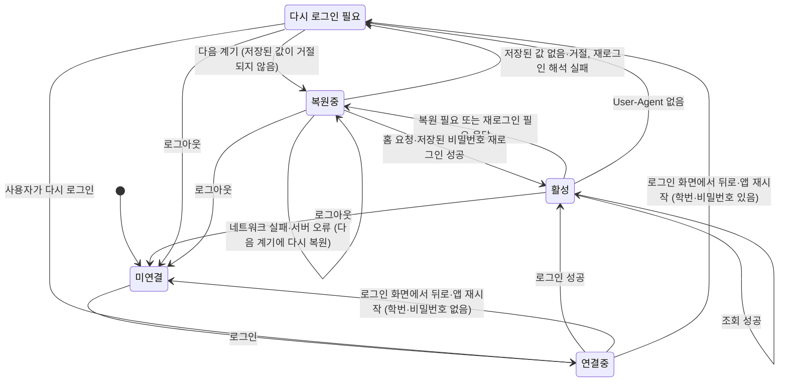

# LMS 연동 규칙

`app/lib/lms/`와 LMS(사이버캠퍼스)를 부르는 코드를 고치기 전에 읽습니다. 공개 레포라서 이 문서에는 동작 규칙만 적습니다. LMS·학교 통합정보시스템의 엔드포인트 경로, 요청 상수, 암호화 키·방식, 판별 표식, 쿠키 이름, 실제 응답은 레포 어디에도 적지 않습니다. 호스트 이름은 공개 정보이지만 레포에는 두지 않고, 로그인 주소·홈 주소·요청 상수·판별 표식·시간표 조회 상수는 Remote Config(`lms_request_params`)에서 받습니다. 앱 안 WebView(LMS 페이지 보기·숨은 복원)가 열 수 있는 주소는 학교 도메인으로 제한하고, 그 값은 코드와 Remote Config에 둡니다.

연결 방식은 폰 직접 연결 하나이고 R0부터 있습니다. PC 브라우저 확장과 중계 서버는 쓰지 않습니다.

## 원칙

- 로그인은 앱 화면(온보딩 1단계와 다시 로그인 화면)에서 학번·비밀번호로 합니다. 로그인에는 앱 안 WebView를 쓰지 않고, 앱 자체의 계정과 회원가입은 없습니다. 로그인 요청 방식은 코드와 Remote Config에만 둡니다.
- 로그인한 학번·비밀번호는 OS 보안 저장소에 늘 저장하고, 세션이 끊기면 그 값으로 조용히 다시 로그인합니다(자동 재로그인). 저장할지 고르는 선택은 두지 않습니다. 학번·비밀번호·쿠키는 LMS·통합정보시스템에만 보내고 앱 서버로는 보내지 않습니다.
- 계정당 세션이 하나라서, 앱이 로그인하거나 자동 재로그인하면 그 순간 PC·웹 등 다른 기기의 LMS 세션이 끊깁니다(서버 정책이라 피할 수 없음). 이 사실은 개인정보 처리 안내와 10 나 › LMS 계정에 적습니다. 반대로 브라우저에서 LMS에 로그인하면 앱의 세션이 풀리고, 그 뒤 앱이 조용히 다시 로그인하면 브라우저 세션이 또 끊깁니다. 이 되풀이를 줄이려고 자동 갱신은 마지막으로 받은 지 3시간(임시)이 지났을 때만 합니다(아래 '호출 예산').
- 앱은 LMS를 읽기만 합니다. 제출·출석은 LMS에서 하고, 앱은 LMS의 값을 바꾸지 않습니다.
- 로그와 오류 보고에는 시각, 계기, 동기화 범위, 판별 종류, HTTP 상태 코드, 걸린 시간, 바뀐 항목 수, 실패한 과목 수, 스키마 검증에 실패한 필드 이름만 남깁니다. URL, 헤더, 본문, 쿠키, 학번, 비밀번호, 과목명, 제목은 남기지 않습니다. `lms/` 밖으로는 예외를 던지지 않고 판별 종류와 상태 코드만 담은 `LmsOutcome`을 `Result`의 `Err`로 돌려주며([architecture.md](architecture.md) '앱 코드 규약'), dio `LogInterceptor`는 쓰지 않습니다.
- 할 일과 마감은 정해진 시간마다 불러오고, 사용자가 새로 고치면 바로 불러옵니다. '정해진 시간마다'는 마지막으로 받은 지 3시간(임시)이 지났을 때이고, 앱을 열 때·앱이 화면에 있는 동안·백그라운드(R1, OS가 깨워 줄 때만)에 이 조건을 봅니다(아래 '동기화'). 화면에는 늘 마지막 확인 시각을 보여 줍니다.

## 로그인

- 처음 로그인은 온보딩 1단계에서 합니다. 로그인 버튼은 학번·비밀번호를 넣고 개인정보 처리 안내에 동의해야 켜집니다. 화면 흐름과 안내의 요지는 [screens.md](screens.md) '14 온보딩'에 있습니다.
- 로그인 요청은 네이티브 요청(dio)으로 보내고, 결과는 로그인 응답으로 나눕니다. 나누는 데 쓰는 표식은 `lms_request_params`에서 받습니다.
- 결과 종류와 앱의 동작:
  - 성공: 로그인에 쓴 User-Agent와 응답의 쿠키는 금고에, 학번·비밀번호는 보안 저장소에 저장하고 `active`로 바꿉니다. 이어서 이번 학기 시간표(아래 '시간표')와 LMS 할 일(전체 동기화)을 불러온 뒤 온보딩 2단계로 갑니다. 로그아웃한 뒤 온보딩 1단계에서 로그인했으면 2–5단계 없이 01 아침 브리핑이나 02 홈으로 갑니다(아래 '로그아웃, 데이터 삭제, 내보내기').
  - 학번·비밀번호 틀림: 저장하지 않고 비밀번호 칸을 비웁니다.
  - 서버 오류·점검, 네트워크 실패: 저장하지 않고 '다시 시도'를 보여 줍니다(점검이면 이유도).
  - 해석 실패: 저장하지 않고 필드 이름만 담은 오류 보고를 남깁니다.
- 시간표만 실패하거나 불러온 수업이 0개일 때의 처리는 아직 정하지 않았습니다.
- 다시 로그인 화면은 저장된 학번을 고정하고 비밀번호만 받습니다. 결과 종류는 처음 로그인과 같습니다. 성공하면 새 비밀번호를 저장하고 할 일만 다시 불러옵니다(아래 '동기화'). 화면은 [screens.md](screens.md) '다시 로그인'에 있습니다.

## 학번·비밀번호와 자동 재로그인

- 학번·비밀번호는 로그인에 성공했을 때만 `flutter_secure_storage`의 키 `lms_credential`에 저장합니다. 비밀번호는 로그인·재로그인에 쓸 때만 메모리에서 읽고, 로그·화면·다른 저장소 어디에도 내보내지 않습니다. 학번은 다시 로그인 화면과 10 나의 가린 학번에도 씁니다.
- 자동 재로그인은 '세션 복원'(아래)의 한 단계입니다. 저장된 학번·비밀번호로 화면 없이 한 번만 시도하고, 성공하면 아무것도 띄우지 않고 조용히 이어서 조회합니다.
- 저장된 비밀번호가 거절되면(비밀번호를 바꾼 경우 등) 사용자가 다시 로그인할 때까지 그 값으로 다시 시도하지 않습니다. 상태를 `reconnectRequired`로 바꿔 '다시 로그인' 칩을 띄우고, 받아 둔 할 일은 그대로 둡니다. 거절 표시는 앱을 다시 켜도 남게 저장하고 다시 로그인에 성공하면 지웁니다. 학교 계정의 잠금 정책(틀린 비밀번호를 몇 번까지 받는지)은 확인하지 않았습니다.
- 보안 저장소에 학번·비밀번호가 없으면 재로그인하지 않고 바로 `reconnectRequired`로 둡니다. 이때 다시 로그인 화면이 학번을 어떻게 받을지는 아직 정하지 않았습니다.
- 앱이 쓰는 LMS 로그인(포털 계정)은 2026-10-26 프로토타입에서 2차 인증 없이 됐습니다. 학외 2차 인증은 학교 포털 사이트에 직접 로그인할 때 요구하는 것으로 봅니다. LMS 로그인에서 예상하지 못한 응답이 오면 '해석 실패'로 다룹니다.
- 학번·비밀번호는 로그아웃과 데이터 삭제 때 지웁니다(아래 '로그아웃, 데이터 삭제, 내보내기').

## 쿠키 금고

- 로그인 응답(네이티브 요청)이 준 쿠키(HttpOnly 포함)를 OS 보안 저장소(금고)에 저장하고, 네이티브 요청은 금고를 그대로 씁니다. 앱 안 WebView(숨은 복원·LMS 페이지 보기)를 열 때 금고의 쿠키를 쿠키 브리지(플랫폼 채널)로 넣습니다. 앱을 시작할 때 금고가 비어 있으면 상태는 `disconnected`입니다.
- 앱 안 WebView에 쿠키를 넣고 꺼낼 때: Android의 `CookieManager.getCookie(url)`는 `이름=값`만 돌려주므로 `lms_request_params`의 쿠키 도메인별로 이름과 값만 읽고, 넣을 때는 `setCookie(url, "이름=값; Path=/; Secure; HttpOnly")`처럼 넣고 `flush()`합니다. 이렇게 꺼낸 쿠키는 원래 속성(Domain, HttpOnly 여부)을 모르므로, 다시 넣어도 LMS 페이지와 로그인 서버가 동작하는지(특히 페이지 스크립트가 읽는 쿠키) 실험 T5에서 확인하고, 문제가 있으면 그 쿠키는 HttpOnly 없이 넣습니다. iOS는 기본 저장소(`WKWebsiteDataStore.default().httpCookieStore`)의 `getAllCookies`로 속성까지 읽고 `setCookie`로 넣습니다. 두 OS 모두 넣기가 끝난 콜백 뒤에만 첫 페이지를 엽니다.
- 금고는 `flutter_secure_storage`의 키 `lms_cookie_vault` 하나에 JSON `{savedAt, userAgent, cookies: [레코드…]}`를 둡니다. 레코드는 [architecture.md](architecture.md) '한눈에 보기'의 쿠키 브리지 채널 레코드 형식이고(Android WebView에서 꺼낸 레코드만 브리지가 채운 기본 속성) 도메인별로 모두 보관합니다. 통합정보시스템(시간표) 호스트의 쿠키도 같은 금고에 도메인별로 둡니다. 쿠키 값은 다른 키나 폰 DB에 두지 않습니다.
- 네이티브 요청은 dio 인터셉터 한 곳에서 금고의 쿠키를 붙이고, 응답에 `Set-Cookie`가 있으면 금고와 WebView 쿠키 저장소에 바로 되돌려 씁니다. 앱 안 WebView를 닫을 때도 WebView 쿠키를 금고로 복사합니다.
- iOS 보안 저장소 접근 수준은 `first_unlock_this_device`입니다.
- 쿠키 금고, WebView 저장소, 폰 DB는 앱 백업과 기기 이전에서 뺍니다. Android는 `allowBackup=false`와 `dataExtractionRules`로 클라우드 백업과 기기 간 이전을 모두 빼고, iOS는 폰 DB와 WebView 데이터 폴더에 백업 제외 속성을 겁니다.
- iOS Keychain 항목은 앱을 지워도 남을 수 있습니다. 앱은 폰 DB의 `settings`에 설치 표식을 두고, 첫 실행 때 표식이 없으면 보안 저장소(쿠키 금고, 저장된 학번·비밀번호, 설치 토큰)를 모두 비운 뒤 표식을 만듭니다. 금고는 그 뒤에만 읽습니다. 두 OS 모두 같은 규칙을 씁니다.
- 설치 표식은 앱 모드와 관계없이 실제 모드의 폰 DB(`app.sqlite`)에서 읽고 씁니다. 데모 DB에는 표식이 없으므로, 데모 DB로 보면 데모 모드로 다시 켤 때마다 실제 계정의 학번·비밀번호·쿠키를 지우게 됩니다. 표식이 없으면 `shared_preferences`의 앱 값(`onboarding_done`, `app_mode`, `demo_entry`)도 함께 지웁니다. iOS 백업 복원과 기기 이전에는 폰 DB와 보안 저장소가 빠지고 이 값만 따라오므로, 새 기기를 첫 설치처럼 온보딩부터 시작하게 하려는 것입니다. 보안 저장소를 비우지 못하면 표식을 적지 않고 다음 실행에 다시 시도하며, 폰 DB를 읽지 못하면 아무것도 지우지 않습니다. 순서는 [architecture.md](architecture.md) '실행 방법'에 있습니다.

## 세션 상태

상태 이름은 Dart enum `LmsSessionState { disconnected, connecting, active, restoring, reconnectRequired }`(도식의 미연결·연결중·활성·복원중·다시 로그인 필요)이고, 값은 폰 DB `settings`에 저장해 백그라운드 isolate도 같은 값을 읽습니다. 전이는 다음뿐입니다.

1. 사용자 행동: '로그인'·'다시 로그인'을 누르면 `connecting`입니다. 로그인이 실패하면 로그인 화면에 머물고 `connecting`에 둡니다. 로그인 화면에서 뒤로 가거나 그 화면에서 앱이 꺼지면(다음 시작 때) 시작 전 상태로 돌아갑니다. 학번·비밀번호가 저장돼 있으면 `reconnectRequired`, 없으면 `disconnected`입니다. 로그아웃은 어느 상태에서든 `disconnected`입니다.
2. 로그인 성공: `connecting` → `active`.
3. 판별 결과 '재로그인 필요'·'복원 필요': `active` → `restoring`. `reconnectRequired`도 저장된 비밀번호가 있고 거절되지 않았으면 다음 동기화 계기에 `restoring`으로 갑니다.
4. 복원(저장된 비밀번호 재로그인 포함) 뒤 재조회가 '정상'·'빈 목록'이면 `restoring` → `active`. 저장된 학번·비밀번호가 없거나 거절되거나, 재로그인 응답이 '해석 실패'이면 `restoring` → `reconnectRequired`. 복원 중 '네트워크 실패'·'서버 오류·점검'이면 `restoring`에 머물고 다음 동기화 계기에 복원을 다시 시도합니다.
5. 그 밖의 판별 결과('정상', '빈 목록', '서버 오류·점검', '네트워크 실패', '해석 실패')는 상태를 바꾸지 않습니다. 쿠키는 있는데 User-Agent가 없으면 `reconnectRequired`입니다.

동기화는 `active`에서만 시작하고, `restoring`에서는 복원 절차만 돕니다.

## 응답 판별

모든 LMS 응답을 일곱 가지 중 하나로 나눕니다.

| 종류 | 판단 | 앱의 동작 |
|---|---|---|
| 정상 | 스키마에 맞는 JSON | 폰 DB 갱신 |
| 빈 목록 | 스키마에 맞고 항목이 0개 | "남은 할 일이 없어요" |
| 재로그인 필요 | 로그인 주소로 넘어가거나 로그인 폼이 담긴 HTML | 세션 복원 시도(저장된 비밀번호 재로그인 포함) |
| 복원 필요 | JSON이지만 인증 오류 표시 | 세션 복원 시도(저장된 비밀번호 재로그인 포함) |
| 서버 오류·점검 | 5xx, 점검 페이지 | 기존 데이터 유지, 원인 표시 |
| 네트워크 실패 | 연결 실패, 시간 초과(연결 10초, 수신 20초) | 기존 데이터 유지. 3초 뒤 1회만 바로 다시 시도하고, 그래도 실패하면 네트워크 실패로 끝냅니다. 연결 상태 감지 라이브러리는 쓰지 않습니다 |
| 해석 실패 | 위 어디에도 맞지 않음, 스키마 검증 실패 | 기존 데이터를 덮어쓰지 않음, 필드 이름만 담은 오류 보고 |

로그인 응답은 위 '로그인'의 결과 종류로 나누고, `LmsOutcome`은 이 일곱 가지에 '학번·비밀번호 틀림'을 더해 담습니다(그 표식은 LMS 연동 때 확인).

로그인 주소로 넘어가지 않았고 로그인 페이지·점검 표식도 없으며 5xx·429도 아닌 HTML은 '재로그인 필요'가 아니라 '해석 실패'입니다.

판별기 입력은 `LmsRawResponse {int? statusCode, Uri? finalUrl, String? contentType, String body}` 하나이고, dio 응답을 이 형태로 바꿔 넣습니다. 네이티브 요청은 리다이렉트를 최대 5회 따라가고, `validateStatus`는 모든 상태 코드를 통과시켜 판별기가 봅니다. 분류 순서는 ① 예외(연결 실패·시간 초과) → 네트워크 실패, ② 5xx·429 또는 본문에 점검 표식 → 서버 오류·점검, ③ 최종 URL이 로그인 주소로 시작하거나 본문에 로그인 페이지 표식 → 재로그인 필요, ④ JSON이고 인증 오류 표식 → 복원 필요, ⑤ JSON이고 스키마 통과 → 정상 또는 빈 목록, ⑥ 나머지(그 밖의 4xx, 표식 없는 HTML, 스키마 실패) → 해석 실패입니다.

판별에 쓰는 표식 문자열(로그인 페이지, JSON 인증 오류, 점검 페이지)과 로그인 주소·홈 주소는 `lms_request_params`에서 받고, 코드와 테스트에는 실제 표식을 적지 않습니다. 판별기는 표식을 생성자 인자로 받고, 테스트는 합성 샘플에 맞춘 테스트 전용 표식을 넣습니다. '로그인 주소로 넘어감'은 최종 URL이 `lms_request_params`의 로그인 주소와 같은 호스트이고 같은 경로로 시작하는지로 판단합니다.

여기서 '스키마'는 `app/lib/lms/`의 Dart 파서가 요구하는 필드 집합입니다. LMS 응답의 JSON Schema 파일은 만들지 않고 `schema/`에도 두지 않습니다. 파서는 필요한 필드만 읽고 모르는 필드는 무시하며, 필요한 필드가 없거나 형이 다를 때만 '해석 실패'로 봅니다.

'해석 실패'의 오류 보고는 R0에서는 `sync_runs`에 결과 종류와 빠진 필드 이름만 남기고, R1부터는 같은 내용만 Crashlytics 비치명 오류로 보냅니다. 응답 본문은 어디에도 남기지 않습니다.

## 응답 해석

- 응답 원문은 메모리에서만 다룹니다. 파서가 뽑은 필드(`lms_items`의 열)만 폰 DB에 쓰고, 그 밖의 필드는 버립니다. 원문을 폰 DB·파일·캐시에 쓰지 않습니다.
- 항목은 제목이 아니라 원본 키(학기·과목·종류·항목 ID)로 구분합니다.
- LMS의 날짜·시각은 모두 한국 시간으로 해석합니다. 문자열에 시간대가 없으면 `+09:00`을 붙여 해석하고, 기기 시간대는 쓰지 않습니다.
- 마감에 날짜만 있으면 그날 23:59로 저장하고 `lms_items`의 `dueTimeUnknown`을 켭니다. `23:59:59`는 23:59로, `24:00`은 다음 날 00:00으로 바꿉니다.
- 할 일 목록 응답에는 종류·제목·과목·마감만 있습니다. 영상 길이·인정 시간·시청 시간·제출·출석 인정은 과목별 상세 조회에서 받습니다(상세 응답의 구조는 아직 확인하지 않았으므로, 이 값들이 없으면 '해석 실패'나 0이 아니라 null로 둡니다). 영상 길이·인정 시간·시청 시간은 각각 따로 저장하고, LMS 쪽 완료는 LMS가 준 제출·출석 인정 값(`submitted`·`officiallyDone`)만 따릅니다. 시청 시간이 없으면 배치 엔진은 출석 인정 시간 전체를 계획에 놓습니다([architecture.md](architecture.md) '도메인 기본값과 배치 엔진'의 2번).
- 공개일이 미래인 항목은 공개일을 채워 저장하고 배치 대상에서 뺍니다.
- 마감·제출·출석 인정 값이 바뀌면 `lms_item_changes`에 이전 값과 새 값을 남깁니다. 앱의 '공부 완료'와 LMS의 제출·출석 인정은 따로 저장합니다. LMS가 제출·출석 인정을 알려 준 할 일은 앱이 묻지 않고 끝낸 일로 봅니다. 이때도 동기화는 `tasks.status`를 바꾸지 않고, 화면과 배치 엔진이 LMS 원본 값을 함께 읽습니다([architecture.md](architecture.md) '폰 DB (drift)').

## 세션 복원

'복원 필요'나 '재로그인 필요'를 받으면 이 순서로 합니다.

1. 홈(`lms_request_params`의 홈 주소)을 화면 없이 dio 네이티브 요청으로 엽니다(리다이렉트 따라감, 금고의 User-Agent와 쿠키). 응답의 `Set-Cookie`를 금고에 반영한 뒤 원래 조회를 한 번 다시 합니다. '정상'·'빈 목록'이면 `active`로 돌아갑니다.
2. 다시 '재로그인 필요'·'복원 필요'이고 앱이 화면에 있으면 숨은 WebView로 홈을 한 번 열고(`onPageFinished`까지) WebView 쿠키를 금고로 복사한 뒤 원래 조회를 다시 합니다. 숨은 WebView는 이 단계 동안만 앱 루트 `Stack`에 `IgnorePointer`로 감싼 1×1 `WebViewWidget`으로 넣고(`app/lib/lms/`가 관리, 터치를 받는 `Opacity(0)` 덮개는 쓰지 않음) 끝나면 뺍니다. 학교 도메인 밖 이동, 새 창, JavaScript 채널은 막고, 15초 안에 홈 도착을 알아채지 못하면 폐기하고 3단계로 갑니다. 백그라운드에서는 건너뜁니다. 앱 화면 로그인에서도 이 단계가 필요한지는 LMS 연동 때 확인합니다.
3. 그래도 '재로그인 필요'·'복원 필요'이고 보안 저장소에 학번·비밀번호가 있으며 거절된 값이 아니면, 저장된 값으로 화면 없이 한 번 로그인하고(네이티브 요청) 성공하면 원래 조회를 다시 해 `active`로 돌아갑니다(되풀이를 줄이는 갱신 간격은 위 '원칙').
4. 학번·비밀번호가 없거나 거절된 값이면, 또는 3단계 결과가 '학번·비밀번호 틀림'·'해석 실패'이면 멈추고 `reconnectRequired`로 바꿉니다. 01 아침 브리핑·03 할 일의 LMS 상태 줄과 02 홈에 '다시 로그인' 칩만 띄우고 팝업이나 알림은 보내지 않습니다(칩 문구와 누르면 여는 화면은 [screens.md](screens.md)의 "LMS 상태 줄과 '다시 로그인'"). 복원 중 '네트워크 실패'·'서버 오류·점검'이면 `restoring`에 머물고 다음 동기화 계기에 1단계부터 다시 합니다.

숨은 WebView와 LMS 페이지 보기 WebView는 모두 플랫폼 기본 쿠키 저장소를 쓰고 따로 만든 저장소는 쓰지 않습니다.

## LMS 페이지 열기

- LMS 페이지(영상·과제·공지)를 여는 길은 할 일 상세와 함께 재설계 예정입니다. 정할 때 지킬 것: 영상 페이지는 앱 안 시청이 출석으로 인정되는지 실험 T10으로 확인할 때까지 외부 브라우저로 열고, 브라우저를 열기 전에 "브라우저에서 LMS에 새로 로그인하면 앱의 LMS 로그인이 풀릴 수 있어요"를 보여 줍니다.
- 앱 안 WebView에는 스크립트를 넣거나 입력값을 읽지 않습니다(`runJavaScript`, `runJavaScriptReturningResult`, `addJavaScriptChannel` 금지). LMS 페이지가 JavaScript로 동작하므로 페이지 자체의 JavaScript는 켭니다(`setJavaScriptMode(JavaScriptMode.unrestricted)`).
- 앱 안 WebView의 이동은 `NavigationDelegate`에서 검사합니다. 학교 도메인 밖 주소는 앱 안에서 열지 않고, LMS 페이지 보기는 외부 브라우저로 넘기며 숨은 복원은 막습니다. `javascript:`·`data:` 스킴은 막습니다. 딥링크로 WebView에 열 주소를 받지 않습니다. 보는 동안의 동기화는 아래 '동기화'를 따릅니다.

## 시간표 (통합정보시스템)

LMS에는 수업 요일·교시가 없어서 시간표는 학교 통합정보시스템에서 받습니다(R0).

- 14 온보딩 1단계에서 로그인할 때(첫 로그인과 로그아웃 뒤 로그인) 이번 학기 시간표 전체를 불러와 `class_slots`에 `source` `auto`로 저장합니다. 첫 로그인이면 온보딩 2단계에서 확인받고, 로그아웃 뒤 로그인이면 2단계를 거치지 않습니다.
- 그 밖에는 13 시간표·고정 일정의 '새로 고침'을 누를 때만 다시 조회합니다. 다시 로그인 화면에서 로그인할 때나 13 시간표·고정 일정을 열 때는 부르지 않고, 주기적으로도 부르지 않습니다. 새 학기에 다시 불러오는 계기는 아직 정하지 않았습니다.
- 새로 고침은 수업마다 불러온 값과 비교합니다. 요일·시각은 늘 비교하고, 사용자가 고친 시간이 불러온 값과 다르면 불러온 값으로 맞출지 묻습니다. 강의실은 학교 쪽에서 바뀌었을 때만 묻고, 사용자가 고친 장소와 실시간 온라인 수업은 그대로 둡니다. 새로 생기거나 없어진 수업(과목 추가·취소)의 처리는 아직 정하지 않았습니다.
- 바뀐 것이 없으면 알리기만 하고, 바뀐 수업은 수업마다 반영할지 묻습니다. 반영하면 빈 시간을 다시 계산해 제안 블록을 다시 놓고(확정 블록은 그대로), 그대로 두면 다음 새로 고침 때 다시 묻습니다. 화면은 [screens.md](screens.md) '13 시간표·고정 일정'에 있습니다.
- 통합정보시스템은 LMS와 호스트·요청 방식이 다릅니다. 조회에 필요한 세션은 LMS 로그인 뒤에 얻고, 구체 방식은 코드와 Remote Config에만 둡니다. 쿠키·세션 토큰은 금고에만 둡니다.
- 조회가 여러 번이면 직렬로 합니다. 학번·성적 등 시간표 밖의 정보는 조회하지 않습니다.
- 불러온 시간표에 수업 시간이 없는 과목(온라인 수업 등)은 필요하면 사용자가 13 시간표·고정 일정에서 직접 넣습니다. 과목별 조회 실패의 표시는 화면이 없어 아직 정하지 않았습니다.

## 동기화

| 계기 | 동작 |
|---|---|
| 로그인 직후 | 이번 학기 시간표(위 '시간표')를 불러온 뒤 전체 동기화 |
| 다시 로그인 직후 | 갱신(`list`). 시간표는 부르지 않습니다 |
| 앱을 열 때(처음 실행과 백그라운드에서 돌아올 때(`AppLifecycleState.resumed`) 모두) | 마지막으로 '정상'이나 '빈 목록'으로 끝난 할 일 목록 조회가 3시간(임시)보다 오래됐으면 갱신(`list`) |
| 앱을 쓰는 동안 | 앱이 화면에 있는 동안에도 위처럼 3시간(임시)이 지나면 갱신(`list`). 하루 횟수 예산이 끝나면 그날은 자동 조회를 멈추고 마지막 확인 시각만 보여 줍니다 |
| 사용자 새로 고침 | 10 나 › LMS 계정, 01 아침 브리핑의 LMS 상태 줄, 03 할 일의 LMS 정보 시트·연결 실패 안내, 20 시스템의 점검 안내에서 새로 고침·다시 시도·다시 확인을 누르면 바로 갱신(`list`). 간격·하루 횟수·조용한 시간을 보지 않고, `sync_runs.trigger`는 `manual`입니다 |
| 백그라운드 (R1) | OS가 깨워 줄 때(workmanager 작업, 서버 신호 푸시(FCM)), 마지막으로 받은 지 3시간(임시)이 지났을 때만. 세션 상태에 따라 아래 문단처럼 하고, 다시 로그인이 필요하면 다음에 앱이 화면에 올 때 '다시 로그인' 칩을 띄웁니다 |

조회 전에 세션 상태를 봅니다. `restoring`이면 먼저 세션 복원(저장된 비밀번호 재로그인 포함)을 하고, 그래도 `active`가 아니면 그 계기의 조회를 건너뛰고 복원에서 받은 판별 종류로 남깁니다. 이 행은 LMS를 불렀으므로 자동 계기면 하루 횟수와 실패 뒤 10분 간격에 셉니다.

동기화 범위는 `SyncScope { full, list, detail }` 셋입니다. '전체 동기화'인 `full`은 과목 목록 → 할 일 목록 → 과목별 상세(직렬)이고, '갱신'인 `list`는 할 일 목록을 받고 할 일이 바뀐 과목만 상세를 이어서 합니다. `detail`은 과목별 상세 조회이고, `list`가 이어서 한 상세도 `detail` 행으로 따로 남기며 `detailMaxPerDay`는 그날 자동 계기(`open`/`periodic`/`background`)로 LMS를 부른 `detail` 행(`skipped` 제외) 수로 셉니다. 할 일 개수만 받는 별도 조회는 없습니다. 결과는 `SyncResult { kind, changedCount, failedCourseIds, duration }`이고, `kind`는 판별 일곱 가지(`normal`, `empty`, `reloginRequired`, `restoreRequired`, `serverError`, `networkFailure`, `parseFailure`)에 `partial`(일부 과목 실패), `skipped`(예산·임대·스위치·조용한 시간·설정 없음처럼 LMS를 부르지 않고 끝난 때), `cancelled`(WebView 열림·스위치 꺼짐으로 중단)를 더한 열 가지입니다. 결과는 범위마다 `sync_runs`에 한 줄로 남기고 `partial`·`failedCourseIds`는 `detail` 행에 적습니다. 화면의 '마지막 확인 시각'은 `settings`의 `lmsLastSuccessAt`이고, `normal`·`empty`·`partial`로 끝난 동기화의 시작 시각입니다.

- 동기화는 한 번에 하나만 돌아갑니다. 잠금은 메모리가 아니라 폰 DB의 `sync_lease` 한 행(`holder`: `foreground`·`background`, `expiresAt`)으로 겁니다. 행이 없거나 `expiresAt`이 지났으면 한 트랜잭션 안에서 자기 것으로 바꿔 넣고, 임대는 5분이며 과목 하나를 끝낼 때마다 다시 5분으로 늘리고, 끝나면 행을 지웁니다. 백그라운드 작업은 다른 Flutter 엔진·isolate에서 돌므로 폰 DB 연결을 따로 열고 닫습니다. 잠금을 잡지 못한 요청은 `skipped`로 끝냅니다. 같은 isolate의 두 번째 요청은 진행 중인 `Future`를 받고, 다른 isolate의 결과는 폰 DB로만 전해지므로 앱이 화면으로 돌아올 때 화면 데이터를 다시 읽습니다.
- 과목 전환은 서버 쪽 상태라 과목별 조회는 직렬로 합니다. 도중에 앱이 꺼지면 다음 실행 때 처음부터 다시 돌립니다.
- 과목별 상세가 일부 과목에서 실패하면 성공한 과목만 갱신하고, 실패한 과목은 `sync_runs`에 과목 ID로만 남겨 화면이 "확인 못 함"을 답니다(결과는 `partial`). 실패한 과목의 항목은 그 동기화에서 연속 미발견 횟수를 올리지 않습니다. 과목 하나에서 '재로그인 필요'나 '복원 필요'가 나오면 그 자리에서 멈추고 세션 복원 절차로 넘어가며, 복원되면 그 과목부터 이어서 합니다.
- 사용자가 앱 안 WebView로 LMS를 보는 동안에는 새 동기화를 시작하지 않고, 진행 중인 동기화는 지금 과목까지만 끝내고 `sync_runs`에 `cancelled`로 남깁니다. WebView를 닫은 뒤에는 위 표의 자동 갱신처럼 마지막으로 받은 지 3시간(임시)이 지났을 때만 갱신(`list`)합니다.
- 네이티브 요청의 User-Agent를 얻는 곳은 앱 화면 로그인에 맞춰 LMS 연동 때 정합니다. 정한 값은 쿠키와 함께 금고에 두고, 문자열을 코드에 적지 않습니다. 금고에 쿠키는 있는데 User-Agent가 없으면 네이티브 요청을 하지 않고 `reconnectRequired`로 둡니다. LMS 공식 앱의 User-Agent나 모바일 로그인 경로는 쓰지 않습니다.
- LMS·통합정보시스템·앱 서버 요청은 모두 HTTPS만 씁니다. 예외는 로컬 에뮬레이터 실행(`--dart-define=API_BASE_URL=http://...`, [architecture.md](architecture.md) '실행 방법')뿐이고, 테스터·스토어 빌드에는 `http://` 주소를 넣지 않습니다. Android는 `network_security_config.xml`의 `cleartextTrafficPermitted="false"`를 매니페스트에 연결하고, iOS는 ATS 기본값(예외 키 없음)을 둡니다. 이 설정은 dio에 적용되지 않으므로 에뮬레이터 때문에 풀거나 debug용 파일을 두지 않습니다. 인증서 검증을 끄거나 완화하는 코드(`badCertificateCallback` 등)는 쓰지 않습니다.
- 동기화는 LMS 원본 테이블만 바꾸고 사용자의 계획은 지우지 않습니다. `lms_items`의 연속 미발견 횟수는 할 일 목록을 받은 동기화(`full`, `list`)가 '정상'이나 '빈 목록'으로 끝났는데 그 항목이 없을 때만 1씩 올리고, 다시 보이면 0으로 되돌립니다. 횟수가 3이 되면 그 할 일을 03 할 일 목록에서 빼고(행은 지우지 않습니다), 연결된 블록은 흐리게 그립니다.

## 호출 예산

아래 값은 임시 기본값이고, 실제 값은 Remote Config(`lms_sync_budget`)에서 받습니다.

- 할 일 목록 자동 갱신(앱 열기·쓰는 동안·백그라운드): 마지막으로 성공한 조회에서 3시간 간격, 실패한 뒤 자동으로 다시 조회할 때도 최소 10분 간격, 하루 최대 8회.
- 과목별 상세: 과목 목록 응답에서 학기 값이 가장 최근(정렬했을 때 가장 큰)인 과목만, 할 일이 바뀌었을 때와 하루 2회 직렬로 돕니다. 학기 값은 응답에서 받아 `courses`의 학기 필드에 그대로 저장하고 코드에 적지 않습니다.
- 통합정보시스템 시간표 조회는 14 온보딩 1단계의 로그인(첫 로그인과 로그아웃 뒤 로그인)과 13 시간표·고정 일정의 '새로 고침' 때만 합니다.
- 사용자 새로 고침(위 '동기화'의 새로 고침·다시 시도·다시 확인과 13 시간표·고정 일정의 '새로 고침')과 로그인·다시 로그인 직후 조회(로그인 때의 시간표 조회 포함)는 간격·하루 횟수·조용한 시간을 보지 않고 바로 하며, 하루 횟수에도 넣지 않습니다.
- 한국 시간 01:00–06:00에는 자동 조회를 하지 않습니다.
- 호출 예산의 하루는 한국 시간 00:00에 시작합니다.
- 학번을 주는 사용자 정보 API는 부르지 않습니다.

`lms_sync_budget`은 JSON 문자열이고 키 이름과 기본값은 [architecture.md](architecture.md) '환경 변수'에 있습니다. `lms_request_params`도 JSON 문자열이고 `version`, 홈 주소, 로그인 주소, 쿠키 도메인 목록, 판별 표식, 조회별 요청 상수, 시간표 조회 상수를 담으며 키 이름은 `app/lib/lms/lms_config.dart`의 설정 파서가 정의합니다. `lms_login_success_pattern`을 앱 화면 로그인에서 어떻게 쓸지는 LMS 연동 때 확인합니다. `lms_sync_budget`을 해석하지 못하면 이 문서의 기본값을 쓰고 `sync_runs`에 남깁니다.

## 원격 스위치

`lms_enabled`는 앱이 화면에 있을 때 Remote Config 실시간 업데이트(`onConfigUpdated` → `activate()` 뒤 다시 읽음)로 받습니다. 앱 시작 때는 `runApp` 뒤에 `fetchAndActivate()`를 부르고(화면은 기다리지 않음), 앱 열기 계기의 동기화는 그 결과(시간 초과 5초 포함)를 기다린 뒤 시작합니다. 백그라운드 동기화도 먼저 `fetchAndActivate()`를 부릅니다. `minimumFetchInterval`은 15분, `fetchTimeout`은 5초이고, 가져오기가 실패하면 마지막으로 활성화된 값을 씁니다. `false`가 되면(앱이 켜져 있으면 바로, 아니면 다음 실행 때) 새 조회를 시작하지 않고, 진행 중인 동기화는 지금 과목까지만 끝내 `sync_runs`에 `cancelled`로 남기며, 폰 DB의 기존 데이터와 나머지 기능은 그대로 둡니다. 학교가 요청하면 그날 끕니다. 꺼져 있으면 로그인도 LMS 접속이라 온보딩 1단계 로그인과 다시 로그인을 막고 'LMS 연동을 잠시 멈췄어요'를 보입니다. 그동안 로그인하지 않은 사람(처음 쓰는 사람과 로그아웃한 사람)은 '로그인 없이 둘러보기'(데모)만 쓸 수 있습니다.

LMS 관련 Remote Config 값(`lms_*`)은 `app/lib/lms/lms_config.dart` 한 곳에서 읽고(백그라운드 isolate도 `Firebase.initializeApp()` 뒤 같은 파일로), 앱 기본값(`setDefaults`)은 `app/lib/data/remote_config.dart`가 넣습니다. 앱 안 기본값은 `lms_enabled=true`, `lms_request_params=""`, `lms_login_success_pattern=""`, `lms_sync_budget`은 이 문서의 기본값입니다. `lms_request_params`가 비어 있거나 JSON 파싱·`version` 검사에 실패하거나 학교 도메인 밖 호스트를 가리키면 '설정 없음'으로 봅니다. 이때는 스위치가 켜져 있어도 조회하지 않고, 로그인 버튼을 비활성으로 두고 "설정을 받는 중이에요"를 보여 주며, `sync_runs`에 `skipped`로 남깁니다.

앱 버전이 Remote Config `min_app_version`보다 낮으면(R1) LMS 조회를 멈추고 업데이트 화면을 보여 줍니다. 학번·비밀번호와 폰 데이터는 그대로 둡니다. 화면은 [screens.md](screens.md) '20 시스템'에 있습니다.

## 로그아웃, 데이터 삭제, 내보내기

- 10 나 › LMS 계정의 '로그아웃'은 이 폰에서 학번·비밀번호, 쿠키 금고, WebView 저장소와 함께 불러온 시간표(`class_slots`의 `source` `auto`)와 거기에 붙은 수업 예외, LMS 할 일(LMS 원본, 그 할 일의 블록과 걸린 시간 기록)을 지웁니다. 직접 넣은 일정·고정 일정·수업·할 일과 내 규칙은 남깁니다. LMS 과목(`courses`)과 `lms_item_changes`·`sync_runs`는 지우지 않습니다. 그 뒤 상태를 `disconnected`로 두고 14 온보딩 1단계로 갑니다. 거기서 로그인하면 시간표와 할 일을 새로 불러오고, 2–5단계는 다시 거치지 않습니다. 로그인하기 전에 앱을 다시 켜도 1단계가 열립니다.
- 10 나 › 데이터의 '데이터 삭제'는 폰 DB 전부, 보안 저장소(학번·비밀번호, 쿠키 금고, 설치 토큰), WebView 저장소, `shared_preferences`의 앱 값(온보딩 완료·앱 모드 등)을 지웁니다. 재설계 예정 기능의 데이터(예약된 알림·위젯)도 지웁니다. 되돌릴 수 없습니다. 그 뒤 첫 실행처럼 설치 표식과 설치 토큰을 새로 만들고 14 온보딩 1단계로 갑니다.
- 데이터 내보내기·가져오기(R1)의 파일에는 학번·비밀번호, 쿠키 금고, 설치 토큰, LMS 연동 상태를 넣지 않습니다. 가져온 뒤에는 다시 로그인해야 하고, 14 온보딩 1단계와 다시 로그인 화면 가운데 어디서 할지는 아직 정하지 않았습니다.

## 테스트

- 응답 판별·해석 테스트에는 `app/test/lms/fixtures/`의 합성 샘플만 씁니다. 파일 이름은 `<판별 종류>_<상황>.<json|html>`입니다. 필드 이름·중첩·타입은 실제 응답과 같게 하되 값은 모두 지어낸 것이어야 하고, 호스트는 `example.invalid`, 과목명은 `과목A`, ID는 1부터 시작하는 숫자로 둡니다. 실제 과목명·교수명·항목 ID·학기 코드·이름·학번을 옮겨 적지 않고, 사용자 정보 필드는 샘플에서 뺍니다. 실제 응답을 복사해 값만 가리는 방식은 쓰지 않고, 샘플에 `Cookie`·`Set-Cookie` 헤더와 JWT 모양 문자열을 넣지 않습니다. 실제 LMS·통합정보시스템 응답, 쿠키, 비밀번호, 학번은 커밋하지 않습니다. PR의 `leak-check`가 `app/test/**/fixtures/`에 추가된 줄에서 `example.invalid` 밖 호스트나 학번 꼴 숫자(20으로 시작하는 9자리)를 찾으면 실패합니다.
- 로그인 테스트에도 실제 학번·비밀번호를 쓰지 않고 합성 값만 씁니다.
- LMS 연동을 실기기로 시험할 때는 본인 계정으로만 합니다. 기기는 본인 폰이나 팀 공기계를 씁니다. 조회 간격은 5분 이상, 계정당 하루 30회 이하로 둡니다.
- 실험 기록에는 시각과 응답 종류만 적습니다.
