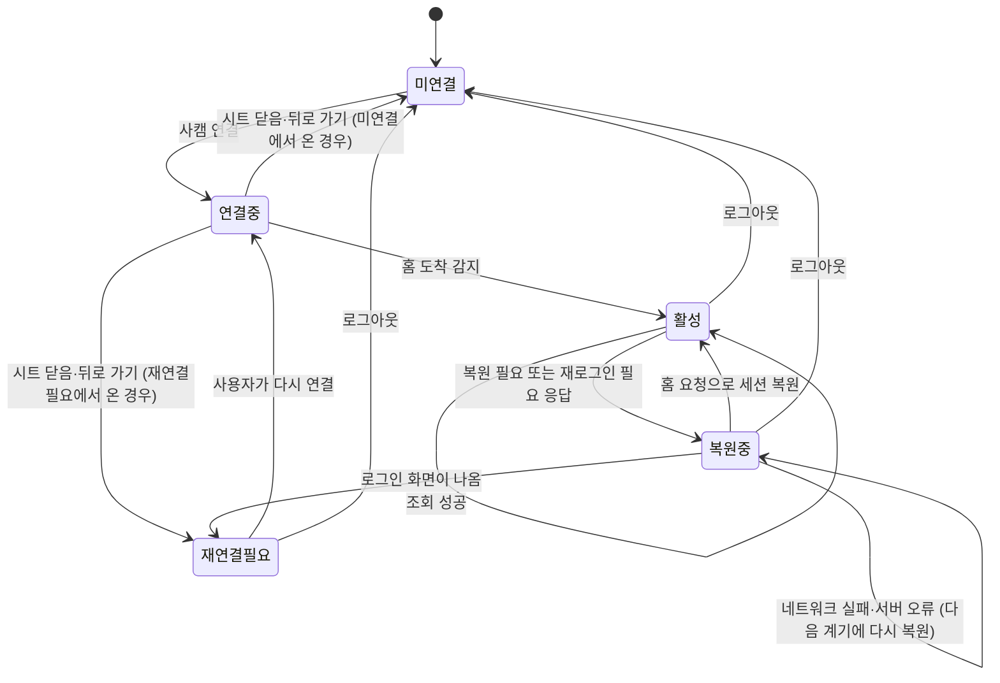

# 사캠 연동 규칙

`app/lib/lms/`와 사캠을 부르는 코드를 고치기 전에 읽습니다. 공개 레포라서 이 문서에는 동작 규칙만 적습니다. 사캠 엔드포인트 경로, 요청 상수, 판별 표식, 실제 응답은 레포 어디에도 적지 않습니다. 호스트 이름은 공개 정보이므로 코드에 둘 수 있고, 두는 곳은 확장 manifest의 호스트 권한뿐입니다. 로그인 시트가 여는 홈 주소, 로그인 주소, 요청 상수, 판별 표식은 Remote Config(`lms_request_params`)에서 받고, 홈에서 로그인 페이지로 넘기는 것은 사캠이 합니다. 사캠 홈을 열면 로그인 서버 호스트로 넘어가므로 앱 안 WebView(R1)의 이동 허용 목록은 호스트 하나가 아니라 학교 도메인(`*.cnu.ac.kr`)으로 둡니다. R0의 사캠 연결은 PC 확장뿐입니다. '로그인', '쿠키 금고', '세션 상태', '세션 복원' 절과 '사캠 페이지 열기'의 앱 안 WebView, '동기화' 절의 사캠 직접 조회는 R1(폰 직접 연결)부터 적용합니다. '응답 판별', '응답 해석', '호출 예산', '원격 스위치', 'PC 확장', '테스트' 절은 R0부터 적용합니다.

## 원칙

- 로그인은 늘 사용자가 앱 안 WebView에 띄운 사캠 공식 로그인 화면에서 직접 합니다.
- 앱은 비밀번호를 읽지도, 저장하지도 않습니다. 자동으로 다시 로그인하지 않습니다. 계정당 세션이 하나라면 앱의 로그인이 PC에서 보던 영상강의 세션을 끊기 때문입니다.
- 사캠 쿠키와 학번은 그 기기(폰, PC 브라우저) 밖으로 나가지 않습니다. 응답 원문은 PC 확장이 폰으로 보낼 때만, 폰만 풀 수 있는 암호문으로 서버를 거칩니다. 셋 다 로그, 크래시 리포트, 레포 어디에도 남기지 않습니다.
- 로그와 오류 보고에 남기는 것은 시각, 계기, 동기화 범위, 판별 종류, HTTP 상태 코드, 걸린 시간, 바뀐 항목 수, 실패한 과목 수, 스키마 검증에 실패한 필드 이름뿐입니다. URL, 헤더, 본문, 쿠키, 학번, 과목명, 제목은 남기지 않습니다. `lms/` 밖으로는 예외를 던지지 않고 판별 종류와 상태 코드만 담은 `LmsOutcome`을 `Result`의 `Err`로 돌려주며([architecture.md](architecture.md) '앱 코드 규약'), dio `LogInterceptor`는 쓰지 않습니다.
- 기본 연결 방식은 PC 확장(R0)입니다. 폰 앱 안에서 사캠 세션을 오래 유지하는 것은 현실적으로 어렵기 때문입니다. PC 연결의 약속은 "PC에서 사캠에 접속할 때마다 최신"이고, 폰 직접 연결(R1, 보조)의 약속은 "앱을 열면 최신"입니다. 백그라운드 갱신은 세션이 살아 있을 때만 하는 덤입니다.

## 로그인 (R1)

- 로그인 성공은 URL(사캠 홈 도착)로만 판단합니다. `lms_login_success_pattern`은 Dart `RegExp` 문자열이고 전체 URL에 `hasMatch`로 맞춥니다. `NavigationDelegate.onUrlChange`와 `onPageFinished` 둘 다에서 검사하고 먼저 맞는 쪽이 성공입니다. 성공을 알아채면 그 페이지의 `onPageFinished`를 기다린 뒤 ① 쿠키 브리지로 쿠키를 읽어 금고에 저장하고 ② `WebViewController.getUserAgent()` 값을 금고에 함께 저장한 뒤 ③ 시트를 닫고 상태를 `active`로 바꾸고 ④ 전체 동기화를 시작합니다.
- 로그인 페이지에 스크립트를 넣거나 입력값을 읽지 않습니다(`runJavaScript`, `runJavaScriptReturningResult`, `addJavaScriptChannel` 금지). 페이지 자체의 JavaScript는 켭니다(`setJavaScriptMode(JavaScriptMode.unrestricted)`). 사캠 로그인 페이지가 JavaScript로 동작하기 때문입니다.
- 대학 선택과 2차 인증은 사용자가 직접 합니다. 대신 누르지 않습니다.
- 로그인 시트에는 지금 열린 주소와 "충남대 비공식 앱"을 늘 보여 줍니다. 유리(blur) 효과는 쓰지 않습니다.
- 로그인 시트와 앱 안 WebView는 `NavigationDelegate`에서 이동을 검사합니다. 학교 도메인(`*.cnu.ac.kr`) 밖 주소는 앱 안 WebView에서 열지 않습니다. 로그인 시트에서는 그 이동을 막고, 사캠 페이지 보기 WebView에서는 외부 브라우저로 넘깁니다. `javascript:`·`data:` 스킴은 막습니다. Remote Config 값이 학교 도메인 밖 호스트를 가리키면 무시합니다. 시트에 보여 주는 주소는 `NavigationDelegate`가 준 현재 URL의 호스트이고, 페이지 내용이나 제목에서 읽지 않습니다. 딥링크로 WebView에 열 주소를 받지 않습니다.
- 로그인·재연결 시트 위에 "PC에서 사캠 강의를 보고 있다면 그쪽 로그인이 풀릴 수 있어요"를 늘 보여 줍니다.
- 60초는 로그인 주소(`lms_request_params`)가 아닌 페이지의 로드가 끝난 때(`onPageFinished`)부터 재고, 페이지가 또 바뀌면 다시 잽니다. 로그인 페이지에 머무는 동안은 재지 않습니다. 60초 안에 성공 패턴이 맞지 않으면 시트는 그대로 둔 채 시트 위에 "연결이 끝나지 않았어요"와 '다시 시도'를 보여 주고, '다시 시도'는 시트 안에서 홈 주소를 다시 엽니다. 상태는 `connecting`에 머뭅니다. 사용자가 시트를 닫거나 뒤로 가면 취소로 처리해 시트를 열기 전 상태(`disconnected` 또는 `reconnectRequired`)로 돌아가고 "다시 시도"를 보여 줍니다.
- 로그인 시트에서 페이지 로드가 실패하면(`NavigationDelegate.onWebResourceError`에서 `isForMainFrame`이 true. iOS의 취소 오류(`errorCode` -999)는 다른 이동에 밀려난 것이므로 실패로 보지 않습니다) 시트는 그대로 둔 채 시트 위에 "페이지를 열 수 없어요. 연결을 확인해 주세요"와 '다시 시도'를 보여 주고, 상태는 `connecting`에 둡니다. 이때 60초는 재지 않습니다(Android는 실패한 페이지에도 `onPageFinished`가 오므로 그 호출로 60초를 시작하지 않습니다). '다시 시도'는 시트 안에서 홈 주소를 다시 엽니다. 시트를 닫거나 뒤로 가면 위의 취소 규칙과 같습니다. 로그에는 `errorType` 이름만 남기고 URL과 `description`은 화면과 로그 어디에도 적지 않습니다.

## 쿠키 금고 (R1)

이 절의 규칙 가운데 iOS 보안 저장소 접근 수준, 폰 DB의 백업 제외, 설치 표식으로 보안 저장소를 비우는 규칙은 R0부터 적용합니다. 설치 토큰, PC 연결 키·토큰, 폰 DB가 R0부터 있기 때문입니다.

- 로그인 직후 WebView 쿠키(HttpOnly 포함)를 쿠키 브리지(플랫폼 채널)로 읽어 OS 보안 저장소(금고)에 복사합니다. Android의 `CookieManager.getCookie(url)`는 `이름=값`만 돌려주므로(속성 없음) `lms_request_params`의 쿠키 도메인별로 이름과 값만 읽고(나머지 속성은 브리지가 기본값으로 채웁니다), 복원할 때 `setCookie(url, "이름=값; Path=/; Secure; HttpOnly")`로 넣은 뒤 `flush()`합니다. 원래 속성(Domain, HttpOnly 여부)을 알 수 없으므로, 이렇게 되돌린 쿠키로 사캠 페이지와 로그인 서버가 그대로 동작하는지(특히 페이지 스크립트가 읽는 쿠키가 있는지) 실험 T5에서 확인하고, 문제가 있으면 그 쿠키는 HttpOnly 없이 되돌립니다. Android WebView는 앱을 다시 켜도 세션 쿠키를 스스로 되살리므로 이 복원은 WebView 저장소가 비었을 때만 씁니다. iOS는 webview_flutter가 쓰는 기본 저장소(`WKWebsiteDataStore.default().httpCookieStore`)의 `getAllCookies`로 도메인·경로·만료·HttpOnly 속성까지 읽어 그대로 저장하고 `setCookie`로 되돌립니다. 두 OS 모두 복원 완료 콜백이 끝난 뒤에만 첫 요청을 보냅니다.
- 금고는 `flutter_secure_storage`의 키 `lms_cookie_vault` 하나에 JSON `{savedAt, userAgent, cookies: [레코드…]}`를 둡니다. 레코드는 [architecture.md](architecture.md) 쿠키 브리지 채널의 레코드 형식이고(Android는 브리지가 채운 기본 속성, iOS는 실제 속성) 도메인별로 모두 보관합니다. 쿠키 값은 다른 키나 폰 DB에 두지 않습니다.
- 네이티브 요청은 dio 인터셉터 한 곳에서 금고의 쿠키를 붙이고, 응답에 `Set-Cookie`가 있으면 금고와 WebView 쿠키 저장소에 바로 되돌려 씁니다. 앱 안 WebView(로그인·숨은 복원·페이지 보기)를 닫을 때도 WebView 쿠키를 금고로 복사합니다.
- 앱이 다시 켜지면 금고의 쿠키를 쿠키 브리지로 WebView에 넣고, 네이티브 요청은 금고를 그대로 씁니다. 금고가 비어 있으면 상태는 `disconnected`입니다.
- iOS 보안 저장소 접근 수준은 `first_unlock_this_device`입니다.
- 쿠키 금고, WebView 저장소, 폰 DB는 앱 백업과 기기 이전에서 뺍니다. Android는 `allowBackup=false`와 함께 `dataExtractionRules`에서 클라우드 백업과 기기 간 이전을 모두 빼고, iOS는 폰 DB와 WebView 데이터 폴더에 백업 제외 속성을 겁니다. 로그아웃하면 셋 다 지웁니다.
- iOS Keychain 항목은 앱을 지워도 남을 수 있습니다. 앱은 폰 DB의 `settings`에 설치 표식을 두고, 첫 실행 때 표식이 없으면 보안 저장소(쿠키 금고, 설치 토큰, PC 연결 키·토큰)를 모두 비운 뒤 표식을 만듭니다. 금고의 쿠키 복원은 그 뒤에만 합니다. 두 OS 모두 같은 규칙을 씁니다.

## 세션 상태 (R1)

상태 이름은 Dart enum `LmsSessionState { disconnected, connecting, active, restoring, reconnectRequired }`(도식의 미연결·연결중·활성·복원중·재연결필요)이고, 값은 폰 DB `settings`에 저장해 백그라운드 isolate도 같은 값을 읽습니다. 전이는 다음뿐입니다.

1. 사용자 행동: '사캠 연결'·'다시 연결'을 누르면 `connecting`. 로그인 시트를 닫거나 뒤로 가면 시트를 열기 전 상태(`disconnected` 또는 `reconnectRequired`)로 돌아가고 "다시 시도"를 보여 줍니다. 로그아웃은 어느 상태에서든 `disconnected`입니다.
2. 로그인 성공 URL 감지: `connecting` → `active`.
3. 판별 결과 '재로그인 필요'·'복원 필요': `active` → `restoring`.
4. 복원 뒤 재조회가 '정상'·'빈 목록'이면 `restoring` → `active`. 복원 중 로그인 화면이 나오면 `restoring` → `reconnectRequired`. 복원 중 '네트워크 실패'·'서버 오류·점검'이면 `restoring`에 머물고 다음 동기화 계기에 복원을 다시 시도합니다.
5. 그 밖의 판별 결과('정상', '빈 목록', '서버 오류·점검', '네트워크 실패', '해석 실패')는 상태를 바꾸지 않습니다.

동기화는 `active`에서만 시작하고, `restoring`에서는 복원 절차만 돕니다.

## 응답 판별

모든 사캠 응답을 일곱 가지 중 하나로 나눕니다.

| 종류 | 판단 | 앱의 동작 |
|---|---|---|
| 정상 | 스키마에 맞는 JSON | 폰 DB 갱신 |
| 빈 목록 | 스키마에 맞고 항목이 0개 | "남은 할 일이 없어요" |
| 재로그인 필요 | 로그인 주소로 넘어가거나 로그인 폼이 담긴 HTML | 폰 직접 연결(R1)은 세션 복원 시도. PC 묶음(R0)은 기존 데이터를 두고 마지막 확인 시각을 보여 줍니다(세션 되살리기는 확장이 합니다) |
| 복원 필요 | JSON이지만 인증 오류 표시 | 폰 직접 연결(R1)은 세션 복원 시도. PC 묶음(R0)은 기존 데이터를 두고 마지막 확인 시각을 보여 줍니다(세션 되살리기는 확장이 합니다) |
| 서버 오류·점검 | 5xx, 점검 페이지 | 기존 데이터 유지, 원인 표시 |
| 네트워크 실패 | 연결 실패, 시간 초과(연결 10초, 수신 20초) | 기존 데이터 유지. 3초 뒤 1회만 바로 다시 시도하고, 그래도 실패하면 네트워크 실패로 끝냅니다. 연결 상태 감지 라이브러리는 쓰지 않습니다 |
| 해석 실패 | 위 어디에도 맞지 않음, 스키마 검증 실패 | 기존 데이터를 덮어쓰지 않음, 필드 이름만 담은 오류 보고 |

로그인 주소로 넘어가지 않았고 로그인 페이지·점검 표식도 없으며 5xx·429도 아닌 HTML은 '재로그인 필요'가 아니라 '해석 실패'입니다.

판별기 입력은 `LmsRawResponse {int? statusCode, Uri? finalUrl, String? contentType, String body}` 하나이고, dio 응답(R1, 폰 직접 연결)과 PC 확장이 보낸 원문(R0) 모두 이 형태로 바꿔 넣습니다. PC 묶음은 `status`를 `statusCode`로 넣고, `status`가 0이면 `finalUrl`에 로그인 주소를 넣어 판별합니다. 네이티브 요청은 리다이렉트를 최대 5회 따라가고 `validateStatus`는 모든 상태 코드를 통과시켜 판별기가 봅니다. 분류 순서는 ① 예외(연결 실패·시간 초과) → 네트워크 실패, ② 5xx·429 또는 본문에 점검 표식 → 서버 오류·점검, ③ 최종 URL이 로그인 주소로 시작하거나 본문에 로그인 페이지 표식 → 재로그인 필요, ④ JSON이고 인증 오류 표식 → 복원 필요, ⑤ JSON이고 스키마 통과 → 정상 또는 빈 목록, ⑥ 나머지(그 밖의 4xx, 표식 없는 HTML, 스키마 실패) → 해석 실패입니다.

판별에 쓰는 표식 문자열(로그인 페이지, JSON 인증 오류, 점검 페이지)과 로그인 주소·홈 주소는 `lms_request_params`에서 받습니다. 코드와 테스트에는 실제 표식을 적지 않습니다. 판별기는 표식을 생성자 인자로 받고, 테스트는 합성 샘플에 맞춘 테스트 전용 표식을 넣습니다. '로그인 주소로 넘어감'은 최종 URL이 `lms_request_params`의 로그인 주소와 같은 호스트이고 같은 경로로 시작하는지로 판단합니다.

여기서 '스키마'는 `app/lib/lms/`의 Dart 파서가 요구하는 필드 집합입니다. 사캠 응답의 JSON Schema 파일은 만들지 않고 `schema/`에도 두지 않습니다. 파서는 필요한 필드만 읽고 모르는 필드는 무시하며, 필요한 필드가 없거나 형이 다를 때만 '해석 실패'로 봅니다.

'해석 실패'의 오류 보고는 R0에서는 `sync_runs`에 결과 종류와 빠진 필드 이름만 남기고, R1부터는 같은 내용만 Crashlytics 비치명 오류로 보냅니다. 응답 본문은 어디에도 남기지 않습니다.

## 응답 해석

- 응답 원문은 메모리에서만 다룹니다. 파서가 뽑은 필드(`lms_items`의 열)만 폰 DB에 쓰고, 그 밖의 필드는 버립니다. 원문을 폰 DB·파일·캐시에 쓰지 않습니다. PC 연결로 받은 암호문도 풀어 해석한 뒤 바로 버립니다(R0).
- 항목은 제목이 아니라 원본 키(학기·과목·종류·항목 ID)로 구분합니다.
- 사캠의 날짜·시각은 모두 한국 시간으로 해석합니다. 문자열에 시간대가 없으면 `+09:00`을 붙여 해석하고, 기기 시간대는 쓰지 않습니다.
- 마감에 날짜만 있으면 그날 23:59로 저장하고 `lms_items`의 `dueTimeUnknown`을 켭니다. `23:59:59`는 23:59로, `24:00`은 다음 날 00:00으로 바꿉니다.
- 영상 진도 필드가 없으면 시청 시간을 null로 둡니다. 0으로 바꾸지 않습니다. 영상 길이·인정 시간·시청 시간은 각각 따로 저장하고, 완료 여부는 공식 완료 필드만 따릅니다.
- 공개일이 미래인 항목은 공개일을 채워 저장하고 배치 대상에서 뺍니다.
- 마감·제출·완료 값이 바뀌면 `lms_item_changes`에 이전 값과 새 값을 남깁니다. 앱의 '공부 완료'와 사캠의 '제출·출석 완료'는 따로 저장합니다.

## 세션 복원 (R1)

'복원 필요'나 '재로그인 필요'를 받으면 이 순서로 합니다.

1. 홈(`lms_request_params`의 홈 주소)을 화면 없이 dio 네이티브 요청으로 엽니다(리다이렉트 따라감, 금고의 User-Agent와 쿠키). 응답의 `Set-Cookie`를 금고에 반영한 뒤 원래 조회를 한 번 다시 합니다. '정상'·'빈 목록'이면 `active`로 돌아갑니다.
2. 다시 '재로그인 필요'·'복원 필요'이고 앱이 화면에 있으면 숨은 WebView로 홈을 한 번 연 뒤(`onPageFinished`까지) WebView 쿠키를 금고로 복사하고 원래 조회를 다시 합니다. 숨은 WebView는 2단계를 도는 동안만 앱 루트 `Stack`에 `IgnorePointer`로 감싼 1×1 크기 `WebViewWidget` 하나로 넣고 `app/lib/lms/`가 관리하며, 끝나면 바로 뺍니다. `Opacity(0)`으로 화면을 덮는 방식은 터치를 받으므로 쓰지 않습니다. 학교 도메인 밖 이동, 새 창, JavaScript 채널은 막고, 15초 안에 홈 도착을 알아채지 못하면 폐기하고 3단계로 갑니다. 백그라운드에서는 이 단계를 건너뛰고 `restoring`에 머문 채 끝내며, 다음에 앱이 화면에 올 때 2단계부터 이어서 합니다.
3. 그래도 로그인 화면이 나오면 멈추고 `reconnectRequired`로 바꿉니다. 홈 위에 재연결 칩("사캠 정보 3시간 전 · 다시 연결")만 띄우고, 칩을 누르면 재연결 시트(앱 안 WebView의 공식 로그인 화면, 로그인 절의 규칙과 같음)가 뜹니다. 팝업이나 알림은 보내지 않습니다. 복원 중 '네트워크 실패'·'서버 오류·점검'이면 `restoring`에 머물고 다음 동기화 계기에 1단계부터 다시 합니다.

로그인 시트, 숨은 WebView, 사캠 페이지 보기 WebView는 모두 플랫폼 기본 쿠키 저장소를 쓰고 따로 만든 저장소는 쓰지 않습니다.

## 사캠 페이지 열기

R0는 사캠 페이지를 외부 브라우저로 엽니다. 아래는 폰 직접 연결(R1)을 쓸 때입니다.

- 과제·공지·자료 페이지는 같은 쿠키를 쓰는 앱 안 WebView로 엽니다. 외부 브라우저에서 새로 로그인하면 앱 세션이 끊길 수 있습니다.
- 영상강의 페이지는 외부 브라우저로 열고 "브라우저에서 새로 로그인하면 앱 연결이 풀릴 수 있어요"를 보여 줍니다.

## 동기화

R0 폰의 동기화는 PC 묶음 받기입니다. 앱을 열 때, 앱을 쓰는 동안 15분마다, PC 연결 직후 `GET /v1/relay/{pairId}`로 묶음을 받아 같은 해석 코드로 적용합니다. 같은 묶음은 한 번만 적용합니다(`fetchedAt`이 마지막으로 받은 묶음과 같거나 오래되면 적용하지 않습니다). 사캠은 부르지 않습니다. 응답 판별·해석·호출 예산·원격 스위치·PC 확장 규칙은 R0부터 씁니다.

아래 표의 행은 폰 직접 연결(R1)의 계기입니다. '전날 밤'만 사캠을 부르지 않는 브리핑 초안 작업이라 R0부터 합니다.

| 계기 | 동작 |
|---|---|
| 로그인 직후 | 전체 동기화 |
| 앱을 열 때(처음 실행과 백그라운드에서 돌아올 때(`AppLifecycleState.resumed`) 모두) | 마지막으로 '정상'이나 '빈 목록'으로 끝난 할 일 목록 조회가 10분보다 오래됐으면 갱신(`list`) |
| 앱을 쓰는 동안 | 앱이 화면에 있을 때만 15분마다 갱신(`list`)을 합니다. 하루 24회 예산에 넣어 세고, 예산이 끝나면 그날은 조회를 멈추고 마지막 확인 시각만 보여 줍니다 |
| 전날 밤 | 앱이 백그라운드로 갈 때(`AppLifecycleState.paused`)마다 폰 DB의 사캠 원본으로 내일 브리핑의 사실 JSON을 다시 만들고 브리핑 알림을 다시 예약합니다. 사실 JSON이 직전 초안과 같으면 다시 만들지 않습니다. AI 문장은 20:00 이후 처음 백그라운드로 갈 때 하루 한 번만 부르고, 그 뒤 사실이 바뀌면 템플릿 문장으로 다시 만듭니다. 사캠 조회는 하지 않으며 `features/briefing`이 맡습니다 |
| 백그라운드 (R1) | OS가 깨워 줄 때(workmanager). 폰 직접 연결은 세션이 `active`일 때만 사캠을 부릅니다(`restoring`이면 세션 복원 1단계만). PC 묶음 적용과 새 할 일 푸시(`data.type` `relay`)는 세션 상태와 관계없이 합니다 |

동기화 범위는 `SyncScope { full, list, detail }` 셋입니다. `full`은 과목 목록 → 할 일 목록 → 과목별 상세(직렬), `list`는 할 일 목록을 받고 할 일이 바뀐 과목만 상세를 이어서 합니다. '전체 동기화'는 `full`, '갱신'은 `list`입니다. `detail`은 폰 직접 연결(R1)의 과목별 상세 조회입니다. `list`가 상세를 이어서 하면 그 부분은 `detail` 행으로 따로 남기고, `detailMaxPerDay`는 그날 `trigger`가 `pc`가 아닌 `detail` 행 수로 셉니다. PC 묶음 적용은 늘 전체 묶음이므로 `trigger` `pc`, `scope` `full`로 남기고, 폰 직접 연결의 호출 예산(`listMinIntervalMin`·`listMaxPerDay`·`detailMaxPerDay`)과 앱을 열 때 보는 '마지막 할 일 목록 조회'는 `trigger`가 `pc`가 아닌 행만 셉니다. 할 일 개수만 받는 별도 조회는 없습니다. 결과는 `SyncResult { kind, changedCount, failedCourseIds, duration }`이고 `kind`는 판별 일곱 가지(`normal`, `empty`, `reloginRequired`, `restoreRequired`, `serverError`, `networkFailure`, `parseFailure`)에 `partial`(일부 과목 실패), `skipped`(예산·임대·스위치·조용한 시간·설정 없음), `cancelled`(WebView 열림·스위치 꺼짐으로 중단)를 더한 열 가지입니다. 결과는 범위마다 `sync_runs`에 한 줄로 남깁니다(`list`가 이어서 한 상세는 `detail` 행이고, `partial`·`failedCourseIds`는 그 `detail` 행에 적습니다). 화면의 '마지막 확인 시각'은 `settings`의 `lmsLastSuccessAt`에서 읽습니다. 폰 직접 연결은 `normal`·`empty`·`partial`로 끝난 동기화의 시작 시각을, PC 연결은 `normal`·`empty`·`partial`로 적용한 마지막 묶음의 `fetchedAt`을 이 키에 적습니다. 두 연결이 함께 켜져 있으면(R1 `lmsPhoneFallback`) 이 키는 지금 값보다 늦을 때만 바꿉니다.

- 동기화는 한 번에 하나만 돌아갑니다. 잠금은 메모리가 아니라 폰 DB의 `sync_lease` 한 행(`holder`: `foreground`·`background`, `expiresAt`)으로 겁니다. 시작할 때 행이 없거나 `expiresAt`이 지났으면 한 트랜잭션 안에서 자기 것으로 바꿔 넣고, 임대 시간은 5분이며 과목 하나를 끝낼 때마다 5분으로 다시 늘립니다. 끝나면 행을 지웁니다. 백그라운드 작업은 다른 Flutter 엔진·isolate에서 돌기 때문에 거기서는 폰 DB 연결을 따로 열고 끝나면 닫습니다. 잠금을 잡지 못한 요청은 새로 돌리지 않고 `skipped`로 끝냅니다. 같은 isolate 안의 두 번째 요청은 진행 중인 `Future`를 그대로 받고, 다른 isolate의 결과는 폰 DB로만 전달되므로 앱이 화면으로 돌아올 때 화면 데이터를 다시 읽습니다.
- 과목 전환은 서버 쪽 상태라 과목별 조회는 직렬로 합니다. 도중에 앱이 꺼지면 다음 실행 때 처음부터 다시 돌립니다.
- 과목별 상세가 일부 과목에서 실패하면 성공한 과목만 갱신하고, 실패한 과목은 `sync_runs`에 과목 ID로만 남겨 화면이 "확인 못 함"을 답니다(결과는 `partial`). 실패한 과목의 항목은 그 동기화에서 연속 미발견 횟수를 올리지 않습니다. 과목 하나에서 '재로그인 필요'나 '복원 필요'가 나오면 그 자리에서 멈추고 세션 복원 절차로 넘어가며, 복원되면 그 과목부터 이어서 합니다.
- 사용자가 앱 안 WebView로 사캠을 보는 동안에는 새 동기화를 시작하지 않고, 진행 중인 동기화는 지금 과목까지만 끝내고 `sync_runs`에 `cancelled`로 남깁니다. WebView를 닫으면 WebView 쿠키를 금고로 다시 복사하고, 직전 조회에서 10분 이상 지났으면 갱신(`list`)을 한 번 합니다.
- 네이티브 요청의 User-Agent는 로그인 성공 때 `WebViewController.getUserAgent()`로 읽어 쿠키와 함께 금고에 저장한 값을 씁니다. User-Agent 문자열을 코드에 적지 않습니다. 금고에 쿠키는 있는데 User-Agent가 없으면 네이티브 요청을 하지 않고 `reconnectRequired`로 둡니다. 사캠 공식 앱의 User-Agent나 모바일 로그인 경로는 쓰지 않습니다.
- 사캠과 앱 서버 요청은 모두 HTTPS만 씁니다. 예외는 [architecture.md](architecture.md) 실행 방법의 로컬 에뮬레이터 실행(`--dart-define=API_BASE_URL=http://...`)뿐이고, 테스터와 스토어에 내는 빌드에는 `http://` 주소를 넣지 않습니다. Android는 `network_security_config.xml`에 `cleartextTrafficPermitted="false"`를 명시하고 매니페스트에 연결하며, iOS는 ATS 기본값을 유지합니다(예외 키를 넣지 않습니다). 두 설정은 WebView 같은 플랫폼 네트워크 스택에만 적용되고 dio(dart:io 소켓)에는 적용되지 않으므로, 에뮬레이터의 `http://` 주소 때문에 이 설정을 풀거나 debug용 설정 파일을 따로 두지 않습니다. `badCertificateCallback`처럼 인증서 검증을 끄거나 완화하는 코드는 쓰지 않습니다.
- 동기화는 사캠 원본 테이블만 바꿉니다. 사용자의 계획은 지우지 않습니다. `lms_items`의 연속 미발견 횟수는 할 일 목록을 받은 동기화(`full`, `list`)가 '정상'이나 '빈 목록'으로 끝났는데 그 항목이 없을 때만 1씩 올리고, 다시 보이면 0으로 되돌립니다. 횟수가 3이 되면 "사캠에서 사라졌어요"로 표시하고 행은 지우지 않으며, 연결된 계획은 회색으로 남깁니다.

## 호출 예산

기본값입니다. 실제 값은 Remote Config(`lms_sync_budget`)에서 받습니다.

- 폰 직접 연결(R1)의 할 일 목록: 최소 10분 간격, 하루 최대 24회.
- 폰 직접 연결(R1)의 과목별 상세: 과목 목록 응답에서 학기 값이 가장 최근(정렬했을 때 가장 큰)인 과목만, 할 일이 바뀌었을 때와 하루 2회 직렬로 돕니다. 학기 값은 응답에서 받아 `courses`의 학기 필드에 그대로 저장하고 코드에 적지 않습니다.
- 폰 직접 연결(R1)은 한국 시간 01:00–06:00에 조회하지 않습니다. 사용자가 정한 브리핑 시각이 이 안이면 브리핑 전 갱신(R1) 1회만 허용합니다. 확장은 사용자가 사캠을 쓸 때만 조회하므로 이 제한을 두지 않습니다.
- PC 확장: 확장은 사용자가 사캠 페이지를 열 때 할 일 목록을 조회합니다. 직전 조회에서 10분 이상 지났을 때만 하고, 하루 18회를 넘지 않습니다. 과목 전환이 필요한 상세 조회(영상 진도, 제출 상태)는 사용자가 마지막 사캠 탭을 닫을 때, 할 일이 바뀐 과목만 하루 2회까지 합니다. 보고 있는 사캠 화면이 바뀌지 않게 하기 위해서입니다. 팝업의 '지금 확인'도 같은 간격과 횟수 안에서 하고, 사캠 탭이 열려 있으면 목록만 조회합니다. 주기 알람으로 조회하지 않습니다. 사용자가 사캠을 쓰는 동안에만 조회하므로 01:00–06:00 제한은 확장에 두지 않습니다. 서비스 워커가 상세 조회 도중 꺼지면 진행 위치를 확장 저장소에 남기고 다음 탭 닫힘이나 '지금 확인' 때 남은 과목부터 잇습니다. 서버의 올리기 한도(`RELAY_DAILY_UPLOAD_LIMIT`, 기본 48)는 재시도 여유를 둔 별도 상한이며, 429를 받으면 확장은 그날 조회와 올리기를 멈추고 팝업에 표시합니다. 폰 직접 연결도 켜져 있으면(R1) 확장이 조회한 묶음의 `fetchedAt`이 30분 안이면 폰은 사캠을 부르지 않습니다.
- 호출 예산의 하루는 한국 시간 00:00에 시작합니다. 폰, 확장, 서버가 같은 기준으로 셉니다.
- 학번을 주는 사용자 정보 API는 부르지 않습니다.

`lms_sync_budget`은 JSON 문자열이고 구조와 기본값은 [architecture.md](architecture.md)의 환경 변수 절에 있습니다(`listMinIntervalMin` 10, `listMaxPerDay` 24, `detailMaxPerDay` 2, `foregroundPollMin` 15, `openStaleMin` 10, `quietHours` 01:00–06:00, `pcFreshMin` 30, `ext.tabOpenMinIntervalMin` 10, `ext.maxPerDay` 18, `ext.detailMaxPerDay` 2). `foregroundPollMin`은 R0 폰이 PC 묶음을 받는 간격에도 씁니다. `listMinIntervalMin`·`listMaxPerDay`·`detailMaxPerDay`·`openStaleMin`·`quietHours`·`pcFreshMin`은 폰 직접 연결(R1)용입니다. 서버는 같은 JSON을 `/v1/ext/config`에 그대로 실어 보내고 확장은 `ext`만 씁니다. `lms_request_params`도 JSON 문자열이고 `version`, 홈 주소, 로그인 주소, 쿠키 도메인 목록, 판별 표식, 조회별 요청 상수를 담으며 키 이름은 `app/lib/lms/lms_config.dart`의 설정 파서가 정의합니다. `lms_login_success_pattern`은 정규식 문자열입니다. `lms_sync_budget`을 해석하지 못하면 이 문서의 기본값을 쓰고 `sync_runs`에 남깁니다.

## 원격 스위치

`lms_enabled`는 앱이 화면에 있을 때 Remote Config 실시간 업데이트(`onConfigUpdated` → `activate()` 뒤 설정을 다시 읽음)로 받습니다. 실시간 연결은 앱이 화면에 있을 때만 유지되므로, 앱 시작 때는 `runApp` 뒤에 `fetchAndActivate()`를 부르고(화면은 기다리지 않습니다) 앱 열기 계기의 동기화는 그 결과(시간 초과 5초 포함)를 기다린 뒤 시작하며, 백그라운드 동기화 시작 때도 `fetchAndActivate()`를 먼저 부릅니다. `minimumFetchInterval`은 15분, `fetchTimeout`은 5초입니다. 가져오기가 실패하면 마지막으로 활성화된 값을 씁니다. `false`가 되면 앱이 켜져 있을 때는 바로, 아니면 다음 실행 때 새 조회를 시작하지 않고 진행 중인 동기화는 지금 과목까지만 끝내 `sync_runs`에 `cancelled`로 남기며, 폰 DB의 기존 데이터와 나머지 기능은 그대로 둡니다. PC 확장은 `/v1/ext/config`로 같은 값을 받습니다. 학교가 요청하면 그날 끕니다.

사캠 관련 Remote Config 값(`lms_*`)은 `app/lib/lms/lms_config.dart` 한 곳에서 읽고, 앱 기본값(`setDefaults`)은 `app/lib/data/remote_config.dart`가 넣습니다. 앱 안 기본값은 `lms_enabled=true`, `lms_request_params=""`, `lms_login_success_pattern=""`이고 `lms_sync_budget`은 이 문서의 기본값입니다(요청 상수가 비어 있으면 스위치가 켜져 있어도 조회하지 않습니다). 백그라운드 isolate는 `Firebase.initializeApp()` 뒤 같은 `lms_config.dart`로 읽습니다. `lms_request_params`가 비어 있거나 JSON 파싱·`version` 검사에 실패하거나 학교 도메인 밖 호스트를 가리키면 '설정 없음'으로 보아 사캠 연결 버튼을 비활성으로 두고 "설정을 받는 중이에요"를 보여 주며 동기화를 시작하지 않고, `sync_runs`에 `skipped`로 남깁니다.

## PC 확장 (R0, 기본 연결 방식)

- R0의 사캠 연결은 PC 확장뿐이고 폰 직접 연결은 R1에 보조로 더합니다. R1부터 온보딩과 설정에서 PC 연결을 먼저 권하고("PC로 강의를 듣는다면 PC 연결이 더 오래 유지돼요"), PC가 없거나 PC에서 사캠을 쓰지 않는 학생이 폰 직접 연결을 고릅니다. R0에서는 이런 학생이 할 일을 직접 입력합니다. `settings`의 `lmsMode`는 R0에 `none`·`pc`이고 R1에 `phone`을 더합니다. `lmsMode`가 `pc`면 폰은 앱을 열 때, 쓰는 동안 15분마다, PC 연결 직후(첫 묶음이 올 때까지 PC 연결 화면에서 5초마다, 최대 5분) `GET /v1/relay/{pairId}`로 묶음을 받습니다. 새 할 일 푸시는 R1입니다.
- 확장은 로그인하지 않습니다. PC 브라우저가 이미 가진 사캠 세션으로만 조회합니다. 확장의 사캠 요청은 `fetch(…, {credentials: 'include', redirect: 'manual'})`로 보냅니다. 로그인 서버 호스트는 호스트 권한에 없어 리다이렉트를 따라가면 요청이 실패하므로, 응답이 `opaqueredirect`(status 0)면 '재로그인 필요'로 봅니다. 응답이 '재로그인 필요'나 '복원 필요'(`/v1/ext/config`로 받은 JSON 인증 오류 표식이 있음)면 사캠 홈을 한 번 요청해 세션을 되살린 뒤 같은 조회를 한 번 더 하고(폰의 세션 복원 1단계와 같습니다), 그래도 둘 중 하나면 아이콘에 "!" 배지만 띄웁니다.
- 호스트 권한은 사캠과 앱 서버 둘뿐이고, 그 밖의 권한은 `storage`만 씁니다. `tabs` 권한과 `content_scripts`는 두지 않고 주기 알람도 쓰지 않습니다. 사캠 탭이 열린 것은 `chrome.tabs.onUpdated`(status `complete`, URL이 사캠 호스트)로 알아챕니다. `onRemoved`에는 닫힌 탭의 URL이 오지 않으므로, 확장은 열린 사캠 탭 ID 집합을 `chrome.storage.session`에 둡니다. `onUpdated`에서 탭 URL이 사캠 호스트면 넣고, URL이 없거나 사캠 밖이면 뺍니다(사캠 밖으로 이동). `onRemoved`에서는 그 탭 ID를 뺍니다. 서비스 워커가 시작할 때는 `chrome.tabs.query({url: 'https://<사캠 호스트>/*'})`로 집합을 다시 채웁니다. `onRemoved`로 닫힌 탭이 집합에 있던 탭이고 그 ID를 빼서 집합이 비었을 때만(`chrome.tabs.query` 결과도 비면) '마지막 사캠 탭을 닫음'으로 봅니다. `onUpdated`에서 URL이 사캠 밖으로 가거나 읽을 수 없게 되어(로그인 서버로 넘어간 경우 포함) 뺀 탭은 집합에서 빼기만 하고, 그 때문에 집합이 비어도 상세 조회 계기로 보지 않습니다. 확장 코드는 호스트를 따로 적지 않고 `chrome.runtime.getManifest().host_permissions`에서 `.cnu.ac.kr/*`로 끝나는 패턴을 찾아 `tabs.query`와 `onUpdated` 검사에 씁니다. 로그인 페이지에는 스크립트를 넣지 않습니다.
- 조회 시점: 사용자가 사캠 페이지를 열 때 할 일 목록을, 마지막 사캠 탭을 닫을 때 할 일이 바뀐 과목의 상세를 조회합니다. 팝업의 '지금 확인'도 같은 간격과 횟수 안에서 하고, 사캠 탭이 열려 있으면 목록만 조회합니다. 주기 알람으로 조회하지 않고, 사용자가 사캠을 쓰는 동안에만 조회하므로 01:00–06:00 제한도 두지 않습니다. 서비스 워커가 상세 조회 도중 꺼지면 진행 위치를 확장 저장소에 남기고 다음 탭 닫힘이나 '지금 확인' 때 남은 과목부터 잇습니다. 상세 조회 도중 `onUpdated`로 사캠 탭이 다시 열리면 지금 과목까지만 끝내고 멈춘 뒤 진행 위치를 남깁니다. 간격과 횟수는 위 '호출 예산'의 PC 확장 항목과 같습니다.
- 응답 원문은 묶어서 AES-256-GCM으로 암호화해 올립니다. 확장이 응답에서 읽는 값은 셋뿐입니다. 항목 ID와 마감(직전 조회와 비교해 새 할 일·마감 변경이 있으면 올릴 때 `notify`를 켭니다), 과목 ID와 학기 값 목록(과목별 조회 요청 채우기와 계정 바뀜 판별), 리다이렉트(`opaqueredirect`)인지, 로그인 페이지·JSON 인증 오류 표식이 있는지(세션 끊김 판별). 이 값을 꺼내는 JSON 경로와 표식은 `/v1/ext/config`가 내려 주고 확장 코드에는 적지 않습니다. 확장 저장소에는 연결 ID(`pairId`), 키, 중계 토큰, `/v1/ext/config` 응답(60분 캐시), 묶음용 최근 응답(직전 조회분), 비교용 '항목 ID + 마감' 집합, 연결할 때의 과목 ID 집합, 직전 조회 시각과 그날의 조회 횟수, 상세 조회 진행 위치, 열린 사캠 탭 ID 집합(`chrome.storage.session`)만 둡니다. 그 밖의 해석(종류, 진도, 제출 상태, 화면 표시)은 모두 폰의 `app/lib/lms/`가 합니다.
- 암호문 형식은 [architecture.md](architecture.md)의 중계 API 약속과 같습니다. AES-256-GCM, 12바이트 임의 nonce(`iv` 필드, base64url), 암호문 뒤에 16바이트 태그가 붙은 값(`ciphertext` 필드, base64url), AAD는 `pairId`(UTF-8), 키는 32바이트 원시 키이고 nonce는 암호화마다 새로 만듭니다. 평문은 `{"v": 1, "fetchedAt": "<일시>", "responses": [{"kind": "<조회 종류>", "status": <HTTP 상태, opaqueredirect는 0>, "contentType": "<Content-Type 또는 null>", "body": "<응답 원문>"}]}` 모양의 UTF-8 JSON입니다. 확장은 Web Crypto `AES-GCM`(tagLength 128, `additionalData`에 `pairId`)으로 만들고(결과의 마지막 16바이트가 태그), 폰은 `cryptography` 패키지의 `AesGcm.with256bits()`에 `iv`와 `ciphertext`를 이어 붙인 `SecretBox.fromConcatenation(nonceLength: 12, macLength: 16)`과 `aad`로 `pairId`를 줘서 풉니다.
- 키는 확장이 만들어 QR로 폰에만 넘깁니다. 서버로 보내지 않습니다.
- 연결 ID(`pairId`)는 UUID v4, 중계 토큰과 키는 각각 32바이트 난수의 base64url이고 셋 다 확장이 만듭니다. QR에는 `pair1:<pairId>.<토큰>.<키>` 한 줄을 넣고, 폰이 QR을 읽은 뒤 `POST /v1/relay/pair`로 연결 ID와 토큰 해시(와 푸시 토큰. R0는 null)를 등록합니다. 연결되면 확장은 '지금 확인'과 같은 규칙으로 한 번 조회해 올리고, 폰은 첫 묶음이 올 때까지 PC 연결 화면에서 5초마다(최대 5분) 받아 봅니다. 확장과 폰은 중계 토큰을 `Authorization: Bearer <토큰>` 헤더로 보내고, 서버는 토큰의 SHA-256 해시만 둡니다. 올리기 본문은 `{"v": 1, "iv": "…", "ciphertext": "…", "notify": <bool>}`이고, 받기 응답에는 서버가 적은 `uploadedAt`이 더해집니다. 본문과 오류 코드의 전체 약속은 architecture.md에 있습니다.
- 사캠 요청 상수, 호출 예산, 원격 스위치는 `/v1/ext/config`에서 받습니다. 코드는 내려받지 않습니다.
- 과목 전환이 필요한 조회는 사캠 탭이 하나도 열려 있지 않을 때만 합니다(마지막 사캠 탭을 닫을 때, 사캠 탭이 없을 때의 '지금 확인'과 연결 직후 조회). 사용자가 보는 사캠 화면을 바꾸지 않기 위해서입니다. 남은 사캠 탭이 있는지는 `chrome.tabs.query({url: 'https://<사캠 호스트>/*'})`로 봅니다. 사캠 호스트 권한이 있으면 그 탭의 URL을 읽을 수 있어 `tabs` 권한 없이 되므로 `tabs` 권한은 추가하지 않습니다(`tabs` 권한을 넣으면 설치 때 '방문 기록 읽기' 경고가 붙습니다).
- 연결할 때 저장한 과목 ID 집합과 이번 조회의 과목 ID 집합에서 겹치는 과목이 둘 중 작은 집합의 절반 미만이면 다른 계정으로 보고 올리기를 멈추고 다시 연결하라고 알립니다. 절반 이상 겹치면(수강 정정) 그대로 올리고 저장한 집합을 이번 것으로 바꿉니다.
- (R1) PC 연결을 켜면 폰 직접 연결은 기본으로 끕니다(`settings`의 `lmsPhoneFallback` false). 사용자는 설정에서 이 값을 켜 PC 연결 중에도 폰 직접 연결을 함께 쓸 수 있습니다. 끈다는 것은 폰의 사캠 조회를 멈추는 것이고, 쿠키 금고와 세션 상태는 사용자가 로그아웃할 때까지 둡니다. PC 연결이 켜져 있으면 동기화는 먼저 `GET /v1/relay/{pairId}`로 묶음을 받고, 묶음의 `fetchedAt`이 30분 안이면 사캠을 부르지 않습니다. 두 출처의 항목은 원본 키로 합치고 조회 시각이 늦은 쪽이 이깁니다. 묶음에 없는 종류의 항목(예: 과목별 상세)은 '미발견'으로 세지 않습니다. 묶음이 30분 안이면 재연결 칩을 띄우지 않습니다. 로그인·재연결 시트의 PC 세션 경고는 PC 연결 여부와 관계없이 늘 보여 줍니다.
- 설정의 '데이터 삭제'와 PC 연결 화면의 '연결 끊기'는 PC 연결 키와 중계 토큰을 보안 저장소에서 지우고 `DELETE /v1/relay/{pairId}`로 연결을 끊습니다. 사캠 로그아웃(R1)은 PC 연결을 끊지 않습니다.

## 테스트

- 응답 판별·해석 테스트에는 `app/test/lms/fixtures/`의 합성 샘플만 씁니다. 파일 이름은 `<판별 종류>_<상황>.<json|html>`입니다. 필드 이름·중첩·타입은 실제 응답과 같게 하되 값은 모두 지어낸 것이어야 하고, 호스트는 `example.invalid`, 과목명은 `과목A`, ID는 1부터 시작하는 숫자로 둡니다. 실제 과목명·교수명·항목 ID·학기 코드·이름·학번을 옮겨 적지 않고, 사용자 정보 필드는 샘플에서 뺍니다. 실제 응답을 복사해 값만 가리는 방식은 쓰지 않고, 샘플에 `Cookie`·`Set-Cookie` 헤더와 JWT 모양 문자열을 넣지 않습니다. 실제 사캠 응답, 쿠키, 학번은 커밋하지 않습니다.
- 사캠 연동을 실기기로 시험할 때는 본인 계정으로만 합니다. 기기는 본인 폰이나 팀 공기계를 씁니다. 조회 간격은 5분 이상, 계정당 하루 30회 이하로 둡니다.
- 실험 기록에는 시각과 응답 종류만 적습니다.
